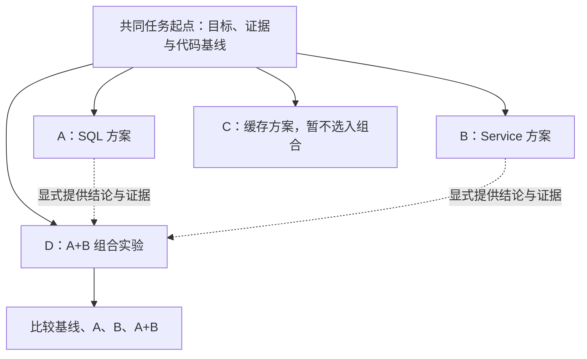

# 会话分支工作流

> 记录如何利用共同上下文探索路线、验证假设、审查方案和组合实验。内容是可复用方法与示例，具体结论须由项目证据支持。
>
> **关联笔记**：[实践记录与验收指导](../Agent实践案例/Agent工作流指南.md) ， [Pi 会话操作](../Agent工具使用手册.md#54-操作文件终端命令与会话) ， [分支、分叉与子 Agent 原理](../Agent原理与开发.md#61-子-agent会话分支与会话分叉)

---

## 1. 分支的价值与适用场景

> [!important] 核心价值：保留上下文，探索不同路线
> 会话分支允许保留已有上下文，从合适的历史节点探索另一条路线，再依据证据选择继续位置。它既能用于比较方案，也能用于排除猜测、重新分析和审查既有结论。

| 工作流 | 典型场景 | 核心价值与验收依据 |
| --- | --- | --- |
| 多方案探索 | 同一需求有多种架构设计 | 比较收益、复杂度、风险与维护成本，说明取舍 |
| 多假设排障 | 502 可能与代理、后端或网络有关 | 每条路线提出可验证假设，用日志、配置和复现结果判断 |
| 方案组合 | A、B 各自有价值，研究 A+B | 检查兼容性，再比较基线、A、B、A+B 的实测结果 |
| 失败路线回退 | 某种修复思路无法解释现象 | 保存失败证据，返回合适的分析节点重新探索 |
| 多模型对比 | 不同模型分析同一问题 | 尽量固定其他条件，比较正确性、证据质量、用量与费用 |
| 反向审查 | 已有方案，需要寻找缺陷 | 从边界、异常与简化角度提出可复核的问题，不按多数意见投票 |
| 最小实现与扩展实现 | Agent 先实现最小循环，再考虑更多能力 | 先验证最小目标，再说明扩展解决的实际问题与新增成本 |
| 条件决策树 | 需求或基础设施尚未确定 | 标明各路线的前提、触发条件与失效条件，按真实条件选择 |

---

## 2. 通用流程：共同起点 → 分别调查 → 证据决策

1. **建立共同起点**：写清目标、已知事实、代码基线、限制和验收标准。先区分事实、猜测与未知条件。
2. **定义每条路线的问题**：一个分支集中回答一个问题，例如“是否存在重复查询”或“当前方案在哪些条件下失效”。
3. **从相同节点继续**：在 Pi 中用 `/tree` 选择共同节点；希望避免携带离开分支的摘要时选择 `No summary`。节点选择和摘要选项以当前界面为准。
4. **分别保存证据**：记录源码位置、日志、复现步骤、测试结果、尚未确认的判断和下一步验证方法。可给共同起点与结论节点添加标签。
5. **显式汇总**：把所选路线的结论提供给后续讨论，比较证据与取舍。切换分支不会自动让模型看到其他路线的全部后续消息。
6. **选择继续位置**：回到合适节点推进有效路线，或另建组合路线；只有进入代码实现阶段才安排具体修改与测试。

Pi 的 `/tree` 在同一会话文件中导航，返回历史位置不会删除离开的路线；切换时可带入分支摘要。这些行为见 [Pi 官方会话与上下文说明](https://pi.dev/docs/latest/sessions)（2026-11-05 核对）。

> [!tip] 分支结论记录模板
> 使用以下简短格式，方便比较和交接：
>
> ```text
> 路线与待验证问题：
> 适用前提：
> 证据（文件位置 / 日志 / 命令与结果）：
> 已确认与尚未确认：
> 支持或否定本路线的结果：
> 下一步与主要取舍：
> ```

---

## 3. 典型工作流示例

### 3.1 多假设排障

以 Spring Boot 的事务未按预期回滚为例，先保留同一组复现步骤与代码，再分别调查：

| 路线 | 待验证问题 | 应查证据 |
| --- | --- | --- |
| A：调用路径 | 调用是否经过事务代理？是否存在同类内部调用？ | 入口、实际调用链、代理配置与复现结果 |
| B：异常处理 | 实际抛出或捕获了什么异常？回滚规则如何配置？ | 异常类型、捕获位置、事务注解及有效配置 |
| C：事务边界 | 实际事务边界和传播设置是否符合预期？ | 调用链、传播配置与事务相关日志 |

> [!note] 调查方向与实际根因
> 这些是调查方向，不能仅凭症状判定根因。在 Spring 默认代理模式中，同类内部调用不会经过事务代理，但还需核对项目实际使用的模式与配置。参见 [Spring 官方事务注解说明](https://docs.spring.io/spring-framework/reference/data-access/transaction/declarative/annotations.html)。

某一路线获得证据后，应通过最小复现确认它是否足以解释现象；其他路线未发现问题，不等于已被彻底排除。定位后再决定修改范围。

### 3.2 反向审查

以 Python LLM API 的重试机制为例，可以从同一代码快照分别检查功能行为、异常与边界，以及实现能否简化。

```text
请审查以下方案，重点寻找可以验证的缺陷：
（提供目标、约束、代码或 diff）

检查异常路径、终止条件、重复操作的副作用与不必要的复杂度。
每个问题应给出源码位置、触发条件、影响和验证办法。
区分已证实的问题与待验证疑点，不为了反驳而编造问题。
先只读分析，不修改代码。
```

> [!warning] 用证据审查，不能按分支数量投票
> 不同分支可能犯同样的错误，不能用“多数分支赞同”代替测试。审查分支仍可能继承原方案的假设；若需要减少既有结论的影响，可另开会话，只提供目标、约束和待审查产物。

### 3.3 失败路线回退

当某条路线反复修补却无法解释问题时，先留下失败条件、错误日志和已排除事项，再返回假设积累之前的合适节点探索其他方向。需要保留有效发现时，显式提供相关结论或选择生成摘要。

> [!warning] 对话回退不会恢复实际环境
> 对话回退不会撤销文件、数据库或网络操作。继续前应核对实际环境；如需恢复代码基线，先保存现有工作，再按 Git 或备份记录处理，不能假设旧节点对应的文件状态仍然存在。

### 3.4 最小实现与扩展实现

以工具调用 Agent 为例，先让一条路线实现“LLM + 一个工具 + Agent Loop”的最小目标，并验证真实工具结果能返回模型。其他路线再研究上下文压缩、多工具调度和异常恢复。

> [!tip] 扩展前先说明它解决什么问题
> 扩展路线应说明：它解决了最小实现中的什么具体问题、引入哪些依赖与状态，以及怎样证明值得增加。单独实现各路线时，代码仍需分别保存；最小方案可运行不代表扩展方案已经成立。

---

## 4. 多方案探索与组合验证

先从共同起点探索多个方向，再建立新的组合实验分支，显式传入选中方案的结论，验证兼容性与整体收益。以下为工作流示例，具体结果需在实际项目中验证。

以 Spring Boot 查询接口的性能问题为例：A 分析 SQL 与索引，B 分析 Service 重复查询，C 评估 Redis 缓存。若 A、B 值得进一步验证，另建 D 研究组合方案，保留原有探索路径。



> [!note] 如何阅读这张图
> 图中的 A、B、C、D 是逻辑上的实验路线；虚线表示传递结论，不表示 Pi 自动合并会话上下文或 Git 提交。

**操作步骤：**

1. **建立共同起点**：记录目标、约束、代码基线及验收标准；先以只读方式探索 A、B、C。
2. **提取有效结论**：分别保存 A、B 的源码位置、问题证据、修改建议、依赖条件、风险和验证方法，区分已确认事实与假设。
3. **创建组合路线 D**：用 `/tree` 回到共同任务节点，选择 `No summary`，在新消息中主动提供 A、B 两份结论，明确 C 暂不纳入组合。
4. **先检查兼容性**：判断是否解决同一问题、存在重复优化、依赖顺序或功能冲突，列出组合后的步骤与验收标准。
5. **再实现并验证**：需要修改代码时，先安排独立的代码实现分支或工作目录，再按任务范围执行。对比共同基线、单独 A、单独 B 与 A+B。
6. **保留选择依据**：依据测试与测量结果决定采用组合、只采用其中一个方案，或继续调查；不预设组合一定更好。

> [!important] 组合实验要显式传递结论
> Pi 的分支切换可携带离开路径的摘要，但不会自动汇集 A、B 两条路径的完整后续消息，因此组合任务应显式提供所选结论。命令行为见 [Pi 官方会话说明](https://pi.dev/docs/latest/sessions)，基础概念见[原理笔记 6.3 节](../Agent原理与开发.md#63-会话分支的应用同一任务的多方案比较)。

**组合分支提示词：**

```text
目标：研究当前问题的 A+B 组合方案。
共同代码基线、任务约束与验收标准：
（填写）

方案 A：
（粘贴关键结论、源码或测试证据、修改建议、风险）

方案 B：
（粘贴关键结论、源码或测试证据、修改建议、风险）

要求：
1. 分析两个方案是否兼容，检查功能冲突、重复优化与依赖关系。
2. 区分已确认事实、待验证假设和缺失证据。
3. 给出组合后的实现步骤。
4. 设计验证方案，对比共同基线、A、B、A+B。
5. 不要默认组合效果更好；说明什么结果会支持或否定组合。
先只读分析，不修改代码。
```

**代码实现与验收：**

- Git 分支用于保存不同实现的提交历史；需要同时保留多套工作文件时，可使用独立 worktree。各方案应从同一个基线提交开始，避免 B 在未记录的 A 改动上继续实现。参见 [Git worktree 官方说明](https://git-scm.com/docs/git-worktree)。
- 组合代码也从共同基线建立新的 Git 分支，再引入所选 A、B 提交；按需使用合并或 `cherry-pick`，检查依赖并解决冲突。切换分支或引入提交前先检查工作区，妥善处理未提交修改。参见 [Git cherry-pick 官方说明](https://git-scm.com/docs/git-cherry-pick)。
- 无文本冲突不代表逻辑兼容。基线、A、B、A+B 都应检查功能正确性与边界行为，再在一致的数据、请求、并发与缓存条件下重复测量，记录实际命令、性能结果、资源消耗和代码差异。
- 独立 worktree 只分开工作文件；测试数据库、缓存等外部状态仍需另行安排。会话切换不会恢复文件或撤销数据库操作，未运行的验证不得写成收益。

---

## 5. 多模型对比与条件决策

> [!tip] 多模型对比：固定条件，再比较结果
> 尽量固定任务、共同历史、代码与数据基线、工具权限、提示词和验收标准，并记录模型版本、推理设置、用量与实际结果；避免在一个模型看过其他路线答案后，仍把结果当作相同条件下的比较。模型和提供商可能有不同费用口径，不能只按 Token 数判断总成本。
>
> 一次回答不足以判断模型的普遍能力。应复核源码或测试证据，区分回答是否正确、任务是否完成，以及完成任务的时间和成本。

> [!note] 条件决策树：前提改变，路线随之调整
> 用于前提未定的任务，例如“允许增加缓存依赖”和“只能修改现有代码”两种条件。每条路线写明适用前提、建议方案和失效条件；条件尚未确认时保留备选，不把假设写成既定需求。

---

## 6. 选择机制与控制范围

| 任务 | 可采用的机制 |
| --- | --- |
| 保留上下文，探索或审查另一条路线 | Pi `/tree` |
| 将某条路线发展成独立保存的任务 | Pi `/fork` 从较早用户消息创建新会话；`/clone` 从当前位置复制活动分支 |
| 验证选中方案能否组合 | 新建组合实验会话分支，显式传入结论 |
| 保存并比较不同代码实现 | Git 分支；需要独立工作文件时配合 worktree |
| 多个执行者同时调查独立问题 | 子 Agent 或其他并行调度机制 |

> [!important] 分清三个层次
> 会话路线、代码版本和任务调度是不同层次。切换分支不会自动启动并行 Agent，创建独立会话也不会自动隔离文件系统；相关命令区别见 [Pi 官方会话说明](https://pi.dev/docs/latest/sessions)。

> [!tip] 什么时候值得开分支？
> 分支适合不确定性较高、存在多个合理假设、需要保留探索路径的任务。解释一个命令、修正明确的拼写错误等小任务，可直接在当前会话完成，避免增加不必要的上下文、调用和操作成本。
>
> 方法不必逐项练习；按实际问题选用，并将有证据支持的真实经验写入[实践记录](../Agent实践案例/Agent实践记录.md)。

---
