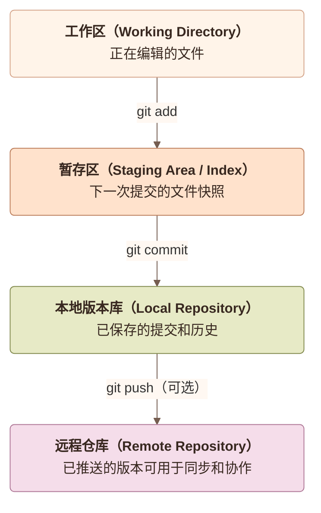
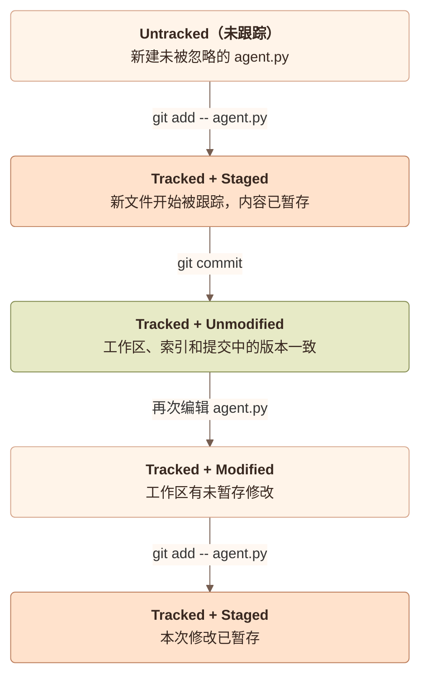
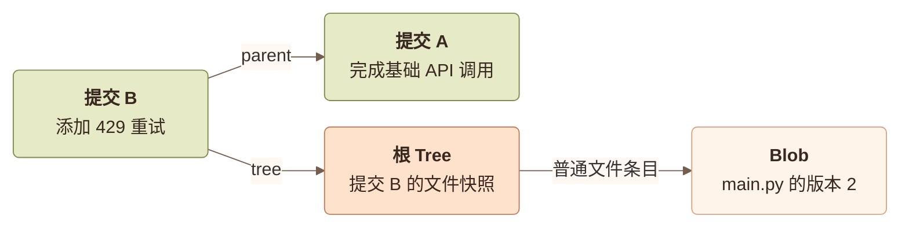
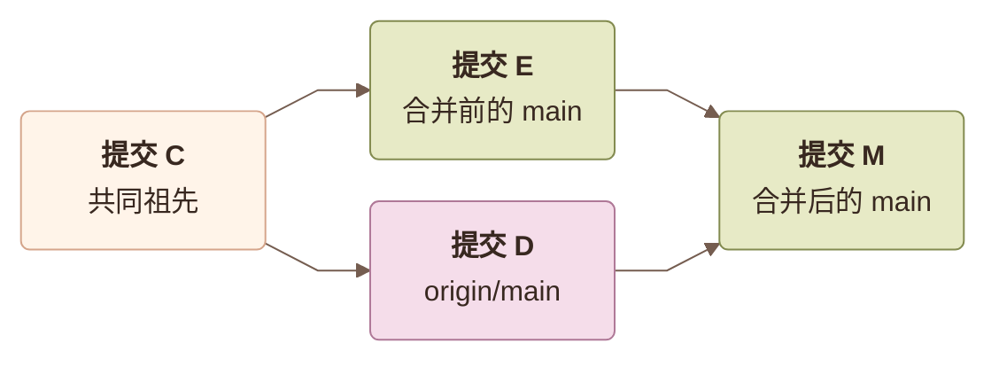
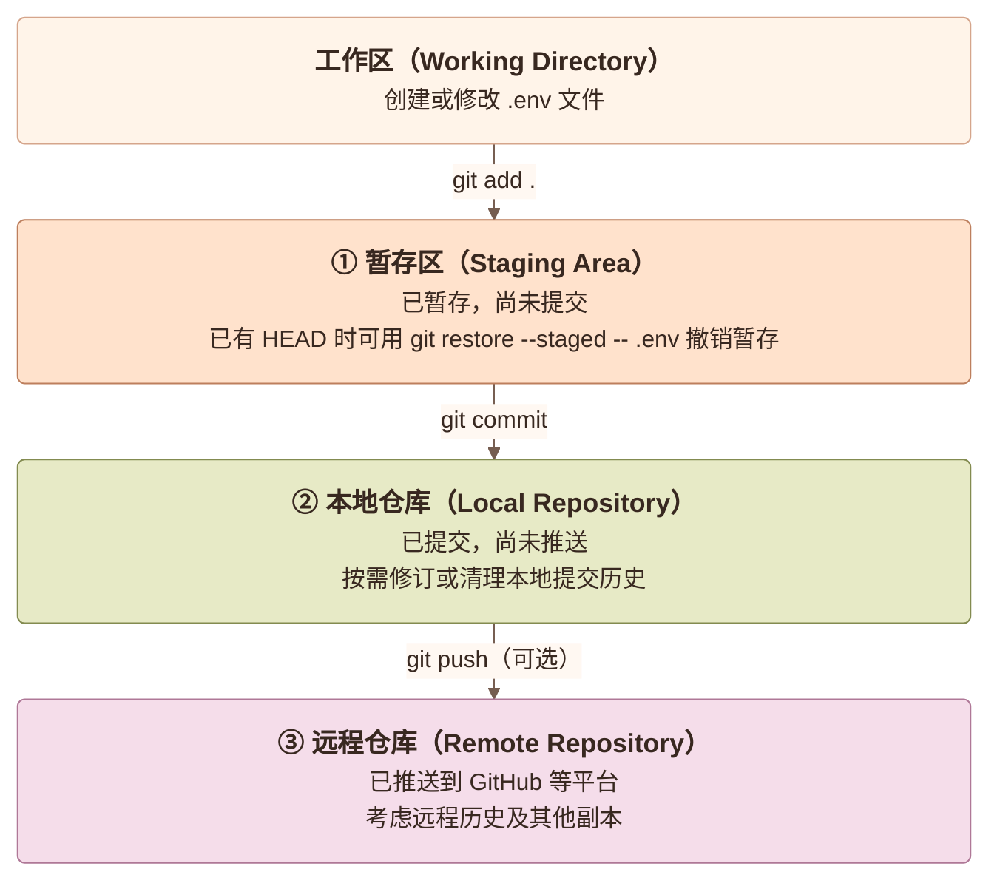

# Git 常用操作笔记

---

## 零、工程流程导航

| 任务 | 章节 |
|---|---|
| 接手项目、确认仓库边界、配置身份和远程 | [一、仓库接入与基础](#一仓库接入与基础) |
| 修改代码、检查差异、拆分和提交变更 | [二、日常开发与提交](#二日常开发与提交) |
| 同步分支、审查 PR/MR、整合变更和解决冲突 | [三、分支协作与代码审查](#三分支协作与代码审查) |
| 创建发布版本、交付产物和处理生产故障 | [四、版本发布与生产回滚](#四版本发布与生产回滚) |
| 撤销变更、找回提交、定位回归和排查错误 | [五、撤销恢复与故障排查](#五撤销恢复与故障排查) |
| 统一文件规则、管理敏感信息、优化仓库体积和备份 | [六、仓库规范与长期维护](#六仓库规范与长期维护) |

---

## 一、仓库接入与基础

### 1.1 初始化 Git 仓库

#### 1.1.1 确认位置并初始化

- **`git --version` 检查 Git 是否可用**。
- `git rev-parse --show-toplevel` **显示当前工作树的根目录**，属于只读查询。
  - 返回上级目录时，当前命令使用上级仓库，文件的跟踪状态需另查。
  - `rev-parse`：Git 的底层查询命令，可以**解析引用或查询仓库信息**。
  - `--show-toplevel`：要求**显示当前工作区的顶层目录**。
  - 若提示 `not a git repository`，可在确认目录后为需要独立版本管理的项目初始化仓库。[Git rev-parse 文档](https://git-scm.com/docs/git-rev-parse)

父子目录都已初始化时，以当前目录实际找到的仓库为准，见[嵌套仓库与项目组织](#14-嵌套仓库与项目组织)。

```bash
# 在需要建立独立仓库的目录中执行。
git init -b main
```

- `git init` **创建本地仓库**
  - 通常将 Git 的对象、引用及其他管理数据放在隐藏的 `.git/` 目录中
  - `-b main` 指定初始分支名
- 首次提交前，`git status` 会显示 `No commits yet`。文件要经过暂存和提交才进入提交历史，推送是独立的远程操作。[Git init 文档](https://git-scm.com/docs/git-init)

#### 1.1.2 克隆已有工程

接手已有工程时从远程克隆。`git clone` 通常配置 `origin`，并检出远程默认分支。项目有子模块时，见[嵌套仓库与项目组织](#14-嵌套仓库与项目组织)。已有本地提交和已有远程提交时，先 `fetch` 查清双方历史，再决定如何整合。[Git clone 文档](https://git-scm.com/docs/git-clone)

#### 1.1.3 配置提交身份

`--local` **只设置当前仓库**，`--global` **设置当前用户的默认值**。公司和个人项目需要不同身份时，可在各仓库用本地配置覆盖。`--show-origin` 可确认实际值来自哪个配置文件。

**提交身份会写入历史**，远程认证则使用 SSH 密钥、凭证助手或托管平台的令牌。[Git config](https://git-scm.com/docs/git-config) · [Git 凭证](https://git-scm.com/docs/gitcredentials)

```bash
git config --local user.name "你的提交名"
git config --local user.email "your-name@example.com"
git config --show-origin --get user.email
```

#### 1.1.4 选择 Git 命令行环境

**Git Bash** 随 Git for Windows 提供，使用 Bash 作为命令行 Shell，可运行 Git 和常用 Unix 命令。PowerShell 是跨平台 Shell。WSL 可在 Windows 上运行 Ubuntu 等 Linux 发行版。[Git for Windows](https://gitforwindows.org/) · [PowerShell](https://learn.microsoft.com/powershell/scripting/overview) · [WSL](https://learn.microsoft.com/en-us/windows/wsl/faq)

| 环境 | 同一个 D 盘目录的写法 | 列出目录内容 |
|---|---|---|
| PowerShell（Windows） | `D:\demo` | `Get-ChildItem` |
| [Git Bash](https://gitforwindows.org/file-names-branch-names-path-quotation-executable-bit-and-file-modes-core-filemode.html) | `/d/demo` | `ls` |
| [WSL Ubuntu（默认挂载）](https://learn.microsoft.com/en-us/windows/dev-environment/wsl-interop#access-windows-files-from-linux) | `/mnt/d/demo` | `ls` |

Windows 上的 PowerShell 把 `ls` 和 `rm` 分别设为 `Get-ChildItem` 和 `Remove-Item` 的别名，参数按 PowerShell 语法解释。[PowerShell 别名](https://learn.microsoft.com/en-us/powershell/scripting/learn/shell/using-aliases)

PowerShell 和 Git Bash 可以调用同一套 Git for Windows。在**同一个工作树**中运行 `git status` 和 `git log`，查看的是同一份暂存区和提交历史。

---

### 1.2 关联远程仓库

#### 1.2.1 Git 与托管平台

Git 是**分布式版本控制系统**，可以在本地离线提交、比较差异和管理分支。GitHub、Gitee、GitLab 提供**远程 Git 仓库托管和团队协作**。[Pro Git](https://git-scm.com/book/en/v2/Getting-Started-What-is-Git%3F)

| 平台 | 协作功能 |
|---|---|
| GitHub | 通过 Pull Request 审查改动，用 GitHub Actions 自动构建、测试和部署。[Pull Request](https://docs.github.com/en/pull-requests/reference/pull-requests) · [GitHub Actions](https://docs.github.com/en/actions/get-started/understand-github-actions) |
| Gitee | 托管 Git 仓库，通过 Pull Request 组织代码审查与合并。[Gitee 代码审查](https://help.gitee.com/%E5%BC%80%E5%8F%91%E5%8D%8F%E4%BD%9C/%E4%BD%BF%E7%94%A8PullRequest%E5%8A%9F%E8%83%BD%E8%BF%9B%E8%A1%8C%E4%BB%A3%E7%A0%81%E5%AE%A1%E6%9F%A5) |
| GitLab | 通过 Merge Request 协作，集成 CI/CD。可使用 GitLab.com 托管服务或自行部署。[GitLab CI/CD](https://docs.gitlab.com/ci/pipelines/) · [GitLab 部署方式](https://docs.gitlab.com/subscriptions/choosing_subscription/) |

本地仓库与远程仓库**各自保存提交、分支等 Git 数据**。本地 Git 仓库可以独立使用，也可以连接一个或多个远程。远程还可以是自行搭建的 Git 服务器。[Pro Git 搭建服务器](https://git-scm.com/book/en/v2/Git-on-the-Server-Setting-Up-the-Server)

#### 1.2.2 查看远程配置

`git remote -v` **列出当前仓库配置的远程名称和 URL**。命令成功且无输出时，表示当前仓库还没有配置远程。[Git remote](https://git-scm.com/docs/git-remote)

```text
origin  https://gitee.com/example/demo.git (fetch)
origin  https://gitee.com/example/demo.git (push)
```

`origin` 是惯用的远程名称，也可使用其他名称。示例中的 URL 指向 Gitee。`(fetch)` 表示获取地址，`(push)` 表示推送地址。[Pro Git 远程仓库](https://git-scm.com/book/en/v2/Git-Basics-Working-with-Remotes)

#### 1.2.3 添加或修改远程

已有本地历史想直接推送到新远程时，可在托管平台创建空仓库，接着关联地址。若已有同名远程，先用 `git remote -v` 或 `git remote get-url origin` 核对地址，确需迁移时使用 `git remote set-url`。

```bash
# 核对仓库地址、目标分支或配置作用范围，区分本地与远端操作。
git remote add origin https://github.com/你的用户名/你的仓库名.git
```

上面的 `git remote add` 命令**只写入本地远程配置**。将本地提交发送到远程，需要另行执行 `git push`。

HTTPS 可以用受支持的凭证助手管理凭证。SSH 方式需要在平台登记公钥，并验证服务端主机身份。令牌和私钥交给本地凭证系统管理，远程 URL 使用普通仓库地址。[Git remote](https://git-scm.com/docs/git-remote) · [Git 凭证](https://git-scm.com/docs/gitcredentials) · [GitHub SSH](https://docs.github.com/en/authentication/connecting-to-github-with-ssh)

---

### 1.3 推送到远程仓库

```bash
# 核对仓库地址、目标分支或配置作用范围，区分本地与远端操作。
git push -u origin main
```

`-u` **设置本地 `main` 的上游为 `origin/main`**。常见的同名分支配置下，后续可以省略远程名和分支名。团队主分支通常通过 PR/MR 合入，见[分支协作与代码审查](#三分支协作与代码审查)。[Git push](https://git-scm.com/docs/git-push)

---

### 1.4 嵌套仓库与项目组织

#### 1.4.1 命令作用于哪个仓库

普通工作树中，Git 从当前目录向上查找最近的仓库入口。假设上级 `python-practice/` 与子项目 `AI_API/` 都有自己的 `.git/`，它们各自保存对象库、暂存区、分支、历史和远程配置。

| 运行 `git rev-parse --show-toplevel` 的位置 | 返回路径的末尾 |
|---|---|
| `python-practice/` | `python-practice` |
| `python-practice/AI_API/` | `python-practice/AI_API` |

两个本地仓库可以分别推送到 GitHub 和 Gitee。一个本地仓库也可以配置多个远程名，例如 `origin` 指向 GitHub，`gitee` 指向 Gitee。用 `git remote -v` 查看当前仓库的远程配置，推送时显式指定目标。[Git rev-parse](https://git-scm.com/docs/git-rev-parse) · [Git remote](https://git-scm.com/docs/git-remote)

#### 1.4.2 Commit ID 指定一个版本

Git 对**对象头和完整的提交内容**计算哈希，得到十六进制的 Commit ID。对象头包含对象类型和内容长度。使用 SHA-1 对象格式时，完整 ID 有 40 个十六进制字符。[Git 对象哈希](https://git-scm.com/docs/hash-function-transition#_object_names)

| 提交对象中的字段 | 含义 |
|---|---|
| `tree` | 根目录树的对象 ID，关联该次提交的文件快照。 |
| `parent` | **直接父提交的 ID**。根提交没有父提交，普通后续提交通常有一个，合并提交可以有多个。 |
| `author` | 原始改动的作者身份和作者时间。 |
| `committer` | 创建当前提交对象的身份和提交时间。 |
| 提交说明 | 记录该次提交的改动或原因。 |

沿一个或多个父引用可达的提交称为**祖先提交**。在线性历史的父引用链 `C → B → A` 中，B 是 C 的直接父提交，B 和 A 都是 C 的祖先。`git log` 默认从 `HEAD` 沿父引用遍历历史。[Git log](https://git-scm.com/docs/git-log)

两个提交引用同一棵根 Tree 时，父提交、提交说明或其他元数据的差异通常会产生不同的 Commit ID。哈希值理论上存在碰撞的可能。

- `git show` 可**查看提交等 Git 对象**。
- `git show <commit-id>` 显示相应的提交说明和改动。若使用缩写，当前仓库必须能唯一解析它。[Pro Git 对象模型](https://git-scm.com/book/en/v2/Git-Internals-Git-Objects) · [Git show](https://git-scm.com/docs/git-show)

#### 1.4.3 上级仓库如何暂存嵌套目录

假设上级尚未跟踪 `AI_API/` 及其中的文件，且该路径未被忽略。在上级执行 `git add -- AI_API/`，三种情况的结果不同。

| 子目录的状态 | 上级索引中的结果 |
|---|---|
| 普通目录 | 逐个添加未被忽略的文件。 |
| 独立仓库，`HEAD` 指向提交 | 通常警告 `adding embedded git repository`，添加模式 `160000` 的 gitlink，保存当前检出的 commit ID。 |
| 独立仓库，`HEAD` 尚无提交 | 报错 `does not have a commit checked out`，该路径的暂存失败。 |

首次提交前，子仓库即使已有文件和暂存内容，仍缺少 gitlink 所需的提交。遇到这个错误时，Git 会保留仓库边界，子目录中的文件不会被自动暂存。有效 gitlink 所指向的文件树和历史由子仓库提供。[Git add](https://git-scm.com/docs/git-add) · [Git 子模块](https://git-scm.com/docs/gitsubmodules)

从上级用 `git ls-files --stage -- AI_API` 核对索引。**单条 `160000` 记录表示提交引用**。逐个列出的普通文件说明上级索引直接跟踪了这些文件。后来在子目录运行 `git init` 时，上级原有的跟踪记录仍会保留。[Git ls-files](https://git-scm.com/docs/git-ls-files)

> [!important] 公开前核对上级仓库
>
> 即使子仓库是私有的，上级仓库一旦跟踪了子目录中的普通文件，推送上级仓库也可能公开这些文件。检查上级将推送的提交及其历史记录。

#### 1.4.4 按目标选择组织方式

| 目标 | 组织方式 | 上级保存的内容 |
|---|---|---|
| 用同一仓库统一提交和查看历史 | 单仓库（Monorepo） | 子项目作为普通目录，源代码直接进入上级仓库。 |
| 保留独立历史，同时固定依赖的项目版本 | 子模块（Submodule） | gitlink 固定子仓库提交，`.gitmodules` 配置路径和 URL。 |
| 集中展示独立项目 | 项目索引 | README 中的项目说明和链接。 |

#### 1.4.5 子模块的版本与来源

gitlink 指定**要哪个版本**。用 `git submodule add` 登记标准子模块时，`.gitmodules` 记录路径和 URL，提供**从哪里获取**的信息。`git clone --recurse-submodules <上级仓库地址>` 会按配置获取子模块，前提是子仓库和所指提交可访问。[Git 子模块](https://git-scm.com/docs/gitsubmodules) · [Git clone](https://git-scm.com/docs/git-clone)

> [!example] 提交引用固定到具体版本
>
> 上级记录 `AI_API → A2`。子仓库新增提交 `A3` 后，上级当前提交仍指向 `A2`。要记录 `A3`，确认子仓库当前检出的是 `A3`，再从上级暂存并提交更新后的 gitlink。

目录压缩遵循压缩工具的选项。直接打包 ZIP 可能包含子项目文件和 `.git/` 历史，发布压缩包前要按实际打包范围检查密钥、缓存及隐私文件。

---

## 二、日常开发与提交

### 2.1 理解三个区域并选择暂存范围

#### 2.1.1 从工作区到仓库



- `git add` **读取工作区文件当时的内容**，用它**更新暂存区**
  - 继续编辑同一个文件时，工作区和暂存区可以有不同版本。要让新修改进入下一次提交，需要再次暂存。[Git add 文档](https://git-scm.com/docs/git-add)

通常 `.git/index` **记录待提交路径及其内容对象**。暂存时 Git 就会按需将新内容写入对象库。`git commit` 才**将索引对应的快照写入提交历史**，之后可用 `git log` 找到它。[Pro Git 对象模型](https://git-scm.com/book/en/v2/Git-Internals-Git-Objects)

#### 2.1.2 按文件或目录暂存

```bash
# 只暂存列出的路径。
git add -- .gitignore config.py main.py
git status
git diff --cached --stat
```

`--` 要作为**独立参数**，后面用空格接路径。路径含空格时，用引号括住整个路径，例如 `git add -- "docs/API 接口设计.md"`。把 `--` 和路径连写时，Git 可能将其当成选项并报 `unknown option`。

要批量暂存当前目录及子目录中的新增、修改和删除，可用 `git add .`。匹配忽略规则的未跟踪文件默认跳过。尚未检查的文件较多时，可先列出本次准备提交的路径，再按[状态、差异和历史](#22-查看状态差异和历史)核对全部暂存内容。

指定目录可以缩小批量操作范围。`git add -- tests/` 更新该目录下的索引，包含未被忽略的新增文件、已跟踪文件的修改和删除。匹配忽略规则的未跟踪缓存会跳过。[Git add 路径规则](https://git-scm.com/docs/git-add)

#### 2.1.3 文件的跟踪与改动状态

**Tracked 和 Untracked 描述 Git 是否跟踪该路径**。Modified 和 Staged 分别描述工作区中的改动和暂存区中的待提交改动。[Pro Git 文件状态](https://git-scm.com/book/en/v2/Git-Basics-Recording-Changes-to-the-Repository)

| 状态 | 含义 |
|---|---|
| **Untracked**（未跟踪） | 工作区中尚未纳入 Git 跟踪的文件。 |
| **Tracked**（已跟踪） | 索引中已有该路径的记录，刚暂存的新文件也属于这一类。 |
| **Unmodified**（未修改） | 已跟踪文件在工作区、索引和当前提交中的版本一致。`git status` 默认省略这类文件。 |
| **Modified**（工作区已修改） | 工作区中的文件与索引中记录的版本存在差异。 |
| **Staged**（已暂存） | 索引已记录准备提交的新增、修改或删除。 |

已有提交时，是否为 **Staged** 取决于索引与 `HEAD` 的差异。若 `main.py` 在工作区、索引和 `HEAD` 中的版本一致，执行 `git add -- main.py` 后仍是 **Tracked + Unmodified**。



暂存后又继续编辑时，同一文件可以同时是 **Tracked + Staged + Modified**。已跟踪文件从工作区删除且删除尚未暂存时，`git status` 会报告未暂存的 `deleted`。

---

### 2.2 查看状态、差异和历史

#### 2.2.1 常用查看命令

##### 2.2.1.1 状态与差异

```bash
git status                    # 详细状态
git status -s                 # 简略模式
git diff                      # 工作区相对暂存区的改动
git diff --stat               # 未暂存改动的文件及增删行数摘要
git diff --cached --stat      # 已暂存改动的文件及增删行数摘要
git diff --cached             # 暂存区相对当前提交的改动
git diff --cached --check     # 检查暂存改动中的空白错误和冲突标记
```

`git diff` 加上 `--stat` 时**只显示改动摘要**。

- 对文本文件，路径后的数字是新增与删除行数之和，`+` 和 `-` 表示两者的相对规模。
- 末行汇总本次比较的改动文件数、新增行数和删除行数。

要判断大量增删是否涉及换行符变化，需要查看具体差异。

##### 2.2.1.2 中文路径显示

中文路径显示为 `\346\216\245` 这类八进制转义时，可用以下命令直接显示中文路径。`-c` 指定的配置**只对本次命令生效**。

```bash
git -c core.quotePath=false status
git -c core.quotePath=false diff --stat
```

##### 2.2.1.3 提交历史

```bash
git log                           # 只读查看详细提交历史
git log --oneline                 # 一行一条
git log --oneline -5              # 从 HEAD 开始，最多显示 5 条提交
git log --graph --all --oneline   # 图形化显示所有分支历史
git show 提交哈希                  # 查看某次提交的详细内容
git show --stat HEAD              # 只读查看当前提交的信息和文件改动统计
```

#### 2.2.2 先确认在比较哪两层

##### 2.2.2.1 差异输出

`git diff` 是**只读查询**。`--` 将选项或版本与文件路径分开，普通相对路径以当前目录为起点。

| 想看什么 | 命令 | 比较范围 |
|---|---|---|
| 文件刚改了什么 | `git diff -- main.py` | **索引与工作区**，只显示该文件的未暂存改动。 |
| 下一次准备提交什么 | `git diff --cached` | **当前提交与索引**。 |
| 相对当前提交文件的总体变化 | `git diff HEAD -- main.py` | **当前提交与工作区**。 |

为文件增加一行注释但尚未暂存时，`git diff -- main.py` 中以 `+` 开头的行表示新增内容，提交与索引仍处于原来的状态。

若差异段头是 `@@ -10,3 +10,4 @@`，旧侧从第 10 行起有 3 行，新侧有 4 行，行数包含上下文。[Git diff](https://git-scm.com/docs/git-diff)

##### 2.2.2.2 状态输出

| `git status` 输出 | 含义 |
|---|---|
| `On branch main` | 当前位于 `main` 分支。 |
| `Changes to be committed` | 已暂存的改动。 |
| `Changes not staged for commit` | 已跟踪文件还有未暂存改动，包括修改（`modified`）和删除（`deleted`）。 |
| `Untracked files` | 尚未跟踪的文件。被忽略的未跟踪文件默认省略。 |

同一文件暂存后又修改时，可以**同时出现在已暂存和未暂存分组中**。末尾显示 `no changes added to commit` 时，表示当前没有已暂存的改动。[Git status 文档](https://git-scm.com/docs/git-status)

> [!example] 暂存后继续编辑同一个文件
>
> 为 `main.py` 添加异常处理后执行 `git add -- main.py`，再添加日志。此时 `git status` 的两组记录分别对应两次改动。
>
> ```text
> Changes to be committed:
>     modified: main.py
>
> Changes not staged for commit:
>     modified: main.py
> ```
>
> `git diff --cached -- main.py` 显示已暂存的异常处理，`git diff -- main.py` 显示还在工作区的新增日志。普通 `git commit` 会记录索引中的 `main.py`。要一起提交两次改动，再用 `git add -- main.py` 更新索引。

#### 2.2.3 读懂暂存差异

**`git diff --cached` 与 `git diff --staged` 等价**。
首次提交前没有当前提交，此时显示全部暂存内容。追加 `-- .gitignore` 可将比较限定到该文件。下面是新文件的暂存差异示意。[Git diff 文档](https://git-scm.com/docs/git-diff)

```diff
diff --git a/.gitignore b/.gitignore
new file mode 100644
index 0000000..7a60b85
--- /dev/null
+++ b/.gitignore
@@ -0,0 +1,2 @@
+__pycache__/
+*.pyc
```

| 差异中的字段 | 含义 |
|---|---|
| `diff --git a/... b/...` | 标明比较的前后路径。 |
| `new file mode 100644` | 新增普通非可执行文件。 |
| `index 0000000..7a60b85` | 旧、新文件内容的对象标识。旧侧全零表示没有旧对象。 |
| `--- /dev/null`、`+++ b/.gitignore` | 旧侧无文件，新侧为 `.gitignore`。`/dev/null` 在此是占位符。 |
| `@@ -0,0 +1,2 @@` | 旧侧没有行，新侧从第 1 行开始，共 2 行。 |
| 正文行首 `+`、`-` | 本次新增的行、本次删除的行。 |
| 正文行首的空格 | 未改动的上下文行，用于定位改动。 |

一行由 `A` 改成 `B` 时，差异通常显示为 `-A` 和 `+B`。

> [!tip] 顺着三条命令审查
>
> `git status` 核对路径和状态，`git diff --cached --stat` 看改动规模，`git diff --cached` 审查具体内容。

#### 2.2.4 检查暂存改动的格式

`git diff --cached --check` **检查新增的合并冲突标记和空白错误**，例如行尾空格与文件末尾新增空行。空白判定取决于 `core.whitespace`。检查通过时通常无输出，发现问题会提示位置并返回非零退出码。修正后重新暂存再检查。敏感内容仍要在具体差异中审查。[Git diff 文档](https://git-scm.com/docs/git-diff#Documentation/git-diff.txt---check)

#### 2.2.5 审查配置与认证代码

- `git diff --cached -- config.py` 用于检查配置改动，`git diff --cached -- main.py` 用于检查调用代码。公开接口、模型名和超时值通常属于普通配置。变量名引用和动态构造认证头可以进入代码，**真实凭证应由运行环境提供**。
- `git diff --cached -- tests/` 将审查限定在测试目录。检查测试数据、调试打印和失败输出中的真实凭证与私人信息。模拟测试使用 `"mock-test-key"` 之类的虚构值。检查环境变量时，只显示是否读取到非空值。凭证能否通过认证由实际服务响应判断。
- `.gitignore` 按路径匹配。已暂存代码中的真实 API Key、Token 和密码，需要在本地审查差异时发现并处理。分享差异前先遮盖敏感内容。
- 差异展示相对旧版本的改动。输出截断时，判断范围以实际看到的内容为准。要读完整的暂存版本，可在本地用 `git show :config.py` 读取索引中的文件。[Git 差异格式](https://git-scm.com/docs/diff-format) · [Git 索引路径语法](https://git-scm.com/docs/gitrevisions)

---

### 2.3 实现、选择性暂存和审查

每次提交围绕一个能说明原因、能独立审查的改动。可以用 `git add -p` 选择同一文件中的部分改动。对自己和 Agent 的修改都先检查差异，运行相关测试，再暂存提交。

```bash
git status --short
git diff -- main.py
git add -p -- main.py
git diff --cached --check
git diff --cached
git commit -m "fix: handle empty model response"
```

`git add .` 的路径范围是**当前目录及其子目录**。在仓库根目录执行时，范围是整棵工作树。准备协作时，推送当前任务分支并开 PR/MR。[Git add](https://git-scm.com/docs/git-add)

---

### 2.4 提交说明（Conventional Commits）

使用统一的提交标签可以使项目历史更清晰，便于自动化生成更新日志

常见格式是 `type(scope): summary`，例如 `fix(api): handle empty model response`。正文可交代原因、验证方式与兼容影响。破坏性变更用 `!` 或 `BREAKING CHANGE:` 标明，版本编号见[版本发布与生产回滚](#四版本发布与生产回滚)。[Conventional Commits 1.0.0](https://www.conventionalcommits.org/en/v1.0.0/)

#### 2.4.1 常用类型

| 标签 | 全称 | 适用场景 | 举个例子 |
| ------ | ------ | ---------- | ---------- |
| `feat` | feature | 开发**新功能**。只要是系统里以前没有、现在刚写完的功能，都用它 | `feat: 编写GourmetCoffee的购物车商品添加功能` |
| `fix` | fix | **修复 Bug**。代码报错、逻辑漏洞、死循环，只要是改错都用它 | `fix: 修复咖啡数量输入负数时导致金额计算错误的Bug` |
| `docs` | documentation | 仅仅**修改了文档**。比如改了 README.md、写了注释、改了脑图 | `docs: 更新W4阶段Python测试接口脑图说明` |
| `style` | style | 不影响代码逻辑的**格式调整**。比如对齐空格、删掉多余空行、格式化代码 | `style: 格式化GourmetCoffee主类的缩进和空格` |
| `refactor` | refactor | **重构代码**。既不是新功能，也不是修 Bug，而是把烂代码写得更优雅、更健壮 | `refactor: 提取公共咖啡属性到基类以优化代码结构` |
| `test` | test | **增加或修改测试用例**。比如你在写 Java 时用的 JUnit 测试代码 | `test: 增加购物车结算逻辑的单元测试` |
| `chore` | chore | **杂务/日常构建维护**。比如修改了 pom.xml 引入了新依赖、改了 .gitignore、配置了 IntelliJ IDEA 的环境 | `chore: 导入老师提供的GourmetCoffee第三方类库` |

#### 2.4.2 其他类型

| 标签 | 全称 | 适用场景 | 举个例子 |
| ------ | ------ | ---------- | ---------- |
| `perf` | performance | **性能优化**相关的改动 | `perf: 优化图片加载策略减少首页白屏时间` |
| `build` | build | 影响**构建系统或外部依赖**的改动（如 Maven/Gradle 配置） | `build: 升级Spring Boot版本至2.7.0` |
| `ci` | continuous integration | 修改 **CI 配置或脚本**（如 GitHub Actions、Jenkins） | `ci: 添加自动化测试流水线` |
| `revert` | revert | **撤销**之前的某次提交 | `revert: 回退feat(购物车)因为发现性能瓶颈` |

---

### 2.5 提交到本地仓库

审查暂存内容后，不带路径执行 `git commit -m`，Git 会**根据索引创建本地提交快照**，并生成对应的 commit ID。`-m` 指定提交说明。远程同步由后面的推送步骤完成。[Git commit 文档](https://git-scm.com/docs/git-commit)

```bash
git commit -m "Initial commit: CLI AI Chat"
git log --oneline -1
git status
```

#### 2.5.1 读懂首次提交的输出

##### 2.5.1.1 提交记录与工作区状态

- 提交摘要形如 `[main (root-commit) a1b2c3d] Initial commit: CLI AI Chat`。`main` 是分支，`root-commit` 表示没有父提交，`a1b2c3d` 是示意的提交 ID 缩写。
- 分支是**指向提交的可移动引用**。`HEAD` 表示当前检出位置，通常指向当前分支。
- `git log --oneline -1` 显示最近一条提交的 ID 缩写和说明。`HEAD -> main` 表示 `HEAD` 指向当前分支 `main`，该分支再指向其最新提交。可加 `--decorate` 明确显示引用名。
- 在 `main` 上创建普通提交 D 时，D 将原分支顶端记为父提交，Git 把 `main` 更新到 D。此时的引用关系是 **`HEAD` → `main` → D**。
- 默认的 `git status` 若显示 `working tree clean`，表示索引与当前提交一致，工作区也没有未暂存的已跟踪变更或未忽略的未跟踪文件。[Git log](https://git-scm.com/docs/git-log) · [Git status](https://git-scm.com/docs/git-status)

遇到 `Author identity unknown` 时，先核对当前仓库生效的 `user.name` 和 `user.email`，确认要用于项目历史的身份后再配置。

##### 2.5.1.2 文件统计与大小

- `files changed` 是本次涉及的文件数。`create mode 100644` 表示新增普通非可执行文件。
- `git show --stat HEAD` 对单父提交统计相对父提交的改动。首次提交没有父提交，统计的是相对空树的改动。

```bash
git ls-tree -r -l HEAD -- main.py
```

这条命令只读查询 `HEAD` 中的文件条目。`-r` 递归列出条目，`-l` 显示文件对象的字节数。

```text
100644 blob e69de29bb2d1d6434b8b29ae775ad8c2e48c5391       0    main.py
```

| 字段示例 | 含义 |
|---|---|
| `100644` | 普通非可执行文件的模式。 |
| `blob` | 保存文件内容的 Git 对象类型。 |
| `e69de29…` | **文件内容对象的 ID**（Blob ID）。 |
| `0` | 文件大小为 0 字节，表示该历史版本中的文件为空。 |
| `main.py` | 文件在该提交中的路径。 |

使用 SHA-1 对象格式时，空文件的 Blob ID 固定为示例中的值。

#### 2.5.2 本地提交的用途

- 比较代码改动。`git diff` 查看工作区相对暂存区的变化，`git diff --cached` 审查准备提交的变化。
- 用 `git log --oneline` 查看项目历史，从已知正常的提交定位或恢复旧版本。

这些操作可以离线完成。GitHub 等远程仓库用于多设备同步、协作和保存异机副本。磁盘损坏后，远程仓库可恢复的是已经同步的版本，本机独有的提交和未提交改动还需要独立备份。[Pro Git 的本地操作与快照](https://git-scm.com/book/en/v2/Getting-Started-What-is-Git%3F)

#### 2.5.3 提交快照与对象复用

普通 `git commit` 根据整个索引生成**完整的版本快照**。假设提交 A 已包含三个文件，提交 B 前只修改并暂存 `main.py`，为它加入 429 重试逻辑。

| 文件 | 提交 A | 提交 B |
|---|---|---|
| `main.py` | 版本 1 | 版本 2 |
| `config.py` | 版本 1 | 版本 1 |
| `requirements.txt` | 版本 1 | 版本 1 |

目录树中的普通文件条目引用对应的 Blob，子目录条目引用子 Tree。两次提交中的 `config.py` 和 `requirements.txt` **分别复用各自原有的 Blob**。[Pro Git 对象模型](https://git-scm.com/book/en/v2/Git-Internals-Git-Objects)



> [!note] 创建与父提交快照相同的提交
>
> 普通的单父提交默认要求索引相对 `HEAD` 有改动。索引与 `HEAD` 一致时，可以用 `git commit --allow-empty -m "记录验证完成"` 显式创建新提交，复用父提交的根 Tree。[Git commit 文档](https://git-scm.com/docs/git-commit#Documentation/git-commit.txt---allow-empty)

---

### 2.6 暂存工作现场（stash）

临时保存当前修改，以便切换分支处理急事：

```bash
git stash                 # 保存已跟踪文件的工作区和暂存区修改
git stash push -u          # 同时保存未跟踪文件（不含被忽略的文件）
git stash pop             # 恢复最近一次保存；成功后删除记录，冲突时保留记录
git stash list            # 查看暂存列表
```

想先预览可用 `git stash show -p 'stash@{0}'`。用 `git stash apply 'stash@{0}'` **恢复并保留备份项**，加 `--index` 会尝试一并恢复原有暂存状态。验收工作区和暂存区后再删除已用完的记录。[Git stash](https://git-scm.com/docs/git-stash)

---

## 三、分支协作与代码审查

### 3.1 选择分支模型

| 团队场景 | 常见组织方式 |
|---|---|
| 频繁交付到同一产品线 | 保护 `main`，使用短任务分支，改动通过 PR/MR 和 CI 后合入。 |
| 同时维护多个已发布版本 | 由 `release/*` 或维护分支承载对应版本的补丁，同步修复到仍受支持的分支。 |
| 外部贡献或缺少上游写权限 | Fork 后向上游提 PR。通常 `origin` 指自己的 Fork，另设 `upstream` 指原仓库。 |

---

### 3.2 获取远程状态并开始任务

`origin/main` 是**本地的远程跟踪引用**，在 `fetch` 时更新。`git branch -r` 列出这类引用，`git branch -a` 同时列出本地分支。`git branch -vv` 可检查各本地分支和上游的关系。Fork 协作时，查看上游原仓库的最新状态应从 `upstream` 获取。[Git fetch](https://git-scm.com/docs/git-fetch) · [Git branch](https://git-scm.com/docs/git-branch)

`git fetch` 把获取的提交及所需对象写入**本地 Git 对象库**，普通仓库中通常位于 `.git/objects`。例如，本地 `main` 在 C，远程 `main` 已到 D。按默认跟踪配置获取后，本地 `origin/main` 指向 D，本地 `main` 仍指向 C。[Git 仓库结构](https://git-scm.com/docs/gitrepository-layout)

```bash
git fetch origin
git switch -c feature/chat-retry origin/main
# 完成开发、审查差异并提交后，推送任务分支。
git push -u origin feature/chat-retry
```

`git switch -c` 的 `-c` 表示 `--create`，可用 `git checkout -b` 完成同样的建分支操作。已有分支直接用 `git switch 分支名` 或 `git checkout 分支名` 切换。已有未提交修改时，先明确它们应归哪个分支，必要时用[暂存工作现场](#26-暂存工作现场stash)。[Git switch](https://git-scm.com/docs/git-switch)

---

### 3.3 同步已有分支

#### 3.3.1 选择获取或整合

`git pull` **先用 `git fetch` 获取远程更新，再整合到当前分支**。整合方式由命令参数和 Git 配置决定。

例如，在 `feature/chat-retry` 上执行 `git pull origin main`，会从远程 `origin` 获取 `main` 分支，并尝试整合到**当前的 `feature/chat-retry` 分支**。

| 命令 | 适用情形与效果 |
|---|---|
| `git fetch origin` | 按远程配置更新对应的远程跟踪引用，**保留当前分支和工作区**。先看变化，再选整合方式。 |
| `git pull --ff-only` | **只允许快进**。适用于本地 `main` 只跟随上游、双方尚未分叉的情况。 |
| `git pull --no-rebase` | 获取后**以合并方式整合**，可能快进，也可能创建合并提交。 |
| `git pull --rebase` | 获取后**将本地独有提交重放到上游**。适合可重写的个人提交。 |

在团队中先同步，再根据分支约定整合。`git diff HEAD origin/main` 比较两个提交的快照，`git log --left-right --oneline HEAD...origin/main` 查看双方各自独有的提交。临时收起改动后，可在确认更新成功时用 `git stash apply` 恢复并检查。[Git pull](https://git-scm.com/docs/git-pull) · [Git diff](https://git-scm.com/docs/git-diff) · [Git log](https://git-scm.com/docs/git-log)

#### 3.3.2 快进与三方合并

本地 `main` 的顶端 C 是待整合提交 D 的祖先时，允许快进的合并会**直接将 `main` 移到已有提交 D**，并更新索引和工作区。[Git 快进合并](https://git-scm.com/docs/git-merge#_fast_forward_merge)

获取 D 后，也可以继续在 C 上创建本地提交 E。此时 `main` 指向 E，`origin/main` 指向 D，两条历史从 C 分叉。直接推送 E 到远程 `main` 通常会收到 `non-fast-forward` 拒绝。**文件冲突在整合时才可能发生**。[Git push](https://git-scm.com/docs/git-push#_note_about_fast_forwards)

在 `main` 上执行 `git merge origin/main`，Git 以**共同祖先 C、本地 E 和待合入的 D** 为依据进行三方合并。合并完成后，本地 `main` 指向新的合并提交 M，M 的两个父提交是 E 和 D。[Pro Git 分支与合并](https://git-scm.com/book/en/v2/Git-Branching-Basic-Branching-and-Merging)



不同文件或同一文件不同位置的改动通常可以自动合并。同一处的不同改动无法自动协调时，按[解决冲突并验证](#35-解决冲突并验证)处理。[Git 合并冲突](https://git-scm.com/docs/git-merge#_how_conflicts_are_presented)

远程 `main` 仍指向 D 时，推送合并提交 M 满足快进条件。[Git push](https://git-scm.com/docs/git-push#_note_about_fast_forwards)

> [!important] 拉取前检查未提交改动
>
> 采用合并方式拉取时，不重叠的未暂存改动通常可以保留。更新会覆盖本地未提交的内容时，Git 通常会中止整合。已暂存的改动也可能阻止合并。[Git 合并前检查](https://git-scm.com/docs/git-merge#_pre_merge_checks)
>
> 变基通常要求索引和工作区干净。拉取前先用 `git status` 检查，必要时[暂存工作现场](#26-暂存工作现场stash)。[Git rebase](https://git-scm.com/docs/git-rebase)

---

### 3.4 PR/MR 审查与合入

#### 3.4.1 审查流程

1. **选对目标与来源**。目标是希望合入的分支，来源是任务分支。关联需求或缺陷，说明改动原因、验证方法、兼容影响与迁移要求。
2. **检查实际差异**。可以用 `git diff origin/main...HEAD` 查看从共同祖先到当前任务分支的改动。审查时重点核对权限、数据迁移、依赖、异常路径和测试覆盖。
3. **通过合并条件**。保护分支可要求审查通过、必需 CI 检查通过、限制直接推送。按仓库规则配置代码所有者和必要审批。主分支频繁接收 PR 时，可用合并队列对实际合入顺序进行验证。
4. **选用团队约定的合并方式**。合并后同步本地目标分支，核对任务分支已完成再清理。[GitHub 保护分支](https://docs.github.com/en/repositories/configuring-branches-and-merges-in-your-repository/managing-protected-branches/about-protected-branches)

#### 3.4.2 选择合入方式

| 方式 | 结果 | 适合情形 |
|---|---|---|
| 快进 | 只把目标分支指针移到新的后代提交 | 提交已经线性，团队允许保留原提交。 |
| Merge commit | 合并提交记录多个父节点 | 需要保留分支汇合及原提交历史。 |
| Squash merge | 把任务改动形成一条目标分支提交 | 关注任务整体，分支上有较多细碎提交。 |
| Rebase and merge | 将提交逐个放到目标分支，形成线性历史 | 需要保留提交粒度，接受生成新的提交 ID。 |

在本地执行普通 merge 时，先切到**目标**分支，如 `git switch main`，再 `git merge feature/chat-retry`。合并方向由当前分支决定。[Git merge](https://git-scm.com/docs/git-merge) · [GitHub 合并方式](https://docs.github.com/en/repositories/configuring-branches-and-merges-in-your-repository/configuring-pull-request-merges/about-merge-methods-on-github)

---

### 3.5 解决冲突并验证

> [!example] 选课人数上限冲突
>
> `数据库设计.md` 的选课人数上限在共同祖先 C 中为 50 人。本地提交 E 将它改为 40 人，`origin/main` 指向的提交 D 将它改为 60 人。
>
> `git merge origin/main` 无法自动协调双方对同一行的改动时，会**暂停合并**。默认冲突标记如下。
>
> ```text
> <<<<<<< HEAD
> 学生选课最大人数：40人
> =======
> 学生选课最大人数：60人
> >>>>>>> origin/main
> ```
>
> **`<<<<<<< HEAD` 与 `=======` 之间是当前分支的内容，`=======` 与 `>>>>>>> origin/main` 之间是待合入分支的内容。**
>
> **最终内容以业务需求为准**。如果核对后确认上限应为 50 人，就将包含冲突标记的整段替换为 `学生选课最大人数：50人`，再暂存解决后的文件。

1. 用 `git status` 确认当前在 merge、rebase 或 cherry-pick 的哪个阶段。`Unmerged paths` 列出尚未解决的路径，`both modified` 表示双方都修改了该路径。
2. 阅读双方改动，编辑成预期结果，处理新增、删除、重命名等路径冲突。文本冲突需要清理 `<<<<<<<`、`=======`、`>>>>>>>`。
3. 用 `git add -- 路径` 暂存编辑结果并**标记该路径已解决**，确认删除时用 `git rm -- 路径`。再次用 `git status` 核对剩余冲突，再用 `git diff --cached --check` 检查暂存内容并运行受影响的测试。
4. 普通合并中，`All conflicts fixed but you are still merging.` 表示所有冲突路径已标记解决，合并正在等待提交。根据进行中的操作运行 `git merge --continue`、`git rebase --continue` 或 `git cherry-pick --continue`。普通合并也可用 `git commit` 创建合并提交。

   `git merge --abort` 中止进行中的合并，并**尝试恢复到合并前的状态**。合并前已有未提交改动时，恢复可能不完整。在干净工作区开始整合，便于回到起点。变基或拣选使用各自的 `--abort`。[Git merge](https://git-scm.com/docs/git-merge) · [Git rebase](https://git-scm.com/docs/git-rebase) · [Git cherry-pick](https://git-scm.com/docs/git-cherry-pick)

> [!note] 按改动内容解决冲突
>
> rebase 正在把旧任务提交逐个重放到新基线，`ours`、`theirs` 的视角与常见的普通 merge 不同。先读实际改动，再决定保留哪些代码。

---

### 3.6 已发布分支的历史与清理

#### 3.6.1 重写个人分支历史

`git rebase -i` 可在个人分支上调整提交顺序、合并细碎提交或修改说明。`rebase` 和 `commit --amend` 会产生新 ID。已被团队使用的历史通常通过新提交修复。

若团队允许重写某个个人 PR 分支，**核对远端预期的旧 ID** 后使用 `--force-with-lease=<远端引用>:<预期旧ID>`，只更新明确的目标分支。远端与预期不符时，先重新检查差异和他人提交。[Git rebase](https://git-scm.com/docs/git-rebase) · [Git push](https://git-scm.com/docs/git-push)

#### 3.6.2 清理已完成的分支

合入并确认无后续工作后，从其他分支执行 `git branch -d feature/chat-retry`。`-d` 按配置的上游判断是否已合并，未设上游才按当前 `HEAD` 判断。

需要确认原提交在目标历史中时，可用 `git branch --merged origin/main`。Squash merge 后应以 PR/MR 合并记录与实际改动为依据。确认本地分支可以舍弃时才用 `-D`。

远程分支是否删除按团队约定，可用 `git push origin --delete feature/chat-retry`。[Git branch](https://git-scm.com/docs/git-branch)

---

## 四、版本发布与生产回滚

### 4.1 确定版本与可追溯的产物

| 阶段 | 需要固定什么 |
|---|---|
| 合入与候选验证 | 合并后的 Git SHA、依赖锁文件、测试结果和必要的接口或数据库兼容性检查。 |
| 打标签与发布说明 | 版本名、精确的提交、变更清单、升级和回滚条件。 |
| 构建、分发与部署 | 将 Git SHA 和版本记录到产物及部署信息。产生制品的构建、校验值或容器镜像 digest 能对应到同一版本。 |
| 生产验收 | 记录部署到哪个环境、使用哪个制品及结果。用关键功能与运行指标判断是否需要恢复。 |

产品采用语义化版本时，公共 API 有不兼容改动**升主版本**，向后兼容的新功能**升次版本**，向后兼容的修复**升补丁版本**。`1.4.0-rc.1` 表示预发布候选。已发布版本的内容应保持稳定，修复通过下一版本交付。[SemVer 2.0.0](https://semver.org/spec/v2.0.0.html)

---

### 4.2 建立标签并触发发布

确认当前 `HEAD` 是已验证的发布提交后，可创建带说明的附注标签。附注标签包含标签创建者、时间、说明和可选签名，轻量标签是指向对象的引用。需要签名时，用已配置的密钥以 `git tag -s` 创建，并用 `git verify-tag` 验证。[Git tag](https://git-scm.com/docs/git-tag) · [Git verify-tag](https://git-scm.com/docs/git-verify-tag)

```bash
git tag -a v1.4.0 -m "Release 1.4.0"
git show --no-patch v1.4.0
git push origin refs/tags/v1.4.0
```

平台的 Release 可以绑定标签，附发布说明和构建产物。团队可让 PR 跑检查，让已批准的主分支提交或发布标签触发交付。

CI 记录源码 SHA，构建一次并在验证与生产阶段使用**同一个已校验制品**。部署所需凭证由对应环境提供，外部贡献的 PR 检查按最小权限配置。流水线和环境配置见 [CI/CD 笔记](CI-CD.md)。[GitHub Releases](https://docs.github.com/en/repositories/releasing-projects-on-github/about-releases) · [GitHub Actions 安全使用](https://docs.github.com/en/actions/security-for-github-actions/security-guides/security-hardening-for-github-actions)

---

### 4.3 回滚发布与修复代码

- **恢复服务**。识别事故对应的制品和配置版本，确认旧制品还能读取当前数据和配置，再部署上一个已验证版本并检查监控。数据库迁移涉及数据状态时，按迁移方案执行兼容修复、回迁或恢复。只回滚应用制品覆盖不了数据变化。
- **修复代码历史**。在受保护分支上用 `git revert` 或修复提交，经审查和测试后走发布。**回滚部署与生成撤销提交是两个独立动作**。需要紧急补丁时，从实际生产标签创建修复分支，交付后把补丁合入仍受支持的开发与发布分支。[Git revert](https://git-scm.com/docs/git-revert)

---

## 五、撤销恢复与故障排查

### 5.1 恢复工作区文件

`git restore -- main.py` 默认用**索引**中的版本覆盖工作区中的 `main.py`。索引与 `HEAD` 一致时，结果才等同于恢复到当前提交。若文件已有暂存改动，这些改动会保留在索引中，并反映到恢复后的文件。[Git restore](https://git-scm.com/docs/git-restore)

#### 5.1.1 执行恢复并核对结果

```bash
git diff -- main.py
# 核对差异并确认可以舍弃后，再恢复文件。
git restore -- main.py
git status
git diff -- main.py
git diff --cached -- main.py
```

两条差异都为空时，该文件在工作区、索引和 `HEAD` 中一致。仅 `git diff -- main.py` 为空时，仍可能保留已暂存的改动。默认的 `git status` 显示 `working tree clean` 时，整个工作树也没有其他待处理的改动。[Git diff](https://git-scm.com/docs/git-diff) · [Git status](https://git-scm.com/docs/git-status)

> [!important] 恢复前先看差异
>
> 整文件恢复会覆盖该文件的全部未暂存改动。只想撤销部分改动，用 `git restore -p -- main.py` 逐块选择。索引与提交历史保持原状。

旧式 `git checkout -- main.py` 也可从索引恢复工作区。`git restore -- .` 或旧式 `git checkout .` 将范围扩展到当前目录及子目录下的已跟踪文件。

---

### 5.2 撤销暂存区的文件（已 add 未 commit）

#### 5.2.1 已有提交时取消暂存

用 `HEAD` 恢复指定路径的索引内容。**工作区文件仍保留编辑后的内容**。[Git restore 文档](https://git-scm.com/docs/git-restore)

以 `main.py` 中的一行新注释为例。`HEAD` 始终保留旧版本。

| 操作 | 索引 | 工作区 |
|---|---|---|
| 刚加入一行注释 | 与 `HEAD` 一致 | 有注释 |
| 暂存注释后 | 有注释 | 有注释 |
| `git restore --staged -- main.py` | 恢复到 `HEAD` | 仍有注释，可继续编辑 |
| 核对差异后再用 `git restore -- main.py` | 仍与 `HEAD` 一致 | 从索引恢复，舍弃注释 |

取消暂存后，`git status` 会把这处改动重新归到 `Changes not staged for commit`。`git diff --cached -- main.py` 为空，`git diff -- main.py` 仍显示注释。

若直接对已暂存的文件执行默认 `restore`，索引里的注释仍会出现在工作区。只想让改动暂时退出下次提交时，做到取消暂存那一步即可。

```bash
git restore --staged -- .gitignore
# 也可显式指定 HEAD 作为来源。
git reset HEAD -- .gitignore
```

#### 5.2.2 首次提交前移出索引

新文件的暂存内容与磁盘一致时，可直接从索引移除它。

```powershell
git rm --cached -- .gitignore
git status
Test-Path -LiteralPath .gitignore  # True 表示文件仍在磁盘上。
```

若该路径未被忽略，`git status` 会将它重新列为 `Untracked files`。普通 `git rm` 同时从索引和工作区移除已跟踪文件。[Git rm 文档](https://git-scm.com/docs/git-rm)

> [!important] 已跟踪文件的处理
>
> 对旧提交已跟踪的文件执行 `git rm --cached` 会**暂存一项删除**。只想取消普通修改的暂存时，用 `git restore --staged`。停止跟踪含密钥的文件见[敏感文件误入 Git 的处理](#62-敏感文件误入-git-的处理)。

---

### 5.3 修改最近一次提交信息（未 push）

```bash
# 以当前索引和新说明替换最近一次提交。
git commit --amend -m "新的提交信息"
```

只想改说明时，**先确认索引没有额外改动**。若要补漏掉的文件，先 `git add`，再执行 `git commit --amend`。省略 `-m` 会进入编辑器。修订会生成新的提交 ID。

---

### 5.4 撤销本地提交（已 commit 未 push）

分支尚未共享且已有父提交时，可以把分支退到 `HEAD~1`。先用 `git status` 和 `git log --oneline -3` 确认影响范围。

| 命令 | 暂存区 | 工作区 |
|---|---|---|
| `git reset --soft HEAD~1` | 保留 | 保留 |
| `git reset --mixed HEAD~1` | 改成目标提交，等同省略模式 | 保留 |
| `git reset --hard HEAD~1` | 改成目标提交 | 改成目标提交，覆盖不一致的已跟踪内容 |

`--hard` 还可能**覆盖阻挡目标路径的未跟踪文件**。需要保留现有提交时，先为它建立一个临时分支。首个提交没有 `HEAD~1`，应按具体目标选择操作。[Git reset](https://git-scm.com/docs/git-reset)

---

### 5.5 撤销已推送到远程的提交

使用 `git revert <commit-id>` **创建反向提交**，再按团队流程审查和合入。若要撤销的恰是当前提交，可写 `git revert HEAD`。撤销合并提交要用 `-m` 指定应保留的主线父节点，先确认父节点顺序与合入方向。[Git revert](https://git-scm.com/docs/git-revert)

---

### 5.6 找回提交与清理未跟踪文件

误用 `reset`、`rebase` 或删除本地分支后，**先查 `git reflog`**。找到旧提交后用 `git branch recovery/old-work <commit-id>` 在该处建立分支，再比较差异。处于 detached HEAD 且刚提交时，可以立即用 `git switch -c recovery/old-work` 保存当前位置。Reflog 记录的是本地引用变化，会过期，能恢复的是仍可访问的对象。[Git reflog](https://git-scm.com/docs/git-reflog) · [Git switch](https://git-scm.com/docs/git-switch)

> [!important] 清理未跟踪文件先预览
>
> `git clean -nd -- 路径` 预览该范围将删除的未跟踪文件和目录。核对无须保留后，才考虑对应的 `git clean -fd -- 路径`。`-x` 会把匹配忽略规则的内容也纳入，可能涉及本地配置和环境目录。[Git clean](https://git-scm.com/docs/git-clean)

---

### 5.7 定位回归与跨分支修复

| 问题 | 入口 |
|---|---|
| 哪次提交最后修改了这一段 | `git blame -L 20,45 -- main.py` 后用 `git show` 看上下文。 |
| 某个字符串何时被引入或移除 | `git log -S '目标文本' -- main.py` 追踪出现次数变化。要匹配补丁行的正则表达式可用 `-G`。 |
| 大范围提交里何时开始出现故障 | 用 `git bisect` 在已知正常和故障版本之间二分，逐个运行同一验收用例。 |
| 只把一个修复带到维护分支 | 切到目标分支，使用 `git cherry-pick -x <commit-id>`，再验证目标版本的依赖、测试和行为。 |

二分时用 `git bisect start` 开始，标记已知 `bad` 和 `good`。每次检查当前版本后继续标记，无法判断的版本用 `git bisect skip`。找到可疑提交后验证其与前一版本的行为，最后用 `git bisect reset` 回到起点。[Git bisect](https://git-scm.com/docs/git-bisect) · [Git log](https://git-scm.com/docs/git-log) · [Git cherry-pick](https://git-scm.com/docs/git-cherry-pick)

---

### 5.8 常见错误速查

| 现象 | 先检查什么 |
|---|---|
| `not a git repository` | 先确认位置。项目在独立仓库时进入相应根目录。 |
| `Author identity unknown` | 看本地及全局的提交身份配置，按第一章核对。 |
| `Permission denied`、认证失败或仓库找不到 | 用 `git remote -v` 核对 URL、平台账户和读写权限，再检查 SSH 或 HTTPS 凭证。 |
| 推送被拒绝，提示 `non-fast-forward` | 先 `fetch`，比较双方独有提交，再按约定 merge 或 rebase。 |
| 分支保护拒绝推送或合并 | 看目标分支规则、审批和必需的 CI 状态。 |
| Pull 提示历史无共同祖先 | 确认远程是否选错，或两边是否分别初始化。先判断要保留哪份历史，再设计迁移。 |
| `dubious ownership` | 核对仓库及上级目录的所有权。确实可信且须共享时，只为对应的具体路径配置例外。 |

[Git 配置与仓库信任](https://git-scm.com/docs/git-config) · [Git push](https://git-scm.com/docs/git-push)

---

## 六、仓库规范与长期维护

### 6.1 忽略文件（.gitignore）

在仓库根目录创建 `.gitignore` 文件，示例内容：

```gitignore
# 编译产物
target/
*.class

# Python 本地环境与字节码缓存
.venv/
__pycache__/
*.pyc

# 系统文件
.DS_Store
Thumbs.db

# 日志
*.log

# 本地敏感配置
.env
.env.*
!.env.example
```

Python 在导入源码模块时通常把编译后的字节码缓存为 `__pycache__/` 中的 `.pyc`。解释器会按需生成或更新缓存，Git 通常跟踪的是源代码、非敏感配置和测试代码。[Python 3.11 字节码缓存](https://docs.python.org/3.11/tutorial/modules.html#compiled-python-files)

`#` 开头的行是注释，`__pycache__/` 的尾部斜杠限定为目录。`.env.*` 匹配 `.env.local` 等本地配置，靠后的 `!.env.example` 为无真实密钥的模板保留例外。

已有 `.gitignore` 时，先保留并核对原有规则，再合并新增项。**忽略规则适用于匹配的未跟踪文件**。已跟踪文件需先从索引移除，再提交变更，历史版本按下节处理。[Git `.gitignore` 文档](https://git-scm.com/docs/gitignore)

---

### 6.2 敏感文件误入 Git 的处理

如果真实 API Key 已经泄露，或无法确认暴露范围，先在服务商处**撤销旧 Key 或轮换凭证**，再处理仓库记录。[GitHub 敏感数据清理指南](https://docs.github.com/zh/authentication/keeping-your-account-and-data-secure/removing-sensitive-data-from-a-repository)

#### 6.2.1 按泄露阶段判断影响



图中以 `.env` 实际被加入暂存区为例。匹配忽略规则的未跟踪 `.env` 会被 `git add .` 默认跳过。

| `.env` 的状态 | 处理方式 |
|---|---|
| 仅暂存，尚未提交 | 撤销暂存，检查忽略规则和待提交列表。 |
| 已提交到本地，尚未推送 | 先暂停推送。若仅最近一次本地提交包含密钥，可以修订该提交。若更早的提交也包含密钥，需要清理相应的历史范围。 |
| 已推送到远程 | 处理凭证后，再评估是否需要重写并更新远程历史，以及如何处理协作者和平台保留的副本。 |

#### 6.2.2 撤销刚加入暂存区的 .env

已有提交且 `.env` 只作为新文件进入暂存区时，下面的命令从 `HEAD` 恢复索引，磁盘上的 `.env` 仍可供本地程序使用。随后确认 `.gitignore` 含有 `.env`，并检查待提交列表。[Git `restore` 文档](https://git-scm.com/docs/git-restore)

```bash
git restore --staged -- .env
git status
```

首次提交前还没有可供恢复的 `HEAD`。如果暂存的 `.env` 与磁盘上的文件一致，可用 `git rm --cached -- .env` 把它移出索引，再用 `git status` 检查。[Git `rm` 文档](https://git-scm.com/docs/git-rm)

#### 6.2.3 让后续版本排除已跟踪的 .env

在 `.gitignore` 中加入 `.env`，然后从索引移除该文件并暂存忽略规则。`--cached` 只操作索引，本地文件可继续使用。核对暂存内容后提交这两项变更。[Git `rm` 文档](https://git-scm.com/docs/git-rm)

```bash
git rm --cached -- .env
git add -- .gitignore
git status
```

> [!Example]
>
> 在提交 A 中加入 `.env`，在提交 B 中记录删除。提交 B 的文件快照已经排除 `.env`，**从提交 A 仍可读取旧文件**。`git revert` 同样会创建一个新提交并保留原提交。

如果发现时当前分支仍停在提交 A，而且 A 尚未推送、只有该次提交包含密钥，可以先暂存正确的内容，再用[修改最近一次提交信息](#53-修改最近一次提交信息未-push)中的 `git commit --amend` 替换分支顶端的提交。

如果已创建提交 B，直接推送仍可能把包含密钥的提交 A 一并上传。[Git `commit` 文档](https://git-scm.com/docs/git-commit#Documentation/git-commit.txt---amend)

#### 6.2.4 清理已发布的历史

`git-filter-repo` 可按指定路径或内容重写历史。改写会改变受影响的提交 ID，更新远程可能需要强制推送，并与协作者协调分支和克隆。旧数据仍可能保留在克隆、Fork、Pull Request 引用或平台缓存中。根据暴露范围核对这些副本，再决定是否需要协调清理或联系平台支持。[GitHub 敏感数据清理指南](https://docs.github.com/zh/authentication/keeping-your-account-and-data-secure/removing-sensitive-data-from-a-repository)

---

### 6.3 查看 Git 对象占用

Git 用哈希标识内容对象，提交通过树对象引用项目快照。相同的文件内容可以复用已有对象，打包还可压缩对象及相似版本之间的差异。

普通文本项目的额外磁盘占用通常较小。视频、模型权重或数据集即使已从工作区删除，旧提交也可能继续引用它们。

CPU 和内存主要在运行 Git 命令时使用，本地比较与提交无需联网。[Pro Git 对象模型](https://git-scm.com/book/en/v2/Git-Internals-Git-Objects) · [打包机制](https://git-scm.com/book/en/v2/Git-Internals-Packfiles)

#### 6.3.1 统计松散对象与包文件

`git count-objects -vH` 报告松散对象与已打包对象的数量和占用，以易读的单位显示大小。

| 字段 | 含义 |
|---|---|
| `count` / `size` | 松散对象数量、松散对象占用空间。 |
| `in-pack` / `packs` | 已打包对象数量、包文件数量。 |
| `size-pack` | 包文件占用空间。 |

`count` 统计松散对象，暂存时新写入的松散文件内容对象也计入其中。提交次数应从提交历史中查看。

这些字段反映对象库占用。要查看普通仓库的全部磁盘开销，还要计入 `.git/` 内的索引、配置、引用和日志。[Git count-objects 文档](https://git-scm.com/docs/git-count-objects)

#### 6.3.2 汇总 .git 目录的文件大小

普通仓库的 `.git` 为目录时，可以用 PowerShell 汇总文件逻辑大小。输出单位是 KiB，实际磁盘分配还取决于文件系统。[PowerShell Measure-Object](https://learn.microsoft.com/en-us/powershell/module/microsoft.powershell.utility/measure-object)

```powershell
$bytes = (Get-ChildItem -LiteralPath .git -Recurse -Force -File |
    Measure-Object -Property Length -Sum).Sum
$bytes / 1KB
```

---

### 6.4 跨平台文件规则与提交检查

工程仓库通常跟踪源码、自动化测试、README、随代码更新的配置模板以及适用的依赖锁文件。README 要说明启动和验证入口。公共发行项目还要明确许可证和第三方依赖的授权。编译输出由流水线按版本生成。

项目级规则用 `.gitignore` 随代码共享。个人的临时文件可写入 `.git/info/exclude`，跨项目的个人规则可通过 `core.excludesFile` 配置。`git check-ignore -v -- 路径` 可定位匹配的规则来源。若文件已经被跟踪，需要专门验证规则是否匹配时，加 `--no-index`。[Git ignore](https://git-scm.com/docs/gitignore) · [Git check-ignore](https://git-scm.com/docs/git-check-ignore)

#### 6.4.1 用 .gitattributes 描述文件

LF（`\n`）常见于 Linux，CRLF（`\r\n`）常见于 Windows。`LF will be replaced by CRLF the next time Git touches it` 是**换行转换提示**，表示 Git 下次按当前规则写入该工作区文件时会使用 CRLF。

在 Windows 和 Linux 共用工程时，用版本化的 `.gitattributes` 明确脚本换行和二进制类型。下面的规则让脚本检出时使用 LF：

```gitattributes
* text=auto
*.sh text eol=lf
*.ps1 text eol=lf
*.png binary
```

为已有项目引入规则时，把换行归一化放在单独提交中。可用 `git add --renormalize .` 重新按规则处理已跟踪文件，再审查暂存差异。

脚本需要在 Linux 直接执行时，可核对索引中的执行位，例如用 `git update-index --chmod=+x -- scripts/deploy.sh` 设置。[Git attributes](https://git-scm.com/docs/gitattributes) · [Git update-index](https://git-scm.com/docs/git-update-index)

#### 6.4.2 本地 Hook 与仓库门禁

本地 Hook 可运行格式检查或提交说明检查。`.git/hooks` 里的脚本通常由各工作环境安装，也可通过 `core.hooksPath` 指向项目提供的受控脚本。团队共同依赖的检查应在 CI 或服务端规则中执行，并由目标分支保护来要求通过。签名提交或标签前要确认使用的密钥和团队信任规则。[Git hooks](https://git-scm.com/docs/githooks) · [GitHub 提交签名](https://docs.github.com/en/authentication/managing-commit-signature-verification/signing-commits)

---

### 6.5 并行开发与大型仓库

#### 6.5.1 用 worktree 并行处理任务

`git worktree` 可在同一个本地仓库下维护多个独立工作目录，**各有自己的工作区、索引和 `HEAD`**。例如当前任务未完成、又需要从已同步的 `origin/main` 开始修复，可单独建立目录：

```bash
git worktree add -b hotfix/session ../hotfix-session origin/main
git worktree list
```

通常同一分支只在一个工作树中检出。任务结束后，先确认新工作树干净，再用 `git worktree remove ../hotfix-session` 关闭它。[Git worktree](https://git-scm.com/docs/git-worktree)

#### 6.5.2 根据瓶颈选择方案

| 瓶颈 | 机制 | 影响 |
|---|---|---|
| 需要版本化的大型二进制 | Git LFS | 仓库保存指针，文件由 LFS 存储提供。`git lfs track "*.psd"` 后将 `.gitattributes` 与适用文件一同提交。 |
| 只改大仓库中的少量目录 | Sparse checkout | 缩小工作区。`git sparse-checkout set services/api docs` 选择检出范围。 |
| 完整克隆内容对象成本高 | Partial clone | 服务端支持时用 `--filter=blob:none` 延迟下载文件内容，访问缺失对象时可能需要网络。 |
| CI 只需验证当前版本 | Shallow clone | 用 `--depth` 缩短初始提交历史。需要比较祖先、查旧标签或计算版本时，按需补齐历史。 |

大型权重、数据集和构建产物也可以保存在产物仓库、对象存储或模型库，Git 跟踪其版本和校验值。启用 LFS 后，已有历史中的大对象仍需要单独治理。[Git LFS](https://git-lfs.com/) · [Git clone](https://git-scm.com/docs/git-clone) · [Git sparse-checkout](https://git-scm.com/docs/git-sparse-checkout)

---

### 6.6 导出、备份与长期维护

| 目的 | 方式 |
|---|---|
| 交付某个版本的源码快照 | `git archive --format=zip --output=source.zip v1.4.0` 从指定树生成包。包中只含该树要导出的版本化内容。 |
| 离线备份或传输提交历史 | `git bundle create backup.bundle --all` 保存引用可达的 Git 对象，用 `git bundle verify backup.bundle` 检查，并在恢复测试中核对关键分支和标签。 |
| 维护普通对象库 | 用 `git count-objects -vH` 手工观察。大量松散对象可由常规仓库维护打包。 |

> [!important] 备份覆盖范围
>
> Bundle 保存 Git 引用及其可达对象。工作区改动、仓库配置、LFS 实体和独立子仓库按各自的备份方式保留。关键项目还要检查备份恢复后的历史、构建依赖和访问权限。

[Git archive](https://git-scm.com/docs/git-archive) · [Git bundle](https://git-scm.com/docs/git-bundle) · [Git gc](https://git-scm.com/docs/git-gc)

#### 6.6.1 迁移托管平台

1. 盘点默认分支、受保护分支、标签与 LFS 对象，明确迁移起点，并保留旧仓库备份。
2. 将所需分支和标签同步到新仓库。在两端用 `git ls-remote --heads --tags <仓库地址>` 核对引用，再从新地址独立克隆，验证检出和构建。`git push --mirror` 会按本地引用**覆盖或删除远程引用**，适用于明确接受镜像覆盖的目标仓库。
3. 单独迁移或重建托管平台的 PR/MR、议题、发布附件、权限、分支规则、CI 凭证和 Webhook。若子模块地址改变，更新 `.gitmodules`，并在切换后核对子仓库访问。
4. 验收后切换协作者和流水线的远程地址，按项目安排保留旧仓库用于回查。[Git push](https://git-scm.com/docs/git-push) · [Git ls-remote](https://git-scm.com/docs/git-ls-remote)

---
