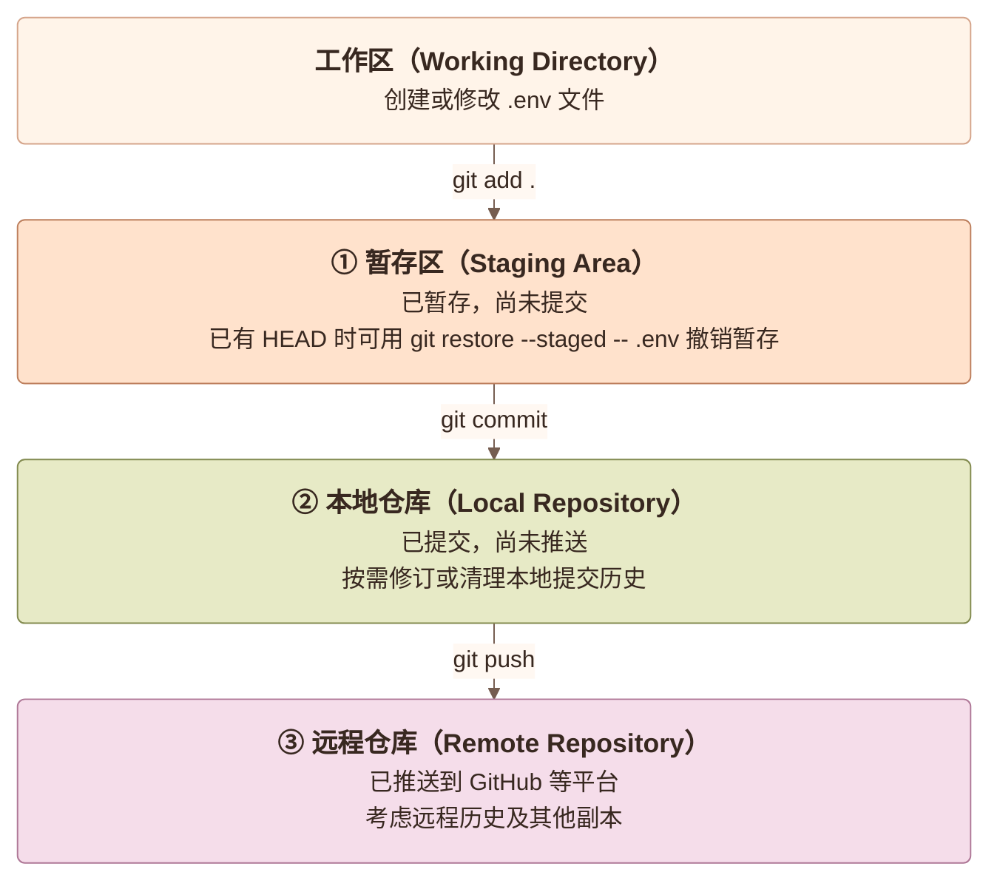

# Git 常用操作笔记

## **一、初次上传本地项目到远程仓库**

### 1. 初始化 Git 仓库

```bash
# 在对应终端执行，先替换示例路径或参数，再核对当前目录和退出状态。
git init -b main
```

### 2. 将所有文件添加到暂存区

```bash
# 把指定改动放入暂存区并记录提交，提交前核对暂存差异。
git add .
```

### 3. 提交到本地仓库

```bash
# 把指定改动放入暂存区并记录提交，提交前核对暂存差异。
git commit -m "feat: 上传Java相关代码与练习文件"
```

### 4. 关联远程仓库

先在 GitHub 等平台创建一个**空仓库**（不勾选 README、.gitignore、License），然后执行：

```bash
# 核对仓库地址、目标分支或配置作用范围，区分本地与远端操作。
git remote add origin https://github.com/你的用户名/你的仓库名.git
```

### 5. 推送到远程仓库

```bash
# 核对仓库地址、目标分支或配置作用范围，区分本地与远端操作。
git push -u origin main
```

+ 加上 `-u` 后，本地 `main` 分支会与远程 `origin/main` 建立追踪关系，后续可直接使用 `git push`

---

## **二、日常更新操作**

### 1.代码实现

当项目内容有变化时，依次执行：

```bash
# 把指定改动放入暂存区并记录提交，提交前核对暂存差异。
git add .
git commit -m "描述本次更新的内容"
git push
```

+ `git add .`：将当前目录及其子目录中的新增、修改和删除添加到暂存区（忽略未跟踪且被忽略的文件）；在仓库根目录执行才覆盖全仓库
+ `git commit -m "xxx"`：提交到本地仓库，建议填写有意义的提交信息
+ `git push`：推送至已关联的远程仓库（已建立追踪关系后可省略远程名和分支名）

### 2.**Git Commit 消息规范**（Conventional Commits）

使用统一的提交标签可以使项目历史更清晰，便于自动化生成更新日志

#### (1)**常用标签说明**

| 标签 | 全称 | 适用场景 | 举个例子 |
| ------ | ------ | ---------- | ---------- |
| `feat` | feature | 开发**新功能**。只要是系统里以前没有、现在刚写完的功能，都用它 | `feat: 编写GourmetCoffee的购物车商品添加功能` |
| `fix` | fix | **修复 Bug**。代码报错、逻辑漏洞、死循环，只要是改错都用它 | `fix: 修复咖啡数量输入负数时导致金额计算错误的Bug` |
| `docs` | documentation | 仅仅**修改了文档**。比如改了 README.md、写了注释、改了脑图 | `docs: 更新W4阶段Python测试接口脑图说明` |
| `style` | style | 不影响代码逻辑的**格式调整**。比如对齐空格、删掉多余空行、格式化代码 | `style: 格式化GourmetCoffee主类的缩进和空格` |
| `refactor` | refactor | **重构代码**。既不是新功能，也不是修 Bug，而是把烂代码写得更优雅、更健壮 | `refactor: 提取公共咖啡属性到基类以优化代码结构` |
| `test` | test | **增加或修改测试用例**。比如你在写 Java 时用的 JUnit 测试代码 | `test: 增加购物车结算逻辑的单元测试` |
| `chore` | chore | **杂务/日常构建维护**。比如修改了 pom.xml 引入了新依赖、改了 .gitignore、配置了 IntelliJ IDEA 的环境 | `chore: 导入老师提供的GourmetCoffee第三方类库` |

#### (2)补充标签（可选）

| 标签 | 全称 | 适用场景 | 举个例子 |
| ------ | ------ | ---------- | ---------- |
| `perf` | performance | **性能优化**相关的改动 | `perf: 优化图片加载策略减少首页白屏时间` |
| `build` | build | 影响**构建系统或外部依赖**的改动（如 Maven/Gradle 配置） | `build: 升级Spring Boot版本至2.7.0` |
| `ci` | continuous integration | 修改 **CI 配置或脚本**（如 GitHub Actions、Jenkins） | `ci: 添加自动化测试流水线` |
| `revert` | revert | **撤销**之前的某次提交 | `revert: 回退feat(购物车)因为发现性能瓶颈` |

---

## 三、分支管理

### 1.查看分支

```bash
git branch         # 查看本地分支，当前分支前有 *
git branch -r      # 查看远程分支
git branch -a      # 查看所有分支（本地+远程）
```

### 2.创建并切换到新分支

```bash
git checkout -b 分支名
# 或新版命令
git switch -c 分支名
```

+ `git checkout -b` 表示创建并切换分支；`-b` 不是 `--branch` 的简写
+ -c 是 --create 的简写,代表创建并切换

### 3.切换分支

```bash
git checkout 分支名
# 或
git switch 分支名
```

### 4.合并分支

#### (1)先切换到目标分支（例如 `main`）

```bash
# 操作分支或切换工作位置，执行前确认当前分支和未提交改动。
git checkout main
```

#### (2)执行合并

```bash
# 把指定提交或分支整合到当前分支，遇到冲突时先核对双方改动。
git merge 要合并的分支名
```

### 5.删除分支

```bash
git branch -d 分支名   # 删除已合并的分支
git branch -D 分支名   # 强制删除分支（即使未合并）
```

### 6.推送新分支到远程

```bash
# 核对仓库地址、目标分支或配置作用范围，区分本地与远端操作。
git push -u origin 分支名
```

---

## 四、**撤销与回退**

### 1.**撤销工作区的修改**（未 add）

```bash
git checkout -- 文件名
# 新版
git restore 文件名
```

放弃所有文件修改（慎用）：

```bash
# 操作分支或切换工作位置，执行前确认当前分支和未提交改动。
git checkout .
```

### 2.撤销暂存区的文件（已 add 未 commit）

```bash
git reset HEAD 文件名
# 新版
git restore --staged 文件名
```

这些写法以 `HEAD` 为来源，适用于仓库已有提交的情况。首次提交前误暂存新文件时，可参照[敏感文件误入 Git 的处理](#敏感文件误入-git-的处理)。

### 3.修改最近一次提交信息（未 push）

```bash
# 把指定改动放入暂存区并记录提交，提交前核对暂存差异。
git commit --amend -m "新的提交信息"
```

如果漏了文件，可以先 `git add`，再执行 `git commit --amend`（不加 `-m` 进入编辑器），会将新变更并入上一次提交。

### 4.撤销本地提交（已 commit 未 push）

+ 保留修改，仅撤销 commit：

```bash
# 先用状态和差异确认范围，再观察此操作对工作区、暂存区或历史的影响。
git reset --soft HEAD~1
```

+ 保留修改，同时清空暂存区：

```bash
git reset HEAD~1          # 等同 --mixed
```

+ 彻底丢弃所有修改（危险）：

```bash
# 先用状态和差异确认范围，再观察此操作对工作区、暂存区或历史的影响。
git reset --hard HEAD~1
```

### 5.撤销已推送到远程的提交

```bash
git revert HEAD       # 生成一个反向提交
git push
```

---

## 五、查看状态与历史

```bash
git status                    # 详细状态
git status -s                 # 简略模式
git log                       # 详细提交日志
git log --oneline             # 一行一条
git log --graph --all --oneline   # 图形化显示所有分支历史
git show 提交哈希             # 查看某次提交的详细内容
```

---

## 六、远程同步

### 1.拉取并合并

```bash
git pull --no-rebase          # 获取远程更新，再合并到当前分支
# git pull --rebase           # 获取远程更新，再变基本地提交
```

### 2.仅获取远程更新不合并

```bash
# 同步远端引用。检查当前分支与上游关系，再决定是否整合。
git fetch origin
```

查看远程与本地的差异：

```bash
# 查看仓库证据。注意比较的是工作区、暂存区还是提交历史。
git diff origin/main
```

### 3.本地有未提交修改时拉取

先用 `stash` 暂存：

```bash
# 同步远端引用。检查当前分支与上游关系，再决定是否整合。
git stash
git pull
git stash pop
```

---

## 七、暂存工作现场（stash）

临时保存当前修改，以便切换分支处理急事：

```bash
git stash                 # 保存已跟踪文件的工作区和暂存区修改
git stash push -u          # 同时保存未跟踪文件（不含被忽略的文件）
git stash pop             # 恢复最近一次保存；成功后删除记录，冲突时保留记录
git stash list            # 查看暂存列表
```

---

## 八、忽略文件（.gitignore）

在仓库根目录创建 `.gitignore` 文件，示例内容：

```gitignore
# 编译产物
target/
*.class

# 系统文件
.DS_Store
Thumbs.db

# 日志
*.log

# 本地敏感配置
.env
```

忽略规则适用于匹配的未跟踪文件。某个文件已经被 Git 跟踪时，需要从索引中移除它，再提交这一变更。[Git `.gitignore` 文档](https://git-scm.com/docs/gitignore)

### 敏感文件误入 Git 的处理

如果真实 API Key 已经泄露，或无法确认暴露范围，先在服务商处撤销旧 Key 或轮换凭证，再处理仓库记录。[GitHub 敏感数据清理指南](https://docs.github.com/zh/authentication/keeping-your-account-and-data-secure/removing-sensitive-data-from-a-repository)

**Git 的完整流程**



图中以 `.env` 实际被加入暂存区为例。匹配忽略规则的未跟踪 `.env` 会被 `git add .` 默认跳过。

| `.env` 的状态 | 处理方式 |
|---|---|
| 仅暂存，尚未提交 | 撤销暂存，检查忽略规则和待提交列表。 |
| 已提交到本地，尚未推送 | 先暂停推送。若仅最近一次本地提交包含密钥，可以修订该提交。若更早的提交也包含密钥，需要清理相应的历史范围。 |
| 已推送到远程 | 处理凭证后，再评估是否需要重写并更新远程历史，以及如何处理协作者和平台保留的副本。 |

**撤销刚加入暂存区的 `.env`**

已有提交且 `.env` 只作为新文件进入暂存区时，下面的命令从 `HEAD` 恢复索引，磁盘上的 `.env` 仍可供本地程序使用。随后确认 `.gitignore` 含有 `.env`，并检查待提交列表。[Git `restore` 文档](https://git-scm.com/docs/git-restore)

```bash
git restore --staged -- .env
git status
```

首次提交前还没有可供恢复的 `HEAD`。如果暂存的 `.env` 与磁盘上的文件一致，可以用下面的 `git rm --cached` 命令把它移出索引，再用 `git status` 检查。[Git `rm` 文档](https://git-scm.com/docs/git-rm)

**让后续版本排除已跟踪的 `.env`**

在 `.gitignore` 中加入 `.env`，然后从索引移除该文件并暂存忽略规则。`--cached` 只操作索引，本地文件可继续使用。核对暂存内容后提交这两项变更。[Git `rm` 文档](https://git-scm.com/docs/git-rm)

```bash
git rm --cached -- .env
git add -- .gitignore
git status
```

> [!Example]
>
> 在提交 A 中加入 `.env`，在提交 B 中记录删除。提交 B 的文件快照已经排除 `.env`，从提交 A 仍可读取旧文件。`git revert` 同样会创建一个新提交并保留原提交。

如果发现时当前分支仍停在提交 A，而且 A 尚未推送、只有该次提交包含密钥，可以先暂存正确的内容，再用第四节的 `git commit --amend` 替换分支顶端的提交。如果已创建提交 B，直接推送仍可能把包含密钥的提交 A 一并上传。[Git `commit` 文档](https://git-scm.com/docs/git-commit#Documentation/git-commit.txt---amend)

**清理已发布的历史**

`git-filter-repo` 可按指定路径或内容重写历史。改写会改变受影响的提交 ID，更新远程可能需要强制推送，并与协作者协调分支和克隆。旧数据仍可能保留在克隆、Fork、Pull Request 引用或平台缓存中。根据暴露范围核对这些副本，再决定是否需要协调清理或联系平台支持。[GitHub 敏感数据清理指南](https://docs.github.com/zh/authentication/keeping-your-account-and-data-secure/removing-sensitive-data-from-a-repository)

---

## 九、常用小贴士

+ 首次推送 `git push -u origin main` 后，日常直接 `git push` 即可。
+ 提交信息遵循约定式提交，如 `feat:`、`fix:`、`docs:` 等，便于回溯。
+ 操作前可用 `git status` 确认当前状态，避免误操作。
