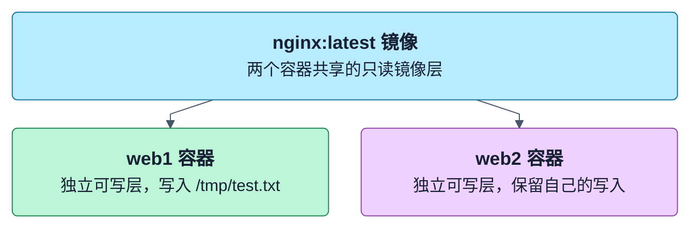
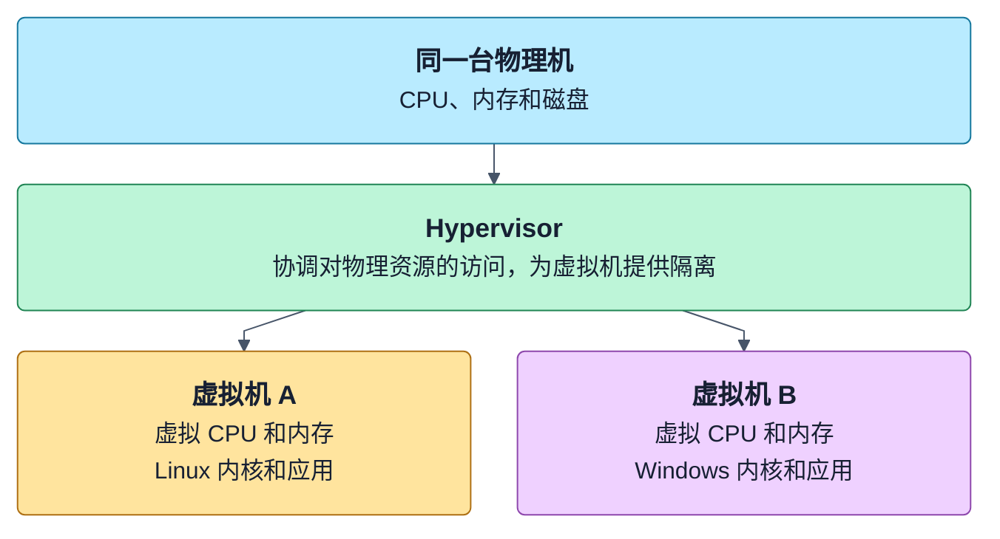
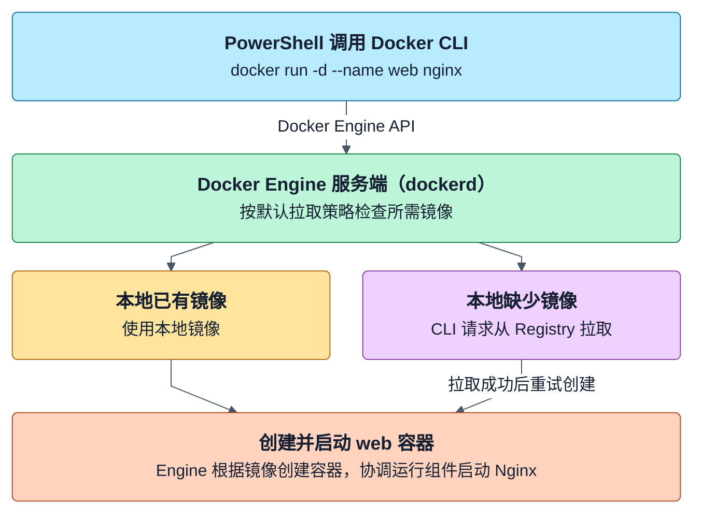
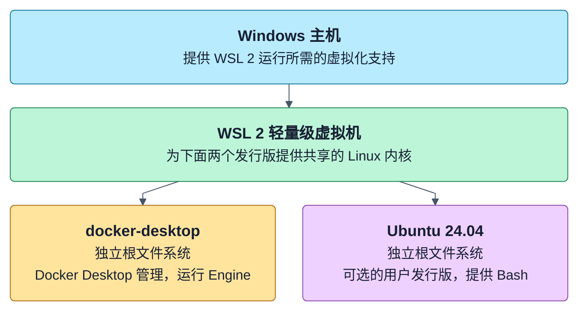
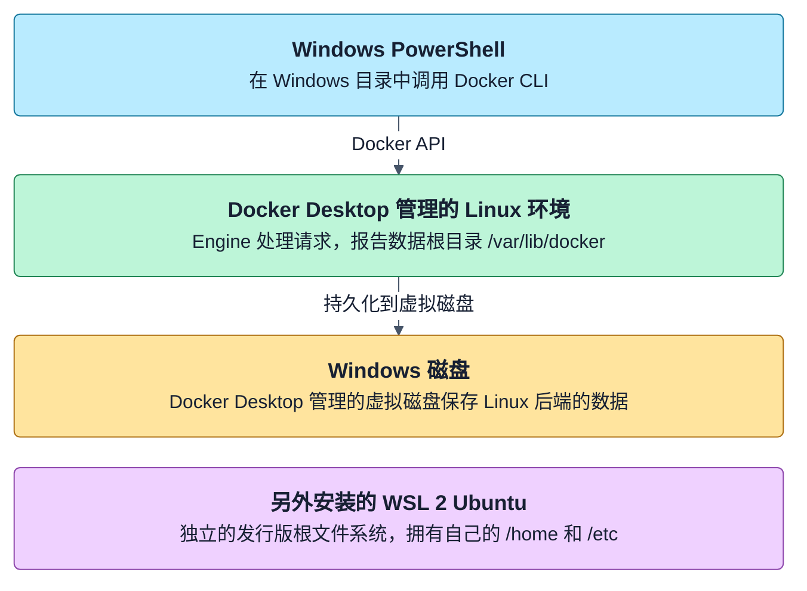

# 🐳 Docker 学习笔记（面向 Spring Boot 项目）

---

## 0. 🚀 新手极简速查

> 如果你忘了 Dockerfile 和 Compose 到底是干啥的，只看这一块就够了

---

### 0.1 **Dockerfile 是什么？**

- **一句话定义**：Dockerfile 是一份 **“自动化的安装说明书”**，Docker 照着它就能自动生成一个干净的镜像
- **核心指令（记住这4个就够了）**：

  | 指令 | 作用 | 大白话 |
  | :--- | :--- | :--- |
  | **FROM** | 指定基础镜像 | “基于谁” |
  | **WORKDIR** | 设置工作目录 | “进哪个文件夹干活” |
  | **COPY** | 复制文件到镜像 | “把代码拷进去” |
  | **CMD** | 容器启动时执行的命令 | “开机后自动运行啥” |

> **注意**：`COPY` 是构建时复制文件，`CMD` 是运行时才执行

- **什么时候用**：你写了一个项目（Spring Boot / Python / Node），需要把它打包成镜像去部署

- **怎么用**：

  ```bash
  docker build -t my-app .   # 打包成镜像
  docker run -p 8080:8080 my-app  # 运行
  ```

- **示例**：

  ```dockerfile
  # 1. 基础环境：我用 Python 3.9 官方系统当底子
  FROM python:3.9
  
  # 2. 设置工作目录：进到容器里的 /app 文件夹干活
  WORKDIR /app
  
  # 3. 复制文件：把电脑里的代码复制进容器里
  COPY . .
  
  # 4. 启动命令：容器运行时，执行 python app.py
  CMD ["python", "app.py"]
  ```

---

### 0.2 **Docker Compose 是什么？**

- **一句话定义**：当你需要**同时管理多个容器**（如：后端 + MySQL + Redis）时，Compose 是一张 **“一键启动全家桶的布局图”**
- **核心字段（记住这4个就够了）**：

  | 关键词 | 大白话解释 | 举例 |
  | :--- | :--- | :--- |
  | **services** | 声明“我要开几个店” | 下面缩进的都是你要启动的容器 |
  | **build** | “现场用 Dockerfile 现做” | `build: .` 代表用当前目录的 Dockerfile 现打包 |
  | **image** | “去网上直接下载现成的” | `image: redis` 代表直接去官方仓库拽一个 Redis 过来用，连 Dockerfile 都不用写！ |
  | **depends_on** | “启动顺序” | 短语法只控制启动顺序，不等待数据库就绪；需 healthcheck 与 service_healthy，应用仍应支持重试 |

- **`docker-compose.yml`示例**（注意后缀是 `.yml`）：

  ```yaml
  # 使用当前 Compose Specification，无需 version 字段
  # 2. 核心：定义所有需要启动的“服务”
  services:
  
    # 服务A：你的 Python 后端（基于刚才的 Dockerfile）
    web:
      build: .                # 意思是：“去当前目录找 Dockerfile 来构建”
      ports:
        - "5000:5000"         # 把容器的 5000 映射到电脑的 5000
      depends_on:
        - db                  # 告诉工头：“先启动数据库，再启动我”
  
    # 服务B：数据库（不用写 Dockerfile，直接从网上下载官方现成的）
    db:
      image: postgres:15      # 意思是：“去网上下载 Postgres 15 这个成品”
      environment:            # 设置数据库的密码（环境变量）
        POSTGRES_PASSWORD: "${POSTGRES_PASSWORD:?请先设置数据库密码}"
      ports:
        - "5432:5432"         # 把数据库端口暴露出来
  ```

> [!IMPORTANT]
> **重点来了**：在 Compose 文件里，`web` 服务想连接 `db` 服务，**直接在代码里写主机名 `db` 就行**（比如 `postgresql://db:5432`）。Compose 会自动帮你们配好网络，你完全不用管 IP 地址！

- **使用**：在 `docker-compose.yml` 文件所在的目录，打开终端，敲：

  ```bash
  # 一键启动所有服务（-d 代表后台运行，像开机一样）
  docker compose up -d
  
  # 一键停止所有服务
  docker compose down
  
  # 查看所有服务的运行日志（看哪里报错）
  docker compose logs -f
  ```

- **什么时候用**：你的项目需要多个容器配合工作（比如后端要连数据库、缓存、AI模型等）

---

### 0.3 **它俩到底啥关系？**

| 对比项 | **Dockerfile** | **Docker Compose** |
| :--- | :--- | :--- |
| **管什么** | 管 **“怎么做”**（如何打包一个镜像） | 管 **“怎么跑”**（如何启动一堆镜像） |
| **文件类型** | 无后缀名，叫 `Dockerfile` | 叫 `docker-compose.yml` |
| **干活的** | 描述镜像构建过程；镜像可启动多个容器 | 负责同时管理和连接 N 个容器 |
| **是否必须** | 通常用于自定义镜像；使用现成镜像可不写 | **非必须**（但项目一复杂就是神器） |

> [!TIP]
> **“Dockerfile 负责把代码装进箱子（镜像），Compose 负责把箱子和数据库、Redis 一起通上电、插上网线（运行）”**

---

### 0.4 **菜鸟救急命令**（复制即用）

| 场景 | 命令 |
| :--- | :--- |
| 把 Dockerfile 打包成镜像 | `docker build -t my-app .` |
| 运行镜像 | `docker run -p 8080:8080 my-app` |
| 启动 compose 全家桶 | `docker compose up -d` |
| 关停 compose 全家桶 | `docker compose down` |
| 查看容器日志（找报错） | `docker logs 容器名 --tail 50` |
| 查看容器退出码 | `docker inspect 容器名 --format='{{.State.ExitCode}}'` |

---

## 1. **核心概念**

- **镜像（Image）**：只读模板，包含应用和运行时文件（如 `app.jar`、Java 21 和相关库），也可指定默认启动命令。
- **容器（Container）**：从镜像创建的实例，可启动、停止、删除。容器启动后，应用进程在其中执行。
- **镜像仓库（Repository）**：同名镜像及其标签的集合；Docker Hub 是托管仓库的注册服务（Registry）

### 1.1 容器化技术

**容器化**把应用、运行时、依赖和可随应用分发的配置打包进镜像。部署时，从镜像创建容器来运行应用。

#### 1.1.1 Spring Boot 应用怎么交付

| 交付方式 | 交付内容 | 目标机器需要准备 |
| :--- | :--- | :--- |
| 直接交付 JAR | `app.jar` | 版本匹配的 Java 运行时及其他系统依赖 |
| 交付容器镜像 | `app.jar`、Java 运行时和相关依赖 | 兼容的容器运行环境 |

同一镜像可以减少不同机器上的依赖版本差异。同一台 Linux 服务器也可以同时运行项目 A（Java 17）和项目 B（Java 21），因为两个容器各自使用镜像里的 Java。

> [!NOTE]
> 数据库连接等配置仍需按部署环境提供。MySQL 作为独立服务运行时，应用容器需要能访问它。

#### 1.1.2 `docker run` 如何启动应用

假设镜像 `my-java-app` 包含 Java 21 和 `app.jar`，启动命令为 `java -jar app.jar`。

```bash
docker run my-java-app
```

1. **准备镜像**。Docker 管理目标机器上的镜像文件，将解包后的镜像层用于容器文件系统。
2. **创建容器**。Docker 以只读镜像层为基础，默认给新容器添加自己的可写层。
3. **启动应用**。容器内的 Java 21 执行 `app.jar`。宿主机无需单独安装 Java。

[`docker run` 命令参考](https://docs.docker.com/reference/cli/docker/container/run/) · [镜像层与容器层](https://docs.docker.com/engine/storage/drivers/#container-and-layers)

#### 1.1.3 三种部署方式的资源开销

假设同一个 Spring Boot 应用使用相同的 Java 21 运行时、JVM 参数和负载。应用本身的 CPU 和内存用量通常相近，整机开销还取决于部署方式。

| 部署方式 | 运行环境的开销 |
| :--- | :--- |
| 在 Linux 上直接运行 | Java 进程直接使用宿主系统。 |
| 在 Docker 容器中运行 | Java 进程共享底层 Linux 内核，整机用量还包括 Docker 和容器相关开销。 |
| 在独立虚拟机中运行 | 整机用量还包括客户机内核和系统服务的开销。 |

假设 Java 应用直接运行时使用 600 MB 内存，仅凭这个数值无法推算容器中的内存用量。实际用量还受资源限制影响。把 Java 放进镜像，主要是为了隔离依赖、简化部署和复用交付产物。 [Docker 容器与虚拟机](https://docs.docker.com/get-started/docker-concepts/the-basics/what-is-a-container/#containers-versus-virtual-machines-vms)

> [!TIP]
> **共享镜像层节省的是磁盘空间。** 多个镜像可以复用相同的 Java 21 基础层。每个单独启动的 Java 应用仍有自己的 JVM 进程和堆。比较磁盘占用时，还要算上镜像里的基础系统库。 [Docker 镜像层与容器层](https://docs.docker.com/engine/storage/drivers/#container-and-layers)

在 Windows 上使用 Docker Desktop 的 WSL 2 后端时，比较整机资源占用要计入 WSL 2 和 Docker Desktop 的开销。 [Docker Desktop 的 WSL 2 后端](https://docs.docker.com/desktop/features/wsl/)

容器可以发布端口供外部访问，也可以挂载宿主机目录来读写文件。

#### 1.1.4 镜像怎么迁移

**构建结果保存在哪里。** 使用默认的 Docker 构建驱动时，`docker build` 成功后会将镜像导入构建所用的 Docker Engine 的镜像存储。向 Registry 发布需要显式推送，例如构建后执行 `docker push`，或在适用的构建命令里指定推送输出。 [默认 Docker 构建驱动](https://docs.docker.com/build/builders/drivers/docker/) · [构建输出方式](https://docs.docker.com/build/exporters/)

镜像交给兼容的 Linux 服务器时，可以走镜像仓库或传输归档文件。

- **通过镜像仓库**。为镜像添加指向目标仓库的完整引用，有权限的源机器用 `docker push` 发布，目标服务器用同一个引用执行 `docker pull`。 [镜像仓库与版本管理](镜像仓库与版本管理.md)
- **通过归档文件**。在开发机把镜像导出为 `app.tar`。 [`docker save` 参考](https://docs.docker.com/reference/cli/docker/image/save/)

  ```powershell
  docker save -o app.tar my-spring-app:1.0
  ```

  把 `app.tar` 传到 Linux 服务器，在文件所在目录执行加载。导入后可用 `docker image ls` 核对镜像和标签。 [`docker load` 参考](https://docs.docker.com/reference/cli/docker/image/load/)

  ```bash
  docker load -i app.tar
  ```

---

### 1.2 Docker 镜像是什么

#### 1.2.1 镜像里有哪些内容

以 Spring Boot 镜像 `my-java-app:1.0` 为例，镜像包含文件系统层和镜像配置。 [Docker 镜像基础](https://docs.docker.com/get-started/docker-concepts/the-basics/what-is-an-image/)

| 组成 | 示例 |
| :--- | :--- |
| **文件系统层** | 基础系统文件和库、Java 21 可执行文件和运行库、`app.jar` |
| **镜像配置** | 工作目录 `/app`、默认启动命令 `java -jar app.jar`、环境变量默认值 |

Java 21 在镜像里以文件形式保存。容器启动时，才会按启动配置创建 Java 进程。见 [§1.1.2 `docker run` 如何启动应用](#112-docker-run-如何启动应用)。

#### 1.2.2 同一个镜像如何运行多个容器

在同一个 Docker Engine 上，可以从同一份 `nginx:latest` 镜像创建 `web1` 和 `web2`。两个容器共享镜像的只读层，各自拥有独立的可写层，并分别运行自己的 Nginx 进程。 [Docker 镜像层与容器层](https://docs.docker.com/engine/storage/drivers/#container-and-layers)



> [!NOTE]
> **写入发生在各自的可写层。** 假设没有配置共享挂载，`web1` 写入可写层的 `/tmp/test.txt` 只出现在 `web1` 的文件系统中。需要共享文件时，可以把同一个卷挂载到两个容器中。

| 命令 | 删除的对象和影响 |
| :--- | :--- |
| `docker rm web1` | `web1` 停止后，可用此命令删除该容器及其可写层。默认保留挂载数据和原镜像，`web2` 可以继续运行。 [删除容器](https://docs.docker.com/reference/cli/docker/container/rm/) |
| `docker rmi nginx:latest` | 操作的是本地镜像引用。镜像有多个标签时，可以只移除指定标签。镜像仍被 `web2` 等运行中的容器使用时，删除镜像本身会受限制。 [删除镜像](https://docs.docker.com/reference/cli/docker/image/rm/) |

---

### 1.3 Docker 解决了哪些问题

#### 1.3.1 环境一致性、隔离与交付

| 问题 | Docker 的做法 |
| :--- | :--- |
| **环境一致性** | 把 Spring Boot 应用和 Java 21 一起打包。不同机器部署同一镜像时，使用镜像里相同的运行时和依赖。 |
| **环境隔离** | 让两个容器分别使用各自的 Java 17 和 Java 21。容器有各自的进程和文件系统视图，同时共享底层 Linux 内核。 |
| **部署与迁移** | 把构建好的镜像交付给另一台兼容的机器，再创建容器运行。镜像可通过仓库分发，也可通过文件迁移。 |

[§1.1.4 镜像怎么迁移](#114-镜像怎么迁移) · [Docker 容器基础](https://docs.docker.com/get-started/docker-concepts/the-basics/what-is-a-container/)

#### 1.3.2 应用仍需要外部服务

Spring Boot 镜像可以包含正确的 Java 21 和 `app.jar`。如果应用启动时必须连接 MySQL，数据库也要在配置的地址和端口上提供服务，而且应用容器需要能访问它。

> [!NOTE]
> 假设应用启动日志同时出现 `Communications link failure` 和 `Connection refused`，说明这次 TCP 连接被拒绝。可以检查 MySQL 是否已启动并监听目标端口，以及 Spring Boot 使用的数据库地址、端口和容器网络是否正确。应用如果在启动时必须连上数据库，就可能因此启动失败。 [Linux `connect(2)`](https://man7.org/linux/man-pages/man2/connect.2.html)

#### 1.3.3 Spring Boot 和 MySQL 分开部署

Spring Boot 容器运行应用镜像，MySQL 容器运行官方 `mysql` 镜像。两个容器加入同一个自定义 Docker 网络。若 Compose 中的数据库服务名是 `mysql`，应用可通过 `mysql:3306` 连接数据库。 [§4.3 自定义网络](#43-自定义网络) · [MySQL 官方镜像](https://hub.docker.com/_/mysql)

- **独立更新**。发布新版 Spring Boot 时，只需替换应用容器，继续使用原有的 MySQL 容器。
- **独立扩展**。可以增加 Spring Boot 实例，让它们连接同一个 MySQL 服务。 [Docker 多容器应用](https://docs.docker.com/get-started/docker-concepts/running-containers/multi-container-applications/)
- **数据持久化**。给 MySQL 的数据目录 `/var/lib/mysql` 挂载命名卷。即使将来重建 MySQL 容器，也可以挂载原来的卷来保留数据。 [§4.2.2 命名卷](#422-命名卷方便备份与共享) · [Docker 卷的生命周期](https://docs.docker.com/engine/storage/volumes/#a-volumes-lifecycle)

> [!NOTE]
> 两个容器可以独立更新，服务之间仍有依赖。MySQL 停止后，Spring Boot 的数据库操作可能失败。

---

### 1.4 Docker 容器与虚拟机的区别

#### 1.4.1 应用使用哪个内核

| 部署方式 | 应用运行环境 | 应用使用的内核 |
| :--- | :--- | :--- |
| Ubuntu 虚拟机 | 虚拟化软件提供虚拟硬件，客户机启动自己的操作系统和系统服务 | Ubuntu 客户机的 Linux 内核 |
| Linux 上的 Docker 容器 | 应用进程使用镜像提供的用户态文件，例如命令、库和 Java 运行时 | 运行这些容器的 Linux 宿主机内核 |

多个容器共享一个内核，启动容器时只需启动配置好的应用进程及其所需进程。虚拟机还需要启动客户机操作系统。资源比较见 [§1.1.3 三种部署方式的资源开销](#113-三种部署方式的资源开销) · [Docker 容器与虚拟机](https://docs.docker.com/get-started/docker-concepts/the-basics/what-is-a-container/#containers-versus-virtual-machines-vms)。

#### 1.4.2 Ubuntu 和 Alpine 容器

> [!NOTE]
> 同一台 Linux 服务器上的 Ubuntu 容器和 Alpine 容器各自使用基础镜像提供的命令和库。两者的进程由同一个宿主 Linux 内核运行。

#### 1.4.3 Windows 上的 WSL 2 与 Docker

**系统调用**是应用程序向操作系统内核请求服务的接口，例如打开文件、读取数据或创建进程。以 Python 读取文本文件为例，Python 运行时会通过系统调用向内核发出文件操作请求。 [Linux 系统调用手册](https://man7.org/linux/man-pages/man2/syscalls.2.html)

```python
with open("test.txt", "r", encoding="utf-8") as f:
    print(f.read())
```

| 版本 | Linux 程序的请求如何处理 | 运行环境 |
| :--- | :--- | :--- |
| WSL 1 | 兼容层把 Linux 系统调用转换为 Windows 内核能够处理的操作。 | Windows 内核和兼容层 |
| WSL 2 | Linux 内核直接处理 Linux 系统调用。 | 由 Windows 管理的轻量级虚拟机 |

[Microsoft WSL 版本对比](https://learn.microsoft.com/zh-cn/windows/wsl/compare-versions)

> [!NOTE]
> **WSL 1 兼容的是系统调用。** `ls` 仍作为 Linux 程序执行。它请求读取目录时，兼容层将该请求转换为 Windows 内核能够处理的操作，再把结果返回给 `ls`。

Docker Desktop 使用 WSL 2 后端时，Docker Engine 在专用的 `docker-desktop` WSL 发行版中运行。Docker 创建的 Linux 容器共享 WSL 2 虚拟机里的 Linux 内核。 [Docker Desktop 的 WSL 2 后端](https://docs.docker.com/desktop/features/wsl/)

> [!NOTE]
> **WSL 2 虚拟机运行完整的 Linux 内核。** 同一个 Docker Engine 启动多个 Linux 容器时，这些容器里的应用进程都向该 Linux 内核发出系统调用。 [Microsoft WSL 版本对比](https://learn.microsoft.com/zh-cn/windows/wsl/compare-versions)

**多个终端与发行版**

在同一个 Windows 用户的常规 WSL 2 环境中，多个发行版可以同时运行在一台轻量级虚拟机里，共享该虚拟机的 Linux 内核。 [WSL 2 架构](https://learn.microsoft.com/en-us/windows/wsl/compare-versions#wsl-2-architecture) · [Docker Desktop 的 WSL 2 后端](https://docs.docker.com/desktop/features/wsl/#enable-docker-in-a-wsl-2-distribution)

| 场景 | 分开的部分 | 共享的部分 |
| :--- | :--- | :--- |
| 同一个 Ubuntu 发行版的多个终端窗口 | 各自的 Shell 会话，可运行不同程序 | Ubuntu 的根文件系统、WSL 2 虚拟机及其 Linux 内核 |
| 同时运行 Ubuntu、Debian 等 WSL 2 发行版 | 各发行版的根文件系统和进程命名空间 | WSL 2 虚拟机及其 Linux 内核 |
| 同一个 Docker Engine 启动的两个普通 Linux 容器 | 各自的容器可写层 | 同一个 Linux 内核。若来自同一镜像，也共享镜像的只读层 |

同一个 Linux 内核可以同时运行使用不同文件系统视图的进程。WSL 为每个发行版挂载自己的虚拟磁盘作为根文件系统，并用进程命名空间限制进程的可见范围。 [WSL 发行版的启动过程](https://wsl.dev/technical-documentation/init/#wsl2-specific-distributions-startup) · [§1.2.2 容器的可写层](#122-同一个镜像如何运行多个容器)

发行版之间也可以通过共享挂载点访问文件，例如 `/mnt/wsl`。

**在两个窗口查看同一个文件**

假设两个窗口进入同一个 Ubuntu WSL 2 发行版，并使用同一 Linux 用户的家目录。

```bash
# 窗口 A：创建文件
touch ~/docker-test.txt

# 窗口 B：查看文件
ls ~/docker-test.txt
```

窗口 A 成功创建文件后，窗口 B 能列出它。两个窗口各有自己的 Shell 会话，但 `~` 都展开为同一个 Ubuntu 文件系统中的同一家目录，因此两条命令访问的是同一个路径。 [Bash 的波浪号展开规则](https://www.gnu.org/software/bash/manual/html_node/Tilde-Expansion.html)

**查看内核版本**

在两个 Ubuntu 终端中运行以下命令，可以比较它们看到的内核发行版本。

```bash
uname -r
```

相同的输出只表明内核发行版本相同。判断是否共享同一个内核实例，要看两个终端所在的发行版是否运行于同一台 WSL 2 虚拟机。 [GNU `uname` 命令参考](https://www.gnu.org/software/coreutils/manual/html_node/uname-invocation.html)

#### 1.4.4 一台物理机如何运行多个内核

操作系统内核是管理进程、内存和设备的核心软件。两台虚拟机可以各自启动一套内核，由同一台物理机的 CPU 执行这些内核的指令。

**Hypervisor（虚拟机监控器）** 与宿主的虚拟化组件为每台虚拟机提供独立的虚拟硬件视图。客户机内核管理自己看到的处理器、内存和设备，虚拟化层负责协调对物理硬件的访问并提供隔离。 [Microsoft Hyper-V 架构](https://learn.microsoft.com/en-us/windows-server/virtualization/hyper-v/architecture)



- **CPU**。客户机内核把应用的工作分配给虚拟 CPU（vCPU），虚拟化层再把可运行的 vCPU 调度到宿主的 CPU 上。假设宿主有 4 个物理核心，两台虚拟机各配置 4 个 vCPU。每台虚拟机都看到 4 个虚拟处理器，宿主仍有 4 个物理核心。两台虚拟机同时满载时可能竞争 CPU 时间。 [Hyper-V 的虚拟处理器调度](https://learn.microsoft.com/en-us/windows-server/virtualization/hyper-v/manage/manage-hyper-v-scheduler-types#understand-how-hyper-v-virtualizes-processors)
- **内存**。各客户机看到独立的内存地址范围，虚拟化层把这些地址映射到宿主的实际内存。若宿主有 16 GB 物理内存，宿主系统和各虚拟机共同使用这 16 GB。虚拟机的实际占用随配置和运行需求而变。 [Hyper-V 的内存处理](https://learn.microsoft.com/en-us/windows-server/virtualization/hyper-v/architecture#interrupt-and-memory-handling)

WSL 2 利用 Hyper-V 的部分虚拟化能力，在轻量级虚拟机中运行 Linux 内核。Docker Desktop 使用 WSL 2 后端时，Linux 容器的隔离由这台虚拟机里的 Linux 内核提供。同一个后端启动的容器共享该内核。 [Microsoft WSL 常见问题](https://learn.microsoft.com/en-us/windows/wsl/faq#does-wsl-2-use-hyper-v) · [Docker Desktop 的 WSL 2 后端](https://docs.docker.com/desktop/features/wsl/)

---

### 1.5 Docker 的典型使用场景

| 场景 | 示例 | Docker 提供的便利 |
| :--- | :--- | :--- |
| **本地开发** | 为 Spring Boot 项目启动指定版本的 MySQL 或 Redis | 减少宿主机上的安装步骤，按项目管理服务版本和启动配置。 |
| **应用部署** | 将 Spring Boot 和 Java 运行时打包为镜像，再部署到 Linux 服务器 | 用同一镜像交付应用及其运行环境，便于部署和迁移。 |
| **自动化测试** | 在 CI 中为集成测试启动临时数据库 | 每次测试可从指定的镜像和初始化配置开始，任务结束后清理容器。 |

> [!NOTE]
> **MySQL 运行数据需要单独迁移。** 在新服务器上使用同一镜像可以启动相同版本的 MySQL。运行后创建的 `school` 数据库保存在数据目录里。迁移时可以备份并恢复数据库，也可以通过数据卷迁移数据。 [§4.2.2 命名卷](#422-命名卷方便备份与共享) · [Docker 卷的生命周期](https://docs.docker.com/engine/storage/volumes/#a-volumes-lifecycle)

[CI/CD 笔记 §8.1 测试数据库](../DevOps/CI-CD.md#81-ci-数据库必须独立准备) · [GitHub Actions 服务容器](https://docs.github.com/en/actions/tutorials/use-containerized-services/use-docker-service-containers)

---

### 1.6 容器与宿主机的关系

在原生 Linux 上，容器里的进程由宿主机内核调度，使用宿主机的 CPU、内存和磁盘。以一台 8 核 CPU、16 GB 内存、500 GB 磁盘的服务器为例，MySQL 和 Spring Boot 容器都从这台服务器获取资源，宿主机上的其他进程也会占用这些资源。

Linux 容器通常使用命名空间（namespace）隔离进程、网络等视图，并通过 cgroup 统计资源用量和实施已配置的限制。一个容器可以同时运行多个进程。例如，Nginx 容器中可以有一个 master 进程和多个 worker 进程。

| 对象 | 磁盘（SSD/HDD） | 运行时的 RAM 与 CPU |
| :--- | :--- | :--- |
| 镜像 | 保存程序、依赖和只读镜像层。 | 拉取、解包和读取时可能短期使用内存和 CPU。 |
| 已停止的容器 | 保留容器配置和可写层，挂载的数据另计。 | 容器里的程序已退出。 |
| 运行中的容器 | 读写可写层、挂载的数据或日志。 | 内核调度容器进程，JVM 堆和 MySQL 缓冲区会占用内存。 |
| Docker Engine | 保存守护进程的配置、元数据等。 | 守护进程和配套组件运行时使用内存和 CPU。 |

以 Java 应用为例，镜像体积表示它的存储规模。启动容器后，JVM 根据配置和运行负载使用堆等内存，运行时用量要单独查看。 [容器存储](https://docs.docker.com/engine/storage/) · [容器资源用量](https://docs.docker.com/reference/cli/docker/container/stats/)

默认情况下，容器在宿主机内核允许的范围内按需使用 CPU 和内存。部署时可以为单个容器设置上限，以减少资源竞争对其他服务的影响。 [Docker 资源限制](https://docs.docker.com/engine/containers/resource_constraints/)

**WSL 2 使用 Windows 电脑的物理 RAM。** Windows 程序和 WSL 2 虚拟机共享整台电脑的物理内存。在 Docker Desktop 的 WSL 2 后端中，守护进程与容器进程使用的是虚拟机分到的内存。WSL 2 按需分配内存，也能将部分可回收内存返还给 Windows。Linux 页缓存何时回收受 WSL 配置影响，例如 `autoMemoryReclaim`。 [Docker Desktop 的 WSL 2 后端](https://docs.docker.com/desktop/features/wsl/) · [Microsoft WSL 配置参考](https://learn.microsoft.com/en-us/windows/wsl/wsl-config)

---

### 1.7 Docker CLI 与守护进程

#### 1.7.1 组件职责

| 组件 | 职责 |
| :--- | :--- |
| Docker CLI（`docker`） | 解析命令，通过 Docker API 向目标守护进程发出请求，再显示返回的结果。 |
| Docker Daemon（`dockerd`） | 接收请求，管理镜像、容器、网络和数据卷。启动容器时，协调底层运行时。 |

守护进程在后台持续接收请求并管理容器。每次在终端调用 CLI，CLI 都可以向同一个守护进程查询或操作它管理的容器。CLI 和守护进程可以分别运行在不同的系统环境或机器上。 [Docker 官方架构说明](https://docs.docker.com/get-started/docker-overview/#docker-architecture)

#### 1.7.2 命令执行过程

**查询运行中的容器**

```powershell
docker ps
```

1. **PowerShell** 找到并启动 `docker.exe`，把 `ps` 作为参数传给它。
2. **Docker CLI** 解析 `ps`，通过 Docker API 向守护进程请求容器列表。
3. **`dockerd`** 查询容器状态，返回正在运行的容器列表。
4. **Docker CLI** 将返回的结果显示为表格。

> [!NOTE]
> - **连接失败**。CLI 可以解析 `ps`。目标守护进程未运行时，查询在连接阶段失败，CLI 会报告连接错误。 [守护进程连接故障排查](https://docs.docker.com/engine/daemon/troubleshoot/#unable-to-connect-to-the-docker-daemon)
> - **列表为空**。守护进程正常响应且没有运行中的容器时，命令成功，表格没有容器条目。 [`docker ps` 命令参考](https://docs.docker.com/reference/cli/docker/container/ls/)

**启动 Nginx 容器**

```powershell
docker run -d --name web nginx
```

`--name web` 将新容器命名为 `web`。`-d` 让它在后台运行。 [`docker run` 命令参考](https://docs.docker.com/reference/cli/docker/container/run/)

1. **PowerShell 启动客户端**。PowerShell 调用 `docker.exe`，把镜像名和运行选项传给它。
2. **CLI 请求创建容器**。CLI 解析参数，通过 Docker API 将创建请求发给守护进程。
3. **守护进程检查镜像并创建容器**。取得镜像后，守护进程准备容器配置和可写层。在默认的 `missing` 策略下，镜像检查有两种结果。 [镜像拉取策略](https://docs.docker.com/reference/cli/docker/container/run/#set-the-pull-policy---pull) · [§1.1.2 `docker run` 如何启动应用](#112-docker-run-如何启动应用)

   - **镜像已存在**。守护进程直接使用已有镜像。
   - **镜像缺失**。守护进程通知 CLI，由 CLI 请求拉取。成功后 CLI 重试创建，失败时命令在创建容器前结束。

4. **Nginx 开始运行**。CLI 请求启动已创建的容器，守护进程协调底层组件启动 Nginx 主进程。`containerd` 管理容器的生命周期，默认使用 `runc` 按 OCI 运行时规范创建和启动容器。 [Docker 容器运行时](https://docs.docker.com/engine/daemon/alternative-runtimes/) · [runc 项目说明](https://github.com/opencontainers/runc)

> [!NOTE]
> **CLI 退出之后**。`docker run -d` 成功时，CLI 输出容器 ID 并退出。`dockerd` 负责容器管理和启动协调，容器中的 Nginx 主进程由 Linux 内核调度执行。Docker 后端和 Nginx 主进程继续运行时，关闭 PowerShell 后，在新终端连接同一个守护进程仍能查询到 `web` 容器。 [§1.6 容器与宿主机的关系](#16-容器与宿主机的关系) · [Docker 后台运行模式](https://docs.docker.com/reference/cli/docker/container/run/#detached-mode--d---detach)

#### 1.7.3 Windows 与 WSL 2 中的运行位置

- **Windows**。从 PowerShell 调用的 Docker CLI 在这里运行。
- **WSL 2**。Docker Desktop 使用 WSL 2 后端时，守护进程和它启动的 Linux 容器在这里运行。容器共享 WSL 2 提供的 Linux 内核。 [§1.4.3 Windows 上的 WSL 2 与 Docker](#143-windows-上的-wsl-2-与-docker) · [Docker Desktop 的 WSL 2 后端](https://docs.docker.com/desktop/features/wsl/)

#### 1.7.4 哪些命令需要连接守护进程

| 命令 | 信息来自哪里 | 需要连接守护进程 |
| :--- | :--- | :--- |
| `docker --version` | 本地 Docker CLI 的版本信息 | 否 |
| `docker ps` | 守护进程管理的运行中容器列表 | 是 |

排查时，可以用 `docker --version` 确认本地 CLI 能运行，再用 `docker ps` 检查守护进程能否响应。若要查询服务端版本，见 [§1.11.5 查看 Docker 版本](#1115-查看-docker-版本)。 [`docker ps` 命令参考](https://docs.docker.com/reference/cli/docker/container/ls/)

---

### 1.8 Docker Engine

**Docker Engine** 用于构建镜像、运行和管理容器。它采用客户端与服务端架构。 [Docker Engine 官方说明](https://docs.docker.com/engine/)

- **CLI** 提供命令行入口。
- **Engine API** 定义客户端与服务端的通信接口。
- **`dockerd`** 在后台持续运行，管理镜像、容器、网络和数据卷。

```text
Docker CLI（docker）
    ↕ Docker Engine API（请求和响应）
Docker Daemon（dockerd）
    ↓ 协调容器操作
containerd 等运行组件
```

**Server（服务端）** 是以 `dockerd` 为核心、提供 Docker API 的软件服务，可以与 CLI 在同一台电脑上运行，也可以部署在远程主机。 [Docker 客户端与服务端架构](https://docs.docker.com/get-started/docker-overview/#docker-architecture)

收到创建或启动容器的请求后，守护进程会协调 `containerd` 等组件在服务端环境中执行操作。 [Docker 容器运行时](https://docs.docker.com/engine/daemon/alternative-runtimes/)

> [!NOTE]
> **容器查询遇到连接错误**。`docker --version` 成功只说明 CLI 能完成本地版本查询。若 `docker ps` 提示无法连接守护进程，可从三个方面排查。 [§1.7.4 命令与守护进程的关系](#174-哪些命令需要连接守护进程)
>
> - **服务状态**。确认目标守护进程是否运行。本机 Docker Desktop 的后台服务未启动时也会出现这个现象。 [Docker 守护进程连接故障排查](https://docs.docker.com/engine/daemon/troubleshoot/#unable-to-connect-to-the-docker-daemon)
> - **连接地址**。确认 CLI 指向的地址正确且可达。 [检查 CLI 连接的目标](https://docs.docker.com/engine/daemon/troubleshoot/#check-which-host-your-client-is-connecting-to)
> - **访问权限**。确认当前用户能访问目标服务的通信端点。例如在 Linux 上，访问 Docker 的 Unix 套接字需要相应权限。 [Docker Engine 在 Linux 上的权限说明](https://docs.docker.com/engine/install/linux-postinstall/#manage-docker-as-a-non-root-user)

---

### 1.9 Docker Registry 与镜像拉取

#### 1.9.1 Registry 与 Docker Hub

**Registry（镜像仓库服务）** 负责存储和分发容器镜像。 [Docker Registry 官方说明](https://docs.docker.com/get-started/docker-concepts/the-basics/what-is-a-registry/)

**Docker Hub** 是 Docker 运营的镜像托管平台。Docker 默认使用它提供的 Registry 服务。Hub 还提供账号和组织管理、公开与私有仓库、访问权限和网页管理功能。 [Docker Hub 功能](https://docs.docker.com/docker-hub/) · [Docker Hub 仓库管理](https://docs.docker.com/docker-hub/repos/)

**自建 Registry** 也可以分发镜像。例如公司可以自己部署私有 Registry，开发人员和部署服务器用包含该仓库地址的镜像引用，按各自获得的权限推送或拉取。 [Docker Registry 官方说明](https://docs.docker.com/get-started/docker-concepts/the-basics/what-is-a-registry/)

例如，在 Windows 构建好 Spring Boot 镜像 `my-java-app:1.0` 后，用 `docker tag` 为它添加包含目标仓库地址的引用，再推送到该仓库。有权限的 Linux 服务器可用同一个完整引用拉取。 [§1.1.4 镜像怎么迁移](#114-镜像怎么迁移)

一个 Registry 可以托管多个 Repository，同一个 Repository 可以用不同的标签标记镜像版本。 [镜像仓库与版本管理](镜像仓库与版本管理.md)

#### 1.9.2 一次 `docker pull` 如何完成

```bash
docker pull nginx:latest
```

`nginx:latest` 是镜像引用的简写，按 Docker 的默认命名规则展开为 `docker.io/library/nginx:latest`。CLI 通过 Docker Engine API 发出拉取请求，守护进程从 Registry 获取标签指向的镜像内容，下载缺少的层并复用已有的层。 [镜像引用规则](https://docs.docker.com/reference/cli/docker/image/tag/) · [`docker pull` 命令参考](https://docs.docker.com/reference/cli/docker/image/pull/)

```text
Docker CLI
    ↓ 发出拉取请求
dockerd  ↔  Registry（请求和下载镜像）
    ↓ 保存镜像内容
目标 Docker Engine 的镜像存储
```

**本地镜像**以 CLI 当前连接的 Docker Engine 为准。连到远程 Engine 时，拉取结果保存在远程 Engine 管理的镜像存储中。 [§1.8 Docker Engine](#18-docker-engine)

| 命令 | 作用 |
| :--- | :--- |
| `docker pull nginx:latest` | 拉取镜像，使它在目标 Engine 上可用 |
| `docker image ls` | 查看目标 Engine 已保存的镜像 |
| `docker run --name web nginx:latest` | 用镜像创建并启动名为 `web` 的容器 |
| `docker ps` | 查看目标 Engine 上正在运行的容器 |

单独执行 `docker pull` 只完成镜像拉取。需要创建并启动容器时，使用 `docker run`。它默认使用目标 Engine 中已有的镜像，缺少时再尝试拉取。 [镜像列表](https://docs.docker.com/reference/cli/docker/image/ls/) · [容器列表](https://docs.docker.com/reference/cli/docker/container/ls/) · [§1.7.2 创建与拉取流程](#172-命令执行过程)

---

### 1.10 Docker 基本架构串联

以从 PowerShell 执行 `docker run -d --name web nginx` 为例，Docker Engine 是这套容器运行与管理系统。CLI 通过 Docker Engine API 向核心服务端进程 `dockerd` 发出请求。 [§1.8 Docker Engine](#18-docker-engine)



镜像提供 Nginx 的程序文件和默认启动配置。容器是从该镜像创建的实例。容器中的 Nginx 进程由 Engine 所在 Linux 环境的内核调度。 [§1.2 Docker 镜像](#12-docker-镜像是什么) · [§1.7.2 启动 Nginx 的过程](#172-命令执行过程)

> [!NOTE]
> **通信结果和请求处理结果需要分别判断。** 在上面的 Nginx 示例中，守护进程先向 CLI 返回镜像缺失的结果，CLI 随后发出拉取请求。守护进程能把处理错误返回给 CLI，说明这次 API 请求和响应已经完成。 [Docker 默认拉取策略](https://docs.docker.com/reference/cli/docker/container/run/#set-the-pull-policy---pull)

| 提示 | 能确认的环节 | 排查方向 |
| :--- | :--- | :--- |
| `Cannot connect to the Docker daemon` | CLI 未能连接到目标守护进程 | 检查守护进程状态、连接地址和访问权限。 [§1.8 Docker Engine](#18-docker-engine) |
| 拉取报错含 `Error response from daemon` 和 `pull access denied` | CLI 已收到守护进程的响应，操作在获取镜像时失败，本次命令还未启动 Nginx。 | 核对镜像引用及拉取权限。 |
| `docker ps` 成功返回容器列表 | 守护进程响应了这一次查询，空列表也是有效响应。 | 比较两条命令的结果时，先确认它们连接同一个 Engine。 [`docker ps`](https://docs.docker.com/reference/cli/docker/container/ls/) · [Docker 连接上下文](https://docs.docker.com/engine/manage-resources/contexts/) |
| 守护进程返回 `The container name "/web" is already in use` | 新容器在创建阶段遇到名称冲突，`web` 已被同一个 Engine 中的容器占用。 | 用 `docker ps -a` 查看 `NAMES` 和 `STATUS`，包括已停止的容器。 |

`pull access denied` 可以定位到镜像拉取失败。具体原因仍需核实，例如镜像引用写错、仓库不存在，或访问私有仓库时未登录有拉取权限的账号。 [Moby 拉取错误处理](https://github.com/moby/moby/blob/master/daemon/containerd/image_pull.go#L237-L245) · [Registry 认证与访问范围](https://docs.docker.com/reference/api/registry/auth/)

如果 `docker ps -a` 中的 `web` 显示为 `Exited (0)`，它已停止运行，容器对象和名称仍然保留。`docker stop` 停止容器中的进程，删除容器对象会释放它占用的名称。 [列出所有容器](https://docs.docker.com/reference/cli/docker/container/ls/#show-both-running-and-stopped-containers--a---all) · [停止容器](https://docs.docker.com/reference/cli/docker/container/stop/) · [删除容器](https://docs.docker.com/reference/cli/docker/container/rm/)

---

### 1.11 Docker 运行环境

#### 1.11.1 Docker Desktop 与 Linux Docker Engine

- **Docker Engine** 负责构建镜像、运行和管理容器。 [§1.8 Docker Engine](#18-docker-engine)
- **Docker Desktop** 是桌面应用，集成 Engine、Docker CLI、Compose 和图形界面，也负责管理本机后端，例如 Windows 上的 WSL 2 后端。 [Docker Desktop 官方说明](https://docs.docker.com/desktop/)

Linux 容器里的进程由 Linux 内核调度。内核还提供 namespace 来隔离进程、网络等视图，并通过 cgroup 统计和限制资源用量。因此，在符合要求的 Ubuntu 服务器上直接安装 Docker Engine，就能用服务器现有的 Linux 内核运行容器。 [§1.6 容器与宿主机的关系](#16-容器与宿主机的关系) · [Ubuntu 上的 Docker Engine](https://docs.docker.com/engine/install/ubuntu/)

| 场景 | 命令发到哪里 | Linux 容器使用的内核 |
| :--- | :--- | :--- |
| Ubuntu 服务器直接安装 Engine | Ubuntu 上的 CLI → 同机 Engine | Ubuntu 服务器的 Linux 内核 |
| Windows 上的 Docker Desktop 使用 WSL 2 后端 | PowerShell 中的 CLI → Desktop 管理的 Engine | WSL 2 虚拟机的 Linux 内核 |

CLI 指向 Desktop 管理的本地 Engine 时，图形界面和命令行看到的是同一套容器、镜像和卷。CLI 也适用于没有桌面界面的 Linux 服务器，可用于部署和排障。 [Docker Desktop 图形界面](https://docs.docker.com/desktop/use-desktop/) · [Docker Context](https://docs.docker.com/engine/manage-resources/contexts/)

---

#### 1.11.2 Docker 在 Windows 与 WSL 2 中的运行方式

**WSL 2 与发行版**

- **WSL 2** 提供轻量级虚拟机和 Linux 内核。选择 WSL 2 后端前，Windows 上需要有可用的 WSL 2。 [Docker Desktop 安装要求](https://docs.docker.com/desktop/setup/install/windows-install/#system-requirements)
- **`docker-desktop`** 是 Docker Desktop 管理的专用发行版，在其中运行 Docker Engine。
- **Ubuntu 24.04** 是可选的用户发行版，可以另外安装。Docker Desktop 可以仅用自己的后端运行 Linux 容器。 [Docker Desktop 的 WSL 2 后端](https://docs.docker.com/desktop/features/wsl/)



在同一 Windows 用户的常规配置下，两者可以共享 WSL 2 的 Linux 内核。各发行版有独立的根文件系统和进程环境，`/etc`、`/usr` 等目录各归所属发行版。发行版可通过共享挂载点交换文件。 [Microsoft WSL 架构说明](https://learn.microsoft.com/en-us/windows/wsl/compare-versions#wsl-2-architecture) · [§1.4.3 多个终端与发行版](#143-windows-上的-wsl-2-与-docker)

> [!NOTE]
> **Docker Desktop 的 Hyper-V 后端。** 如果 Docker Desktop 使用独立的 Hyper-V 后端运行 Linux 容器，Desktop 的容器虚拟机和 Ubuntu 所在的 WSL 2 虚拟机分别使用自己的 Linux 内核。 [Windows 上的 Docker Desktop 后端选项](https://docs.docker.com/desktop/setup/install/windows-install/#system-requirements) · [Docker Desktop 的 WSL 2 隔离说明](https://docs.docker.com/desktop/features/wsl/#wsl-2-security-in-docker-desktop)

**后来安装 Ubuntu 24.04**

在 WSL 2 已经可用的环境中，可以用下列命令添加 Ubuntu 24.04。发行版名称以 `wsl --list --online` 列出的结果为准。 [Microsoft WSL 基本命令](https://learn.microsoft.com/en-us/windows/wsl/basic-commands)

```powershell
wsl --install -d Ubuntu-24.04
```

**从 Ubuntu 访问 Docker Engine**

Docker Desktop 使用 WSL 2 后端运行 Linux 容器时，可以为指定的 Ubuntu 发行版启用集成。 [Docker Desktop 的 WSL 集成](https://docs.docker.com/desktop/features/wsl/#enable-docker-in-a-wsl-2-distribution)

1. 在 Docker Desktop 中打开 **Settings → Resources → WSL Integration**。
2. 开启目标 Ubuntu 发行版的开关，并应用设置。

- **启用集成后**，Ubuntu 终端的 CLI 可通过 Docker API 向 Desktop 的 Engine 发送请求，例如用 `docker ps` 查询容器。 [§1.7.2 命令执行过程](#172-命令执行过程)
- **在 PowerShell 和 Ubuntu 中对照**。两个 CLI 指向同一个 Engine，且两次查询间容器运行状态相同时，`docker ps` 会列出同一组容器。切换 Docker Context 可以改变连接目标。 [Docker 连接上下文](https://docs.docker.com/engine/manage-resources/contexts/) · [`docker ps` 命令参考](https://docs.docker.com/reference/cli/docker/container/ls/)
- **在 Ubuntu 中独立运行 Engine**。也可安装 Linux 版 Engine，让 CLI 连接 Ubuntu 自己的守护进程。在同一发行版里混用 Desktop 的 WSL 集成与直接安装的 Engine 或 CLI 可能发生冲突。 [Ubuntu 上的 Docker Engine](https://docs.docker.com/engine/install/ubuntu/) · [Docker Desktop 的 WSL 2 后端配置](https://docs.docker.com/desktop/features/wsl/#turn-on-docker-desktop-wsl-2)

**查看已安装的发行版及运行状态**

```powershell
wsl -l -v
```

示例输出如下。

```text
  NAME              STATE      VERSION
* Ubuntu-24.04      Running    2
  docker-desktop    Running    2
```

这里的 `VERSION` 是 WSL 版本。两行都标为 `Running` 和 `2`，表示两个 WSL 2 发行版都在运行。内核的共享关系要结合 Desktop 的实际后端和 WSL 2 架构判断。 [Microsoft WSL 发行版列表命令](https://learn.microsoft.com/en-us/windows/wsl/basic-commands#list-installed-linux-distributions)

---

#### 1.11.3 Docker Engine 与 Docker Compose V2

**`compose.yaml` 声明服务配置**，包括镜像、端口、环境变量、网络和数据卷。例如，`web` 服务可以使用 `nginx:latest`，并通过 `8080:80` 将宿主机的 8080 端口映射到容器的 80 端口。 [Compose 应用模型](https://docs.docker.com/compose/intro/compose-application-model/)

**Compose 读取配置、检查现有资源，再通过 API 请求 Engine 操作。** 服务配置和镜像都未变化时，默认可以复用已有容器。 [`docker compose up` 命令参考](https://docs.docker.com/reference/cli/docker/compose/up/)

```text
compose.yaml（声明 Spring Boot、MySQL、Redis 服务）
    ↓ 读取项目配置
Docker Compose（docker compose up -d）
    ↓ 发出 Docker API 请求
Docker Engine（创建和启动容器，管理网络和数据卷）
```

**命令写法**

- **V1** 使用独立命令 `docker-compose`。
- **V2 和 V5** 作为 Docker CLI 插件使用 `docker compose`。用 `docker compose version` 查看已安装的版本。 [Compose 版本演进](https://docs.docker.com/compose/intro/history/) · [版本命令参考](https://docs.docker.com/reference/cli/docker/compose/version/)

YAML 配置与多服务项目的实操安排在学习计划的阶段 6。 [§4 Docker Compose 模板](#4-docker-compose-模板多服务编排)

---

#### 1.11.4 Docker 服务的启动与停止

在 Windows 使用 Desktop 的本地 Linux Engine 时，先启动 Desktop 并等 Engine 就绪。执行 `docker run -d --name web nginx` 后，Engine 创建并启动 `web` 容器，Nginx 进程随后运行。

| 操作对象 | 启动 | 停止 | 查看状态 |
| --- | --- | --- | --- |
| Windows 上的 Docker Desktop | `docker desktop start` | `docker desktop stop` | `docker desktop status` |
| Linux 上由 `systemd` 管理的 `docker.service` | `sudo systemctl start docker` | `sudo systemctl stop docker` | `sudo systemctl status docker` |
| 已存在的 `web` 容器（Engine 可用时） | `docker start web` | `docker stop web` | `docker ps -a` |

**使用条件**

- **Windows**。使用桌面应用启停，或在支持 Desktop CLI 的版本中使用表中的 `docker desktop` 命令。 [Docker Desktop CLI](https://docs.docker.com/desktop/features/desktop-cli/)
- **Linux**。在管理该 Engine 的 Linux 系统中运行 `systemctl`。如果当前发行版的 PID 1 不是 `systemd`，命令在访问 Docker 服务前就会失败。使用 WSL 集成时，Desktop 的 Engine 由 Windows 上的 Docker Desktop 管理。 [Linux 上启动 Docker Daemon](https://docs.docker.com/engine/daemon/start/) · [WSL 的 systemd 说明](https://learn.microsoft.com/en-us/windows/wsl/systemd) · [§1.11.2 WSL 运行方式](#1112-docker-在-windows-与-wsl-2-中的运行方式)
- **单个容器**。确保 Engine 可用且容器已存在。`docker ps -a` 列出当前 Engine 上的所有容器，包括已停止的容器。 [§2.1 基础命令](#21-基础命令)

正常退出 Desktop 后，本地 Linux Engine 停止提供服务。正在运行的容器通常也会停止，镜像和容器配置仍会保留。重新启动 Desktop 后，容器能否自动启动取决于重启策略和停止前的状态。 [Docker Daemon 停止时的默认行为](https://docs.docker.com/engine/daemon/live-restore/) · [容器重启策略](https://docs.docker.com/engine/containers/start-containers-automatically/)

---

#### 1.11.5 查看 Docker 版本

| 命令 | 读取的信息 | 对 Engine 连接的要求 |
| --- | --- | --- |
| `docker --version` | 本机 Docker CLI 的版本 | 无需连接 Engine |
| `docker version` | 本机 `Client` 及目标 `Server` 的版本信息 | 获取 `Server` 信息时需要 |

**怎么看输出**

- **`Client`**。`OS/Arch` 是客户端的目标系统和架构，`Context` 是当前的 Docker 连接配置名。 [Docker Context](https://docs.docker.com/engine/manage-resources/contexts/)
- **`Server`**。通过 Docker API 取得 Engine 和运行组件的信息。`Engine` 下的 `OS/Arch` 对应服务端平台。能读到这些信息，说明目标 Engine 已响应版本查询。 [Docker 版本命令参考](https://docs.docker.com/reference/cli/docker/version/) · [§1.8 Docker Engine](#18-docker-engine)
- **连接错误**。连接失败时可能仍有 `Client` 输出。错误中的地址是本次尝试访问的 API 端点，例如 Windows 上的 `npipe://` 表示本机命名管道。 [Docker Desktop 的连接端点](https://docs.docker.com/desktop/troubleshoot-and-support/faqs/general/#how-do-i-connect-to-the-remote-docker-engine-api)

---

#### 1.11.6 查看 Docker 系统信息

```powershell
docker info
```

输出的 `Server` 部分显示当前连接的 Engine 管理的资源和运行环境。 [`docker info` 命令参考](https://docs.docker.com/reference/cli/docker/system/info/)

| 字段 | 含义 |
| :--- | :--- |
| `Containers` | Engine 管理的容器总数，包括已停止的容器。 |
| `Images` | 该 Engine 上的镜像数量。同一镜像的多个标签只计一次。 |
| `Server Version` | Engine 服务端的版本。 |
| `Operating System` | Engine 报告的操作系统或运行环境名称。 |
| `Kernel Version` | Engine 运行环境使用的内核版本。 |
| `OSType` | 服务端的容器平台类型，例如 `linux`。 |
| `Architecture` | 服务端报告的架构，例如 `x86_64`。 |
| `Name` | Engine 报告的主机名。 |
| `CPUs` | Engine 进程可见的逻辑 CPU 数。 |
| `Total Memory` | Engine 运行环境报告的总内存。 |
| `Docker Root Dir` | Engine 报告的 Docker 数据根目录。 |

- **平台**。把 `Operating System`、`OSType` 和 `Kernel Version` 一起读。Windows 上使用 Docker Desktop 的 WSL 2 后端时，Engine 仍使用 Linux 内核。 [Docker Desktop 的 WSL 2 后端](https://docs.docker.com/desktop/features/wsl/)
- **资源**。`CPUs` 和 `Total Memory` 描述 Engine 运行环境可见的资源容量。用 `docker stats` 查看运行中容器的实时 CPU 和 RAM 用量。 [Engine 系统信息实现](https://github.com/moby/moby/blob/master/daemon/info.go) · [`docker stats` 命令参考](https://docs.docker.com/reference/cli/docker/container/stats/)
- **路径**。`Docker Root Dir` 以 Engine 服务端的文件系统为参照。在 Windows 的 Docker Desktop Linux 后端中，它是 Docker Desktop 管理的 Linux 环境里的路径。 [Docker Daemon 的数据目录](https://docs.docker.com/engine/daemon/#daemon-data-directory)

按需查看其他配置字段。`Storage Driver` 对应镜像与容器的存储后端，`Logging Driver` 对应日志驱动，`Cgroup Version` 和 `Runtimes` 对应资源隔离与容器运行时，代理字段可用于排查镜像拉取。 [`docker info` 输出示例](https://docs.docker.com/reference/cli/docker/system/info/#examples)

---

#### 1.11.7 Docker 基本目录与数据存放位置

使用 Docker Desktop 的 WSL 2 后端时，从 Windows 桌面等本地目录执行 `docker pull`，CLI 会向当前 Docker Context 指定的 Engine 发出请求，镜像由该 Engine 保存。同一台机器上的 Ubuntu 发行版也有自己的根文件系统。 [镜像拉取与存储](#192-一次-docker-pull-如何完成) · [Docker Context](https://docs.docker.com/engine/manage-resources/contexts/) · [Docker Desktop 的 WSL 2 后端](https://docs.docker.com/desktop/features/wsl/)



| 位置 | 如何理解 |
| :--- | :--- |
| Engine 报告的 `Docker Root Dir` | 在 Linux 上通常是 `/var/lib/docker`。卷、配置等数据由守护进程管理。 |
| containerd 镜像存储 | 启用时，镜像内容和容器快照由 containerd 管理。在典型的 Linux 安装中，其默认目录为 `/var/lib/containerd`。 |
| Windows 上的磁盘映像 | Docker Desktop 将 WSL 2 后端的数据持久化到 Windows 磁盘上的虚拟磁盘（VHDX）。 |

**在 Windows 上定位磁盘映像。** WSL 2 后端的默认数据目录是 `C:\Users\<用户名>\AppData\Local\Docker\wsl`。要确认它实际占用哪块 Windows 磁盘，在 Docker Desktop 的 **Settings → Resources → Advanced → Disk image location** 查看已配置的位置。 [Docker Desktop 的 WSL 2 存储](https://docs.docker.com/desktop/features/wsl/) · [Desktop 数据与虚拟磁盘](https://docs.docker.com/desktop/settings-and-maintenance/backup-and-restore/)

镜像、可写层以及挂载数据的生命周期在阶段 5 实操。 [Engine 数据目录与 containerd](https://docs.docker.com/engine/daemon/#daemon-data-directory)

---

## 2. 常用命令

### 2.1 **基础命令**

| **命令** | **功能** | **示例** |
| --------------------- | -------------------------------- | ------------------------------------------ |
| `docker run` | ==**创建并启动**一个新容器，在其中运行命令== | `docker run -d ubuntu` |
| `docker ps` | ==**列出**当前**正在运行**的容器== | `docker ps` |
| `docker ps -a` | 列出**所有**容器（包括已停止的容器） | `docker ps -a` |
| `docker build` | ==使用`Dockerfile`**构建镜像**== | `docker build -t my-image .` |
| `docker images` | **列出**本地存储的所有**镜像** | `docker images` |
| `docker pull` | 从 Docker 仓库**拉取镜像** | `docker pull ubuntu` |
| `docker push` | 将**镜像推送**到 Docker 仓库 | `docker push my-image` |
| `docker exec` | ==在运行的容器中**执行命令**== | `docker exec -it container_name bash` |
| `docker stop` | **停止**一个或多个容器 | `docker stop container_name` |
| `docker start` | **启动**已停止的容器 | `docker start container_name` |
| `docker restart` | **重启**一个容器 | `docker restart container_name` |
| `docker rm` | **删除**一个或多个**容器** | `docker rm container_name` |
| `docker rmi` | **删除**一个或多个**镜像** | `docker rmi my-image` |
| `docker logs` | ==**查看容器的日志**== | `docker logs container_name` |
| `docker inspect` | 获取容器或镜像的详细信息 | `docker inspect container_name` |
| `docker exec -it` | 进入容器的交互式终端 | `docker exec -it container_name /bin/bash` |
| `docker network ls` | 列出所有`Docker`**网络** | `docker network ls` |
| `docker volume ls` | 列出所有`Docker`**卷** | `docker volume ls` |
| `docker compose up -d` | 后台启动多容器应用（从 docker-compose.yml 文件） | `docker compose up -d` |
| `docker compose down` | 停止并删除由`docker-compose`启动的容器、网络等 | `docker compose down` |
| `docker compose logs -f` | 实时查看`compose`服务日志 | `docker compose logs -f backend` |
| `docker compose restart` | 重启`compose`中的某个服务 | `docker compose restart backend` |
| `docker compose ps` | 列出`compose`管理的容器状态 | `docker compose ps` |
| `docker info` | 显示`Docker`系统的**详细信息** | `docker info` |
| `docker version` | 显示`Docker`客户端和守护进程的**版本信息** | `docker version` |
| `docker stats` | 显示容器的实时资源使用情况 | `docker stats` |
| `docker login` | 登录`Docker`仓库 | `docker login` |
| `docker logout` | 登出`Docker`仓库 | `docker logout` |
| `docker system prune -a` | 删除已停止的容器、未使用的网络、未被容器引用的镜像和未使用的构建缓存（慎用） | `docker system prune -a` |

常用`docker run`选项:

- `-t`：在新容器内指定一个伪终端或终端
  **阅读提示**　从指定上下文构建镜像，输出标签供后续启动或发布使用。

  ```text
  docker build -t
          ↑
       tag 镜像，给镜像设置名称/标签
  
  docker run -t
          ↑
       TTY 终端
  ```
- `-i`：允许你对容器内的标准输入 (STDIN) 进行交互
- `-d`：后台运行
- **`-p 宿主机端口:容器端口`**：端口映射
- `-p 绑定IP:宿主机端口:容器端口`：指定宿主机绑定地址（三段式）
  ```bash
  # 只允许宿主机本机访问，外网/局域网连不进来
  docker run -d -p 127.0.0.1:8081:8080 myapp:1.0

  # 等价于 -p 8081:8080，绑定所有网卡
  docker run -d -p 0.0.0.0:8081:8080 myapp:1.0
  ```
- `--name`：指定容器名称
- `-v 宿主机目录:容器目录`：挂载数据卷（持久化）
- `--restart=always`：自动重启
- `-m 512m`：内存硬限制
- `--cpus="1.5"`：CPU 配额限制
- `--network`：指定容器加入哪个网络
  ```bash
  # 用指定镜像创建容器，核对启动参数、宿主端口和挂载位置。
  docker run -d --name backend --network app-net myapp:1.0
  ```
  - `--network bridge`：默认桥接网络
  - `--network host`：共享宿主机网络栈（端口可能冲突）
  - `--network none`：禁用网络，只有 lo
  - `--network container:容器名`：和另一个容器共享网络栈
  - `--network 自定义网络名`：加入自定义 bridge 网络，可用容器名/服务名互访
  - `--network-alias`：给容器在自定义网络里加别名
    ```bash
    # 用指定镜像创建容器，核对启动参数、宿主端口和挂载位置。
    docker run -d --network app-net --network-alias db mysql:8
    ```

---

### 2.2 🧩 镜像深度操作

| 命令 | 功能 | 示例 |
| :--- | :--- | :--- |
| `docker save` | ==将一个或多个镜像**导出**为归档文件（`.tar`）== | `docker save -o myapp.tar nginx:alpine` |
| **`docker load`** | ==从 `save` 导出的归档文件中**导入镜像**（离线迁移核心）== | `docker load -i myapp.tar` |
| `docker tag` | 给本地镜像打上新的**标签**（仓库名+版本） | `docker tag nginx:latest myrepo/nginx:v1.0`(`latest`本质上就是一个默认 tag，只是一个名字，不保证它真的就是最新版本) |
| `docker history` | 查看镜像的**构建历史**（分层细节与大小） | `docker history ubuntu:22.04 --no-trunc` |
| `docker import` | 从压缩包或 URL **导入**内容创建镜像（配合 `export`） | `docker import myapp.tar.gz myapp:imported` |
| `docker export` | 将**容器**当前文件系统**导出**为快照（扁平化，丢失历史） | `docker export container_id > snapshot.tar` |
| `docker commit` | 将容器的改动**提交**为新的镜像（生产环境不推荐，调试用） | `docker commit -m "fix bug" container_id newimg:v2` |

---

### 2.3 ⚙️ 容器高级控制与调试

| 命令 | 功能 | 示例 |
| :--- | :--- | :--- |
| `docker attach` | 连接容器主进程的标准输入/输出/错误流，不会启动新 shell | `docker attach container_name` |
| `docker pause` | **暂停**容器内所有进程（挂起状态，不占用 CPU） | `docker pause container_name` |
| `docker unpause` | 恢复被暂停的容器 | `docker unpause container_name` |
| `docker wait` | 阻塞当前终端，直到容器停止并返回退出码 | `docker wait container_name` |
| `docker rename` | 重命名一个已有的容器 | `docker rename old_name new_name` |
| `docker update` | 动态更新运行中容器的资源限制（CPU/内存） | `docker update --cpus=2 -m 4G container_name` |
| `docker kill` | **强制杀死**容器进程（发送 SIGKILL，比 `stop` 更粗暴） | `docker kill container_name` |
| `docker container prune` | 删除所有**已停止**的容器（释放磁盘空间） | `docker container prune -f` |

---

### 2.4 📂 文件与数据交互（主机↔容器）

| 命令 | 功能 | 示例 |
| :--- | :--- | :--- |
| **`docker cp`** | ==在**主机与容器**之间**拷贝**文件/目录== | `docker cp ./local.txt container:/app/` |
| `docker diff` | 查看容器**文件系统**相对于镜像的改动（新增/修改/删除） | `docker diff container_name` |

---

### 2.5 🌐 网络与卷（Volume）精细管理

| 命令 | 功能 | 示例 |
| :--- | :--- | :--- |
| `docker network create` | 创建自定义网络（如 bridge/overlay） | `docker network create --driver bridge my-net` |
| `docker network inspect` | 查看网络的详细配置与连接的容器 | `docker network inspect my-net` |
| `docker network rm` | 删除一个网络 | `docker network rm my-net` |
| `docker network prune` | 删除所有未被使用的网络 | `docker network prune` |
| `docker volume create` | 创建一个数据卷 | `docker volume create my-data` |
| `docker volume inspect` | 查看数据卷的挂载路径与元数据 | `docker volume inspect my-data` |
| `docker volume rm` | 删除一个数据卷 | `docker volume rm my-data` |
| `docker volume prune` | 默认删除未使用的匿名卷；加 `-a` 才包含未使用的命名卷 | `docker volume prune -f` |

---

### 2.6 🔍 监控、排障与系统信息

| 命令 | 功能 | 示例 |
| :--- | :--- | :--- |
| `docker top` | 查看容器内运行的**进程列表**（类似 Linux `top`） | `docker top container_name` |
| `docker events` | 实时打印 Docker 守护进程的**事件流**（调试利器） | `docker events --since 1h` |
| `docker port` | 查看容器**端口映射**情况 | `docker port container_name` |
| `docker system df` | 只读查看镜像、容器、本地卷和构建缓存的磁盘占用。 [`docker system df` 命令参考](https://docs.docker.com/reference/cli/docker/system/df/) | `docker system df -v` |
| `docker system prune` | 清理停止的容器、未使用的网络、悬空镜像和未使用的构建缓存。`-a` 扩大镜像清理范围，`--volumes` 额外清理未使用的匿名卷。 [`docker system prune` 命令参考](https://docs.docker.com/reference/cli/docker/system/prune/) | `docker system prune -f` |
| `docker system events` | （同 `docker events`，系统级事件查看） | `docker system events` |

#### 2.6.1 读懂 `docker system df`

`TOTAL` 是每类资源的总数，`ACTIVE` 的统计口径随资源类型变化。 [`docker system df` 命令参考](https://docs.docker.com/reference/cli/docker/system/df/) · [Engine 29.5.2 的空间统计](https://raw.githubusercontent.com/moby/moby/docker-v29.5.2/daemon/disk_usage.go)

| 类型 | `ACTIVE` 统计什么 | `SIZE` 怎么读 |
| :--- | :--- | :--- |
| `Images` | 被至少一个容器引用的镜像，已停止的容器也可以持有引用。 | 镜像数据的占用。详细模式中的 `SHARED SIZE` 和 `UNIQUE SIZE` 分别显示共享和独占的镜像数据。 |
| `Containers` | 运行中、暂停中或重启中的容器。 | 统计容器可写层。镜像层、容器日志和挂载数据需另看。 |
| `Local Volumes` | 有容器引用的本地卷。 | 统计本地卷的数据。查看 Bind Mount 的数据时，应检查容器的 `Mounts` 和对应的宿主机路径。 |
| `Build Cache` | 正在使用的构建缓存记录。 | 构建缓存数据的占用。后续构建可复用匹配的缓存。 [§3.2 镜像分层与构建缓存](#32-镜像分层与构建缓存) |

**容器停止与删除。** 停止容器会保留它对镜像的引用，删除容器才会移除这项引用。只要还有其他容器引用该镜像，它仍计入镜像行的 `ACTIVE`。 [删除镜像的规则](https://docs.docker.com/engine/manage-resources/pruning/#prune-images)

**可回收空间。** `RECLAIMABLE` 是 Docker 按当前状态报告的可回收空间。构建缓存可能与镜像共享数据，因此应查看 `RECLAIMABLE`，并结合引用关系和清理规则判断实际能释放多少。查看单项占用时可用 `docker system df -v`。 [`docker system df` 详细模式](https://docs.docker.com/reference/cli/docker/system/df/#examples) · [构建缓存与镜像共享存储](https://docs.docker.com/reference/cli/docker/buildx/du/) · [Bind Mount](https://docs.docker.com/engine/storage/bind-mounts/)

---

### 2.7 🧩 Docker Compose 深度补充

| 命令 | 功能 | 示例 |
| :--- | :--- | :--- |
| `docker compose exec` | 在 compose 运行中的服务里执行命令（与 `run` 区分） | `docker compose exec web bash` |
| `docker compose build` | 重新构建 compose 中的服务镜像 | `docker compose build --no-cache web` |
| `docker compose pull` | 拉取 compose 服务依赖的最新镜像 | `docker compose pull backend` |
| `docker compose stop` | 停止 compose 服务（不删除容器） | `docker compose stop web` |
| `docker compose rm` | 删除 compose 已停止的服务容器 | `docker compose rm -v web` |
| `docker compose config` | 验证并查看合并后的 compose 配置（排错用） | `docker compose config` |

---

### 2.8 ⚠️ 排障口诀

- **`save` 配 `load`**：镜像迁移；**`export` 配 `import`**：文件系统快照（别混用）。
- **`stop` 优雅退出** vs **`kill` 暴力强杀**：前者给进程 SIGTERM，后者直接 SIGKILL。
- **`commit` 救急不救穷**：生产环境请用 `Dockerfile + build` 实现可复现构建。

---

### 2.9 **调试排障命令**

| 场景 | 命令 |
| ------ | ------ |
| 查看容器实时资源 | `docker stats 容器名` |
| 查看容器进程 | `docker top 容器名` |
| 查看容器详细配置 | `docker inspect 容器名` |
| 查看容器内文件系统变化 | `docker diff 容器名` |
| 复制容器内文件到宿主机 | `docker cp 容器名:/app/logs .` |
| 进入已停止的容器 | `docker commit 容器名 debug-image && docker run --rm -it --entrypoint sh debug-image` |
| 查看容器退出码 | `docker inspect 容器名 --format='{{.State.ExitCode}}'` |

---

### 2.10 🚑 **排障三板斧**（容器起不来时别慌）

遇到容器启动失败或崩溃，按这个顺序查，**能解决 95% 的问题**：

1. **看日志（第一板斧）**：
   ```bash
   # 用容器状态和近期日志确认启动进度及失败位置。
   docker logs 容器名 --tail 100
   ```
   - 看到 `Exception` 或 `Error` 直接定位代码报错
   - 如果啥都没有，加 `-f` 实时盯着

2. **看退出码（第二板斧）**：
   ```bash
   # 读取容器或镜像的实际状态，和配置中的期望值对照。
   docker inspect 容器名 --format='{{.State.ExitCode}}'
   ```
   - **0**：正常退出（没事）
   - **1**：程序内部报错（去看日志）
   - **137**：通常表示 SIGKILL；可能是 OOM、手动 kill 或停止超时。结合 `.State.OOMKilled` 和宿主机日志定位
   - **143**：通常表示因 SIGTERM 退出；是否完成优雅停机还需检查应用日志和请求结果

3. **进入容器内部（第三板斧）**：
   ```bash
   # 如果是 Alpine 系统（没有 bash），用 sh
   docker exec -it 容器名 sh
   # 进去后执行 ps aux 看进程，或者 curl localhost:端口 看通不通
   ```

---

## 3. **Dockerfile 模板**（Spring Boot 项目 + AI 扩展）

### 3.1 **常用指令详解**

| 指令 | 作用 | 示例 |
| ------ | ------ | ------ |
| **FROM** | **指定基础镜像** | `FROM eclipse-temurin:21-jre-alpine` |
| **WORKDIR** | **设置工作目录**，后续指令在此目录下执行 | `WORKDIR /app` |
| **COPY** | **从宿主机复制文件**到镜像（推荐用 COPY，不用 ADD） | `COPY target/*.jar app.jar` |
| **RUN** | 构建 ==镜像== 时**执行命令**（安装依赖、配置） | `RUN apk add --no-cache curl` |
| **ENV** | **设置环境变量**，运行时可用 `-e` 覆盖 | `ENV JAVA_OPTS="-Xmx512m"` |
| **EXPOSE** | 声明容器内**服务端口**（仅文档作用） | `EXPOSE 8080` |
| **CMD** | ==容器== 启动时的**默认命令**，可被 `docker run` 后面的命令覆盖（如果需要运行命令过多，可以创建**启动脚本**，直接运行脚本，如：CMD ["./start.sh"]） | `CMD ["java", "-jar", "app.jar"]` |
| **ENTRYPOINT** | 容器启动时的**入口命令**，可用 `--entrypoint` 覆盖；exec 形式可接收追加参数 | `ENTRYPOINT ["java", "-jar", "app.jar"]` |

#### 3.1.1 `-e`

`-e`: **把配置放在环境变量里，启动容器时再传入**

- **例如**：
  **阅读提示**　用指定镜像创建容器，核对启动参数、宿主端口和挂载位置。

  ```
  docker run -d \
    --name backend \
    -e APP_ENV=production \
    -e DB_HOST=mysql \
    -e DB_PORT=3306 \
    myapp:1.0
  ```
- `-e` 设置的环境变量，是提供给容器内部运行的程序使用的，不是直接修改宿主的环境变量
- `os.getenv()`：根据变量名，从当前程序的环境变量中取值
  ```python
  # 先看输入与依赖，再沿关键调用检查返回结果和异常分支。
  import os
  
  db_host = os.getenv("DB_HOST")
  print(db_host)
  ```
  - `db_host`：Python 代码里的变量名，你自己定义的，可以用小写。
  - `"DB_HOST"`：要从环境变量中查找的名称，字符串，必须和环境变量名称对应
  - **左边变量名可以自己起；右边环境变量名必须匹配**
  - 找不到对应名称时，默认返回 `None`

- 如果你想检查容器实际配置了哪些环境变量，可以使用：
  **阅读提示**　在已运行容器内执行命令，命令使用容器里的路径和网络。

  ```
  docker exec backend printenv
  ```
  - 查看指定变量：

    **阅读提示**　在已运行容器内执行命令，命令使用容器里的路径和网络。

    ```
    docker exec backend printenv DB_HOST
    ```
  - 没设置时 `printenv` 则通常不输出内容。

#### 3.1.2 CMD vs ENTRYPOINT

- **CMD**：适合可有可无的默认参数，运行`docker run image command`会直接替换`CMD`
- **ENTRYPOINT**：固定启动命令，后面传参会追加到`ENTRYPOINT`之后
- **组合**：`ENTRYPOINT ["java", "-jar", "app.jar"]` + `CMD ["--server.port=8080"]`，运行`docker run my-image --server.port=9090`可覆盖`CMD`

- Spring Boot 容器推荐：**只用 ENTRYPOINT**，避免误覆盖启动命令

---

### 3.2 镜像分层与构建缓存

- Docker 镜像采用**分层存储**（Union File System），`RUN`、`COPY`、`ADD` 等通常生成文件系统层，`ENV`、`CMD`、`ENTRYPOINT` 等主要设置镜像元数据，并非每条指令都产生文件系统层

  ```dockerfile
  FROM eclipse-temurin:21-jre-alpine    # 引入基础镜像已有的层
  WORKDIR /app                          # 设置工作目录
  COPY target/app.jar app.jar           # 复制 JAR，内容变化影响后续缓存
  ENTRYPOINT ["java", "-jar", "app.jar"] # 设置启动元数据
  ```

- **关键规则：**
  - 镜像层是**只读**的。创建容器时，Docker 默认在镜像层上添加容器自己的**可写层**。 [Docker 镜像层与容器层](https://docs.docker.com/engine/storage/drivers/#container-and-layers)
  - 某一层变化后，**该层之后的所有层缓存失效**，需重新构建
  - **优化技巧**：将变化频率低的指令放前面（如依赖安装），变化高的放后面（如代码 COPY）

- **最佳实践示例（优化前 vs 优化后）：**

  ```dockerfile
  # ❌ 优化前：每次代码改动都重新下载依赖
  COPY . .                              # 代码和 pom.xml 一起复制
  RUN mvn clean package -DskipTests     # 依赖+编译，缓存完全失效
  
  # ✅ 优化后：先复制 pom.xml 下载依赖，利用缓存
  COPY pom.xml .
  RUN mvn dependency:go-offline -B      # 依赖层缓存，pom.xml 不变就不重新下载
  COPY src ./src
  RUN mvn clean package -DskipTests -B  # 只有 src 变化时才重新编译
  ```

---

### 3.3 多阶段构建（Java 项目瘦身必用）

构建阶段用 Maven + JDK 编译，运行阶段只保留 JRE，最终镜像不包含源码和构建工具

```dockerfile
# 第一阶段：构建
FROM maven:3.9-eclipse-temurin-21-alpine AS builder
WORKDIR /build
COPY pom.xml .
RUN mvn dependency:go-offline -B       # 缓存依赖，加速后续构建
COPY src ./src
RUN mvn clean package -DskipTests -B

# 第二阶段：运行
FROM eclipse-temurin:21-jre-alpine
WORKDIR /app
COPY --from=builder /build/target/*.jar app.jar
EXPOSE 8080
ENTRYPOINT ["java", "-jar", "app.jar"]
```

- 效果：镜像体积可从 600MB+ 降至 200MB 以内

---

### 3.4 ⭐ 实战模板：Spring Boot 生产级 Dockerfile（已修复优雅停机）

> **相比网上多数教程，本模板特别修复了 `docker stop` 时无法优雅停机的致命缺陷。**

```dockerfile
# ========== 构建阶段 ==========
FROM maven:3.9-eclipse-temurin-21-alpine AS builder
WORKDIR /build

# 先复制 pom，利用 Docker 缓存（就算依赖多，第一次慢，后面秒构建）
COPY pom.xml .
RUN mvn dependency:go-offline -B

# 复制源码并打包
COPY src ./src
RUN mvn clean package -DskipTests -B

# ========== 运行阶段 ==========
FROM eclipse-temurin:21-jre-alpine

# 1. 安装 curl + 设置时区
RUN apk add --no-cache curl tzdata && \
    cp /usr/share/zoneinfo/Asia/Shanghai /etc/localtime && \
    echo "Asia/Shanghai" > /etc/timezone && \
    apk del tzdata

# 2. 创建非 root 用户（安全必备）
RUN addgroup -S app && adduser -S app -G app
WORKDIR /app

# 3. 从构建阶段复制 jar
COPY --from=builder /build/target/*.jar app.jar
RUN chown -R app:app /app
USER app

# 4. JVM 参数（容器感知）
ENV JAVA_OPTS="-XX:+UseContainerSupport -XX:MaxRAMPercentage=60.0"

EXPOSE 8080

# 5. 使用 exec 替换 sh 进程，让 Java 能正常接收 SIGTERM 信号（实现优雅停机）
ENTRYPOINT ["sh", "-c", "exec java $JAVA_OPTS -jar app.jar"]

# 6. 配合 Spring Boot 2.3+ 的 /actuator/health/readiness
HEALTHCHECK --interval=30s --timeout=3s --start-period=60s --retries=3 \
  CMD curl -f http://localhost:8080/actuator/health/readiness || exit 1
```

> **配套 Spring Boot 配置（务必在 application.yml 中开启）：**
> ```yaml
> # 管理端点和指标配置分开控制，暴露范围按采集或排障需要设置。
> management:
>   endpoint:
>     health:
>       probes:
>         enabled: true
>   endpoints:
>     web:
>       exposure:
>         include: health
> server:
>   shutdown: graceful
> spring:
>   lifecycle:
>     timeout-per-shutdown-phase: 30s
> ```

**构建与运行**：

```bash
# 构建镜像
docker build -t my-spring-app .
# 运行容器（停机等待时间大于 Spring 的 30s 超时）
docker run -d --stop-timeout 40 -p 8080:8080 --name spring-app -m 512m --cpus="1.5" my-spring-app
```

---

### 3.5 实战模板 2：Python AI 推理服务 Dockerfile

```dockerfile
FROM python:3.10-slim

# 健康检查与时区文件需要这些系统包
RUN apt-get update && apt-get install -y --no-install-recommends curl tzdata \
    && rm -rf /var/lib/apt/lists/*

# 设置时区
ENV TZ=Asia/Shanghai
RUN ln -snf /usr/share/zoneinfo/$TZ /etc/localtime && echo $TZ > /etc/timezone

WORKDIR /app

# 先复制依赖文件，利用缓存
COPY requirements.txt .
RUN pip install --no-cache-dir -r requirements.txt

# 复制模型和代码
COPY model/ /app/model/
COPY app.py .

EXPOSE 5000

# 非 root 运行
RUN groupadd -r app && useradd -r -g app app && chown -R app:app /app
USER app

# 健康检查
HEALTHCHECK --interval=30s --timeout=3s --start-period=30s --retries=3 \
  CMD curl -f http://localhost:5000/health || exit 1

ENTRYPOINT ["python", "app.py"]
```

> 生产环境建议用 Gunicorn 替换 `python app.py`，稳定性更好

---

### 3.6 镜像优化技巧速查

- **选对基础镜像**：优先用 `alpine` 或 `slim` 版本，避免 `latest` 完整版；固定具体版本号，如 `eclipse-temurin:21.0.2_13-jre-alpine`
- **多阶段构建**：`Java/Go`项目必备，编译与运行分离
- **合并 RUN 命令**：减少层数，及时清理缓存和临时文件
  
```dockerfile
# FROM 选择基础环境，RUN 在构建时执行，CMD 或 ENTRYPOINT 决定容器启动方式。
RUN apt-get update && apt-get install -y --no-install-recommends 包名 \
    && rm -rf /var/lib/apt/lists/*
```

- **添加 `.dockerignore`**：排除 `.git`、`target`（仅容器内多阶段构建时）、`node_modules` 等无关内容（参考下方 3.8）
- **固定依赖版本**：Python 用 `requirements.txt` 锁定版本，Maven 在 `pom.xml` 中明确版本号

---

### 3.7 镜像安全扫描

构建后检查漏洞：

```bash
# Docker 内置（需登录）
docker scout cves my-spring-app

# 开源工具 Trivy
trivy image my-spring-app
```

**安全加固建议：**

- 使用非 root 用户（已有 ✅）
- 最小化基础镜像（alpine/slim，已有 ✅）
- 固定基础镜像版本，避免 `latest`
- 只暴露必要的端口
- 只复制必要的文件（配合 `.dockerignore`）

---

### 3.8 📁 `.dockerignore` 文件（按构建方式选择）

在项目根目录新建 `.dockerignore`，防止把本地编译产物和 IDE 配置误拷进镜像，导致缓存失效或镜像臃肿：

```dockerignore
# 适用于容器内多阶段 Maven 构建；外部构建后 COPY JAR 时不可排除该产物
target/
*.jar
*.war

# IDE 和版本控制
.git/
.gitignore
.idea/
*.iml
.vscode/
.DS_Store

# 日志和本地配置
logs/
*.log
application-local.yml
application-dev.yml

# 系统文件
Thumbs.db
```

---

外部先运行 Maven、再 `COPY target/app.jar` 时，删除上面三条产物排除规则；也可在末尾添加 `!target/`、`!target/app.jar` 放行目标文件。

## 4. Docker Compose 模板（多服务编排）

### 4.1 **核心字段说明**

| 字段 | 作用 | 示例 |
| ------ | ------ | ------ |
| **services** | **定义所有服务** | 见下方完整示例 |
| **ports** | 端口**映射**，`宿主机端口:容器端口` | `"8080:8080"` |
| **volumes** | 数据挂载，**持久化存储** | `./logs:/app/logs` |
| **networks** | 自定义**网络**，容器间通过服务名互访 | `networks: - app-net` |
| **depends_on** | **控制启动顺序**（不保证内部服务就绪） | `depends_on: - inference` |
| **restart** | **重启**策略，推荐 `unless-stopped` | `restart: unless-stopped` |
| **environment** | 注入**环境变量** | `SPRING_PROFILES_ACTIVE=docker` |

**重启策略**：

| 策略               | 含义                                  |
| ---------------- | ----------------------------------- |
| `no`             | 默认，不自动重启                            |
| `on-failure`     | 主进程以非零退出码结束时自动重启                    |
| `always`         | 容器退出后通常自动重启                         |
| `unless-stopped` | 自动重启，但主动停止的容器不会在 Docker 守护进程重启后自动恢复 |

**阅读提示**　用指定镜像创建容器，核对启动参数、宿主端口和挂载位置。

```
docker run -d \
  --name backend \
  --restart unless-stopped \
  myapp:1.0
```
**阅读提示**　该参数决定容器退出后的重启条件，适用于容器创建或策略更新。

```
--restart unless-stopped
```
容器退出后，Docker 通常会尝试自动重启它；如果你主动停止容器，则不会自动重新启动，直到你再次手动启动它

---

### 4.2 数据挂载三种方式

#### 4.2.1 匿名卷（Docker 自动管理）

```yaml
volumes:
  - /app/logs        # 容器内路径
```

#### 4.2.2 命名卷（方便备份与共享）

```yaml
volumes:
  - app-logs:/app/logs
# 上面的 volumes 是服务内片段；下方顶层声明需另写在 Compose 根节点：
```

```yaml
volumes:
  app-logs:          # 顶层声明
```

#### 4.2.3 宿主机目录挂载（开发调试最常用）

```yaml
volumes:
  - ./logs:/app/logs           # 日志持久化
  - ./models:/app/model        # 模型热更新，无需重建镜像
```

---

### 4.3 自定义网络

Compose 默认创建 `bridge` 网络，同一网络内的容器可直接用**服务名**作为域名通信。

```yaml
# 按服务组织容器。容器之间用服务名和容器端口访问。
networks:
  app-net:
    driver: bridge

services:
  backend:
    networks:
      - app-net
  inference:
    networks:
      - app-net
```

此时 `backend` 内可用 `http://inference:5000/predict` 访问 AI 服务。

---

### 4.4 网络模式详解

| 模式 | 说明 | 适用场景 |
| ------ | ------ | ---------- |
| **bridge** | 默认模式，容器通过 veth pair 连接 docker0 网桥，NAT 访问外网 | 大多数单机容器通信 |
| **host** | 容器共享宿主机网络栈，无 NAT 隔离 | 性能敏感（如高并发网关），但端口会冲突 |
| **none** | 禁用所有网络，仅 lo 回环 | 完全隔离场景 |
| **container** | 与另一个容器共享网络栈 | 如 Sidecar 模式（日志采集、代理） |
| **自定义 bridge** | 用户创建的 bridge 网络，支持 DNS 自动解析（服务名互访） | docker compose 默认使用 |

```bash
# 查看容器网络详情
docker inspect 容器名 | grep -A 20 "NetworkSettings"

# 默认 bridge 通常使用 docker0；自定义 bridge 使用各自网桥，网段以 inspect 为准
# 自定义网络额外提供：内置 DNS，容器间可用服务名 ping 通
```

#### 4.4.1 回环地址（loopback）与容器网络

**回环地址**就是机器跟自己通信用的地址，常见写法：

| 写法 | 说明 |
| :--- | :--- |
| `127.0.0.1` | IPv4 回环地址 |
| `localhost` | 通常解析到 `127.0.0.1`（也可能解析到 `::1`） |
| `::1` | IPv6 回环地址 |
| `lo` | Linux 回环网卡 |

特点：**只有本机自己能访问，外部机器访问不到**。

#### 4.4.2 关键：默认 bridge 网络中的容器有独立回环地址

- **宿主机**的 `127.0.0.1` = 宿主机自己
- **默认 bridge 容器内**的 `127.0.0.1` = **容器自己**，不是宿主机；host 模式或 container 模式会共享相应网络栈

所以容器里写：

```python
# 先看输入与依赖，再沿关键调用检查返回结果和异常分支。
connect(host="localhost", port=3306)   # ❌ 连的是容器自己，不是宿主机 MySQL
```

如果 MySQL 装在宿主机上，容器内用 `localhost` 是**连不到的**，因为容器里的 `localhost` 指向容器自身。

#### 4.4.3 宿主机 MySQL 只监听 127.0.0.1 时，容器也连不上

即使改用 `host.docker.internal`，如果宿主机 MySQL 配置为：

```ini
# 把键值放到读取该配置的文件或节中，核对覆盖顺序与重启后的生效值。
bind-address = 127.0.0.1
```

它只接受**宿主机本机回环**的连接，容器通过网桥过来的流量会被拒绝。需要改成：

```ini
# 把键值放到读取该配置的文件或节中，核对覆盖顺序与重启后的生效值。
bind-address = 0.0.0.0
```

也可绑定容器可达的宿主机网卡地址。`bind-address` 接受监听地址，不接受 CIDR 网段；网段访问限制需配置防火墙及 MySQL 账号授权。以上是原生 Linux bridge 场景，Docker Desktop 的宿主机转发机制不同，应实测。

#### 4.4.4 `-p` 绑定 IP：`127.0.0.1` vs `0.0.0.0`

`-p` 除了两段式，还可以写成三段式：

```text
-p 绑定IP:宿主机端口:容器端口
```

| 写法 | 绑定地址 | 谁能访问 |
| :--- | :--- | :--- |
| `-p 8081:8080` | `0.0.0.0:8081` | 本机 + 局域网 + 外网（受防火墙影响） |
| `-p 0.0.0.0:8081:8080` | `0.0.0.0:8081` | 同上，显式写法 |
| `-p 127.0.0.1:8081:8080` | `127.0.0.1:8081` | **只有宿主机自己** |
| `-p 192.168.1.10:8081:8080` | 指定网卡 IP | 绑定该宿主机地址，来源是否可达取决于路由和防火墙 |

注意：**这里的 `127.0.0.1` 是宿主机的绑定地址**，不是容器内的回环。含义是：

> 只在宿主机回环口监听 8081，转发到容器 8080。外网和局域网都连不进来。

示例：

```bash
# 只允许宿主机本机访问，外网/局域网连不进来
docker run -d --name backend -p 127.0.0.1:8081:8080 myapp:1.0

# 等价于 -p 8081:8080，绑定所有网卡
docker run -d --name backend -p 0.0.0.0:8081:8080 myapp:1.0
```

**安全实践：**

```bash
# ❌ 数据库端口直接暴露到所有网卡，风险高
docker run -d -p 3306:3306 mysql:8

# ✅ 只允许宿主机访问数据库
docker run -d -p 127.0.0.1:3306:3306 mysql:8
```

- 后端 API 要对局域网/外网提供服务：用 `-p 8080:8080`
- 数据库、Redis、管理后台等只给本机用：用 `-p 127.0.0.1:端口:端口`

Compose 中等价写法：

```yaml
ports:
  - "127.0.0.1:3306:3306"   # 只绑回环
  - "8080:8080"             # 绑所有网卡
```

#### 4.4.5 一句话区分

| 你在哪 | `localhost` / `127.0.0.1` 指谁 |
| :--- | :--- |
| 宿主机终端 | 宿主机自己 |
| 容器内部 | 容器自己 |
| 容器想连宿主机 | 用 `host.docker.internal`（Mac/Win 默认，Linux 加 `extra_hosts`） |
| 容器想连另一个容器 | 用**容器名/服务名**，不是 `localhost` |
| `-p 127.0.0.1:8081:8080` | 宿主机只在回环口监听，**只有本机能访问** |
| `-p 8081:8080` | 宿主机绑 `0.0.0.0`，**外部也能访问** |

#### 4.4.6 容器如何访问宿主机服务（host.docker.internal）

如果 MySQL / Redis 安装在**宿主机**上，而不是 Compose 里的服务，那么容器内**不能用 `localhost` 或 `127.0.0.1`**，因为容器里的 `localhost` 指容器自己。

**此时应使用**：

```python
# 先看输入与依赖，再沿关键调用检查返回结果和异常分支。
connect(host="host.docker.internal", port=3306)
```

**或 Spring Boot 配置**：

```yaml
# 按层级合并到对应配置位置，保持缩进并核对引用的服务、端口或文件。
spring:
  datasource:
    url: jdbc:mysql://host.docker.internal:3306/mydb
```

**说明**：

| 环境 | 是否需要额外配置 |
| :--- | :--- |
| Windows / Mac Docker Desktop | 默认支持 `host.docker.internal` |
| Linux | 需要在 Compose 服务中加 `extra_hosts` |
| 宿主机 MySQL | 原生 Linux bridge 下须监听容器可达的宿主机地址，并配置防火墙及账号权限；Docker Desktop 需按其转发机制验证 |

**Linux 下 Compose 配置**：

```yaml
# 按服务组织容器。容器之间用服务名和容器端口访问。
services:
  backend:
    extra_hosts:
      - "host.docker.internal:host-gateway"
```

**单独 `docker run` 时等价写法**：

```bash
# 用指定镜像创建容器，核对启动参数、宿主端口和挂载位置。
docker run --add-host=host.docker.internal:host-gateway ...
```

> [!warning] **注意区分**：
> 
> - **连接宿主机上的 MySQL**：`host.docker.internal:3306`
> - **连接 Compose 里的 MySQL 服务**：`mysql:3306`，其中 `mysql` 是服务名
> - **容器自身**：`localhost:3306`，当前容器自己

#### 4.4.7 `docker run --network` 用法补充

`docker network create` 只是**创建网络**，容器要加入网络，需要在 `docker run` 时用 `--network` 指定。

```bash
# 1. 创建自定义 bridge 网络
docker network create app-net

# 2. 启动容器并加入该网络
docker run -d --name backend --network app-net myapp:1.0

# 3. 同一网络内的另一个容器，可直接用容器名访问
docker run -d --name mysql --network app-net \
  -e MYSQL_ROOT_PASSWORD="${MYSQL_ROOT_PASSWORD:?请先设置数据库密码}" mysql:8
```

此时 `backend` 容器内可以直接连接：

**阅读提示**　从指定客户端连接 MySQL，先核对主机、端口、账号和目标库。

```text
mysql:3306
```

因为自定义 bridge 网络自带 DNS 解析，容器名就是主机名。

> [!tip]
> **同一个自定义 Docker 网络中的容器，通常不需要通过 `-p` 就能相互访问监听中的服务**

**常见 `--network` 取值**：

| 写法 | 含义 | 注意 |
| :--- | :--- | :--- |
| `--network bridge` | 默认桥接网络 | 默认网络下容器名不能直接 DNS 解析，推荐自定义网络 |
| `--network host` | 共享宿主机网络栈 | 容器端口就是宿主机端口，容易冲突 |
| `--network none` | 无网络 | 只有回环口，完全隔离 |
| `--network container:xxx` | 与 `xxx` 容器共享网络栈 | Sidecar / 代理场景 |
| `--network app-net` | 加入自定义网络 | 同网络内容器名可互访 |

**补充命令**：

```bash
# 把已运行容器连接到另一个网络
docker network connect app-net backend

# 把容器从网络断开
docker network disconnect app-net backend
```

Compose 中等价写法不是 `--network`，而是在服务下写：

```yaml
# 按服务组织容器。容器之间用服务名和容器端口访问。
services:
  backend:
    networks:
      - app-net

networks:
  app-net:
    driver: bridge
```

> [!note] 一句话区分
> 
> - `docker network create app-net`：**建网络**
> - `docker run --network app-net ...`：**让容器加入网络**
> - `docker network connect app-net 容器名`：**给已运行容器补加网络**
> - Compose 里：**用 `networks:` 字段**，不是 `--network`

---

### 4.5 ⭐ 完整编排模板：Spring Boot + AI 推理服务

- **相比网上多数模板，本模板额外兼容了新旧版本 Compose 的资源限制，并修复了 Linux 下无法访问宿主机的问题**

```yaml
services:
  backend:                        # Spring Boot 后端
    build: ./backend              # Dockerfile 所在目录
    container_name: spring-backend
    ports:
      - "8080:8080"
    environment:
      - JAVA_OPTS=-XX:+UseContainerSupport -XX:MaxRAMPercentage=60.0
      - SPRING_PROFILES_ACTIVE=docker
      - AI_SERVICE_URL=http://inference:5000/predict
    volumes:
      - ./logs/backend:/app/logs   # 日志持久化
    networks:
      - app-net
    restart: unless-stopped
    stop_grace_period: 40s
    depends_on:
      - inference
    
    # ⭐【新增】双保险资源限制（兼容新旧版本 Compose）
    mem_limit: 512m                # 老版本 Compose 靠这个
    cpus: '1.5'                    # 老版本 Compose 靠这个
    deploy:                        # 新版本 Compose 和 Swarm 模式靠这个
      resources:
        limits:
          cpus: '1.5'
          memory: 512M
        reservations:
          cpus: '0.5'
          memory: 256M

    # ⭐ 容器访问宿主机 MySQL/Redis 用：host.docker.internal:3306
    # Mac/Win 默认支持；Linux 靠下面这行映射 host-gateway
    extra_hosts:
      - "host.docker.internal:host-gateway"

    logging:                       # 日志轮转，防止撑满磁盘
      driver: "json-file"
      options:
        max-size: "10m"
        max-file: "3"

  inference:                      # AI 推理服务
    build: ./inference
    container_name: ai-inference
    ports:
      - "5000:5000"
    volumes:
      - ./models:/app/model        # 挂载模型，方便更新
      - ./logs/inference:/app/logs
    networks:
      - app-net
    restart: unless-stopped
    
    # 也给 AI 服务加个资源限制（防止它把内存吃光导致后端 OOM）
    mem_limit: 1g
    cpus: '1.0'
    deploy:
      resources:
        limits:
          cpus: '1.0'
          memory: 1G
    
    logging:
      driver: "json-file"
      options:
        max-size: "10m"
        max-file: "3"

networks:
  app-net:
    driver: bridge
```

---

### 4.6 生产环境配置（日志集中化）

```yaml
# 方案1：json-file 驱动 + 轮转（默认）
logging:
  driver: "json-file"
  options:
    max-size: "10m"
    max-file: "3"

# 方案2：local 驱动（Docker 20.10+，性能更好）
logging:
  driver: "local"
  options:
    max-size: "10m"

# 方案3：发送到 Fluentd，再转发到 Elasticsearch
logging:
  driver: fluentd
  options:
    fluentd-address: "localhost:24224"
    tag: "docker.{{.Name}}"
```

---

### 4.7 **Compose 常用运维命令**

| 命令 | 作用 |
| ------ | ------ |
| `docker compose up -d` | **后台启动所有服务** |
| `docker compose down` | **停止并删除容器、网络** |
| `docker compose logs -f [服务名]` | **实时查看日志** |
| `docker compose restart [服务名]` | 重启指定服务 |
| `docker compose ps` | 查看所有服务状态 |
| `docker compose up -d --build` | 重新构建镜像并启动 |
| `docker compose build` | 只构建镜像，不启动 |

---

## 5. CI/CD 流水线示例（GitHub Actions）

CI/CD 的概念、GitHub Actions 基础、测试与发布条件见 [CI/CD 学习笔记](../DevOps/CI-CD.md)；镜像标签、仓库权限和版本追溯见 [镜像仓库与版本管理](镜像仓库与版本管理.md)。本节保留镜像发布模板。

```yaml
# .github/workflows/docker-build.yml
name: Build and Push Docker Image

on:
  push:
    branches: [main]

jobs:
  build:
    runs-on: ubuntu-latest
    steps:
      - uses: actions/checkout@v4

      - name: Set up Docker Buildx
        uses: docker/setup-buildx-action@v3
      
      - name: Set up JDK 21
        uses: actions/setup-java@v4
        with:
          java-version: '21'
          distribution: 'temurin'
          
      - name: Build with Maven
        run: mvn --batch-mode --no-transfer-progress verify
        
      - name: Login to Docker Hub
        uses: docker/login-action@v3
        with:
          username: ${{ secrets.DOCKER_USERNAME }}
          password: ${{ secrets.DOCKER_PASSWORD }}
          
      - name: Build and Push
        uses: docker/build-push-action@v6
        with:
          context: .
          push: true
          tags: ${{ secrets.DOCKER_USERNAME }}/my-spring-app:${{ github.sha }}
          # ⭐【新增】开启 GitHub Actions 原生缓存（第二次构建秒级完成）
          cache-from: type=gha
          cache-to: type=gha,mode=max
```

---

## 6. 注意事项（落地必看）

| 注意事项 | 说明 |
| ---------- | ------ |
| **jar 名称固定** | 在 `pom.xml` 中设置 `<finalName>app</finalName>`，避免 `COPY target/*.jar` 多文件报错 |
| **多阶段构建优先** | 编译与运行分离，最终镜像不含 Maven 和源码，更小更安全 |
| **非 root 用户运行** | 务必创建普通用户并`USER`切换，降低安全风险 |
| **健康检查** | 先添加 spring-boot-starter-actuator 并启用 probes，让工具获取健康状态，标记健康状态；普通 Docker/Compose 不会仅因 unhealthy 自动重启 |
| **时区设置** | Alpine 默认 UTC，需手动设置为`Asia/Shanghai`或其他时区 |
| **日志与模型持久化** | 使用 volumes 挂载到宿主机，容器删除数据不丢 |
| **网络互联** | 自定义网络下用**服务名**互访，如 `inference:5000`，不要硬编码 IP |
| **资源限制** | 生产环境通过 `-m` / `--cpus` 或 Compose 的 `deploy.resources` 限制 CPU/内存，防止雪崩 |
| **访问宿主机** | 容器内 `localhost` 指向自身；连接宿主机 MySQL/Redis 用 `host.docker.internal:3306`。Windows/Mac 默认支持；Linux 需在 Compose 服务下加 `extra_hosts: - "host.docker.internal:host-gateway"`。若数据库本身是 Compose 服务，则直接用服务名，如 `mysql:3306`。 |
| **优雅停机** | Spring Boot 可配置 `server.shutdown=graceful`，配合 `SIGTERM` 保证请求处理完毕（已在本笔记 Dockerfile 中用 `exec` 修复 ✅） |
| **镜像安全更新** | 定期执行 `docker build --pull .` 拉取最新基础镜像；使用 `docker scout` 或 `trivy` 扫描漏洞 |
| **Compose 版本字段** | Docker Compose V2 不再需要 `version`，写上可能报警告，可移除 |
| **JVM 容器感知** | Java 8u191+ / 11+ 默认开启 `-XX:+UseContainerSupport`，JVM 自动读取 cgroup 内存限制；早期版本需显式配置，否则按宿主机总内存分配导致 OOM |
| **日志轮转** | 生产必配 `logging` 的 `max-size` 和 `max-file`，防止日志撑满磁盘 |
| **`.dockerignore` 必备** | 创建 `.dockerignore` 排除无关文件；多阶段构建可排除宿主机 target，外部构建再 COPY JAR 时须保留目标产物（已在本笔记 3.8 提供模板 ✅） |
| **`--network` 参数** | `docker run` 时用 `--network app-net` 加入自定义网络；同一自定义网络内容器可用**容器名**互访。`docker network connect/disconnect` 可动态连接/断开已运行容器。Compose 中用 `networks:` 字段，不是 `--network`。 |
| **回环地址** | `127.0.0.1` 和 `::1` 是回环地址，`localhost` 是主机名，`lo` 是回环接口，**只有本机自己能访问**。容器内的 `localhost` 指容器自己，不是宿主机；容器连宿主机 MySQL 要用 `host.docker.internal`，原生 Linux bridge 下宿主机 MySQL 需监听容器可达地址，并按需授权。 |

---

## 7. 参考与扩展

- 参考链接：[https://www.runoob.com/docker/docker-tutorial.html](https://www.runoob.com/docker/docker-tutorial.html)
- 网课链接：[https://www.bilibili.com/video/BV1s54y1n7Ev/](https://www.bilibili.com/video/BV1s54y1n7Ev/?spm_id_from=333.1387.favlist.content.click&vd_source=e0c0ad2a316e90d4078b1131e8182407)

---
