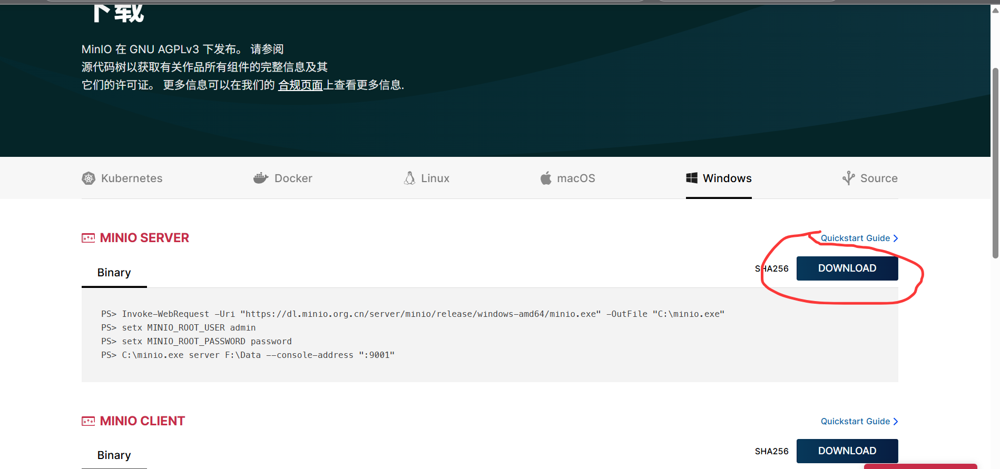
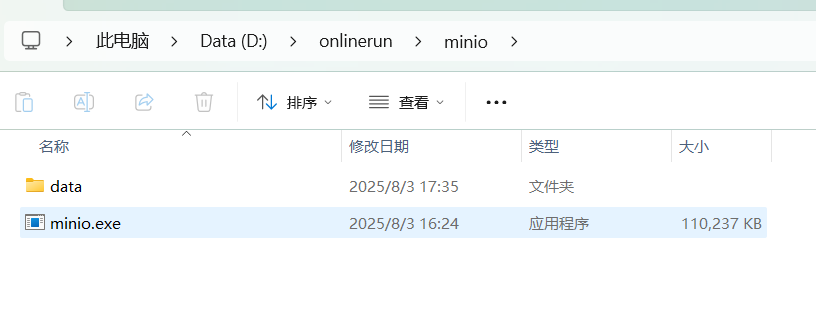
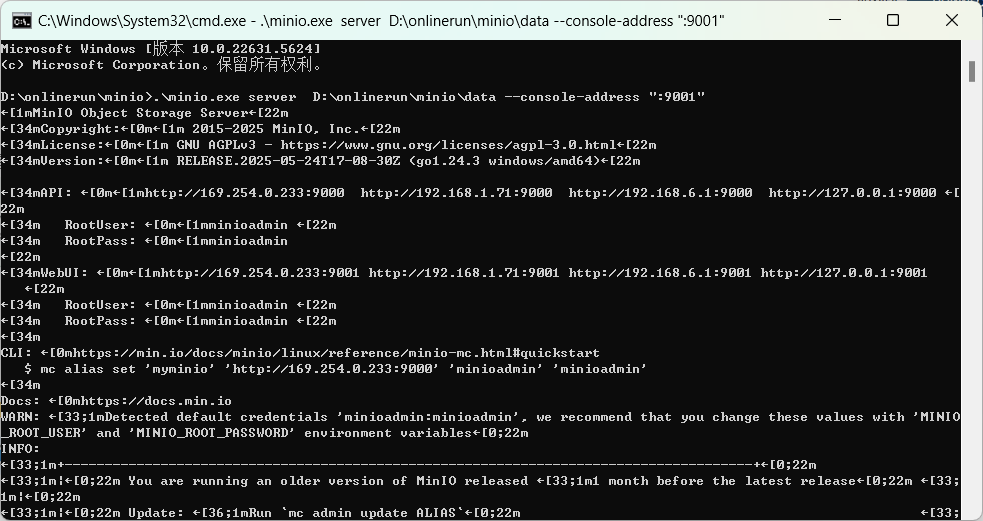
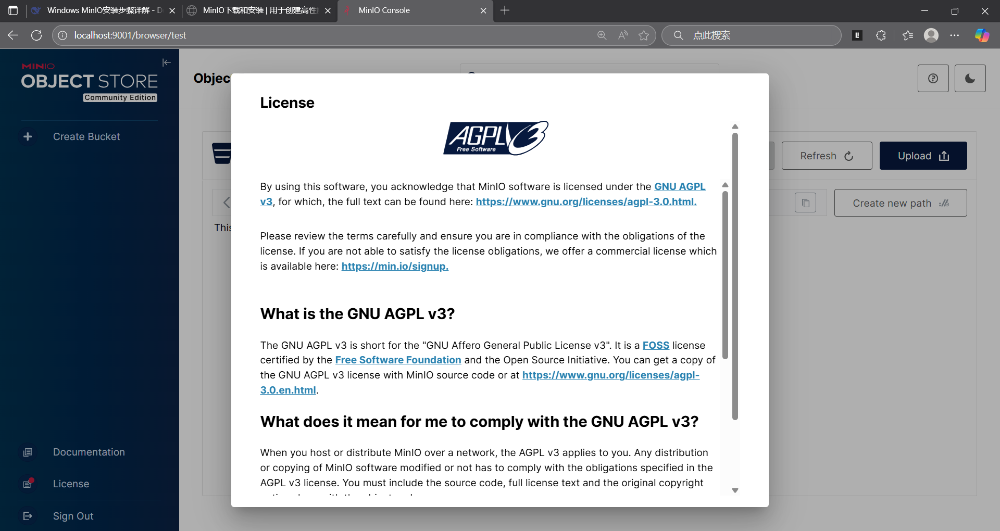
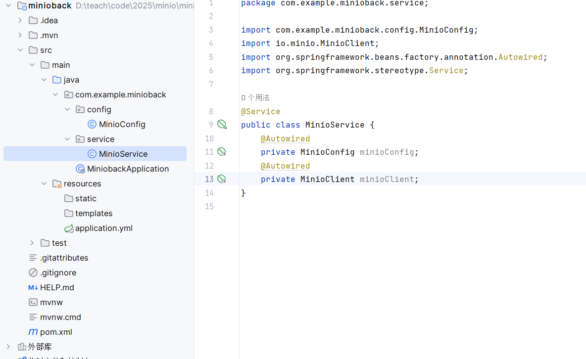
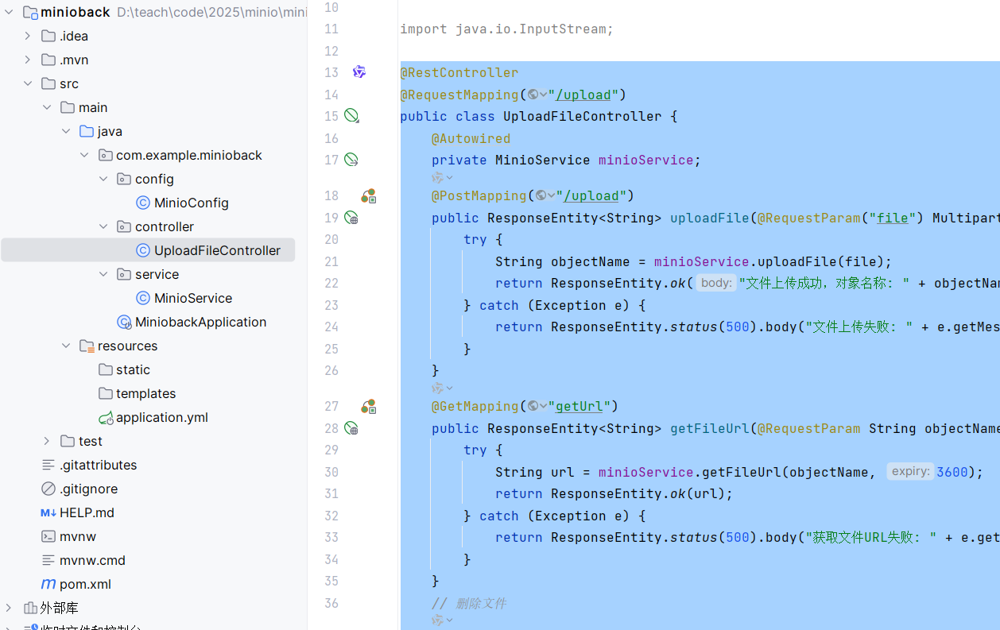
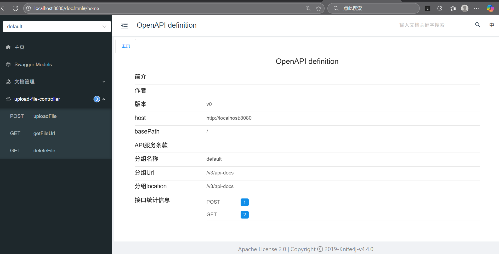

# MinIO 与 Spring Boot 集成

## 一、本地启动 MinIO

以下截图记录的是 Windows 上使用 `minio.exe` 的本地实验。下载渠道和安装方式随发行版而异。



在同一目录放置 `minio.exe`，并创建用于存放对象的 `data` 目录。



在该目录打开终端并运行：

```powershell
.\minio.exe server .\data --console-address ":9001"
```



打开 <http://localhost:9001>，使用本地实例配置的账号和密码登录，并创建本例使用的 `testminio` 存储桶。后端连接的是 S3 API 端口 `9000`。



---

## 二、配置 Spring Boot

**1.引入依赖**

```xml
<dependencies>
    <!-- Spring Boot Web 启动器：提供 MVC、RESTful 接口、嵌入式 Tomcat 等 Web 开发核心能力 -->
    <dependency>
        <groupId>org.springframework.boot</groupId>
        <artifactId>spring-boot-starter-web</artifactId>
    </dependency>

    <!-- Spring Boot 开发工具：支持热部署（自动重启）、LiveReload，提升开发效率，仅在运行时生效 -->
    <dependency>
        <groupId>org.springframework.boot</groupId>
        <artifactId>spring-boot-devtools</artifactId>
        <scope>runtime</scope>
        <optional>true</optional>
    </dependency>

    <!-- Spring Boot 测试启动器：集成 JUnit、Mockito、AssertJ 等，用于单元测试和集成测试 -->
    <dependency>
        <groupId>org.springframework.boot</groupId>
        <artifactId>spring-boot-starter-test</artifactId>
        <scope>test</scope>
    </dependency>

    <!-- Lombok：通过注解自动生成 getter/setter、构造器、日志变量等，减少样板代码 -->
    <dependency>
        <groupId>org.projectlombok</groupId>
        <artifactId>lombok</artifactId>
        <optional>true</optional>
    </dependency>

    <!-- Knife4j（OpenAPI 3 版）：生成美观的 API 文档，支持在线调试，基于 Jakarta 规范 -->
    <dependency>
        <groupId>com.github.xiaoymin</groupId>
        <artifactId>knife4j-openapi3-jakarta-spring-boot-starter</artifactId>
        <version>4.4.0</version>
    </dependency>

    <!-- MinIO 客户端：用于连接 MinIO 或兼容 S3 的对象存储服务，实现文件上传、下载和管理 -->
    <dependency>
        <groupId>io.minio</groupId>
        <artifactId>minio</artifactId>
        <version>8.5.17</version>
    </dependency>
</dependencies>
```

**2.添加minio相关配置**（application.yml）

```yaml
spring:
  application:
    name: minioback
server:
  port: 8080
minio:
  access-key: ${MINIO_ACCESS_KEY}
  secret-key: ${MINIO_SECRET_KEY}
  endpoint: http://localhost:9000
  bucket: testminio
knife4j:
  setting:
    language: zh_cn
  enable: true
```

将 `MINIO_ACCESS_KEY` 和 `MINIO_SECRET_KEY` 设置为有权访问 `testminio` 的本地实验凭据，再创建配置类。

```java
@Configuration
@ConfigurationProperties(prefix = "minio")
@Data
public class MinioConfig {
    private String endpoint;
    private String accessKey;
    private String secretKey;
    private String bucket;
    @Bean
    public MinioClient minioClient() {
        return MinioClient.builder()
                .endpoint(endpoint)
                .credentials(accessKey, secretKey)
                .build();
    }
}
```

---

## 三、创建服务类

**1.创建MinioService.并注入MinioConfig以及MinioClient**

```java
@Service
public class MinioService {
    @Autowired
    private MinioConfig minioConfig;
    @Autowired
    private MinioClient minioClient;
}
```

**目前的目录结构：**



---

## 四、操作对象

以下方法定义在 `MinioService` 中。接口用对象键定位文件。对象键和原始文件名可按需分别保存。[MinIO Java SDK 8.5.17](https://github.com/minio/minio-java/tree/8.5.17)

### 1. 上传文件

```java
    /**
     * 上传文件到MinIO
     * @param file 要上传的文件（Spring MultipartFile）
     * @return 文件在MinIO中的唯一标识（对象名称）
     */
    public String uploadFile(MultipartFile file) throws Exception {
        String objectName = UUID.randomUUID().toString();
        String contentType = file.getContentType();
        try (InputStream stream = file.getInputStream()) {
            minioClient.putObject(
                    PutObjectArgs.builder()
                            .bucket(minioConfig.getBucket())
                            .object(objectName)
                            .stream(stream, file.getSize(), -1)
                            .contentType(contentType == null ? "application/octet-stream" : contentType)
                            .build());
        }
        return objectName;
    }
```

### 2. 获取临时访问 URL

```java
	/**
     * 获取文件临时访问URL（适合前端直接下载）
     * @param objectName 文件在MinIO中的唯一标识
     * @param expiry 有效期（单位：分钟）
     * @return 可访问的URL
     */
    public String getFileUrl(String objectName, int expiry) throws Exception {
        return minioClient.getPresignedObjectUrl(
                GetPresignedObjectUrlArgs.builder()
                        .method(Method.GET)
                        .bucket(minioConfig.getBucket())
                        .object(objectName)
                        .expiry(expiry, TimeUnit.MINUTES)
                        .build());
    }
```

浏览器必须能访问预签名 URL 中的 S3 API 地址。使用 `localhost` 作为端点时，该地址只适用于与 MinIO 同机的浏览器。

### 3. 删除文件

```java
 	/**
     * 删除文件
     * @param objectName 文件在MinIO中的唯一标识
     */
    public void deleteFile(String objectName) throws Exception {
        minioClient.removeObject(
                RemoveObjectArgs.builder()
                        .bucket(minioConfig.getBucket())
                        .object(objectName)
                        .build());
    }
```

---

## 五、测试

### 1. 创建控制器

创建 `UploadFileController`。本例的上传路径为 `POST /upload/upload`，文件字段名为 `file`。

```java
@RestController
@RequestMapping("/upload")
public class UploadFileController {
    @Autowired
    private MinioService minioService;
    @PostMapping("/upload")
    public ResponseEntity<String> uploadFile(@RequestParam("file") MultipartFile file) {
        try {
            String objectName = minioService.uploadFile(file);
            return ResponseEntity.ok("文件上传成功，对象名称: " + objectName);
        } catch (Exception e) {
            return ResponseEntity.status(500).body("文件上传失败: " + e.getMessage());
        }
    }
    @GetMapping("/getUrl")
    public ResponseEntity<String> getFileUrl(@RequestParam String objectName) {
        try {
            String url = minioService.getFileUrl(objectName, 60);
            return ResponseEntity.ok(url);
        } catch (Exception e) {
            return ResponseEntity.status(500).body("获取文件URL失败: " + e.getMessage());
        }
    }
    // 删除文件
    @DeleteMapping("/delete")
    public ResponseEntity<String> deleteFile(@RequestParam String objectName) {
        try {
            minioService.deleteFile(objectName);
            return ResponseEntity.ok("文件删除成功");
        } catch (Exception e) {
            return ResponseEntity.status(500).body("文件删除失败: " + e.getMessage());
        }
    }
}
```

当前目录



### 2. 启动项目并验证

打开 <http://localhost:8080/doc.html>。上传后复制返回的对象键，用 `GET /upload/getUrl` 获取访问地址，再用 `DELETE /upload/delete` 验证删除。

看到如下画面就可以测试了：



后面测试内容请看视频讲解

[配套网课](https://www.bilibili.com/video/BV1CWtJz1EcX?spm_id_from=333.788.player.switch&vd_source=e0c0ad2a316e90d4078b1131e8182407&p=5)

---
