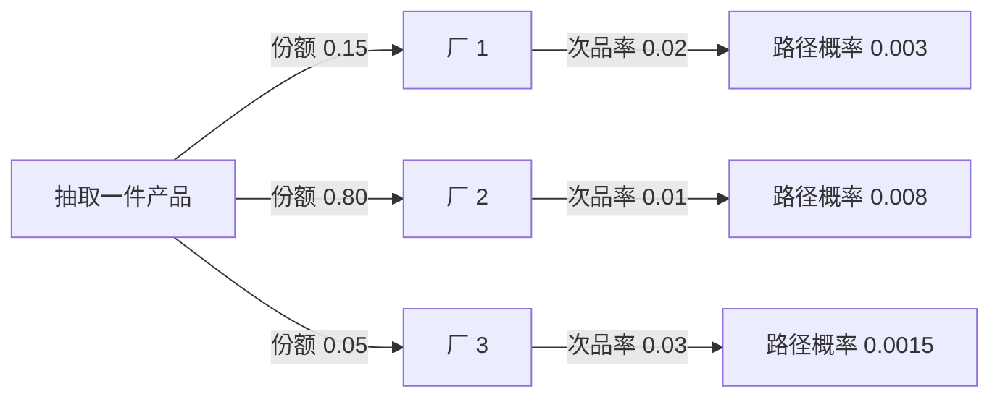
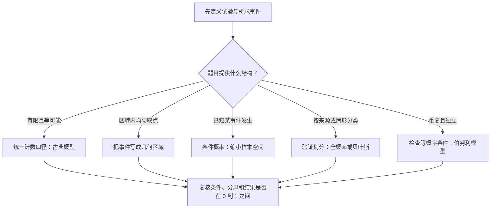

# 第 1 章 随机事件与概率

> [!note] 本章主线
> **先描述结果，再表示事件，最后选择概率模型。** 本章依次解决：试验有哪些结果、所求事件怎样写、为什么可以使用某个公式。
>
> 记号约定：$AB=A\cap B$，$\overline A=\Omega\setminus A$；$A\cup B$ 有时简写为 $A+B$，但这里的“加号”表示事件的并，不是把概率直接相加。$\subseteq$ 表示允许相等的包含关系。

---

## §1.1 随机事件：先把问题写成集合

### 1.1.1 随机试验、样本空间与样本点

确定性现象在给定条件下结果确定；随机现象在给定条件下仍不能预知单次结果，但可通过概率模型研究其规律。初等课程中的随机试验通常强调：可以在相同条件下重复；可能结果可描述；单次结果事先不确定。

| 概念 | 含义 | 例：连续掷两次硬币 |
|---|---|---|
| 随机试验 $E$ | 观察并记录随机现象的过程 | 记录两次正反面 |
| 样本空间 $\Omega$ | 全部可能结果的集合 | $\{HH,HT,TH,TT\}$ |
| 样本点 $\omega$ | 一次完整试验的一个结果 | $HT$ |
| 基本事件 $\{\omega\}$ | 只含一个样本点的事件 | $\{HT\}$ |
| 事件 $A$ | 所讨论的一组结果；发生指实际结果落入其中 | “恰有一次正面”是 $\{HT,TH\}$ |
| 必然事件 | 包含所有结果 | $\Omega$ |
| 不可能事件 | 不包含任何结果 | $\varnothing$ |

样本空间可以有限、可列无限或不可列无限；样本点可以是数字、序列、平面坐标，也可以是其他对象。记录方式取决于所研究的问题。

> [!warning] 换一种记录方式，等可能性可能消失
> 两次公平独立抛硬币的四个有序结果等可能；若只记录正面次数，得到 0、1、2，其概率分别是 $1/4,1/2,1/4$，并不等可能。不能把“有三种结果”直接解释为“每种概率都是 $1/3$”。

### 1.1.2 事件的关系与运算

| 关系或运算 | 集合表达 | 发生含义 |
|---|---|---|
| 包含 | $A\subseteq B$ | A 发生必有 B 发生 |
| 相等 | $A=B$ | 两事件包含完全相同的样本点 |
| 并 | $A\cup B$ | 至少一个发生，包括同时发生 |
| 交 | $A\cap B=AB$ | 两者同时发生 |
| 差 | $A\setminus B=A\overline B$ | A 发生而 B 不发生 |
| 对立 | $\overline A$ | A 不发生 |
| 互斥 | $AB=\varnothing$ | 两者不能同时发生 |

互斥只要求不能同时发生；对立还要求穷尽样本空间。例如掷一次骰子，“点数为 1”与“点数为 2”互斥，却不是对立事件，因为还可能出现 3～6。

**常用运算律**：交换、结合、分配律均适用；尤其要熟悉德摩根律：

$$\overline{A\cup B}=\overline A\cap\overline B,\qquad \overline{AB}=\overline A\cup\overline B$$

$$A=AB\cup A\overline B,\qquad A\setminus B=A\overline B$$

$AB$ 与 $A\overline B$ 互斥，因此按“B 是否发生”可以把 A 拆成两部分。这一分解会反复用于减法公式、独立性证明和全概率公式。

### 1.1.3 把“至少、至多、恰好”翻译成事件

设 $A_i$ 表示第 i 个部件正常，考虑三个部件：

| 文字要求 | 事件表达 |
|---|---|
| 至少一个正常 | $A_1\cup A_2\cup A_3=\overline{\overline A_1\overline A_2\overline A_3}$ |
| 三个都正常 | $A_1A_2A_3$ |
| 恰好一个正常 | $A_1\overline A_2\overline A_3\cup\overline A_1A_2\overline A_3\cup\overline A_1\overline A_2A_3$ |
| 恰好两个正常 | $A_1A_2\overline A_3\cup A_1\overline A_2A_3\cup\overline A_1A_2A_3$ |
| 至多一个正常 | “全不正常”与“恰好一个正常”的并 |
| 不全正常 | $\overline{A_1A_2A_3}=\overline A_1\cup\overline A_2\cup\overline A_3$ |

> [!tip] “至少一个”与“并非全部”不要混淆
> “至少一个正常”的对立是“全部不正常”；“不全正常”的对立是“全部正常”。先翻译成集合，再使用概率公式。

---

## §1.2 概率：满足公理的数量描述

### 1.2.1 频数、频率与概率

重复试验 n 次，A 发生 $n_A$ 次，则频率为：

$$f_n(A)=\frac{n_A}{n}$$

频率是实际观察的比例，会随试验结果而变；概率 $P(A)$ 是模型中描述 A 发生可能性的数。在独立同分布等条件下，大数定律解释了频率为什么会以相应意义接近概率。

> [!warning] 次数增多，不代表频率每一步都更靠近概率
> 若 $P(A)=1/2$，前 100 次出现 A 的次数少于 50，并不意味着下一次 A 的概率就必须大于 $1/2$。独立试验不会为了“补齐过去的偏差”而改变下一次概率。

### 1.2.2 概率三公理

对所讨论的事件赋予数值 $P(A)$，要求：

1. 非负性：$P(A)\ge0$。
2. 规范性：$P(\Omega)=1$。
3. 可列可加性：若 $A_1,A_2,\ldots$ 两两互斥，则

$$P\left(\bigcup_{i=1}^{\infty}A_i\right)=\sum_{i=1}^{\infty}P(A_i)$$

第三条中的“两两互斥”是直接相加的前提。对任意两个事件，重叠部分需要扣除。

### 1.2.3 从公理得到常用运算公式

| 性质 | 公式 | 条件或解释 |
|---|---|---|
| 空事件 | $P(\varnothing)=0$ | 不可能事件概率为 0 |
| 范围 | $0\le P(A)\le1$ | 任意事件 |
| 求对立 | $P(\overline A)=1-P(A)$ | 任意事件 |
| 加法公式 | $P(A\cup B)=P(A)+P(B)-P(AB)$ | 任意两事件 |
| 减法公式 | $P(A\setminus B)=P(A)-P(AB)$ | 注意一般不能减成 $P(A)-P(B)$ |
| 单调性 | $A\subseteq B\Rightarrow P(A)\le P(B)$ | 包含保证概率不减 |
| 包含时的差 | $P(B\setminus A)=P(B)-P(A)$ | 要求 $A\subseteq B$ |

**加法公式的推导**：$A\cup B=A\cup(B\setminus A)$，右侧两部分互斥；又由 $B=AB\cup(B\setminus A)$ 得 $P(B\setminus A)=P(B)-P(AB)$，代入即得。

三个事件的容斥公式：

$$P(A\cup B\cup C)=P(A)+P(B)+P(C)-P(AB)-P(AC)-P(BC)+P(ABC)$$

推广到 n 个事件：

$$P\left(\bigcup_{i=1}^n A_i\right)=\sum_iP(A_i)-\sum_{i<j}P(A_iA_j)+\sum_{i<j<k}P(A_iA_jA_k)-\cdots+(-1)^{n-1}P(A_1\cdots A_n)$$

直观上，先逐个加会重复计算交集，于是扣除两两交集；三重交集又被扣得过多，需要加回。

> [!warning] 概率为 0、1，不等于集合一定是空集、全集
> $X\sim U(0,1)$ 时，“$X=1/2$”的概率是 0，但对应集合不是空集；“$X\ne1/2$”的概率是 1，也不等于整个样本空间。概率 0 的事件称为零概率事件，不能普遍替换成“不可能事件”。

---

## §1.3 古典概型与几何概型：先检查是否均匀

### 1.3.1 古典概型的前提

古典概型要求**样本点有限且等可能**。若总样本点数为 N，事件 A 包含 m 个样本点：

$$P(A)=\frac{m}{N}$$

分子、分母必须采用同一种计数口径：不能分母数有序结果、分子数无序组合。

### 1.3.2 排列组合怎样选

| 取样方式 | 是否计顺序 | 从 N 个不同对象中取 n 个的结果数 |
|---|---|---|
| 不放回 | 计顺序 | $A(N,n)=N!/(N-n)!$ |
| 不放回 | 不计顺序 | $\binom Nn=N!/[n!(N-n)!]$ |
| 放回 | 计顺序 | $N^n$ |

例如从 5 人中选 2 人：选队长和副队长有 $A(5,2)=20$ 种；只选两名代表有 $\binom52=10$ 种。“放回但不计顺序”的各类结果通常不等可能，不能只数种类后直接求比值。

> [!tip] 计数题先写四件事
> 对象是否可区分、是否放回、是否计顺序、每个基本结果是否等可能。只要其中一个条件变化，样本空间和概率模型都可能变化。

### 1.3.3 四类常见古典模型

**模型一：球入盒。** n 个可区分的球，分别独立、等概率地放入 N 个可区分的盒子，共 $N^n$ 种等可能结果。假设 $n\le N$：

- 若要求事先指定的 n 个盒子各有 1 球，其余为空，有 $n!$ 种放法，概率为 $n!/N^n$。
- 若只要求没有两球同盒，先选 n 个盒子再分配，概率为

$$\frac{\binom Nn n!}{N^n}=\frac{A(N,n)}{N^n}$$

**模型二：不放回抽样。** 总共 a 件次品、b 件正品，等概率抽 n 件，恰好 k 件次品：

$$P(X=k)=\frac{\binom ak\binom b{n-k}}{\binom{a+b}n}$$

要同时满足 $0\le k\le a$、$0\le n-k\le b$。这是第二章超几何分布的来源。

**模型三：抽签公平性。** 总计 a 张中奖签、b 张未中奖签，随机排列后逐人不放回抽取。第 k 个位置的每张签具有对称地位，所以事先看：

$$P(\text{第 k 人中奖})=\frac{a}{a+b}$$

但若已经知道前面抽走了多少中奖签，后续的**条件概率**会变化。例如 2 张中奖、3 张未中奖，已知首人中奖，则第二人中奖的条件概率为 $1/4$，不再是 $2/5$。

**模型四：生日问题。** 假设每人生日独立且均匀分布在 365 天，忽略闰日。当 $1\le n\le365$：

$$P(\text{至少两人同生日})=1-\frac{365\times364\times\cdots\times(365-n+1)}{365^n}$$

n=23 时约 0.5073，n=50 时约 0.9704；n≥366 时由抽屉原理，概率为 1。“有人同生日”比“有人和指定的人同生日”更容易发生，二者不能混算。

### 1.3.4 几何概型：概率是区域占比

在长度、面积或体积有限的区域 $\Omega$ 内按相应测度**均匀取点**，且 $0<m(\Omega)<\infty$，则：

$$P(A)=\frac{m(A)}{m(\Omega)}$$

这里的均匀性指等测度区域具有相同概率，不是仅凭“每个单点概率相同”就可以判定。若区域上的分布不均匀，需要用概率密度积分，不能直接做面积比。

### 1.3.5 会面问题：画出条件，再计算面积

两船分别独立、均匀地在 24 小时内到达，先到者等待 6 小时。设到达时刻为 X、Y，则样本空间是 $[0,24]^2$，会面条件为：

$$|X-Y|\le6$$

> [!example] 图形含义：正方形中的一条对角带
> 以 X 为横轴、Y 为纵轴，画 $y=x-6$ 与 $y=x+6$。两线之间与正方形相交的部分是会面区域；剩下的是左上、右下两个直角三角形，**不是减去右上角一个小正方形**。

| 区域 | 条件 | 面积 |
|---|---|---:|
| 全部到达组合 | $0\le x,y\le24$ | $24^2$ |
| Y 到得太晚 | $y>x+6$ | $\tfrac12(24-6)^2$ |
| X 到得太晚 | $x>y+6$ | $\tfrac12(24-6)^2$ |

$$P(\text{会面})=1-\frac{2\times\frac12(24-6)^2}{24^2}=\frac{252}{576}=\frac7{16}=0.4375$$

一般地，独立均匀到达于 $[0,T]$、先到者等待 w，$0\le w\le T$ 时：$P=1-(T-w)^2/T^2$。双方等待时间不同时，要分别写不等式，不能直接套对称图形。

### 1.3.6 蒲丰投针：公式还依赖长度与角度条件

平行线间距为 a，针长 L，假设 $0<L\le a$，针中心位置和方向按标准均匀模型独立产生。令 D 为中心到最近平行线的距离，$\Theta$ 为针与平行线的锐角，则相交条件为：

$$D\le\frac L2\sin\Theta,\qquad 0\le D\le a/2,\quad0\le\Theta\le\pi/2$$

按该矩形区域的面积比例积分：

$$P(\text{相交})=\frac{\int_0^{\pi/2}(L/2)\sin\theta\,\mathrm d\theta}{(a/2)(\pi/2)}=\frac{2L}{a\pi}$$

当 $L>a$ 时，相交区域形状改变，不能直接使用这个短针公式。用实验频率估计相交概率、进而估计 $\pi$，体现了蒙特卡罗方法的思想。

---

## §1.4 条件概率与乘法公式：先明确条件写在哪边

### 1.4.1 条件概率的定义

已知 A 发生，讨论 B 的概率，在 $P(A)>0$ 时：

$$P(B\mid A)=\frac{P(AB)}{P(A)}$$

可以把它理解为：**只保留 A 内的结果，再看其中有多少属于 B**。条件写在竖线右边，分母就是条件事件的概率。

> [!example] 缩小样本空间
> 从 1～10 等概率取一个整数，已知取到偶数。条件事件 $A=\{2,4,6,8,10\}$，其中 3 的倍数只有 6，因此 $P(B\mid A)=1/5$。
>
> 反过来，已知是 3 的倍数时，候选为 $\{3,6,9\}$，取到偶数的概率为 $P(A\mid B)=1/3$。两个方向的条件概率通常不同。

固定条件 A 后，$P(\cdot\mid A)$ 仍满足概率公理，所以：

$$P(\overline B\mid A)=1-P(B\mid A)$$
$$P(B\cup C\mid A)=P(B\mid A)+P(C\mid A)-P(BC\mid A)$$

注意对立的是左侧的事件 B；$P(B\mid\overline A)$ 一般不等于 $1-P(B\mid A)$。

### 1.4.2 乘法公式与逐次事件

由定义直接整理可得：

$$P(AB)=P(A)P(B\mid A)=P(B)P(A\mid B)$$

对应条件概率的分母必须大于 0。推广到 n 个事件：

$$P(A_1\cdots A_n)=P(A_1)P(A_2\mid A_1)\cdots P(A_n\mid A_1\cdots A_{n-1})$$

这就是“沿着一条路径逐步相乘”。它不要求事件独立；若独立，条件概率才可简化为各自的无条件概率。

### 1.4.3 波利亚罐子：分子、分母必须同步更新

袋中最初有 a 个红球、b 个白球、c 个黑球，令总数 $N=a+b+c$。每次等概率取一球，**放回原球，再增加 d 个同色球**，其中 d 为正整数。

前三次均取到红球的概率为：

$$\frac aN\cdot\frac{a+d}{N+d}\cdot\frac{a+2d}{N+2d}$$

> [!example] 完整代入
> 初始红球 2、白球 1、黑球 1，每次额外加 1 个同色球，则三次均红的概率为
>
> $$\frac24\cdot\frac35\cdot\frac46=\frac15$$
>
> 第一次若取红，第二次取红的概率会由 $1/2$ 变为 $3/5$，所以各次取色并不独立。用 d 表示增添数量，可以避免与初始黑球数 c 混淆。

---

## §1.5 全概率公式与贝叶斯公式：按情形分解，再反向更新

### 1.5.1 完备事件组与全概率公式

若 $B_1,\ldots,B_n$ 两两互斥且并为 $\Omega$，则构成一个划分。使用下面的条件概率形式时，另要求各 $P(B_i)>0$；零概率项可单独略去。

因为 $A=AB_1\cup\cdots\cup AB_n$，这些部分互斥，所以：

$$P(A)=\sum_{i=1}^nP(AB_i)=\sum_{i=1}^nP(B_i)P(A\mid B_i)$$

> [!tip] 划分要互斥、穷尽；不必解释为因果关系
> $B_i$ 可以是厂家、机器、渠道或人群等分类。“由因求果”只是帮助记忆；全概率和贝叶斯公式本身处理的是概率关系，并不证明因果关系。

### 1.5.2 同一道厂家题同时理解全概率与贝叶斯

三个厂家的产品混放，先等概率抽取混合总体中的一件产品。令 A 表示次品，$B_i$ 表示来自第 i 厂：

| 来源 | 总体份额 $P(B_i)$ | 次品率 $P(A\mid B_i)$ | 来自该厂且为次品 $P(AB_i)$ |
|---|---:|---:|---:|
| 厂 1 | 0.15 | 0.02 | 0.003 |
| 厂 2 | 0.80 | 0.01 | 0.008 |
| 厂 3 | 0.05 | 0.03 | 0.0015 |
| 合计 | 1 | — | 0.0125 |

**问题一：抽到次品的概率？** 将最后一列相加：$P(A)=0.0125$。

图中只展开每个厂的“次品”分支；每条路径相乘，不同来源的路径相加。

**问题二：已知是次品，来自厂 2 的概率？** 条件事件变为 A，需要把各条次品路径重新归一化：

$$P(B_2\mid A)=\frac{P(B_2)P(A\mid B_2)}{P(A)}=\frac{0.008}{0.0125}=0.64$$

原来厂 2 占 80%，在次品中却只占 64%。总体份额与次品中的份额不是同一分母。

### 1.5.3 贝叶斯公式

在 $P(A)>0$ 时：

$$P(B_i\mid A)=\frac{P(B_i)P(A\mid B_i)}{\sum_{j=1}^nP(B_j)P(A\mid B_j)}$$

| 量 | 含义 |
|---|---|
| 先验 $P(B_i)$ | 观察 A 之前对来源或类别的概率描述 |
| 条件概率 $P(A\mid B_i)$ | 给定类别时观察到 A 的概率 |
| 证据概率 $P(A)$ | 所有类别产生 A 的总概率 |
| 后验 $P(B_i\mid A)$ | 观察 A 后对类别概率的更新 |

### 1.5.4 低基率陷阱：用人数或件数解释更直观

考虑纯数学筛查模型：严重缺陷率 $P(C)=0.0004$，有缺陷时报警的概率 $P(A\mid C)=0.95$，无缺陷时仍报警的概率 $P(A\mid\overline C)=0.10$。

$$P(C\mid A)=\frac{0.0004\times0.95}{0.0004\times0.95+0.9996\times0.10}\approx0.003787\approx0.38\%$$

> [!example] 按 100 万件的期望数量计算
> 预计有缺陷 400 件，其中报警 380 件；无缺陷 999,600 件，其中误报 99,960 件。全部报警 100,340 件，真正有缺陷的比例就是 $380/100340$。
>
> 检出率高，不代表“报警后有缺陷的概率”一定高。后验还取决于缺陷的先验比例和误报率。这里的数量是模型期望值，不表示实际每批必定恰有这么多件。

---

## §1.6 事件独立性与伯努利试验

### 1.6.1 两事件独立：定义要用乘积关系

$$A\text{ 与 }B\text{ 独立}\quad\Longleftrightarrow\quad P(AB)=P(A)P(B)$$

当 $P(A)>0$ 时，等价于 $P(B\mid A)=P(B)$；当 $P(B)>0$ 时，等价于 $P(A\mid B)=P(A)$。若分母为 0，对应条件概率在本章定义下没有意义，但乘积定义仍可使用。

| 对比 | 互斥 | 独立 |
|---|---|---|
| 数学条件 | $AB=\varnothing$ | $P(AB)=P(A)P(B)$ |
| 关注点 | 事件能否同时发生 | 发生概率之间的关系 |
| 当两者概率均为正 | A 发生会排除 B | A 发生不改变 B 的概率 |

因此正概率事件不可能既互斥又独立。若 $P(A)=0$，则 $P(AB)=0=P(A)P(B)$，A 与任意 B 都独立，这是使用定义得到的边界情形。

### 1.6.2 独立性对取对立事件保持

若 A、B 独立，则 A 与 $\overline B$、$\overline A$ 与 B、$\overline A$ 与 $\overline B$ 均独立。例如：

$$P(\overline AB)=P(B)-P(AB)=P(B)[1-P(A)]=P(\overline A)P(B)$$

这也是求“至少一个发生”时可以先算“一个都不发生”的重要依据。

### 1.6.3 两两独立不等于相互独立

三个事件相互独立，需要同时满足：

$$P(AB)=P(A)P(B),\quad P(AC)=P(A)P(C),\quad P(BC)=P(B)P(C)$$
$$P(ABC)=P(A)P(B)P(C)$$

只满足前三条称为两两独立；只满足最后一条，也不能反过来推出相互独立。

> [!example] 四球反例：验算到三重交才看出差别
> 等概率取四只球之一：前三只分别仅涂红、白、黑，第四只涂三色。A、B、C 分别表示有红、白、黑。
>
> 每个事件概率为 $1/2$，任意两事件的交都只包含三色球，所以交概率为 $1/4$，两两独立；但 $P(ABC)=1/4\ne1/8$，不相互独立。

n 个事件相互独立，要求对任意至少含两个事件的子组都有乘积关系。需要验证的等式数为：

$$\sum_{k=2}^n\binom nk=2^n-n-1$$

相互独立的事件中任意若干个换成对立事件，所得事件组仍相互独立。

### 1.6.4 系统可靠性：先把工作条件翻译成事件

假设各元件正常事件**相互独立**，正常概率为 $p_i$：

| 系统 | 工作条件 | 可靠性 |
|---|---|---|
| 串联 | 所有元件正常 | $R_s=\prod_{i=1}^n p_i$ |
| 并联 | 至少一个元件正常 | $R_p=1-\prod_{i=1}^n(1-p_i)$ |

例如三个元件的可靠性均为 0.9，串联系统可靠性为 $0.9^3=0.729$，并联系统为 $1-0.1^3=0.999$。若有共同供电故障等依赖关系，就不能直接套独立乘积公式。

### 1.6.5 n 重伯努利试验与二项概率

一轮伯努利试验只记录成功与失败。独立重复 n 次、每次成功概率均为 p，令 q=1-p，则恰好成功 k 次的概率为：

$$P(X=k)=\binom nkp^kq^{n-k},\qquad k=0,1,\ldots,n$$

推导分两步：一条指定成功位置的序列概率为 $p^kq^{n-k}$；可以选择的成功位置有 $\binom nk$ 个，且这些序列互斥，因此相加得到上式。

> [!warning] 二项模型的三个条件缺一不可
> 次数固定、各次独立、成功概率相同。不放回抽样通常不独立；不同产品具有不同缺陷率时也不能直接使用同一个 p。近似使用要另行说明条件。

**例：10 年内至少出现两次某事件。** 假设每年发生概率 0.1，且各年独立：

$$P(X\ge2)=1-P(X=0)-P(X=1)=1-0.9^{10}-10\times0.1\times0.9^9\approx0.2639$$

---

## 本章解题流程与公式速查

| 要算什么 | 公式或方法 | 先检查什么 |
|---|---|---|
| 至少一个发生 | $1-P(\text{全部不发生})$ | 是否容易算对立事件 |
| A 或 B | $P(A)+P(B)-P(AB)$ | 重叠部分不能重复计入 |
| A 发生而 B 不发生 | $P(A)-P(AB)$ | 不能一般地减 $P(B)$ |
| 给定 A 后的 B | $P(B\mid A)=P(AB)/P(A)$ | $P(A)>0$ |
| 一条逐次路径 | 条件概率连乘 | 各条件分母非零 |
| 不同来源下的总概率 | $\sum_iP(B_i)P(A\mid B_i)$ | 来源互斥且穷尽 |
| 已知结果后推来源 | 该来源的路径概率 ÷ 结果总概率 | $P(A)>0$ |
| 独立事件同时发生 | 概率乘积 | 独立性已给定或已证明 |
| 固定 n 次成功 k 次 | $\binom nkp^k(1-p)^{n-k}$ | 固定次数、独立、同一 p |

> [!note] 小概率事件原理怎样使用
> 在一个给定假设下，**事先指定**的小概率事件若实际发生，可以成为质疑假设的证据，但不等于逻辑上证明假设必错。不能先观察结果，再把“恰好出现这个复杂结果”的小概率当成异常证据。

---

## 与第二章的衔接

本章直接研究事件，下一章把“成功次数、等待时间、测量值”等结果记为随机变量 X，转而研究 $P(X\in G)$。二项概率和不放回抽样会分别成为二项分布、超几何分布。

[继续阅读：第二章 随机变量及其分布](<第二章 随机变量及其分布.md>)

自测题见 [第一章 习题](<../../习题/第一章 随机事件与概率 习题.md>)。
