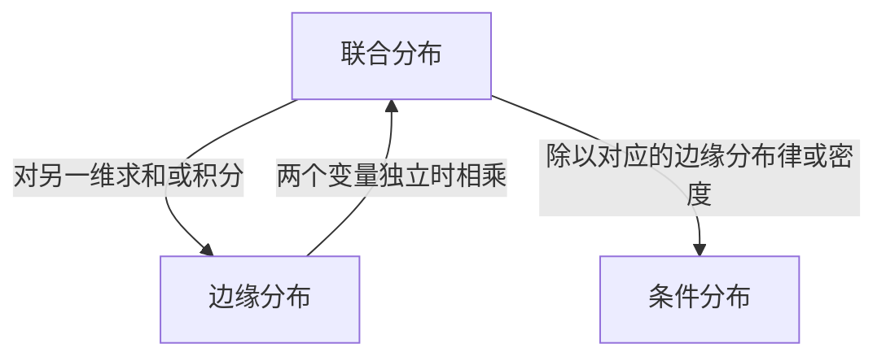

# 第 3 章 二维随机变量及其分布

[← 回顾第二章 随机变量及其分布](<第二章 随机变量及其分布.md>)

> [!note] 本章主线
> 从一个随机变量扩展到两个，先看它们怎样**一起取值**，再看单个变量的分布，以及给定另一个变量后的分布。

---

## §3.1 多维随机变量的概念

一次试验可以同时记录多个量，比如学生的身高和体重、零件的口径和重量。把 $n$ 个随机变量写成 $(X_1,\dots,X_n)$，就得到一个 **$n$ 维随机变量**。本章以 $(X,Y)$ 为例，用分布表、公式和区域描述两个变量怎样一起取值。

### 3.1.1 怎样判断同分布

若对所有实数 $t$ 都有 $F_X(t)=F_Y(t)$，则称 $X$ 与 $Y$ **同分布**，记作 $X\overset{d}{=}Y$。离散型可以逐点比较概率，有密度时可以比较密度是否几乎处处相等。随机变量各自的样本空间可以不同。

> [!warning] 比较密度时要看取值区间
> $U(0,1)$ 和 $U(1,2)$ 的密度在各自区间内都等于 1，但前者落在 $(0,1)$ 的概率为 1，后者为 0。比较分布时，要把区间内外一起看。

**同分布**比较各自的边缘分布，**独立性**比较联合分布与边缘分布的乘积。§3.5 的不放回抽球例子同时用到了这两个判断。

---

## §3.2 二维离散型随机变量及其分布

若 $(X,Y)$ 的概率集中在有限或可列个取值对上，就可以用**联合分布律**描述它。

### 3.2.1 联合分布律

联合分布律的每一项给出 $X=x_i$ 且 $Y=y_j$ 的概率。

$$f(x_i,y_j)=P\{X=x_i, Y=y_j\}=p_{ij},\quad i,j=1,2,\cdots$$

不可能取到的数对对应概率为 0。各项概率非负，且 $\sum_i\sum_j p_{ij}=1$。

| 分布表 | 怎样读 |
| --- | --- |
| 条形表 | 逐个列出取值对及其概率 |
| 矩形表 | 用行标记 $X$、用列标记 $Y$，交叉单元格填入 $p_{ij}$ |

求区域 $G$ 的概率时，把落入区域的取值对所对应的概率相加。

$$P\{(X,Y)\in G\}=\sum_{(x_i,y_j)\in G}p_{ij}$$

### 3.2.2 边缘分布律与条件分布律

#### 边缘分布律

只关心一个变量时，把另一个变量的所有可能取值加总。

$$P\{X=x_i\}=\sum_j p_{ij}\triangleq p_{i\cdot},\qquad P\{Y=y_j\}=\sum_i p_{ij}\triangleq p_{\cdot j}$$

在矩形表中，$X$ 的边缘概率在**行末**，$Y$ 的边缘概率在**列底**。

#### 条件分布律

给定 $Y=y_j$ 时，只看该列，再把每个单元格除以列总概率。若 $p_{\cdot j}>0$，有

$$P\{X=x_i\mid Y=y_j\}=\frac{P\{X=x_i,Y=y_j\}}{P\{Y=y_j\}}=\frac{p_{ij}}{p_{\cdot j}},\quad j=1,2,\cdots$$

归一化后，这一列的条件概率之和为 1。给定 $X=x_i$ 时同理，若 $p_{i\cdot}>0$，有

$$P\{Y=y_j\mid X=x_i\}=\frac{p_{ij}}{p_{i\cdot}}$$

> [!example] 例 3.3 两次抽球的联合分布表
> 袋中有 3 个红球、2 个白球。随机抽两次，$X$、$Y$ 分别记录第一、第二次的结果，红为 1，白为 0。下表对应不放回抽样。
>
> | $X\backslash Y$ | $0$ | $1$ | $P(X=x)$ |
> | --- | ---: | ---: | ---: |
> | $0$ | $1/10$ | $3/10$ | $2/5$ |
> | $1$ | $3/10$ | $3/10$ | $3/5$ |
> | $P(Y=y)$ | $2/5$ | $3/5$ | $1$ |
>
> 给定第二次抽到白球，第一抽为红的条件概率为 $(3/10)/(2/5)=3/4$。有放回和不放回时，两个边缘分布都是 $\operatorname{Bern}(3/5)$。两种抽法的独立性见 §3.5 的例 3.15。

### 3.2.3 常见的二维离散型分布

#### 三项分布

n 次重复独立试验，每次试验不相容事件 $A_1,A_2,A_3$ 出现的概率为 $p_1,p_2,1-p_1-p_2$；记 $A_1$、$A_2$ 出现的次数为 X、Y，则

$$p_n(i,j)=P\{X=i,Y=j\}=C_n^i\,C_{n-i}^j\,p_1^i p_2^j(1-p_1-p_2)^{n-i-j}$$

记 $(X,Y)\sim T(n,p_1,p_2)$，其中 $i,j$ 为非负整数，$i+j\leq n$。可推广到二维以上的情形。

#### 二维超几何分布

N 件产品中有 $M_1$ 件一等品、$M_2$ 件二等品，从中任取 n 件；X、Y 分别表示取出的一等品、二等品件数，则

$$P\{X=i,Y=j\}=\frac{C_{M_1}^{i}\,C_{M_2}^{j}\,C_{N-M_1-M_2}^{\,n-i-j}}{C_N^{n}}$$

记 $(X,Y)\sim H(N,M_1,M_2,n)$。抽到的三类产品的件数分别为 $i$、$j$ 和 $n-i-j$，每一类的件数都在 0 与该类库存量之间。其余取值对的概率为 0。

---

## §3.3 二维连续型随机变量及其分布

### 3.3.1 联合概率密度函数

若平面上存在一个非负可积函数 $f(x,y)$，使任意可测区域 $G$ 的概率都能写成下面的积分，就称 $f$ 为 $(X,Y)$ 的**联合概率密度**。

$$P\{(X,Y)\in G\}=\iint_G f(x,y)\,\mathrm{d}\sigma$$

几何上，概率是区域 $G$ 上方、密度曲面 $z=f(x,y)$ 下方的体积。全平面的体积为 1，可以用来确定密度中的未知常数。

$$f(x,y)\geq 0,\qquad \iint_{\mathbb R^2}f(x,y)\,\mathrm{d}x\mathrm{d}y=1$$

> [!warning] 单点概率为零
> $f(x,y)$ 是密度曲面在该点的高度。任一取值对的概率 $P(X=x,Y=y)$ 都为 0。在零面积集合上修改密度值也不影响概率。

矩形区域可以直接按上下限积分。密度分段或区域不规则时，先画出有效区域，再按需要拆分积分。

$$P\{a\leq X\leq b,\ c\leq Y\leq d\}=\int_a^b\!\!\int_c^d f(x,y)\,\mathrm{d}y\mathrm{d}x$$

### 3.3.2 边缘概率密度函数与条件概率密度函数

#### 边缘密度函数

求 $X$ 的边缘密度时固定 $x$，对 $y$ 积分。求 $Y$ 的边缘密度时交换两个变量。

$$\boxed{f_X(x)=\int_{-\infty}^{+\infty} f(x,y)\,\mathrm{d}y},\qquad \boxed{f_Y(y)=\int_{-\infty}^{+\infty} f(x,y)\,\mathrm{d}x}$$

> [!tip] 沿着固定坐标的切片定积分限
> 例如求 $f_X(x)$ 时，固定横坐标 $x$，画一条竖线，找出它穿过有效区域的各段。把密度沿这些线段积分，就得到该切片在密度曲面下的面积。

#### 条件密度函数

给定一个坐标后，沿另一个坐标取联合密度的切片，再用相应的**边缘密度**归一化。给定 $Y=y$ 时，分母是 $f_Y(y)$，此时 $P(Y=y)=0$。

$$f_{X\mid Y}(x\mid y)=\frac{f(x,y)}{f_Y(y)},\qquad f_Y(y)>0$$

$$f_{Y\mid X}(y\mid x)=\frac{f(x,y)}{f_X(x)},\qquad f_X(x)>0$$

条件密度非负，沿切片积分为 1。也可以反过来用**条件密度乘边缘密度**求联合密度。

> [!example] 例 3.11 从条件密度求联合密度
> $X\sim U(0,1)$，给定 $X=x$ 时，$Y\sim U(0,x)$。在 $0<y<x<1$ 内，$f(x,y)=f_{Y\mid X}(y\mid x)f_X(x)=(1/x)\cdot1=1/x$，区域外取 0。

### 3.3.3 常见的二维连续型随机变量

#### 二维均匀分布

设可测区域 $G$ 的面积 $A$ 有限且为正。若 $(X,Y)$ 在 $G$ 上均匀分布，记作 $(X,Y)\sim U(G)$，则联合密度在区域内为 $1/A$。

$$f(x,y)=\begin{cases}\dfrac{1}{A}, & (x,y)\in G,\\[4pt] 0, & \text{其他}.\end{cases}$$

求落在 $B$ 内的概率时，用交集面积除以总面积，即 $|B\cap G|/|G|$。区域形状和独立性的关系见 §3.5。

> [!warning] 均匀性不会被加减、平方保持
> 只有 $(X,Y)$ 的**联合**分布在 $G$ 上均匀，这不代表 $X+Y$、$X-Y$、$X^2$ 也均匀。例如 $X$、$Y$ 独立且都服从 $U(0,1)$ 时：
>
> - $X+Y$ 的密度是三角形，$X-Y$ 在 $(-1,1)$ 上也是三角形；
> - $X^2$ 的密度为 $\frac{1}{2\sqrt x}$（$0<x<1$），不是均匀分布。
>
> 保面积的仿射变换（平移、旋转、反射）仍保持均匀，但加法、平方这类变换会改变区域形状，均匀性一般不再保留。

#### 二维正态分布

为便于阅读联合密度，先记 $u=(x-\mu_1)/\sigma_1$，$v=(y-\mu_2)/\sigma_2$。

$$f(x,y)=\frac{1}{2\pi\sigma_1\sigma_2\sqrt{1-\rho^2}}\exp\!\left[-\frac{u^2-2\rho uv+v^2}{2(1-\rho^2)}\right]$$

记 $(X,Y)\sim N(\mu_1,\mu_2,\sigma_1^2,\sigma_2^2,\rho)$，其中 $\sigma_1>0$、$\sigma_2>0$、$|\rho|<1$。两个边缘分布均为正态（例 3.13 可用配方后换元积分求得）。

$$X\sim N(\mu_1,\sigma_1^2),\qquad Y\sim N(\mu_2,\sigma_2^2)$$

> [!note] 相同的边缘可以对应不同的联合分布
> 改变 $\rho$ 会改变联合密度，两个边缘分布仍如上式。仅知道两个边缘分布，一般无法还原联合分布。

---

## §3.4 二维随机变量的分布函数

### 3.4.1 联合分布函数

联合分布函数给出点 $(x,y)$ **左下方的累计概率**，包含两条边界。

$$\boxed{F(x,y)=P\{X\leq x,\,Y\leq y\}}$$

#### 怎样检查一个联合分布函数

- **范围与单调性**。$F$ 取值在 $[0,1]$ 内，对 $x$、$y$ 分别单调不减。
- **右连续性**。$F(x^+,y)=F(x,y^+)=F(x,y)$。
- **边界极限**。任意一个坐标趋于 $-\infty$、另一个固定时，极限为 0。两个坐标都趋于 $+\infty$ 时，极限为 1。
- **矩形概率非负**。用下面的四项差检验任意矩形。这一条需要单独检查。

#### 矩形概率

从右上角的累计概率出发，减去下方和左方，再加回被减了两次的左下角。

$$
\begin{aligned}
&P\{x_1<X\leq x_2,\ y_1<Y\leq y_2\}\\
&\quad=F(x_2,y_2)-F(x_2,y_1)-F(x_1,y_2)+F(x_1,y_1).
\end{aligned}
$$

求单点概率时，把矩形的左边界和下边界分别移到 $a$、$b$ 的左极限处。

$$
\begin{aligned}
&P\{X=a,Y=b\}\\
&\quad=F(a,b)-F(a,b^-)-F(a^-,b)+F(a^-,b^-).
\end{aligned}
$$

#### 从分布律或密度求联合分布函数

| 已知 | 对左下区域做什么 |
| --- | --- |
| 联合分布律 | $F(x,y)=\sum_{x_i\leq x}\sum_{y_j\leq y}p_{ij}$ |
| 联合密度 | $F(x,y)=\int_{-\infty}^{x}\int_{-\infty}^{y}f(u,v)\,\mathrm{d}v\mathrm{d}u$ |

在常见的光滑情形下，可以用混合偏导 $\partial^2F/(\partial x\,\partial y)$ 求回密度。独立时，也可以直接把两个边缘分布函数相乘。

> [!example] 例 3.14 先用极限确定参数，再求概率
> 设 $F(x,y)=A\big(B+\arctan\tfrac{x}{2}\big)\big(C+\arctan\tfrac{y}{3}\big)$。由边界极限得 $B=C=\pi/2$、$A=1/\pi^2$。
>
> 用矩形公式得到 $P(0<X\leq2,\,0<Y\leq3)=1/16$。令 $x\to+\infty$ 取出 $Y$ 的边缘分布，由其连续性得 $P(Y<3)=3/4$。

### 3.4.2 边缘分布函数与条件分布函数

#### 边缘分布函数

$$\boxed{F_X(x)=F(x,+\infty)},\qquad \boxed{F_Y(y)=F(+\infty,y)}$$

把另一个变量的上界移到 $+\infty$，就得到所求的边缘分布函数。例如，例 3.14 给出

$$
\begin{aligned}
F_X(x)&=\frac1\pi\left(\frac\pi2+\arctan\frac x2\right),\\
F_Y(y)&=\frac1\pi\left(\frac\pi2+\arctan\frac y3\right).
\end{aligned}
$$

#### 条件分布函数

给定 $Y=y$ 时，$X$ 的条件分布函数记作 $F_{X\mid Y}(x\mid y)$。给定 $X=x$ 时，对应记作 $F_{Y\mid X}(y\mid x)$。

**离散型**对条件分布律累加，相应分母须大于 0。

$$
\begin{aligned}
F_{X\mid Y}(x\mid y_j)&=\frac{\sum_{x_i\leq x}p_{ij}}{p_{\cdot j}},\\
F_{Y\mid X}(y\mid x_i)&=\frac{\sum_{y_j\leq y}p_{ij}}{p_{i\cdot}}.
\end{aligned}
$$

**有联合密度时**，对条件密度积分。例如，给定 $Y=y$ 且 $f_Y(y)>0$ 时，

$$F_{X\mid Y}(x\mid y)=\int_{-\infty}^{x} f_{X\mid Y}(u\mid y)\,\mathrm{d}u$$

---

## §3.5 随机变量的独立性

### 3.5.1 独立性的定义与判据

若关于 $X$ 取值的任意事件与关于 $Y$ 取值的任意事件都独立，就称 **$X$、$Y$ 相互独立**。用联合分布函数判定时，只需检查对所有 $x,y$ 是否有

$$\boxed{F(x,y)=F_X(x)F_Y(y)}$$

| 手头的数据 | 独立的充要条件 |
|---|---|
| 分布函数 | 对每一对实数 $x,y$ 都有 $F(x,y)=F_X(x)F_Y(y)$ |
| 分布律 | 对每一对下标 $i,j$ 都有 $p_{ij}=p_{i\cdot}\,p_{\cdot j}$ |
| 密度 | $f(x,y)=f_X(x)f_Y(y)$ 几乎处处成立，允许零面积差异 |

也可以比较条件分布与边缘分布。以给定 Y 为例，离散型需对每个满足 $P(Y=y)>0$ 的 y 检查 $F_{X\mid Y}(x\mid y)=F_X(x)$ 是否对所有 x 成立。有联合密度时，允许例外的 y 构成一个在 Y 的边缘分布下概率为 0 的集合。

> [!example] 例 3.15 同分布但不独立
> 沿用例 3.3。两次抽到白球的边缘概率均为 $2/5$。有放回且独立随机抽取时，联合概率等于边缘概率的乘积。不放回时，
>
> $$P(X=0,Y=0)=\frac25\cdot\frac14=\frac1{10}\ne\frac4{25}=P(X=0)P(Y=0).$$
>
> 两种抽法的边缘分布相同，不放回抽样中 $X$、$Y$ 不独立。

### 3.5.2 二维正态分布的独立性

对于 §3.3.3 的二维正态分布，**$X$、$Y$ 独立当且仅当 $\rho=0$**。

当 $\rho=0$ 时，指数中的交叉项消失，联合密度分解为两个边缘密度的乘积。当 $\rho\ne0$ 时，联合密度在 $(\mu_1,\mu_2)$ 处是边缘密度乘积的 $1/\sqrt{1-\rho^2}$ 倍。两边都连续，所以在这一点附近也有差异。

### 3.5.3 二维均匀分布的独立性

设 $(X,Y)\sim U(G)$。若两个边缘密度分别在各自的一个区间内几乎处处为正、区间外为零，那么 **X 与 Y 独立，当且仅当 G 与一个边平行于坐标轴的矩形至多相差零面积**。例如，开矩形和对应的闭矩形给出同一个分布。

**矩形上为什么独立**。若 $G=I\times J$，区间 $I$、$J$ 的长度分别为 $a,b$，则两个边缘密度在各自区间内分别为 $1/a$、$1/b$，相乘正好得到矩形内的联合密度 $1/(ab)$。

> [!note] 一般判据看坐标集合的乘积
> 令 $S_X=\{x:f_X(x)>0\}$、$S_Y=\{y:f_Y(y)>0\}$。独立时，联合密度与边缘密度的乘积几乎处处相等，因此 $G$ 与 $S_X\times S_Y$ 至多相差零面积。
>
> 反过来，均匀分布在这种乘积区域上时，两个边缘也分别在对应坐标集合上均匀分布，联合密度等于边缘密度的乘积。若坐标集合分成几段，区域可以是若干矩形的并，例如 $([0,1]\cup[2,3])\times[0,1]$。

> [!example] 例 3.16 三角形上的两个坐标
> 设 $(X,Y)$ 在三角形 $G=\{(x,y):x\ge0,\ y\ge0,\ x+2y\le2\}$ 上均匀分布。按面积比，$P(X>1)=P(Y>1/2)=1/4$。两个条件同时成立会使 $x+2y>2$，所以联合概率为 0，$X$、$Y$ 不独立。

> [!example] 例 3.18 赶班车
> 班车到站时刻 $X\sim U(5,25)$，甲到站时刻 $Y\sim U(0,20)$，两者独立。联合密度在矩形 $(5,25)\times(0,20)$ 内为 $1/400$，在矩形外为 0。
>
> 甲晚到对应矩形中 $y>x$ 的三角形。用面积比得到
>
> $$P(Y>X)=\frac{\tfrac12\times15\times15}{20\times20}=\frac9{32}.$$

### 3.5.4 多个变量与两组变量

- **多个变量相互独立**，等价于联合分布函数为各边缘分布函数的乘积。离散型逐点核对分布律，有联合密度时核对密度是否几乎处处等于各边缘密度的乘积。
- **两个随机向量独立**时，分别对它们作可测变换，所得随机变量仍独立。连续函数可以用于这种变换。

---

## §3.6 二维随机变量的函数的分布

给定 $(X,Y)$ 的联合分布，怎样求 $Z=g(X,Y)$ 的分布？先把 $Z$ 的取值条件翻译成平面上的条件，再用已知的联合分布计算概率。

### 3.6.1 离散型：合并相同输出

若 $(X,Y)$ 的概率集中在可列个点上，$Z$ 仍是离散型。先算每个取值对对应的 $g(x_i,y_j)$，再把映射到同一结果的概率相加。

> [!example] 例 3.21 同一个联合分布，四种变换
> $(X,Y)$ 取 $(0,0)$、$(-1,1)$、$(-1,1/3)$、$(2,0)$，概率依次为 $1/6$、$1/3$、$1/12$、$5/12$。例如，前两个取值对都使 $X+Y=0$，所以这一项的概率为 $1/6+1/3=1/2$。
>
> | 变换 | 取值 | 对应概率 |
> | --- | --- | --- |
> | $X+Y$ | $-2/3,\ 0,\ 2$ | $1/12,\ 1/2,\ 5/12$ |
> | $XY$ | $-1,\ -1/3,\ 0$ | $1/3,\ 1/12,\ 7/12$ |
> | $\min\{X,Y\}$ | $-1,\ 0$ | $5/12,\ 7/12$ |
> | $\max\{X,Y\}$ | $0,\ 1/3,\ 1,\ 2$ | $1/6,\ 1/12,\ 1/3,\ 5/12$ |

#### 泊松分布的可加性

若 $X\sim\operatorname{Pois}(\lambda_1)$、$Y\sim\operatorname{Pois}(\lambda_2)$ 且相互独立，则 $X+Y\sim\operatorname{Pois}(\lambda_1+\lambda_2)$。枚举所有和为 $k$ 的数对，再用二项式定理化简。

$$
\begin{aligned}
P\{X+Y=k\}
&=\sum_{i=0}^{k}\frac{\lambda_1^i e^{-\lambda_1}}{i!}
 \frac{\lambda_2^{k-i}e^{-\lambda_2}}{(k-i)!}\\
&=\frac{(\lambda_1+\lambda_2)^k}{k!}e^{-(\lambda_1+\lambda_2)}.
\end{aligned}
$$

### 3.6.2 有联合密度时：分布函数法

先把 $Z\leq z$ 写成平面区域，再对联合密度积分求 $F_Z$。

$$F_Z(z)=P\{Z\leq z\}=P\{g(X,Y)\leq z\}=\iint_{g(x,y)\leq z}f(x,y)\,\mathrm{d}\sigma$$

如果 $F_Z$ 绝对连续，可以求导得到密度。如果 $F_Z$ 有跳跃，跳跃高度就是对应的单点概率。

> [!example] 连续变换也可能产生单点概率
> 设 $X$、$Y$ 独立且都服从 $U(-1,1)$，令 $Z=\max\{0,X+Y\}$。该变换把正方形中满足 $x+y\leq0$ 的一半区域映到 0，因此 $P(Z=0)=1/2$。

### 3.6.3 求和、乘积、商与最值

#### 求和与卷积

若 $Z=X+Y$ 且 $(X,Y)$ 有联合密度，固定 $z$ 后可以代入 $y=z-x$，再对 $x$ 积分。

$$f_Z(z)=\int_{-\infty}^{+\infty}f(x,z-x)\,\mathrm{d}x=\int_{-\infty}^{+\infty}f(z-y,y)\,\mathrm{d}y$$

若 $X$、$Y$ 独立，则将联合密度换成边缘密度的乘积，得到卷积公式。

$$\boxed{f_Z(z)=\int_{-\infty}^{+\infty}f_X(x)\,f_Y(z-x)\,\mathrm{d}x}$$

#### 乘积

若 $Z=XY$ 且 $(X,Y)$ 有联合密度，作代换 $y=z/x$，再对 $z$ 求导。

$$f_Z(z)=\int_{-\infty}^{+\infty}f\!\left(x,\frac{z}{x}\right)\frac{\mathrm{d}x}{|x|}=\int_{-\infty}^{+\infty}f\!\left(\frac{z}{y},y\right)\frac{\mathrm{d}y}{|y|}$$

独立时，把联合密度拆成两个边缘密度的乘积。

$$\boxed{f_Z(z)=\int_{-\infty}^{+\infty}f_X(x)\,f_Y\!\left(\frac{z}{x}\right)\frac{\mathrm{d}x}{|x|}}$$

> [!tip] 为什么除以 $|x|$
> $Z=XY$ 把 $x$ 附近的长度拉成 $|x|$ 倍，密度要反向压缩，所以出现 $1/|x|$。$x=0$ 只落在零测集上，不影响积分。

#### 商

若 $Z=X/Y$ 且 $Y\ne0$，对 $F_Z(z)=P\{X/Y\leq z\}$ 求导，得

$$\boxed{f_Z(z)=\int_{-\infty}^{+\infty}f(zy,y)\,|y|\,\mathrm{d}y}$$

独立时

$$\boxed{f_Z(z)=\int_{-\infty}^{+\infty}f_X(zy)\,f_Y(y)\,|y|\,\mathrm{d}y}$$

> [!warning] 商的符号要留意
> $y<0$ 时，$X/Y\leq z$ 等价于 $X\geq zy$，不等号方向翻转，因此结果中必须保留 $|y|$。取值范围也要按 $Y$ 的正负分段讨论。

> [!example] 两个 $U(0,1)$ 的乘积与商
> 设 $X$、$Y$ 相互独立，都服从 $U(0,1)$。
>
> **乘积** $Z=XY$：$0<z<1$ 时
>
> $$f_Z(z)=\int_z^1 1\cdot\frac{\mathrm{d}x}{x}=-\ln z,$$
>
> 其余为 0，分布函数为 $F_Z(z)=z(1-\ln z)$。
>
> **商** $Z=X/Y$：由 $f_Z(z)=\int_0^1 f_X(zy)\cdot1\cdot y\,\mathrm{d}y$ 得
>
> $$f_Z(z)=\begin{cases}\dfrac12, & 0<z\leq1,\\[4pt] \dfrac{1}{2z^2}, & z>1.\end{cases}$$

#### 最大值与最小值

比较最大值或最小值与阈值 $z$ 时，先判断是两个变量都要满足条件，还是至少一个满足即可。

| 最值的条件 | 等价事件 |
| --- | --- |
| $\max\{X,Y\}\leq z$ | $X\leq z$ 且 $Y\leq z$ |
| $\max\{X,Y\}>z$ | $X>z$ 或 $Y>z$ |
| $\min\{X,Y\}\leq z$ | $X\leq z$ 或 $Y\leq z$ |
| $\min\{X,Y\}>z$ | $X>z$ 且 $Y>z$ |

表中的“或”指至少一个条件成立，也包括两者都成立。对同一个最值，$\leq z$ 和 $>z$ 互为补事件，取补时“且”和“或”互换。若题目用的是 $<z$，对应的补事件是 $\geq z$。

> [!tip] 用一大一小的数检查
> 取 $z=5$，$X=3$、$Y=8$。此时最大值大于 5，最小值不超过 5，说明这两种情况各有一个变量满足条件就够了。

**最大值**。令 $Z=\max\{X,Y\}$，分布函数对应交事件，可直接用联合分布函数计算。

$$F_Z(z)=P\{X\leq z,Y\leq z\}=F(z,z)$$

若 $X$、$Y$ 独立，交事件的概率可写成 $F_Z(z)=F_X(z)F_Y(z)$。

**最小值**。令 $Z=\min\{X,Y\}$，分布函数对应并事件，可用容斥公式计算。

$$F_Z(z)=P\{X\leq z\ \text{或}\ Y\leq z\}=F_X(z)+F_Y(z)-F(z,z)$$

若 $X$、$Y$ 独立，先算补事件更直接。$Z>z$ 要求两个变量都超过 $z$，因此可把两个尾概率相乘，再用 1 减去这个乘积。

$$
\begin{aligned}
F_Z(z)&=1-P\{X>z,Y>z\}\\
&=1-[1-F_X(z)][1-F_Y(z)].
\end{aligned}
$$

> [!example] 例 3.24 系统寿命怎样写成随机变量
> 设部件寿命 $X\sim E(\alpha)$、$Y\sim E(\beta)$ 且相互独立。
>
> | 系统 | 失效时刻 | 系统寿命 |
> | --- | --- | --- |
> | 串联 | 第一个部件失效 | $\min\{X,Y\}$ |
> | 并联 | 最后一个部件失效 | $\max\{X,Y\}$ |
> | 冷备用 | 主部件失效后才启用备用部件，两段工作时间相加 | $X+Y$ |

### 3.6.4 正态分布的可加性

若 $X\sim N(\mu_1,\sigma_1^2)$、$Y\sim N(\mu_2,\sigma_2^2)$ 且相互独立，则

$$\boxed{Z=X+Y\ \sim\ N\big(\mu_1+\mu_2,\ \sigma_1^2+\sigma_2^2\big)}$$

> [!warning] 独立性不能省
> 不独立时方差一般不相加。若 $(X,Y)$ 为二维正态且 $\rho\ne0$，则 $X+Y$ 仍正态，但方差是 $\sigma_1^2+\sigma_2^2+2\rho\sigma_1\sigma_2$；当 $\rho=\pm1$ 时方差可能为 0，$X+Y$ 退化为常数（退化正态，没有密度）。
>
> “各自正态”不等于“联合二维正态”。设 $X\sim N(0,1)$，$Z$ 独立地以 $1/2$ 的概率取 $\pm1$，令 $Y=ZX$，则 $Y\sim N(0,1)$ 且 $\operatorname{cov}(X,Y)=0$，但 $X+Y$ 以 $1/2$ 的概率为 0，并不服从正态分布。所以用正态可加性时，要么已知 $X$、$Y$ 相互独立，要么确认 $(X,Y)$ 是二维正态。例 3.23 的卷积配方正是靠独立性把联合密度拆成两个边缘密度的乘积。

推广到 $n$ 个相互独立的正态变量 $X_i\sim N(\mu_i,\sigma_i^2)$，得到

$$\boxed{\sum_{i=1}^{n}X_i\ \sim\ N\Big(\sum_{i=1}^{n}\mu_i,\ \sum_{i=1}^{n}\sigma_i^2\Big)}$$

更一般地，对不全为零的系数 $a_1,\dots,a_n$ 和任意常数 $c$，线性组合仍然是正态变量。

$$\boxed{\sum_{i=1}^{n}a_iX_i+c\ \sim\ N\Big(\sum_{i=1}^{n}a_i\mu_i+c,\ \sum_{i=1}^{n}a_i^2\sigma_i^2\Big)}$$

系数全为零时，线性组合退化为常数 $c$。

#### 期望与方差怎样跟着变

正态变量的位置和胖瘦由 $E$、$D$ 决定（定义见第四章）。线性变换时，按下面两条规则计算。

$$\boxed{E\Big(\sum_{i=1}^{n}a_iX_i+c\Big)=\sum_{i=1}^{n}a_iE(X_i)+c}$$

$$\boxed{D\Big(\sum_{i=1}^{n}a_iX_i+c\Big)=\sum_{i=1}^{n}a_i^2D(X_i)}\qquad(\text{各 }X_i\text{ 相互独立})$$

只有两个变量时，写开就是

$$\boxed{E(aX+bY+c)=aE(X)+bE(Y)+c}$$

$$\boxed{D(aX+bY+c)=a^2D(X)+b^2D(Y)}\qquad(X,Y\ \text{独立})$$

> [!tip] 三条记忆要点
> - 期望直接“搬系数”：$E$ 是线性的，加常数就加常数。
> - 方差要把系数**平方**：$D(aX)=a^2D(X)$，别只乘一次。
> - 方差相加要求**相互独立**；常数 $c$ 只是平移，不改变离散程度。

> [!example] 先算 $E$、$D$，再写分布
> 设 $X\sim N(-3,1)$、$Y\sim N(2,1)$ 且相互独立，令 $Z=X+2Y+1$。则
>
> $$E(Z)=-3+2\times2+1=2,\qquad D(Z)=1^2\times1+2^2\times1=5,$$
>
> 所以 $Z\sim N(2,5)$。

---

## 本章速查

| 题目要你求什么 | 先做哪一步 | 回看 |
| --- | --- | --- |
| 边缘分布 | 保留所求变量，把另一个变量求和或积分 | §3.2、§3.3 |
| 条件分布 | 固定给定变量，用其边缘概率或密度归一化 | §3.2、§3.3 |
| 矩形概率 | 确定四个角和端点开闭，再用分布函数作差 | §3.4 |
| 独立性 | 核对联合与边缘的乘积关系。二维均匀分布可检查区域，二维正态分布可检查 $\rho$ | §3.5 |
| $g(X,Y)$ 的分布 | 先写出对应的取值对或平面区域，再合并概率或积分 | §3.6 |
| 乘积、商的分布 | 套对应密度公式，注意 $1/\lvert x\rvert$ 与 $\lvert y\rvert$ | §3.6.3 |
| 正态变量的线性组合 | 先用 $E$、$D$ 的公式算出中心和方差，再写成 $N(\cdot,\cdot)$ | §3.6.4 |

---

自测题见 [第三章 习题](<../../习题/第三章 二维随机变量及其分布 习题.md>)。
