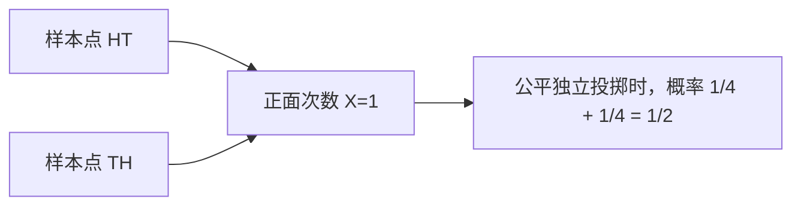
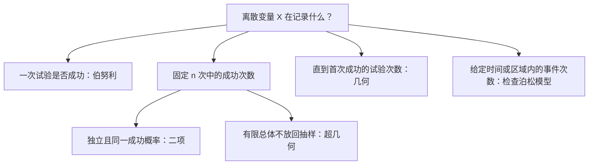

# 第 2 章 随机变量及其分布

> [!note] 本章主线
> **把随机结果数量化，再用分布描述概率如何分配。** 学习顺序为：随机变量 → 离散分布律或连续密度 → 统一的分布函数 → 随机变量变换。
>
> 记号约定：$p_X(x)$ 表示概率质量函数，$f_X(x)$ 表示概率密度函数，$F_X(x)=P(X\le x)$ 表示分布函数。三者不是同一种函数。本章指数分布的 $\lambda$ 采用“率参数”，正态分布写作 $N(\mu,\sigma^2)$，第二个参数是方差。

---

## §2.1 随机变量：把事件转成数值条件

### 2.1.1 随机变量是样本空间上的函数

随机变量 X 为每个试验结果 $\omega\in\Omega$ 指定一个实数 $X(\omega)$。它不是“一个会随意变化的字母”，而是确定的映射；随机性来自实际出现哪个样本点未知。

例如连续掷两次硬币，X 表示正面次数：

| 样本点 $\omega$ | HH | HT | TH | TT |
|---|---|---|---|---|
| $X(\omega)$ | 2 | 1 | 1 | 0 |

事件 $\{X=1\}$ 对应 $\{HT,TH\}$，$\{X\le1\}$ 对应 $\{HT,TH,TT\}$。同一个数值可以由多个样本点产生，所以计算取值概率时要把对应结果的概率相加。

### 2.1.2 类型取决于概率怎样分配

| 类型 | 本章采用的判断方式 | 例子 |
|---|---|---|
| 离散型 | 概率集中在有限或可列个取值上，用分布律描述 | 次品数、成功次数、首次成功的试验次数 |
| 连续型（有密度） | 存在非负密度，区间概率可由积分给出 | 均匀分布、指数分布、正态分布 |
| 混合型 | 既有单点概率，又有连续分配的部分 | 一部分概率集中在 0，其余分布在一个区间 |

> [!warning] “可能取不可列多个值”不足以判定有密度
> 某变量以一半概率等于 0，以另一半概率在 $(0,1)$ 均匀取值，可能取值不可列，但 $P(X=0)=1/2$，不能用一个普通概率密度函数表示全部概率。
>
> 本章主要讨论离散型、有密度的连续型和简单混合型。更一般的分布不在这里展开。

对所有类型都可定义：$F_X(x)=P(X\le x)$。它相当于“从最左边累计到 x 的总概率”，在 §2.4 统一讨论。

---

## §2.2 离散型随机变量及其分布

### 2.2.1 分布律：每个取值分到多少概率

若 X 的不同取值为 $x_1,x_2,\ldots$，定义：

$$p_i=P(X=x_i),\qquad p_i\ge0,\qquad\sum_i p_i=1$$

这两个条件是一个非负数列能构成分布律的基本检查。分布律可以写成公式、表格或概率质量图；某个集合 G 的概率为：

$$P(X\in G)=\sum_{x_i\in G}p_i$$

例如两次公平独立抛硬币的正面次数：

| X | 0 | 1 | 2 |
|---|---:|---:|---:|
| $p_X(x)$ | $1/4$ | $1/2$ | $1/4$ |

$P(X\ge1)=1/2+1/4=3/4$；也可算成 $1-P(X=0)$。求概率时，应对满足条件的**取值**求和。

### 2.2.2 五类常见离散分布

以下令 q=1-p。伯努利、二项分布允许 $0\le p\le1$；讨论一般公式与众数时通常先取 $0<p<1$。几何分布要求 $0<p\le1$，泊松分布此处取 $\lambda>0$。

| 分布 | 记号与取值 | 分布律 |
|---|---|---|
| 伯努利（0-1） | $X\sim\operatorname{Bern}(p)$，$k=0,1$ | $P(X=k)=p^kq^{1-k}$ |
| 二项 | $X\sim B(n,p)$，$k=0,\ldots,n$ | $P(X=k)=\binom nkp^kq^{n-k}$ |
| 泊松 | $X\sim\operatorname{Pois}(\lambda)$，$k=0,1,\ldots$ | $P(X=k)=e^{-\lambda}\lambda^k/k!$ |
| 超几何 | $X\sim H(N,M,n)$ | $P(X=k)=\binom Mk\binom{N-M}{n-k}/\binom Nn$ |
| 几何 | $X\sim G(p)$，$k=1,2,\ldots$ | $P(X=k)=q^{k-1}p$ |

其中 n、N、M 为相应的非负整数；超几何分布要求 $0\le M\le N$、$0\le n\le N$，且通常 $N\ge1$。其可行取值范围为：

$$\max(0,n-(N-M))\le k\le\min(n,M)$$

> [!warning] 泊松分布的指数是参数，不是随机取值
> 正确形式是 $e^{-\lambda}$。若误写成 $e^{-x}$ 或 $e^{-k}$，通常无法使概率总和等于 1。

### 2.2.3 先问“数什么”，再选择模型

| 模型 | 关键条件 | 常见误用 |
|---|---|---|
| 伯努利 | 一次试验只记录 0/1 | 用于记录多次成功总数却不改变模型 |
| 二项 | 次数固定、独立、每次成功概率相同 | 不放回抽样直接当作独立重复 |
| 泊松 | 适合的计数机制或已给定分布假设 | 看到“人数、次数”就认定必为泊松 |
| 超几何 | 有限总体、等概率不放回抽 n 个 | 漏掉总体中成功对象总数 M 的限制 |
| 几何 | 独立重复、成功概率不变，直到首次成功 | 不说明是否把成功那一次计入 X |

### 2.2.4 二项分布：位置数乘上单条序列概率

指定哪 k 次成功时，序列概率为 $p^kq^{n-k}$；这样的成功位置有 $\binom nk$ 种，因此得到二项分布。由二项式定理可检查归一化：

$$\sum_{k=0}^n\binom nkp^kq^{n-k}=(p+q)^n=1$$

当 $0<p<1$ 时，可由相邻概率比判断**众数**（最可能的成功次数）：

$$\frac{P(X=k+1)}{P(X=k)}=\frac{n-k}{k+1}\frac pq,\qquad k=0,\ldots,n-1$$

当 $0<p<1$：

- $(n+1)p$ 不为整数时，唯一众数为 $\lfloor(n+1)p\rfloor$。
- $(n+1)p=m$ 为整数时，众数为 m-1、m。

当 $p=0$ 或 $p=1$ 时，$X$ 分别恒等于 $0$ 或 $n$，对应的众数即该常数。

例如 $B(10,0.3)$ 的众数为 3；$B(9,0.3)$ 的众数为 2 和 3。

> [!note] 二项分布何时近似对称
> p=1/2 时严格对称；p 接近 1/2 时通常更接近对称。固定 $0<p<1$ 而 n 增大，会改善标准化后的正态近似；若 p 同时很小，使 np 始终较小，则即使 n 很大，分布仍可能明显偏斜。
>
> 例如 $B(500,0.01)$ 的 $P(X=5)\approx0.1764$。不能把“n 大”单独当成对称或任意近似的充分条件。

### 2.2.5 泊松分布与稀有事件近似

泊松分布的规范性来自指数级数：

$$\sum_{k=0}^{\infty}e^{-\lambda}\frac{\lambda^k}{k!}=e^{-\lambda}e^{\lambda}=1$$

若采用平稳泊松过程模型，单位时间平均事件数为 r，长度 t 的时间段内计数服从 $\operatorname{Pois}(rt)$。时间单位变化时参数也必须同步变化；这个计数模型需要相应假设，不能仅凭平均次数唯一确定分布。

**泊松极限定理**：当 $n\to\infty$、$np_n\to\lambda>0$ 时，对每个固定的非负整数 k：

$$\binom nkp_n^k(1-p_n)^{n-k}\longrightarrow e^{-\lambda}\frac{\lambda^k}{k!}$$

因此独立、同概率的稀有成功计数可以近似为：

$$B(n,p)\approx\operatorname{Pois}(np)$$

> [!example] 计算“一个也没有”
> $X\sim B(1000,0.002)$，精确值 $P(X=0)=0.998^{1000}\approx0.13506$；用 $\lambda=np=2$ 的泊松近似，得到 $e^{-2}\approx0.13534$。
>
> 大 n、小 p 是常见使用情形，经验阈值不是误差保证；特别是很小的尾概率，还应注意绝对误差与相对误差的区别。

### 2.2.6 超几何与二项：抽样比例小，依赖可能较弱

总体 N 件，其中 M 件为次品，不放回抽 n 件，恰 k 件次品的分子是“从 M 件中选 k 件”乘“从 N-M 件中选 n-k 件”。例如 N=10、M=3、n=2：

$$P(X=1)=\frac{\binom31\binom71}{\binom{10}2}=\frac{21}{45}=\frac7{15}$$

当总体很大、抽样比例 n/N 很小时，可考虑：

$$H(N,M,n)\approx B\left(n,\frac MN\right)$$

这不是说不放回抽样变成了真正独立，而是抽取少量对象对后续成功比例的影响较小。是否足够精确仍取决于参数和所求事件。

### 2.2.7 几何分布：从失败次数推到首次成功

本章 X 包含最后成功的一次，所以：

$$P(X=k)=q^{k-1}p,\qquad P(X>m)=q^m$$

前式表示“前 k-1 次失败，第 k 次成功”；后式表示“前 m 次全失败”。对于非负整数 m、n 且条件事件概率大于 0：

$$P(X>m+n\mid X>m)=\frac{q^{m+n}}{q^m}=q^n=P(X>n)$$

这就是离散的无记忆性。若改记“首次成功前的失败次数”$W=X-1$，则 W 从 0 开始取值，分布律为 $P(W=k)=q^kp$。两种几何分布记法都常见，做题必须先看定义。

---

## §2.3 连续型随机变量及其密度

### 2.3.1 密度的高度不是单点概率

若存在非负可积函数 $f_X(x)$，使任意区间概率可由积分表示：

$$P(a<X\le b)=\int_a^bf_X(x)\,\mathrm dx$$

则称 X 具有概率密度。合法密度应满足：

$$f_X(x)\ge0,\qquad\int_{-\infty}^{\infty}f_X(x)\,\mathrm dx=1$$

密度表示概率的分布强度；**曲线下的面积**才是概率。若密度在 x 附近连续，对足够小的正 h，可以近似 $P(x<X\le x+h)\approx f_X(x)h$。

> [!warning] 密度可以大于 1，单点概率仍为 0
> $X\sim U(0,1/2)$ 的区间内密度为 2，但总面积是 $2\times1/2=1$。同时任意单点的概率都为 0，因此 $f_X(x)$ 一般不等于 $P(X=x)$。

有密度的变量满足：

$$P(X=x)=0,\qquad P(a<X<b)=P(a\le X\le b)=\int_a^bf_X(x)\,\mathrm dx$$

开闭端点不影响这里的区间概率；离散型和有点质量的混合型则不能随意忽略端点。

### 2.3.2 完整例：从密度定参数，再求概率

设 $f_X(x)=cx$（$0<x<2$），其他地方为 0。先用归一化：

$$1=\int_0^2cx\,\mathrm dx=2c\quad\Rightarrow\quad c=\frac12$$

再计算指定区间，而不是只把端点代入密度：

$$P(1<X\le\sqrt3)=\int_1^{\sqrt3}\frac x2\,\mathrm dx=\frac{3-1}{4}=\frac12$$

其分布函数为 $F_X(x)=x^2/4$（$0\le x<2$），区间外分别接 0、1。

### 2.3.3 均匀分布 $U(a,b)$

要求 $a<b$：

$$f_X(x)=\begin{cases}\dfrac1{b-a},&a<x<b,\\0,&\text{其他。}\end{cases}$$

$$F_X(x)=\begin{cases}0,&x<a,\\\dfrac{x-a}{b-a},&a\le x<b,\\1,&x\ge b.\end{cases}$$

若区间 $[c,d]$ 落在 $[a,b]$ 中，则 $P(c<X<d)=(d-c)/(b-a)$；若超出支持范围，先取交集，再求长度比。

### 2.3.4 指数分布 $E(\lambda)$

本章 $\lambda>0$ 为率参数：

$$f_X(x)=\begin{cases}\lambda e^{-\lambda x},&x>0,\\0,&x\le0,\end{cases}\qquad F_X(x)=\begin{cases}1-e^{-\lambda x},&x>0,\\0,&x\le0.\end{cases}$$

其尾概率也称生存函数：$P(X>t)=e^{-\lambda t}$，t≥0。因此 $0\le a<b$ 时：

$$P(a<X<b)=e^{-\lambda a}-e^{-\lambda b}$$

若 a<0，应先结合 X≥0 处理，不能直接套上式。

> [!tip] 无记忆性是“剩余等待时间”的分布不变
> 对 m、t≥0：
>
> $$P(X>m+t\mid X>m)=\frac{e^{-\lambda(m+t)}}{e^{-\lambda m}}=e^{-\lambda t}$$
>
> 例如 $\lambda=0.2$（每小时），已等待 3 小时，再等超过 5 小时的条件概率仍是 $e^{-1}\approx0.3679$。这是指数模型的性质，不能推广成所有寿命分布都没有老化效应。

有些资料用尺度参数 $\theta=1/\lambda$，写密度为 $\theta^{-1}e^{-x/\theta}$。代入公式前必须确认参数约定；率参数有“时间倒数”的量纲。

### 2.3.5 正态分布 $N(\mu,\sigma^2)$

其中 $\mu\in\mathbb R$、$\sigma>0$：

$$f_X(x)=\frac1{\sqrt{2\pi}\sigma}\exp\left[-\frac{(x-\mu)^2}{2\sigma^2}\right],\qquad x\in\mathbb R$$

曲线关于 $x=\mu$ 对称，故 $P(X<\mu)=1/2$；在 $\mu$ 处密度最高。$\sigma$ 越大，曲线越平缓、分布越分散；密度最高只表示附近等宽小区间通常具有更大概率，**单点 $X=\mu$ 的概率仍为 0**。

令标准正态变量 $Z=(X-\mu)/\sigma\sim N(0,1)$，并记 $\Phi(z)=P(Z\le z)$，则：

$$\boxed{P(a<X<b)=\Phi\left(\frac{b-\mu}{\sigma}\right)-\Phi\left(\frac{a-\mu}{\sigma}\right)}$$

常用性质：$\Phi(0)=1/2$、$\Phi(-z)=1-\Phi(z)$、$\Phi(-\infty)=0$、$\Phi(+\infty)=1$。标准化要除以标准差 $\sigma$，不是方差 $\sigma^2$。

> [!example] 从一般正态转成查表区间
> 若 $X\sim N(100,15^2)$，则
>
> $$P(85<X<130)=P(-1<Z<2)=\Phi(2)-\Phi(-1)\approx0.97725-0.15866=0.81859$$
>
> 步骤是“减均值、除标准差、变上下界、查标准正态表”，不用直接积分复杂密度。

**3σ 概率范围**：

| 区间 | 精确表达 | 常用近似 |
|---|---|---|
| $\mu\pm\sigma$ | $2\Phi(1)-1$ | 0.6827 |
| $\mu\pm2\sigma$ | $2\Phi(2)-1$ | 0.9545 |
| $\mu\pm3\sigma$ | $2\Phi(3)-1$ | 0.9973 |

这些比例以正态分布为前提，并不适用于所有分布；即使超过 3σ 的概率很小，也不等于不可能。数值可与 [NIST 的正态分布概率范围](https://itl.nist.gov/div898/handbook/pmc/section5/pmc51.htm)核对。

### 2.3.6 正态分位数：先辨认左右尾

本章把**标准正态的上侧 $\alpha$ 分位数**记为 $z_\alpha$：

$$P(Z>z_\alpha)=\alpha\quad\Longleftrightarrow\quad\Phi(z_\alpha)=1-\alpha$$

| $\alpha$ | 0.100 | 0.050 | 0.025 | 0.010 | 0.005 | 0.001 |
|---|---|---|---|---|---|---|
| $z_\alpha$ | 1.282 | 1.645 | 1.960 | 2.326 | 2.576 | 3.090 |

一般正态 X 的对应上侧分位数为 $x_\alpha=\mu+\sigma z_\alpha$。若使用“累计概率为 p 的左分位数”记法，则应写 $\Phi^{-1}(p)$，不要把 p 与上侧概率 $\alpha$ 混用。

对称中心区间满足 $P(|Z|\le z_{\alpha/2})=1-\alpha$。例如中央 95% 区间使用 $z_{0.025}\approx1.96$，而不是 $z_{0.05}\approx1.645$。

---

## §2.4 分布函数：统一处理累计概率与端点

### 2.4.1 定义与判定性质

$$F_X(x)=P(X\le x)$$

任何分布函数都满足以下条件；反过来，满足单调不减、右连续及两端极限的函数可以作为某个分布函数：

1. 单调不减，因此累计概率不会减少。
2. 右连续：$F_X(x)=\lim_{t\downarrow x}F_X(t)$。
3. $\lim_{x\to-\infty}F_X(x)=0$，$\lim_{x\to+\infty}F_X(x)=1$。
4. 由上述条件可得 $0\le F_X(x)\le1$。

右连续不等于处处连续。有限离散分布常表现为阶梯状：每经过一个取值，就加入该点的概率；有密度的连续分布则没有跳跃。

### 2.4.2 四种区间端点：统一用左极限处理

记 $F_X(a^-)=\lim_{x\uparrow a}F_X(x)=P(X<a)$。当 a<b：

| 要求的概率 | 通用公式 |
|---|---|
| $P(a<X\le b)$ | $F_X(b)-F_X(a)$ |
| $P(a\le X\le b)$ | $F_X(b)-F_X(a^-)$ |
| $P(a<X<b)$ | $F_X(b^-)-F_X(a)$ |
| $P(a\le X<b)$ | $F_X(b^-)-F_X(a^-)$ |
| $P(X=a)$ | $F_X(a)-F_X(a^-)$ |

> [!tip] 先决定是否包含端点，再选 F 或左极限
> 上界“≤”用 F(b)，上界“<”用 F(b⁻)；下界“>”减 F(a)，下界“≥”减 F(a⁻)。只有已经确定对应单点概率为 0 时，才可省略这些区别。

### 2.4.3 离散例：跳跃高度就是单点概率

对前面的 $P(X=0,1,2)=1/4,1/2,1/4$：

$$F_X(x)=\begin{cases}0,&x<0,\\1/4,&0\le x<1,\\3/4,&1\le x<2,\\1,&x\ge2.\end{cases}$$

| 位置 | 加入该点前 $F(x^-)$ | 加入该点后 $F(x)$ | 跳跃高度 |
|---|---:|---:|---:|
| x=0 | 0 | 1/4 | 1/4 |
| x=1 | 1/4 | 3/4 | 1/2 |
| x=2 | 3/4 | 1 | 1/4 |

因此 $P(0<X\le1)=3/4-1/4=1/2$，而 $P(0\le X\le1)=3/4-0=3/4$。边界符号不同，概率确实不同。

### 2.4.4 密度与分布函数的联系

对具有密度的 X：

$$F_X(x)=\int_{-\infty}^xf_X(t)\,\mathrm dt$$

若 $f_X$ 在 x 处连续，则 $F_X'(x)=f_X(x)$；更一般地导数关系几乎处处成立。密度在个别点怎样定义不影响积分和分布，例如均匀密度在两个端点取 0 或 $1/(b-a)$ 都给出同一分布。

> [!warning] F 连续，不足以在所有情形下推出存在密度
> 有密度一定使 F 连续，但更一般的分布中反向推理不成立。本章的“连续型”按有密度的定义使用；解题时不能只凭可能取值很多或 F 没有跳跃，就省略存在密度的条件。

### 2.4.5 混合型例：求导会漏掉跳跃处的概率

给定：

$$F_X(x)=\begin{cases}0,&x<1,\\x/2,&1\le x<2,\\1,&x\ge2.\end{cases}$$

在 x=1 处，$P(X=1)=1/2-0=1/2$。区间 $(1,2)$ 上以密度 $1/2$ 分配剩余概率，面积为 $1/2$；在 x=2 处没有跳跃，$P(X=2)=0$。

> [!example] 检查总概率怎样凑成 1
> 点质量：$1/2$；连续部分：$\int_1^2(1/2)\,\mathrm dx=1/2$；合计为 1。
>
> 例如 $P(X\le1.5)=0.75$，但 $P(1<X\le1.5)=0.25$。若把 F 分段求导后直接当成一个普通密度，会只剩总面积 $1/2$，漏掉 x=1 的点质量。

---

## §2.5 随机变量的函数：求 $Y=g(X)$ 的分布

### 2.5.1 通用方法：先把 Y 的事件改写成 X 的事件

$$F_Y(y)=P(Y\le y)=P(g(X)\le y)$$

这是分布函数法的核心，适用于离散、连续和混合情形。解题按以下顺序：

1. 找 Y 的可能取值或范围，确定需要怎样分段。
2. 将 $g(X)\le y$ 解成 X 的取值条件，注意是否要拆成多个区间。
3. 按 X 的已知分布求概率，写出完整的 $F_Y$。
4. 若 Y 有密度，再对相应部分求导；有跳跃则保留单点概率，不能丢掉。
5. 检查结果非负、归一化，或检查 F 的单调性、右连续性与两端极限。

### 2.5.2 离散型：同一输出值的概率必须合并

设 X 在 -1、0、1 处的概率依次为 $1/4,1/2,1/4$，令 $Y=X^2$：

| X | -1 | 0 | 1 |
|---|---:|---:|---:|
| 原概率 | 1/4 | 1/2 | 1/4 |
| $Y=X^2$ | 1 | 0 | 1 |

两个不同输入 -1、1 都映射为 Y=1，因此 $P(Y=1)=1/4+1/4=1/2$，$P(Y=0)=1/2$。不是把表头改成平方后仍保留两个不同的“Y=1”取值。

### 2.5.3 连续且单调的变换：用反函数换元

设 X 的密度在某区间上给出，g 在该区间可微、严格单调，且导数非零。令反函数 $x=h(y)$，在对应值域内：

$$f_Y(y)=f_X(h(y))\left|h'(y)\right|$$

绝对值处理单调递减时的负导数，保证密度非负。值域外密度为 0；支持范围和分段不能漏写。

> [!example] 指数变量的尺度变换
> 若 $X\sim E(2)$、Y=3X，则 $h(y)=y/3$、$|h'(y)|=1/3$，因此
>
> $$f_Y(y)=\frac23e^{-2y/3},\qquad y>0$$
>
> 即 $Y\sim E(2/3)$。把时间放大 3 倍后，率参数应缩小到原来的 1/3，而不是乘 3。

正态分布的线性变换是重要特例：

$$X\sim N(\mu,\sigma^2),\ a\ne0\quad\Rightarrow\quad aX+b\sim N(a\mu+b,a^2\sigma^2)$$

a<0 时也成立，因为标准差变为 $|a|\sigma$。若 a=0，则 Y 恒等于 b，是单点退化分布，应单独处理。

### 2.5.4 非单调变换：先拆分原像，再相加

若 $X\sim U(-1,1)$，令 $Y=X^2$，则 Y 的范围为 $[0,1]$。当 $0\le y<1$：

$$F_Y(y)=P(-\sqrt y\le X\le\sqrt y)=\frac{2\sqrt y}{2}=\sqrt y$$

所以：

$$F_Y(y)=\begin{cases}0,&y<0,\\\sqrt y,&0\le y<1,\\1,&y\ge1,\end{cases}\qquad f_Y(y)=\begin{cases}\dfrac1{2\sqrt y},&0<y<1,\\0,&\text{其他。}\end{cases}$$

密度在 0 附近无界并不违法，因为总积分仍为 1。$P(Y=0)=P(X=0)=0$，不能把“密度很高”误读成“单点有正概率”。

> [!tip] 非单调时不能只选一个反函数，但可以分支求和
> 当 g 可分成适当的可逆分支时，在各分支导数非零的对应位置可用：
>
> $$f_Y(y)=\sum_{x_i:\,g(x_i)=y}\frac{f_X(x_i)}{|g'(x_i)|}$$
>
> 上例有 $x_1=\sqrt y$、$x_2=-\sqrt y$ 两个原像，每支贡献 $1/(4\sqrt y)$，合计 $1/(2\sqrt y)$。因此“不单调就完全不能使用密度变换公式”过于绝对；应先分支，复杂情况优先用分布函数法。

### 2.5.5 指标、量化与混合型：看映射结果，不只看 g 连不连续

**指标变量**：令 $Y=\mathbf1_{\{X\in A\}}$，则：

$$P(Y=1)=P(X\in A),\qquad P(Y=0)=1-P(X\in A)$$

这总是伯努利型。若 $X\sim\operatorname{Pois}(\lambda)$、$Y=\mathbf1_{\{X>1\}}$：

$$P(Y=0)=P(X=0)+P(X=1)=(1+\lambda)e^{-\lambda}$$

若 $X\sim N(0,1)$，将 X≤0 记为 -1、X>0 记为 1，则两个取值的概率均为 $1/2$。

| 变换例 | Y 的分布类型 | 说明 |
|---|---|---|
| $X\sim U(0,2)$，$Y=\lfloor X\rfloor$ | 离散型 | 只取 0、1，各为 1/2 |
| $X\sim U(-1,1)$，$Y=0$ | 退化离散型 | g 连续，但整个区间被压成一个点 |
| $X\sim U(-1,1)$，$Y=\max(0,X)$ | 混合型 | 负半区间变成 0，故 $P(Y=0)=1/2$；正半区间仍连续分布 |
| $X\sim U(-1,1)$，$Y=X+\mathbf1_{\{X>0\}}$ | 有密度的连续型 | g 在 0 处跳跃，但输出分别分布在 $(-1,0)$、$(1,2)$，各段密度为 1/2 |

> [!warning] 两个常见推断都不成立
> “X 有密度且 g 连续 ⇒ Y 一定有密度”不成立；“g 不连续 ⇒ Y 一定离散”也不成立。应实际检查是否把一段正概率的输入映射成同一个点，以及每个输出值对应哪些输入。

---

## 本章速查：三个函数与常见解题步骤

| 对象 | 定义或作用 | 怎样求事件概率 |
|---|---|---|
| 分布律 $p_X(x_i)$ | 单点概率 $P(X=x_i)$ | 对符合条件的取值求和 |
| 密度 $f_X(x)$ | 单位长度附近的概率分布强度 | 在所求区域积分 |
| 分布函数 $F_X(x)$ | 累计概率 $P(X\le x)$ | 作差，是否用左极限取决于端点 |

| 题型 | 推荐步骤 |
|---|---|
| 判断分布律或密度是否合法 | 先看非负，再检查总和或总积分为 1 |
| 含未知参数的分布 | 用归一化定参数，再检查参数是否满足非负条件 |
| 文字题选择分布 | 明确次数固定还是等待首次成功、放回与否、独立与否、成功概率是否一致 |
| 一般正态求概率 | 标准化 → 改写上下界 → 利用 Φ 的对称性查表 |
| 分布函数求单点概率 | 右侧函数值减左极限，即跳跃高度 |
| 求 $Y=g(X)$ 的分布 | 先找范围、再求原像，最后合并概率或求导 |

**常用归一化工具**：

$$\sum_{k=0}^{\infty}q^k=\frac1{1-q}\ (|q|<1),\qquad \sum_{k=0}^{\infty}\frac{\lambda^k}{k!}=e^\lambda$$
$$\int_{-\infty}^{\infty}e^{-ax^2}\,\mathrm dx=\sqrt{\frac\pi a}\ (a>0),\qquad\int_0^{\infty}e^{-x^2}\,\mathrm dx=\frac{\sqrt\pi}{2}$$
$$\sum_{k=1}^{\infty}\frac1{k^2}=\frac{\pi^2}{6}$$

---

## 阅读衔接与公式核对

[返回第一章：随机事件与概率](<第一章 随机事件与概率.md>)。两章的关系是：第一章提供事件运算、条件概率和独立性；本章把这些工具应用于数值事件，不能因写成了分布符号就省略模型条件。

泊松分布公式可核对 [NIST 泊松分布条目](https://www.itl.nist.gov/div898/handbook/eda/section3/eda366j.htm)；正态密度、标准化和累计概率可核对 [NIST 正态分布条目](https://www.itl.nist.gov/div898/handbook/eda/section3/eda3661.htm)。

自测题见 [第二章 习题](<../../习题/第二章 随机变量及其分布 习题.md>)。
