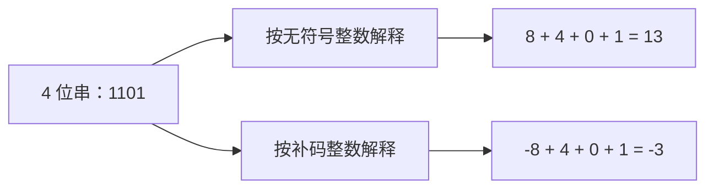
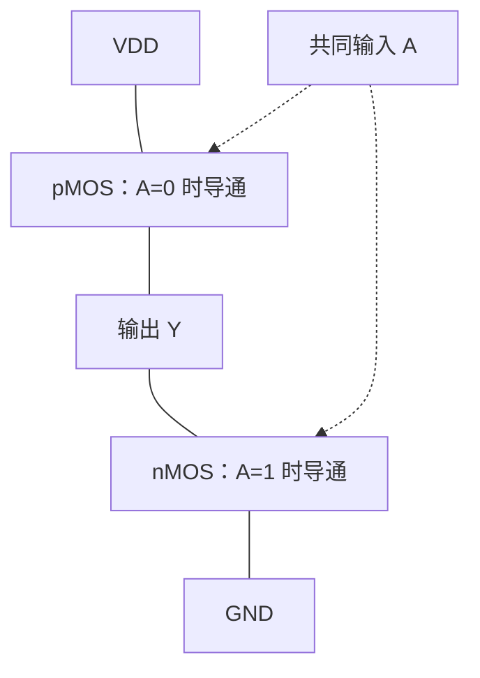

# 《数字设计与计算机体系结构》第一章 完整笔记

> [!note] 本章主线与阅读约定
> 对应本目录课件：第一章数字逻辑基础。阅读主线：抽象层次 → 数制与编码 → 逻辑电平 → 逻辑门和 CMOS → 功耗。课程成绩等信息是本课件的记录，实际教学安排以任课教师通知为准。
>
> 本章先解决两个问题：同一串 0/1 怎样解释为数值，以及连续的物理电压为什么能可靠地表示 0/1。第二章在此基础上设计“计算”电路，第三章增加“记忆”，第五章组合成常用模块。

---

## 一、课程概览（Course Overview）

### 1. 课程目标（Course Objectives）

- 知道—了解—理解计算机神秘面纱下有什么
- 学习数字设计（Digital Design）的原则、原理
- 设计和建造一个微处理器（Microprocessor / CPU）

### 2. 成绩构成（Grading）

| 项目 | 比例 | 内容 |
|------|------|------|
| 线上 MOOC（Massive Open Online Course） | 20% | 周测、单元测验、讨论区、线上期末 |
| 线下慕课堂（Mu Classroom） | 10% | 签到、课内练习、主题讨论 |
| 实验（Lab） | 20% | 实验课 |
| 期末考试（Final Exam） | 50% | 闭卷（closed-book） |

**注意**：MOOC 与慕课堂（Mu Classroom）不同，但账户必须一致，否则数据无法统计。

### 3. 教材与参考书（Textbook and References）

- 教材：*Digital Design and Computer Architecture*, 2nd Ed., Harris & Harris
- 参考书：
  - *Logic and Computer Design Fundamentals*（Mano）
  - *Computer Organization and Design: The Hardware/Software Interface*（Patterson & Hennessy）

### 4. 体系结构 vs 组成原理（Architecture vs Organization）

| 概念 | 关注点 | 例子 |
|------|--------|------|
| 计算机体系结构（Computer Architecture） | 程序员可见属性：指令系统（instruction set）、数据类型（data types）、寻址方式（addressing modes）、I/O 机理（I/O mechanisms） | 有无乘法指令 |
| 计算机组成原理（Computer Organization） | 具体指令的实现：微操作序列（micro-operation sequence）、数据通路（datapath）、控制器（controller） | 如何实现乘法指令 |
| 逻辑与数字系统（Logical and Digital System） | 物理实现：乘法器用什么电子器件实现 | 加法器、门电路 |

**正确关系**：体系结构定义程序员可见属性，组成原理实现这些属性。

---

## 二、驾驭复杂的艺术（The Art of Managing Complexity）

### 1. 三个原则（The Three Y's）

| 原则 | 含义 | 示例 |
|------|------|------|
| 层次化（Hierarchy） | 系统分成若干模块，再细分直到易于理解 | 计算机→CPU→ALU→加法器→逻辑门 |
| 模块化（Modularity） | 每个模块有明确功能（functions）和接口（interfaces），便于连接 | CPU 插槽、内存插槽 |
| 规整化（Regularity） | 模块间寻求一致，通用复用，减少设计数量 | 统一内存条接口 |

### 2. 数字抽象（The Digital Abstraction）

- 物理量是连续的（电压、频率、位置等）
- 数字抽象只取离散子集（如 0 和 1）
- 把一定范围内的连续电压解释为 0 或 1；0V/5V 只是便于说明的理想示例，真实电路并非只有两个精确电压值。

数字抽象能成立，依赖逻辑门遵守**静态约束（static discipline）**：输入落在合法逻辑电平范围时，经过规定延迟，输出也必须落在合法逻辑电平范围。这样，上一级的有效输出可以继续成为下一级的有效输入。

### 3. 约束（Discipline）

- 软件有时间和预算约束；硬件同样有约束
- 数字电路设计难度低于模拟电路（analog circuit），可搭建更复杂精密的系统
- 数字系统逐步取代模拟设备：数码相机、数字电视、手机等

---

## 三、数制系统（Number Systems）

### 1. 带权位置数制（Weighted Positional Number System）

**核心公式**：

$$N = \sum d_i \times R^i$$
其中 $R$ 为基数（radix），$i$ 为位权（weight）。

| 进制 | 基数 | 数字符号 | 示例 |
|------|------|----------|------|
| 十进制（Decimal） | 10 | 0~9 | $5374_{10}$ |
| 二进制（Binary） | 2 | 0,1 | $1101_2 = 13_{10}$ |
| 八进制（Octal） | 8 | 0~7 | $267_8$ |
| 十六进制（Hexadecimal） | 16 | 0~9, A~F | $2CA_{16} = 714_{10}$ |

**权（Weight）**：

- 整数部分第 $i$ 位权为 $R^i$（$i$ 从 0 开始）
- 小数部分第 $i$ 位权为 $R^i$（$i$ 从 -1 开始）

### 2. 数制转换（Number System Conversion）

#### （1）非十进制 → 十进制

按权展开法（expansion by weights）：
$$2CA.E_{16} = 2×16^2 + 12×16^1 + 10×16^0 + 14×16^{-1} = 714.875_{10}$$

#### （2）十进制 → 二进制

- 整数部分：**除基取余法**（repeated division by radix）（先得低位，后得高位）
- 小数部分：**乘基取整法**（repeated multiplication by radix）（先得高位，后得低位）

> [!example]
>**例**：
> 
> - $327_{10} = 101000111_2$
> - $0.8125_{10} = 0.1101_2$
> - $0.2_{10} = 0.0011\ 0011\ 0011..._2$（循环）

**有限位小数为什么可能有误差？** 将有理数约成最简分数后，只有分母不含 2 以外的质因子，才有有限二进制小数。例如 $0.8125=13/16$ 能精确表示，$0.2=1/5$ 不能。保留固定小数位时必须截断或舍入，这也是第五章浮点数误差的来源。

#### （3）二进制 ↔ 八进制 / 十六进制

**规则**：以小数点为界，向两侧分组（grouping）；不足补零（pad with zeros）。

- 八进制：每 3 位一组
- 十六进制：每 4 位一组

> [!example]
> 例：
> 
> - $(10110111.01101)_2 = (010\ 110\ 111.011\ 010)_2 = (267.32)_8$
> - $(110110111.01101)_2 = (0001\ 1011\ 0111.0110\ 1000)_2 = (1B7.68)_{16}$

### 3. 常用 2 的幂（Powers of Two）

| 幂 | 值 | 近似 |
|----|-----|------|
| $2^{10}$ | 1024 | 1K ≈ $10^3$ |
| $2^{20}$ | 1,048,576 | 1M ≈ $10^6$ |
| $2^{30}$ | 1,073,741,824 | 1G ≈ $10^9$ |
| $2^{40}$ | 1,099,511,627,776 | 1T ≈ $10^{12}$ |

**估算技巧**：

- $2^{24} = 2^4 × 2^{20} = 16M ≈ 1600万$
- 32 位可表示 $2^{32} = 4G ≈ 40亿$ 个无符号数（unsigned numbers）

### 4. 术语（Terminology）

| 术语 | 含义 |
|------|------|
| 位（Bit） | 二进制位，msb（most significant bit，最高有效位）、lsb（least significant bit，最低有效位） |
| 字节（Byte） | 8 位 |
| 半字节（Nibble） | 4 位 |
| 字（Word） | 微处理器一次处理的数据，如 64 位、32 位 |

---

## 四、信息表示与有符号数（Information Representation and Signed Numbers）

### 1. 数据类型（Data Types）

- 计算机中主要运行“程序”，程序包括“变量”和“代码”
- 最基础的数据表示（data representation）：无符号数（unsigned numbers）、有符号数（signed numbers）、定点数（fixed-point number）、浮点数（floating-point number）、位串（bit string）

### 2. 无符号数（Unsigned Numbers）

- 表示 0 和正整数，没有负数；N 位无符号整数范围是 $0\sim 2^N-1$。
- 用于：操作码（opcode）、地址码（address code）、寄存器号（register number）、存储器地址（memory address）、计数器值（counter value）、定时器值（timer value）、时钟频率（clock frequency）等

### 3. 有符号数（Signed Numbers）

- 算术操作指令处理的数值（带符号整数或浮点数）
- 位串（bit string）：逻辑操作数、标识符、控制器状态字（status word）、控制码（control code）等

### 4. 定点数（Fixed-Point Number）

- 定点小数（纯小数）和定点整数（纯整数）
- 小数点均为隐含表示（implicit），不占位
- **好处**：数据表示范围和精度满足时，计算效率更高

> [!note] 先确定编码规则，再解释数值
> **补充理解：位串本身没有小数点，也没有“是否有符号”的标签。** 例如 `11111111` 按 8 位无符号整数解释是 255，按 8 位补码整数解释是 -1。若约定末尾有 4 位小数，同一补码位串又表示 $-1\times 2^{-4}=-0.0625$。

一般地，N 位、F 位小数的补码定点数，可先按补码整数求值，再乘 $2^{-F}$：

$$x=\left(-b_{N-1}2^{N-1}+\sum_{i=0}^{N-2}b_i2^i\right)2^{-F}$$

相邻可表示数的间隔为 $2^{-F}$。增加小数位可提高精度，但总位数不变时会缩小整数部分的范围。

### 5. 原码、反码、补码（Sign-Magnitude, One's Complement, Two's Complement）

| 表示法 | 正数 | 负数 | 0 的表示 |
|--------|------|------|----------|
| 原码（Sign-Magnitude） | 符号位 0，数值位不变 | 符号位 1，数值位不变 | +0 和 -0 两种 |
| 反码（One's Complement） | 同原码 | 符号位 1，数值位按位取反 | +0 和 -0 两种 |
| 补码（Two's Complement） | 同原码 | 符号位 1，数值位取反 + 1 | 只有 +0（全 0） |

**手写约定**：

- 整数原码：用逗号分隔，如 $+6 = 0,110$，$-6 = 1,110$
- 小数原码：用句点分隔，如 $+0.75 = 0.110$，$-0.75 = 1.110$

### 6. 补码的数学表达式（Mathematical Expression of Two's Complement）

$$A = a_{n-1}(-2^{n-1}) + \sum_{i=0}^{n-2} a_i 2^i$$
**最高位权值为 $-2^{N-1}$**，这是补码的关键。

> [!example] 图解：同一个 1101，为什么既可以是 13，也可以是 -3？
> 编码方式决定最高位的权值，不能只看最高位是 1 就直接判断数值。



### 7. 表示范围（Representation Range）

设最高位为符号位（sign bit）：

| 类型 | 范围 | 不同数值的个数 |
|------|------|------|
| N 位纯整数原码（Sign-Magnitude Integer） | $-(2^{N-1}-1) \sim +(2^{N-1}-1)$ | $2^N - 1$ |
| N 位纯小数原码（Sign-Magnitude Fraction） | $-(1-1/2^{N-1}) \sim +(1-1/2^{N-1})$ | $2^N - 1$ |
| N 位纯整数反码（One's Complement Integer） | 同原码 | $2^N - 1$ |
| N 位纯小数反码（One's Complement Fraction） | 同原码 | $2^N - 1$ |
| N 位纯整数补码（Two's Complement Integer） | $-2^{N-1} \sim +(2^{N-1}-1)$ | $2^N$ |
| N 位纯小数补码（Two's Complement Fraction） | $-1 \sim +(1-1/2^{N-1})$ | $2^N$ |

> [!warning] 最小负数求补后仍是原位串，这是溢出
> **怪异数（weird number）**：N 位补码整数中的 $10...000_2=-2^{N-1}$，按位取反 + 1 后位串仍是自己，因为正数 $+2^{N-1}$ 超出同位宽的表示范围。这是溢出，不表示该负数在数学上等于其相反数。

### 8. 补码的提出（Motivation for Two's Complement）

原码做加减法的问题：

- 符号位没有权值，不能参与运算
- ±0 有两种表达，造成麻烦

> [!example] 为什么原码不能直接按普通二进制相加
> 例：$(-6) + (+6) = 1,110 + 0,110 = 10,100$（**按原码直接相加得到错误结果**）

**补码核心思想**：用加法代替减法，把减法变加法。

**生活实例**：时钟从 10:15 拨到 14:15，可以 +4 小时，也可以 -8 小时（12 小时制中，-8 ≡ +4）。

**数学原理**：对于 N 位补码，模（modulus）为 $2^N$。
$$[X]_{补} = X + 2^N \pmod{2^N}$$

> [!example] 用模运算求负数补码
> 例：8 位时，$-76$ 的补码：
>
> $$-76 + 256 = 180 = 1011 0100_2$$

### 9. 求补（Taking the Two's Complement）
- **定义**：求一个数的相反数（前提：该数为补码表示）
- **方法**：按位取反，末位加 1
- 例：$[4]_{2's} = 0100$ → 求补 → $1011 + 1 = 1100 = -4$
- 对 0 求补：$0000$ → 取反 $1111$ → +1 → $0000$（仍是 0）

### 10. 补码加减法（Two's Complement Addition and Subtraction）

**加法规则**：

1. 所有操作数转为相同位数的补码
2. 按普通二进制加法逐位相加
3. **丢弃最高位产生的进位**
4. 结果仍为补码

> [!example]
> 例：
> 
> - $(+6) + (-6) = 0110 + 1010 = 10000$，丢弃进位得 $0000 = 0$
> - $(-2) + (+3) = 1110 + 0011 = 10001$，丢弃进位得 $0001 = +1$

**减法规则**：$A - B = A + (-B)$，即对减数求补后相加。

### 11. 补码溢出判断（Overflow Detection in Two's Complement）

| 方法 | 规则 |
|------|------|
| 符号位判断 | **同号相加，结果异号** ⇒ 溢出（overflow）；异号相加不会溢出 |
| 进位判断 | **进入符号位的进位 $C_{N-1}$ 与离开符号位的进位 $C_N$ 不同** ⇒ 溢出，即 $V=C_{N-1}\oplus C_N$ |

例：4 位补码中，$0111(+7) + 0001(+1) = 1000(-8)$，同号相加结果异号，溢出。

> [!tip] 同一结果，要按两种数制分别判断
> **进位与溢出不是一回事。** 同一个加法器可以处理无符号数和补码数，区别在结果的解释：

| 4 位加法 | 无符号解释 | 补码解释 |
|---|---|---|
| `1111 + 0001 = 1 0000` | $15+1$ 超过 15，有进位 | $-1+1=0$，没有有符号溢出 |
| `0111 + 0001 = 1000` | $7+1=8$，没有无符号溢出 | $7+1$ 超过 7，有符号溢出 |

补码减法 $A-B$ 的有符号溢出条件是：**A、B 异号，且结果符号与 A 不同**。不要直接套“同号相加”到减法原操作数上。

### 12. 符号扩展与零扩展（Sign-Extension and Zero-Extension）

| 扩展方式 | 适用场景 | 方法 | 示例 |
|----------|----------|------|------|
| 零扩展（Zero-Extension） | 无符号数 | 高位补 0 | $00101111$ → $0000000000101111$ |
| 符号扩展（Sign-Extension） | 补码数 | 复制符号位到高位 | $-5$：$1011$ → $11111011$ |

> [!warning] 原码不能照搬补码的符号扩展
> 这里的符号扩展规则针对补码整数（或保持小数位数不变的补码定点数）；原码不能照搬。原码扩展时保留符号位，在符号位后、原数值位前补 0。缩短位宽也不能随便截高位，必须先判断原值能否用目标位宽表示。

---

## 五、数字抽象与逻辑电平（Digital Abstraction and Logic Levels）

### 1. 逻辑电平（Logic Levels）

- 数字系统用离散值变量（0V/GND 代表 0，5V/VDD 代表 1）
- 现实电压连续，需定义逻辑电平将连续电压映射到离散二进制
- 输入、输出采用不同电压区间，以此容忍噪声（noise）干扰

### 2. 噪声容限（Noise Margins）

$$NM_H = V_{OH} - V_{IH}$$
$$NM_L = V_{IL} - V_{OL}$$
- $V_{OH}$：输出高电平最小值；$V_{IH}$：输入高电平最小值
- $V_{OL}$：输出低电平最大值；$V_{IL}$：输入低电平最大值
- 禁止区域（forbidden region）：输入电压在此区域时，逻辑门行为不确定

> [!tip] 把噪声容限理解成电平之间的“余量”
> 接收端的低电平范围到 VIL 为止，高电平范围从 VIH 开始；驱动端保证的输出还要更靠近两端，留出的余量就是噪声容限。

```text
电压从低到高 →
0V ------- VOL ---- VIL ---------- VIH ---- VOH ------- VDD
           |<NML-->|              |<--NMH>|
输入判定： [   合法的 0   ]  禁止区  [      合法的 1       ]
输出保证： [  输出低电平 ]                  [ 输出高电平  ]
```

图中仅示意各阈值的相对位置，不按实际电压比例绘制。

### 3. 电源电压缩放（VDD Scaling）

- 早期 VDD=5V，现代芯片 VDD 降至 3.3V、2.5V、1.8V、1.2V 等
- 目的：避免微小晶体管过热过载，省电
- **注意**：不同供电电压的芯片连接前必须检查逻辑电平和输入耐压；满足接口条件时可以直接连接，否则需要电平转换。

**判断接口是否兼容**，至少检查驱动端与接收端满足：

$$V_{OH,driver}\ge V_{IH,receiver},\qquad V_{OL,driver}\le V_{IL,receiver}$$

例如课件表中 TTL 输出的保证高电平最低只有 2.4V，而所列 5V CMOS 输入要求至少 3.15V，所以不能保证可靠识别为 1。低电平仍要单独核对。输入耐压、负载电流和扇出也属于实际连接条件。

### 4. 逻辑系列示例（Logic Family Examples）

| 系列 | VDD | VIL | VIH | VOL | VOH |
|------|-----|-----|-----|-----|-----|
| TTL | 5 (4.75-5.25) | 0.8 | 2.0 | 0.4 | 2.4 |
| CMOS | 5 (4.5-6) | 1.35 | 3.15 | 0.33 | 3.84 |
| LVTTL | 3.3 (3-3.6) | 0.8 | 2.0 | 0.4 | 2.4 |
| LVCMOS | 3.3 (3-3.6) | 0.9 | 1.8 | 0.36 | 2.7 |

---

## 六、逻辑门与 CMOS 晶体管（Logic Gates and CMOS Transistors）

### 1. 基本逻辑门（Basic Logic Gates）

| 门 | 表达式 | 功能 |
|----|--------|------|
| AND | $F = AB$ | 全 1 为 1 |
| OR | $F = A+B$ | 有 1 为 1 |
| NOT | $F = \overline{A}$ | 取反 |
| Buffer | $F = A$ | 缓冲 |
| NAND | $F = \overline{AB}$ | 全 1 为 0 |
| NOR | $F = \overline{A+B}$ | 有 1 为 0 |
| XOR | $F = A \oplus B$ | 不同为 1 |
| XNOR | $F = \overline{A \oplus B}$ | 相同为 1 |

### 2. 多输入逻辑门（Multiple-Input Logic Gates）

- 三输入 NOR：$Y = \overline{A+B+C}$
- 四输入 AND：$Y = ABCD$

### 3. CMOS 晶体管（CMOS Transistors）

- **nMOS**：g=0 时 OFF，g=1 时 ON（低电平断开，高电平导通）
- **pMOS**：g=0 时 ON，g=1 时 OFF（低电平导通，高电平断开）
- **CMOS** = nMOS + pMOS 互补（Complementary Metal-Oxide-Semiconductor）

**CMOS 反相器（Inverter / NOT Gate）**：

- A=0：pMOS ON，nMOS OFF → Y=VDD=1
- A=1：pMOS OFF，nMOS ON → Y=GND=0

> [!example] CMOS 反相器：同一输入，控制上下两条通路
> A=0 时上拉导通、下拉截止，输出被拉高；A=1 时上拉截止、下拉导通，输出被拉低。图中是连接关系，导通与否由输入 A 决定。



**CMOS 与非门（NAND Gate）**：

- 两个 pMOS 并联，两个 nMOS 串联
- 全 1 时输出 0，否则输出 1

**AND 门构建**：NAND + NOT

**CMOS 或非门（NOR）**：pMOS 串联构成上拉网络，nMOS 并联构成下拉网络。任一输入为 1，就有 nMOS 将输出拉低；仅当所有输入为 0 时，上拉通路导通。

| 二输入门 | 上拉 pMOS | 下拉 nMOS | 晶体管数（标准静态 CMOS） |
|---|---|---|---|
| NAND | 并联 | 串联 | 4 |
| NOR | 串联 | 并联 | 4 |
| AND | NAND 后接反相器 | 同左 | 6 |
| OR | NOR 后接反相器 | 同左 | 6 |

分析复杂 CMOS 门时，先找**什么输入使下拉网络导通**，得到输出为 0 的条件，再取反得到输出函数。上拉与下拉网络应互补，串并联关系互换。输入稳定在合法电平时，理想静态 CMOS 没有从 VDD 到 GND 的直流通路；实际电路仍有漏电，翻转过程中也可能有短路电流。

---

## 七、功耗（Power Consumption）

### 1. 动态功耗（Dynamic Power Consumption）

$$P_{dynamic} = \frac{1}{2} C V_{DD}^2 f$$
- $C$：等效开关电容；$V_{DD}$：电源电压；这里的 $f$ 按课件简化模型表示每秒 0→1 与 1→0 的总跳变次数。若直接把时钟频率代入，还需要给出平均活动情况。
- 若考虑翻转概率，可用活动因子（activity factor, $\alpha$）：
$$P_{dynamic} = \alpha C V_{DD}^2 f_{clk}$$
这里约定 $\alpha$ 是每周期平均 **0→1 充电事件数**；如果约定它统计双向跳变，公式应写成 $\tfrac12\alpha CV_{DD}^2f_{clk}$。活动因子的定义不同，前面的 $1/2$ 就不同，不能混用。
- 与 $V_{DD}$ 平方成正比，对电压极其敏感
- 电压减半，动态功耗变为原来的 1/4

### 2. 静态功耗（Static Power Consumption）

$$P_{static} = I_{DD} V_{DD}$$

- 逻辑门无翻转时由漏电流（leakage current）引起的功耗
- 漏电流随 $V_{DD}$ 增大而上升

### 3. 降低功耗的关键

降低 $V_{DD}$ 能按平方关系降低上述动态功耗；也可减少开关电容、活动次数或时钟频率。但降压可能增大门延迟，必须同时满足性能和可靠性要求，不能仅凭动态功耗公式判断总系统最优方案。

### 4. 功耗计算示例（Power Calculation Example）

手机电池 6Wh，$V_{DD}=1.2V$，$C=10nF$，$f=300MHz$，天线 3W，漏电流 40mA：

本例按课件的简化假设：不通话时动态功耗为 0、只计漏电；通话时按 $\tfrac12CV_{DD}^2f$ 计动态功耗。它用于练习单位与功耗计算，不是完整手机待机模型。

- **不通话**：
  $$P_{static} = 40mA × 1.2V = 48mW$$
  使用时间 = $6Wh / 48mW = 125$ 小时 ≈ 5 天

- **连续通话**：
  $$P = \frac{1}{2}×10nF×(1.2V)^2×300MHz + 48mW + 3W = 5.208W$$
  使用时间 = $6Wh / 5.208W ≈ 1.15$ 小时

---

## 八、常见陷阱与考点总结（Common Pitfalls and Exam Points）

1. **补码运算**：丢弃最高位进位，不是保留。
2. **原码/反码**：有 ±0 两种表示；补码只有一种 0。
3. **符号扩展**：复制最高位的规则适用于补码；原码扩展保留符号、扩充数值位，无符号数用零扩展。
4. **怪异数**：最小负数 $-2^{N-1}$ 没有对应的正数。
5. **小数补码范围**：$-1 \sim +(1-1/2^{N-1})$，注意前提是最高位为符号位。
6. **分组补零**：二进制转八/十六进制时，以小数点为界向两侧分组，不足补零。
7. **动态功耗**：先辨清频率统计跳变还是时钟，以及活动因子统计单向还是双向事件。
8. **不同供电电压芯片**：先检查高低电平兼容、输入耐压和负载，不能仅按供电电压判断。
9. **-76 的 8 位补码**：$1011 0100_2$（不是 $1011 0011_2$，后者是 -77）。
10. **补码溢出**：同号相加结果异号则溢出；异号相加不会溢出。

---

## 附录：自测练习题（Self-Test Exercises）

### 题 1：原码、反码、补码（Sign-Magnitude, One's Complement, Two's Complement）

设机器字长 8 位，纯整数。写出 $-35$ 的原码、反码、补码。

**答案**：

- $35 = 0010 0011_2$
- 原码：$1010 0011_2$
- 反码：$1101 1100_2$
- 补码：$1101 1101_2$

### 题 2：补码加减法（Two's Complement Addition）

用 5 位补码计算 $(-9) + (+4)$，并判断是否溢出。

**答案**：

- $-9$ 的 5 位补码：$10111$
- $+4$ 的 5 位补码：$00100$
- 相加：$10111 + 00100 = 11011$
- $11011$ 是 $-5$ 的补码，结果正确，无溢出（异号相加）。

### 题 3：溢出判断（Overflow Detection）

5 位补码计算 $01110 + 00011$，判断是否溢出。

**答案**：

- $01110 = +14$，$00011 = +3$
- 相加：$01110 + 00011 = 10001$
- 同号相加结果异号 ⇒ **溢出**。

### 题 4：符号扩展与零扩展（Sign-Extension and Zero-Extension）

将 8 位数据 $1010 1111$ 扩展为 16 位。

1. 若视为无符号数，零扩展结果？
2. 若视为有符号补码，符号扩展结果？

**答案**：

1. 零扩展：$0000 0000 1010 1111$
2. 符号扩展：$1111 1111 1010 1111$

### 题 5：数制转换（Number System Conversion）

将十进制 $0.6875$ 转换为二进制。

**答案**：

- $0.6875 × 2 = 1.375$ → 1
- $0.375 × 2 = 0.75$ → 0
- $0.75 × 2 = 1.5$ → 1
- $0.5 × 2 = 1.0$ → 1
- 所以 $0.6875_{10} = 0.1011_2$

### 题 6：进制转换（Base Conversion）

将二进制 $(110101.1011)_2$ 转为十六进制。

**答案**：

- 以小数点分组：$0011\ 0101.1011$
- 十六进制：$35.B_{16}$

### 题 7：CMOS 逻辑门（CMOS Logic Gate）

画出 CMOS 反相器的结构，并说明 A=0 和 A=1 时哪个晶体管导通。

**答案**：

- 上拉网络（pull-up network）：pMOS；下拉网络（pull-down network）：nMOS。
- A=0：pMOS 导通，nMOS 截止，Y=VDD=1。
- A=1：pMOS 截止，nMOS 导通，Y=GND=0。


### 题 8：功耗计算（Power Calculation）

某芯片 $V_{DD}=1.2V$，等效电容 $C=20nF$，按课件简化模型取双向跳变频率 $f=200MHz$，漏电流 $I_{DD}=30mA$。求动态功耗和静态功耗。

**答案**：

- 动态功耗：
  $$P_{dyn} = \frac{1}{2} × 20nF × (1.2V)^2 × 200MHz = 2.88W$$
- 静态功耗：
  $$P_{stat} = 30mA × 1.2V = 36mW$$

### 题 9：补码范围（Two's Complement Range）

8 位纯整数补码的表示范围是多少？能表示多少个数？

**答案**：

- 范围：$-128 \sim +127$
- 个数：$2^8 = 256$

### 题 10：求补（Taking the Two's Complement）

若 5 位补码 $01011$ 表示 $+11$，求 $-11$ 的 5 位补码。

**答案**：

- 对 $01011$ 按位取反：$10100$
- 末位加 1：$10101$
- 所以 $-11$ 的 5 位补码为 $10101$。

---

## 阅读定位与复习路线

[本章课件](<Digital Design and Computer Architecture.pdf>) 的 PDF 页码：抽象与设计原则 15～23；信息表示、数制与位宽 25～63；原码/补码/反码及扩展 65～120；逻辑电平和静态约束 123～130；逻辑门及晶体管 133～150；功耗 152～156。

第一次阅读要能解释“编码是位串的解释规则”“逻辑电平是电压范围”；复习时独立做完进制转换、补码运算和噪声容限题。连接下一章前，应能根据输入穷举 AND/OR/NOT/XOR 的输出，而不是只背门名称。
