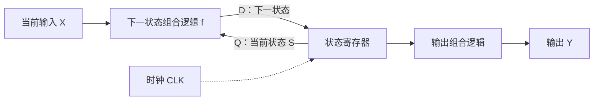
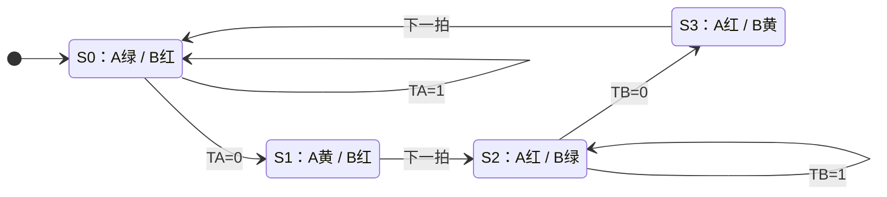

# 《数字设计与计算机体系结构》第三章 完整笔记（含英文术语）

> [!note] 本章主线与阅读约定
> 对应本目录课件《Chapter 3 Sequential Logic Design》。主线：反馈保存状态 → 锁存器/触发器 → 同步状态更新 → FSM → 建立/保持约束 → 流水线。
>
> 本章用 $S^+$ 表示下一状态、$\overline S$ 表示取反，避免把课件中的撇号同时读成“下一状态”和“非”。时序公式默认同源时钟、无时钟偏斜，除非另作说明。

---

## 一、引言（Introduction）

### 1. 状态（State）—— 计算机的核心概念

计算机反复做两件事：

1. **状态存储**（Storage）：存储“bit”位。
2. **状态改变**（State Change）：用布尔代数改变“状态位”。

**硬件层面示例**：

- 寄存器状态：每一位 0/1 都是运算的临时状态。
- 内存（RAM）状态：变量、数组、栈、堆，全部是内存状态。

**时钟（Clock）的作用**：

系统时钟协调硬件状态在何时更新；两次有效边沿之间，组合逻辑计算下一状态。**一行高级语言代码不对应一个时钟周期**，一条机器指令也可能跨多个周期，流水线还可以让多条指令重叠执行。

### 2. 时序逻辑（Sequential Logic）

- 输出不仅依赖当前输入，还依赖之前的输入值（即历史状态）。
- 必须有存储部件（Memory Element）来存储之前的状态。
- 通过输出到输入的 **反馈（Feedback）** 来存储状态信息及状态的变迁。
- 记忆元件起到状态存储和 **隔离（Isolation）** 的作用。当前状态（Current State）和下一状态（Next State）分处在记忆元件的两端。

**核心公式**：

$$\text{同步时序电路} = \text{组合逻辑} + \text{触发器（Flip-Flops）}$$

---

## 二、锁存器和触发器（Latches and Flip-Flops）

### 1. 双稳态电路（Bistable Circuit）

- 双稳态元件是存储器件的基本模块，有两个稳定状态：$(Q,\overline Q)=(0,1)$ 和 $(1,0)$，不是说两个输出端各自代表一个状态。
- 由一对反相器交叉耦合组成（无输入端，有两个输出端）。
- 分析：
  - $Q=0 \Rightarrow \overline{Q}=1 \Rightarrow Q=0$（稳定，存储1位数据“0”）
  - $Q=1 \Rightarrow \overline{Q}=0 \Rightarrow Q=1$（稳定，存储1位数据“1”）
- **缺点**：没有输入端，无法控制初始状态或状态的翻转。

### 2. SR锁存器（SR Latch）

由两个交叉耦合的 **或非门（NOR Gate）** 组成，S（Set/置位），R（Reset/复位）

| 状态 | S | R | Q | $\overline{Q}$ | 说明 |
|------|----|----|----|----|------|
| 置位 | 1 | 0 | 1 | 0 | Set |
| 复位 | 0 | 1 | 0 | 1 | Reset |
| 保持 | 0 | 0 | $Q_{prev}$ | $\overline{Q}_{prev}$ | 记忆/Memory |
| 无效 | 1 | 1 | 0 | 0 | 无效/约束状态（Invalid State） |

> *注：S=1,R=1 时，Q 和 $\overline{Q}$ 同时为0，当输入同时撤销时，下一状态不确定，因此为无效状态。*

这是 **NOR 型、高有效输入** SR 锁存器的表。若用交叉耦合 NAND 门，输入通常记为 $\overline S,\overline R$，则 `11` 保持、`01` 置位、`10` 复位、`00` 非法；不能把两种实现的表混用。

### 3. D锁存器（D Latch）

- 内部由 SR 锁存器加控制门组成。
- **电平触发（Level-triggered）**：
  - 当 CLK=1 时，D 直通向 Q（透明 Transparent）。
  - 当 CLK=0 时，Q 保持前一状态（阻塞 Opaque）。
- 避免了 SR 锁存器的无效输入问题（因为 R 和 S 不会同时为1）。

### 4. D 触发器（D Flip-Flop）

**基本结构**：

- 由两个 D 锁存器级联构成（主从结构，Master-Slave）：前级称"主锁存器"，后级称"从锁存器"，两级时钟反相。
- 也可以是维持-阻塞结构，效果等价。

**触发方式**：

- **边沿触发（Edge-triggered）**：仅在时钟的上升沿（↑，正边沿）或下降沿（↓，负边沿）采样 D，并输出到 Q。
- 符号中带三角形标志（>）表示边沿触发；三角形外加小圆圈表示下降沿触发。

**功能描述**：

| Clk      | L1（主）      | L2（从）     |
| -------- | ---------- | --------- |
| **0（低）** | 透明，N1 跟随 D | 锁住，Q 保持不变 |
| **1（高）** | 锁住，N1 保持   | 透明，Q = N1 |


| CLK | D | Q（次态） | 功能 |
|---|---|---|---|
| ↑ | 0 | 0 | 置 0 |
| ↑ | 1 | 1 | 置 1 |
| 非上升沿 | X | 保持 | 不变 |

- 特征方程：**Qⁿ⁺¹ = D**（次态只取决于边沿时刻的输入 D）

**动态特性参数（时序约束）**：

- **建立时间 tₛ（setup time）**：D 必须比上升沿提前稳定的最短时间。
- **保持时间 tₕ（hold time）**：上升沿之后 D 必须继续维持的最短时间。
- **时钟到输出延迟 tₚ（propagation delay / clk-to-q）**：沿到后 Q 变化所需时间。
- 违反建立/保持要求可能使触发器进入亚稳态（metastability），输出在不确定时间内不能被可靠判为 0/1，或采到非预期值；不代表每次违例都一定出现同一种现象。

**与 D 锁存器的对比**：

| | D 锁存器（Latch） | D 触发器（Flip-Flop） |
|---|---|---|
| 敏感方式 | 电平敏感（高电平期间透明） | 边沿敏感 |
| 符号 | 无三角形 | 有三角形（>） |
| Q 何时变 | CLK=1 期间可随 D 改变，经过门延迟 | 有效沿采样后，经 clk-to-Q 延迟更新 |
| 设计关注 | 透明期间的数据传播与竞赛 | 建立时间、保持时间、亚稳态 |

**为什么主从结构表现为边沿采样**：

- CLK=0 时主锁存器接收 D，从锁存器封闭保持输出；CLK↑ 后，从锁存器把主锁存器已锁存的值送给 Q。
- 在满足时序约束、无异步控制动作的功能模型中，外部 D 无法在整个高电平期间穿透两级锁存器。Q 根据边沿采样的值更新，实际更新发生在边沿之后。D 锁存器透明时跟随 D 是正常功能，不能一概称为故障；带反馈的电平敏感电路才需要进一步分析竞赛等问题。

> [!example]
> **主要用途**：
>
> - 寄存器（Register）的基本单元：寄存多位数据。
> - 移位寄存器、计数器、同步时序电路的状态存储单元。
> - 常用集成电路：74LS74（双 D 上升沿触发器，带置位/复位端）。

一句话记忆：**锁存器看"电平"，触发器看"沿"；D 触发器 = 沿来了，Q 变成当时的 D。**

### 5. 带使能端的D触发器（D Flip-Flop with Enable）

- 增加使能端（EN）：
  - EN=1：正常D触发器，在时钟上升沿采集D。
  - EN=0：有效时钟沿到来时继续保存旧值。

其常见实现是在 D 端前加反馈 MUX：

$$D_{internal}=EN\cdot D+\overline{EN}\cdot Q$$

因此使能控制的是**是否载入新数据**。它不等于简单用 `CLK AND EN` 生成新时钟；EN 在不恰当的时刻变化可能让这种门控时钟产生毛刺。

> [!example] EN 控制本拍是否写入
> 同步时序逻辑中，不一定每个周期都要写入寄存器。EN 用于控制特定时刻写入：有效沿到来且 EN=1 时载入新数据，否则保持旧值。

### 6. 带有复位/置位端的D触发器

- **Reset（复位）**：当 Reset=1，无论 D 为何，Q 强制为 0。
- **Set（置位）**：当 Set=1，无论 D 为何，Q 强制为 1。
- **同步复位**：只在有效时钟沿复位。高有效、复位优先时，D 端逻辑为 $D_{internal}=\overline{Reset}\cdot D$。
- **异步复位**：当 Reset=1 时立即复位（需修改内部电路，逻辑较复杂）。

“立即”指不等待时钟沿，仍有器件延迟。复位端若画了小圆圈/横线，表示低有效，不能照搬 `Reset=1`。异步复位撤销也有时序要求，不能认为它可在任意时刻安全释放。若同时有 Set、Reset、EN，应先查看题目给定的优先级和非法组合。

---

## 三、寄存器与寄存器文件（Register and Register File）

### 1. 寄存器（Register）

- 由多个 D 触发器组成（如4-bit寄存器由4个D触发器实现）。
- 所有触发器共享相同的控制信号（reset, clk, enable）。
- 用于暂存数据（如4总线的寄存器）。

### 2. 寄存器文件/寄存器堆（Register File）

- MIPS架构的寄存器文件支持单周期内的多操作数操作。
- 具有 **2个读端口（Read Ports）** 和 **1个写入端口（Write Port）**。
- **写端口原理**：使用 5-to-32 译码器（Decoder），确保每个时钟周期仅对唯一的一个寄存器执行写入操作。
- **读端口原理**：利用各自的读地址，通过 32:1 多路选择器（MUX）选出对应寄存器的数据向外输出，该过程持续有效（随时可读）。

---

## 四、同步逻辑设计（Synchronous Logic Design）

计算机最核心的工作就是在“计算”和“更新状态”之间交替。

- 状态的更新由时钟控制（如上升沿）。

$$S^+[k]=f(S[k],X[k]),\qquad S[k+1]\leftarrow S^+[k]$$

> [!tip] 所有寄存器同时使用旧状态计算
> 在边沿前，各寄存器 Q 保存当前状态，组合逻辑在 D 端形成下一状态；边沿到来时，各寄存器**同时采样旧状态计算出的 D**。例如两个寄存器做 $A^+=B,B^+=A$，初始 A=0、B=1，则下一拍 A=1、B=0，不能按软件顺序先更新 A 再用新 A 更新 B。
> - 有限状态机（FSM）由两部分构成：
>   1. **状态寄存器（State Register）**：保存当前状态，在时钟沿载入下一状态。
>   2. **组合逻辑（Combinational Logic）**：计算下一状态（Next-State Logic），计算输出（Output Logic）。

> [!note] 图解：Q 是“现在”，D 是“准备在下一拍保存的值”
> 反馈使电路能够保留历史；寄存器把当前状态与下一状态隔开。组合逻辑持续计算，状态寄存器在有效时钟沿统一更新。



图中画的是 Moore 型输出路径；Mealy 型还需要从输入 X 连到输出逻辑。

---

## 五、有限状态机（Finite State Machines, FSM）

### 1. 设计流程（8步法）

> [!note]
>
> 1. 理解逻辑本身，确定输入和输出。
> 2. 画出状态转换图（状态图）。
> 3. 写出状态转换表。
> 4. 选择状态编码，用编码更新状态转换表。
> 5. 根据转换表推导每一位下一状态的布尔表达式。
> 6. 写出输出逻辑表（Moore 看状态；Mealy 看状态与输入）。
> 7. 推导并化简各输出表达式。
> 8. 绘制电路、设置复位初态，逐拍仿真并检查时序。

状态表示“为了决定未来行为而必须保留的历史信息”。检查状态图时，每个状态下的输入条件应覆盖全部合法输入且互斥；X 可以是“不影响本次转移”的输入，但要说明约束。还应考虑未使用编码的处理和能否返回复位状态。

### 2. 示例：交通灯控制器

- **状态定义**：
  - S0：$L_A = G, L_B = R$
  - S1：$L_A = Y, L_B = R$
  - S2：$L_A = R, L_B = G$
  - S3：$L_A = R, L_B = Y$
- **状态编码（二进制）**：S0=00, S1=01, S2=10, S3=11
- **输入含义**：$T_A=1$ 表示 A 方向仍检测到车辆，$T_B=1$ 同理；绿灯在本方向仍有车时保持，检测不到车则下一拍转黄。课件示例的黄灯状态持续一拍，实际按秒定时需要计数器，不能靠状态名自动产生时间。

| 当前状态 | 条件 | 下一状态 | A 灯 / B 灯 |
|---|---|---|---|
| S0=00 | $T_A=1$ | S0=00 | 绿 / 红 |
| S0=00 | $T_A=0$ | S1=01 | 绿 / 红 |
| S1=01 | 任意合法输入 | S2=10 | 黄 / 红 |
| S2=10 | $T_B=1$ | S2=10 | 红 / 绿 |
| S2=10 | $T_B=0$ | S3=11 | 红 / 绿 |
| S3=11 | 任意合法输入 | S0=00 | 红 / 黄 |

表中灯色由**当前状态**确定。课件的灯色编码为绿=00、黄=01、红=10，输出的两根线是编码，不能直接当成红黄绿三根灯线。

> [!example] 交通灯状态图：沿着箭头逐拍走
> 箭头条件在有效时钟沿被采样；S1、S3 在下一拍无条件离开，所以本例黄灯各持续一拍。



- **下一状态逻辑**：
  $$S_1^+ = S_1 \oplus S_0$$
  $$S_0^+ = \overline{S_1}\overline{S_0}\overline{T_A} + S_1\overline{S_0}\overline{T_B}$$

推导时，$S_0^+=1$ 只发生在“00 且 A 无车”或“10 且 B 无车”，所以直接得到上式。$S_1^+=1$ 的当前状态为 01、10，与输入无关，因此是异或。把两式分别接到两个 D 触发器的 D 端。

- **输出逻辑**：
  $$L_{A1} = S_1, \quad L_{A0} = \overline{S_1}S_0$$
  $$L_{B1} = \overline{S_1}, \quad L_{B0} = S_1S_0$$

### 3. 状态编码方式对比

| 编码方式 | 特点 | 4个状态所需位数 | 优缺点 |
|----------|------|----------------|--------|
| **二进制编码（Binary）** | K 个状态通常需 $\lceil\log_2K\rceil$ 位 | 2位（00, 01, 10, 11） | 触发器较少，译码逻辑可能较复杂 |
| **独热编码（One-hot）** | K 个状态使用 K 位，合法状态恰好一位为 1 | 4位（0001, 0010, 0100, 1000） | 逻辑往往较简单，但触发器更多，仍需处理非法状态 |

例如交通灯独热状态位为 $q_0\sim q_3$，则 $q_1^+=q_0\overline{T_A}$、$q_2^+=q_1+q_2T_B$，可以直接从“哪些状态会转入该状态”写出。复位应得到 0001，而不是所有位清零。

### 4. FSM的类型

| 类型 | 输出逻辑 | 状态图标记 |
|------|----------|------------|
| **Moore FSM** | 输出只依赖于当前状态（Current State） | 输出标记在圆圈内（状态内） |
| **Mealy FSM** | 输出依赖于当前状态和输入（Input） | 输出标记在圆弧上（输入/输出） |

### 5. 示例：检测序列“01”的蜗牛FSM

- **Moore 型**：S0 表示尚无可用前缀；S1 表示最近采到 0；S2 表示最近采到 01，Y=1。完整转换如下。

| 当前状态 | X=0 的下一状态 | X=1 的下一状态 | Y |
|---|---|---|---|
| S0 | S1 | S0 | 0 |
| S1 | S1 | S2 | 0 |
| S2 | S1 | S0 | 1 |

- **Mealy 型**：只需 S0（最近不是 0 或尚未开始）、S1（最近为 0）。S0 遇 0 转 S1、遇 1 留 S0；S1 遇 0 留 S1、遇 1 转 S0 且 Y=1，其余 Y=0。若用单状态位 q=1 表示 S1，则 $q^+=\overline X$、$Y=qX$。
- **时序区别**：组合输出的 Mealy 电路可在当前输入到来后、下一次采样沿之前响应；Moore 在状态更新后响应。两者差多少取决于输入与采样时刻以及是否给输出加寄存器，不能一概记成“必然早一整拍”。两类组合输出都要检查毛刺，Moore 的多位状态译码也不是天然无毛刺。

### 6. 示例：自动售糖机

- 15美分糖果，接受5美分（n）和10美分（d）硬币。
- 状态：0, 5, 10, 15, >15。
- 使用独热编码或二进制编码分别设计。

> [!note] 售糖机示例的接口条件
> 课件第 94 页要求：**不找零，但超出的 5 分留作下一次交易余额**。为补全课件留白，按 Moore 型给出一种实现；规定投币是单周期脉冲，每拍最多一枚，出货拍不接收新投币。

| 状态 | 不投币 | 投 5 分 | 投 10 分 | 出货 Y |
|---|---|---|---|---|
| B0：余额 0 | B0 | B5 | B10 | 0 |
| B5：余额 5 | B5 | B10 | V15 | 0 |
| B10：余额 10 | B10 | V15 | V20 | 0 |
| V15：余额 15，出货 | B0 | 按接口约定不接收 | 按接口约定不接收 | 1 |
| V20：余额 20，出货 | B5 | 按接口约定不接收 | 按接口约定不接收 | 1 |

逐格用“旧余额+本拍币值”核算转换。出货态扣除 15 分，因此 V20 必须回 B5，不能回 B0。输入 n=d=1 应定义为非法输入或给出处理策略，不能默默当作 15 分。

---

## 六、时序（Timing）

### 1. 输入时序约束

- **建立时间（Setup Time, $t_{setup}$）**：时钟边沿到来之前，数据必须已经稳定的时间。
- **保持时间（Hold Time, $t_{hold}$）**：时钟边沿之后，数据必须保持稳定的时间。
- **孔径时间（Aperture Time, $t_a$）**：$t_a = t_{setup} + t_{hold}$。

> [!example] 图解：有效沿前后都有一段“数据不能动”的窗口
> 建立时间在边沿之前，保持时间在边沿之后。下图仅表示相对位置，不按时间比例绘制。

```text
时间 →       边沿前 t_setup          采样沿          边沿后 t_hold
                    |-----------------↑-----------------|
                    |<---- 建立 ----->|<---- 保持 ----->|
输入 D：  可变化 ... |========== 必须保持同一个值 =========| ... 可变化
时钟 CLK：                            ↑
```

> [!warning] 延长周期不等于修复所有时序问题
> 建立约束关心新数据能否赶上下一拍，保持约束关心它会不会在本拍到得过早。降低时钟频率不能直接修复同沿保持违例。

### 2. 输出时序约束

- **传输延迟（Propagation Delay, $t_{pcq}$）**：时钟沿之后，输出 Q 到达稳定值所需的时间。
- **最小延迟（Contamination Delay, $t_{ccq}$）**：时钟沿之后，输出 Q 开始改变的时间。

### 3. 动态约束（Dynamic Discipline）

**建立时间约束（Setup Time Constraint）**：
$$T_c \geq t_{pcq} + t_{pd} + t_{setup}$$
*解释*：时钟周期必须大于等于 寄存器传输延迟 + 组合逻辑传输延迟 + 下一级寄存器建立时间。

**保持时间约束（Hold Time Constraint）**：
$$t_{ccq} + t_{cd} \geq t_{hold}$$
*解释*：寄存器最小延迟 + 组合逻辑最小延迟 必须大于等于 下一级寄存器保持时间。

### 4. 时序分析示例

- 例1（违例）：$t_{pcq}=50ps, t_{pd}=105ps, t_{setup}=60ps \Rightarrow T_c \ge 215ps$。$t_{ccq}=30ps, t_{cd}=25ps, t_{hold}=70ps \Rightarrow 55ps < 70ps$，**保持时间违例**！
- 例2（解决）：在组合逻辑路径中加入缓冲器增加 $t_{cd}$（如 $t_{cd}=50ps$），$30+50=80ps > 70ps$，成功修复保持时间违例。

**为什么建立约束看最长路径、保持约束看最短路径？**

- 建立：本拍发出的新数据必须赶在**下一拍**的建立窗口前到达，防止“来得太晚”。$f_{max}=1/T_{min}$。
- 保持：本拍发出的新数据不能在**本拍**的保持窗口结束前冲到下一级，防止“来得太早”并覆盖正在采样的旧数据。
- 降低时钟频率能放宽建立时间，却不能修复同沿保持违例；保持公式里没有周期 T。
- 插入缓冲器修复保持后，也要重算最长路径，避免又导致建立违例。

> [!note] 同步器、消抖与多位一致性要分别处理
> **补充：异步输入与同步器。** 外部按键等信号不与本时钟同步，可能撞上采样窗口。常见的单比特同步器使用两级同钟触发器，让第一级有时间恢复；它降低亚稳态传播概率，不是绝对消除。它也不能代替按键消抖，不能直接保证多位总线原子地更新。

---

## 七、并行（Parallelism）

### 1. 基本概念

- **任务（Token）**：一组输入经过处理后产生一组输出。
- **延迟（Latency）**：一个任务从开始到结束所需要的时间。
- **吞吐量（Throughput）**：系统单位时间内产生任务的数量。
- **目的**：并行化可以增加吞吐量。

### 2. 并行形式

| 形式 | 原理 | 示例 |
|------|------|------|
| **空间并行（Spatial Parallelism）** | 提供多个相同的硬件，多个任务在同一时间一起处理 | 增加一个烤箱，Ben和Alyssa同时烤饼干 |
| **时间并行（Temporal Parallelism）** | 一个任务被分成多个阶段（流水线），像工厂装配线 | 流水线：制胚和烘烤重叠进行 |

### 3. 饼干烘焙示例

- **无并行**：延迟20分钟，吞吐量 = 3盘/小时。
- **空间并行**：延迟20分钟，吞吐量 = 6盘/小时。
- **时间并行（流水线）**：延迟20分钟，吞吐量 = 4盘/小时。
- **空间+时间并行**：吞吐量 = 8盘/小时。

### 4. 电路流水线（Pipeline）

- **无流水线**：$T_c=9.5ns$，吞吐量 = 105 MHz。
- **两级流水线**：$T_c=5.5ns$，延迟11ns，吞吐量 = 182 MHz。
- **三级流水线**：$T_c=4.5ns$，延迟13.5ns，吞吐量 = 222 MHz。
- **结论**：增加流水级数改进了吞吐量，但增加了延迟时间。理想流水线成倍增长吞吐量，但实际中因为负载不均衡和寄存器开销，无法达到理想效果。

对 k 级流水线，若每级组合延迟为 $d_i$、寄存器开销为 $t_{pcq}+t_{setup}$，则在无停顿、每拍可接收一个任务的模型下：

$$T\ge\max_i d_i+t_{pcq}+t_{setup},\qquad Latency=kT,\qquad Throughput=\frac1T$$

连续完成 N 个任务总耗时为 $(k+N-1)T$：前 k 拍填满流水线，之后每拍完成一个。**吞吐量取决于最慢一级，延迟需要经过全部级**；增加流水级是否增加单任务延迟，应根据实际分级和寄存器开销计算，不是无条件结论。

> [!example] 图解：三级流水线同时处理三个不同任务
> 假设每拍接收一个任务、没有停顿。每格表示该任务在本周期占用的阶段；“—”表示尚未进入或已经完成。

| 任务 | 周期 1 | 周期 2 | 周期 3 | 周期 4 | 周期 5 |
|---|---|---|---|---|---|
| A | 阶段 1 | 阶段 2 | 阶段 3 | — | — |
| B | — | 阶段 1 | 阶段 2 | 阶段 3 | — |
| C | — | — | 阶段 1 | 阶段 2 | 阶段 3 |

第 3 周期末完成 A，第 4 周期末完成 B，第 5 周期末完成 C：单任务仍需经过 3 级，但填满后每拍完成一个任务。3 个任务共用 $3+3-1=5$ 拍，不是 9 拍。

---

## 八、常见陷阱与考点总结

1. **锁存器 vs 触发器**：锁存器电平触发（透明），触发器边沿触发（稳定）。
2. **SR锁存器无效状态**：$S=1, R=1$ 时，$Q$ 和 $\overline{Q}$ 同时为0，撤销后状态不确定。
3. **寄存器文件控制**：写端口用译码器，读端口用多路选择器。
4. **FSM状态编码**：二进制编码触发器少但逻辑复杂；独热编码触发器多但逻辑简单。
5. **Moore vs Mealy**：区别是输出依赖状态还是状态与输入；Mealy 可以提前响应，具体拍数取决于接口和寄存方式。
6. **建立时间违例**：电路太慢，需要减小 $t_{pd}$ 或增加 $T_c$。
7. **保持时间违例**：电路太快，需要增加 $t_{cd}$（如插入缓冲器）或换用保持时间更小的触发器。
8. **流水线**：可改善吞吐量，增加寄存器面积；单任务延迟要按级数、周期和额外开销计算。

---

## 九、自测练习题（含答案）

### 题 1：SR锁存器

SR锁存器中，当 S=1, R=1 时，Q 和 $\overline{Q}$ 的状态是？
**答案**：Q=0, $\overline{Q}=0$（无效状态）。

### 题 2：D触发器

D触发器在时钟的什么时刻采样输入 D？
**答案**：在时钟的上升沿（或下降沿，取决于具体设计）。

### 题 3：寄存器文件

MIPS寄存器文件通常包含几个读端口和几个写端口？
**答案**：2个读端口，1个写端口。

### 题 4：FSM

Moore型有限状态机和Mealy型有限状态机的根本区别是什么？
**答案**：Moore型输出仅取决于当前状态；Mealy型输出取决于当前状态和当前输入。

### 题 5：时序约束

已知 $t_{pcq}=40ps, t_{pd}=90ps, t_{setup}=50ps$，求最小时钟周期 $T_c$。
**答案**：$T_c \geq 40 + 90 + 50 = 180ps$。

### 题 6：流水线

为什么课件示例增加流水线级数后提高了吞吐量，却增加了延迟？
**答案**：最慢一级变短，使时钟周期由 9.5ns 缩短为 5.5ns、4.5ns，稳态任务完成率提高；但单任务分别需要 2、3 拍，因此延迟为 11ns、13.5ns。一般情况也应这样计算，不能不看参数就认定延迟一定增加。

---

## 十、重要英文术语表

| 中文 | 英文 |
|------|------|
| 时序逻辑 | Sequential Logic |
| 锁存器 | Latch |
| 触发器 | Flip-Flop |
| 双稳态电路 | Bistable Circuit |
| 寄存器 | Register |
| 寄存器文件 | Register File |
| 有限状态机 | Finite State Machine (FSM) |
| 摩尔型 | Moore FSM |
| 米勒型 | Mealy FSM |
| 状态转换图 | State Transition Diagram |
| 状态转换表 | State Transition Table |
| 建立时间 | Setup Time ($t_{setup}$) |
| 保持时间 | Hold Time ($t_{hold}$) |
| 传输延迟 | Propagation Delay ($t_{pcq}$ / $t_{pd}$) |
| 最小延迟 | Contamination Delay ($t_{ccq}$ / $t_{cd}$) |
| 空间并行 | Spatial Parallelism |
| 时间并行 | Temporal Parallelism |
| 流水线 | Pipeline |
| 延迟 | Latency |
| 吞吐量 | Throughput |

---

## 阅读定位与复习路线

[本章课件](<Chapter 3 Sequential Logic Design.pdf>) 的 PDF 页码：状态与存储元件 4～31；寄存器和寄存器堆 33～39；同步逻辑与交通灯 FSM 45～75；Moore/Mealy 序列检测 77～90；售糖机 94～107；时序约束 110～125；并行与流水线 128～140。

学习时先手画锁存器和触发器波形，再从状态图独立推导下一状态方程。解题时同时保留“当前状态”和“下一状态”两列；每个时钟沿先统一采样，再统一更新。最后分别计算最长路径的建立约束和最短路径的保持约束。
