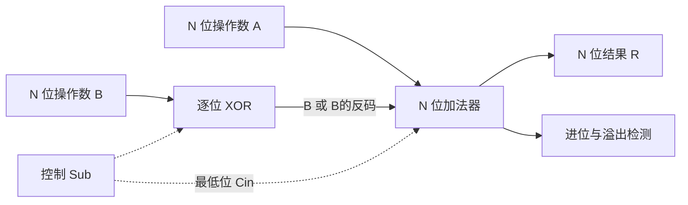
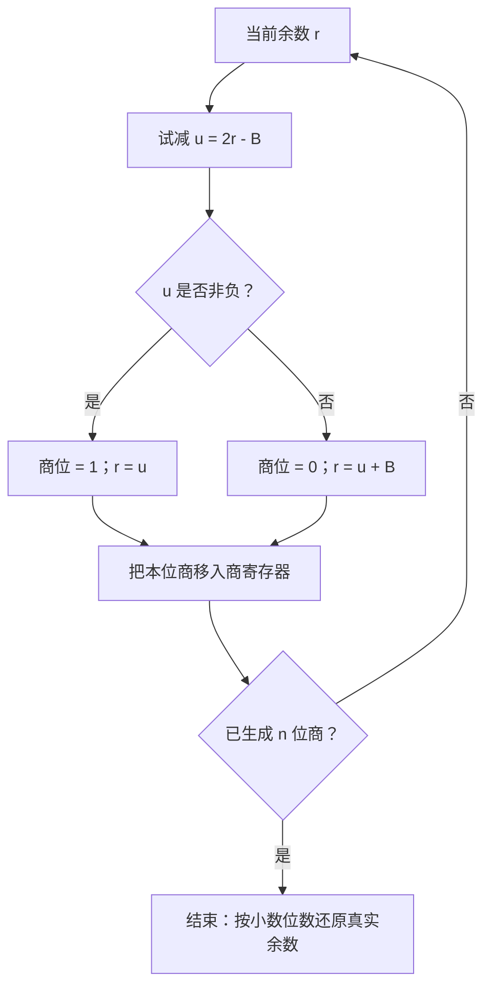
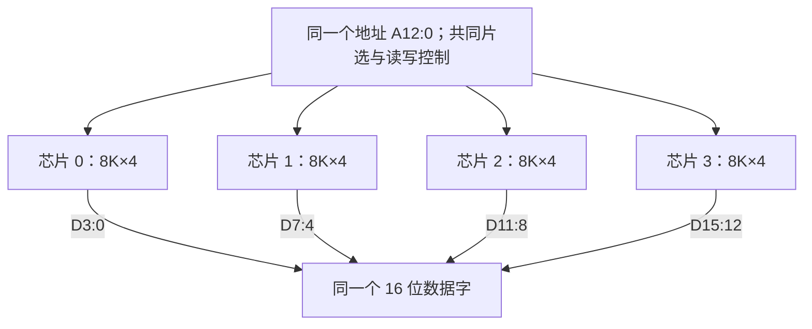

# 《数字设计与计算机体系结构》第五章：常见数字模块

> [!note] 本章主线与阅读约定
> 依据本目录[第五章课件](<Chapter 5 Digital Building Blocks.pdf>)整理。课件共 256 页，除算术模块外，还包含浮点数、计数器、移位寄存器、存储器阵列、刷新、容量扩展、地址译码与多体交叉存储。
>
> 阅读顺序：先理解模块的输入、输出和控制信号，再看内部实现与延迟。公式中的 $+$ 在布尔式里表示“或”，在算术式里表示加法；整数、定点小数、浮点数的编码规则不能混用。

---

## 一、全章框架：数据通路与控制

前两章给出了逻辑门、MUX、译码器，第三章给出了触发器和寄存器。本章用这些元件构成可重复使用的模块。

| 模块 | 输入与输出 | 控制/状态特点 |
|---|---|---|
| 加减法器 | 两个 N 位数 → N 位结果、进位/溢出 | Sub 控制加或减 |
| ALU | 两个操作数 → 算术或逻辑结果 | 功能码选择运算 |
| 组合移位器 | 数据、移位量 → 移位结果 | 本身不保存数据 |
| 迭代乘除法器 | 操作数 → 积/商/余数 | 寄存器保存中间值，控制器安排多拍操作 |
| 计数器、移位寄存器 | 当前状态、输入 → 下一状态 | 时钟沿更新 |
| 存储器 | 地址、写数据 → 读数据 | 片选、读写、时钟等接口依实现而定 |

**数据通路**（datapath）负责存储、选择和变换数据。**控制单元**（control unit）决定本拍执行哪种运算、选择哪条数据路径、写入哪个寄存器。例如 `Sub=1` 选择减法，`EN=1` 使能结果写回。

**模块化例：课件的列车信号讨论（第 33～36 页）。** 28 段轨道各有占用传感器。若把所有输入一起列真值表，需要考虑 $2^{28}$ 种组合；但每段信号只需检查前方两段。令 T1 为下一段有车、T2 为再前一段有车：

$$R=T1,\qquad Y=\overline{T1}\,T2,\qquad G=\overline{T1}\,\overline{T2}$$

这样每段复用同一小模块，并通过接线传入相邻段信息。T1=T2=1 时红灯优先，保证红黄绿只有一盏亮。这体现了“先找局部规则与重复结构，再组合成系统”，不必为整个系统建立一个巨大真值表。

---

## 二、加法器、减法器与 ALU

### 1. 从半加器到全加器

半加器没有输入进位：$S=A\oplus B$，$C_{out}=AB$。全加器还要接收低位进位 $C_{in}$：

$$S=A\oplus B\oplus C_{in}$$
$$C_{out}=AB+AC_{in}+BC_{in}=AB+(A\oplus B)C_{in}$$

| A | B | $C_{in}$ | S | $C_{out}$ |
|---|---|---|---|---|
| 0 | 0 | 0 | 0 | 0 |
| 0 | 0 | 1 | 1 | 0 |
| 0 | 1 | 0 | 1 | 0 |
| 0 | 1 | 1 | 0 | 1 |
| 1 | 0 | 0 | 1 | 0 |
| 1 | 0 | 1 | 0 | 1 |
| 1 | 1 | 0 | 0 | 1 |
| 1 | 1 | 1 | 1 | 1 |

S 是三个输入的奇偶校验，$C_{out}$ 是“三个输入至少两个为 1”。两个半加器和一个 OR 门可构成一个全加器。

### 2. 行波进位加法器（RCA）

将 N 个全加器串接，第 i 位的输出进位接第 i+1 位的输入进位。各位输入虽可同时到达，高位的结果仍可能要等待低位产生的进位。

课件采用简化估计：

$$t_{RCA}\approx Nt_{FA}$$

更细致的模型可分别统计进位产生/传递与末位求和的延迟，例如 $(N-1)t_{carry}+t_{sum}$。解题以给定结构和延迟参数为准，不应把“全加器所有输入到所有输出”的延迟一律视为相同。

### 3. 无符号进位与补码溢出

N 位硬件加法实际保留的是模 $2^N$ 的低 N 位结果。

| 解释 | 加法超范围的判据 |
|---|---|
| 无符号加法 | 最高位向外进位 $C_N=1$ |
| 补码有符号加法 | 两输入同号，结果异号 |

设操作数符号为 $s_A,s_B$，结果符号为 $s_R$：

$$V_{add}=\overline{s_A}\,\overline{s_B}s_R+s_As_B\overline{s_R}$$
$$V=C_{N-1}\oplus C_N$$

这里 $C_{N-1}$ 是**进入符号位**的进位，$C_N$ 是**离开符号位**的进位。若扩为双符号位运算，可按结果两个符号位是否一致判断原位宽是否溢出：00/11 正常，01 正溢出，10 负溢出；这不是说所有有额外保护位的中间计算都只允许 00/11。

例如 4 位 `0111+0001=1000`，无符号 7+1=8 正常，补码 +7+1 溢出；`1111+0001=1 0000` 则无符号溢出，而补码 -1+1=0 正常。

### 4. 复用一个加法器实现加减法

$$A-B=A+\overline B+1\pmod{2^N}$$

让控制信号 Sub 同时接每位 B 前的 XOR 门及最低位进位：

$$B'_i=B_i\oplus Sub,\qquad C_0=Sub$$
$$R=A+(B\oplus\{N\{Sub\}\})+Sub$$

- Sub=0：B 不变，$C_0=0$，得到 A+B。
- Sub=1：B 全部取反，$C_0=1$，得到 A-B。

> [!example] 图解：一个 Sub，同时控制“B 是否取反”和“是否加 1”
> B 的每一位各经过一个 XOR 门，所有 XOR 共享 Sub。图中把 N 个 XOR 简写为一个模块。



> [!tip] 减法器不必先单独存好 -B
> 对 B 取反，并把最低位进位设为 1，同一次加法即可完成 $A+\overline B+1$。

4 位例：$5-3=0101+1100+1=1\,0010$，保留结果 0010。补码减法的有符号溢出条件是 **A、B 异号且结果与 A 异号**：

$$V_{sub}=(s_A\oplus s_B)(s_R\oplus s_A)$$

对于上述直接求 $A+\overline B+1$ 的无符号减法器，$C_N=1$ 表示**无借位**，$C_N=0$ 表示有借位。借位标志在不同指令系统中的命名可能不同，电路分析先看这里的定义。

### 5. ALU：多种运算并行产生，再选择结果

课件 ALU 使用 $F_{2:0}$ 控制：$F_2$ 控制 B 是否取反以及加法器的输入进位，$F_{1:0}$ 选择输出。

| $F_{2:0}$ | 功能 |
|---|---|
| 000 | A AND B |
| 001 | A OR B |
| 010 | A+B |
| 011 | 未使用 |
| 100 | A AND NOT B |
| 101 | A OR NOT B |
| 110 | A-B |
| 111 | SLT（小于置 1） |

逻辑与、逻辑或和加法结果可并行产生，由 MUX 选其中一路。功能码是这套 ALU 的设计约定，并非所有处理器都用这一编码。

> [!warning] 比较大小前，先确定操作数解释
> **SLT 必须区分有符号和无符号比较。**

- 有符号比较：令 $D=A-B$，则 $less=s_D\oplus V_{sub}$。课件简化图取减法符号位，只有在减法不溢出时才足够。
- 反例：4 位补码 $7-(-1)=1000$，结果符号为 1，但 7 并不小于 -1；此时 V=1，$1\oplus1=0$ 才正确。
- 无符号比较：在上述减法器中，$less=\overline{C_N}$，即发生借位才表示 A<B。
- SLT 的 N 位输出是“高 N-1 位全 0、最低位为 less”，不是各位都填 less。

相等比较器可以逐位 XNOR 后 AND，或逐位 XOR 后 NOR：

$$EQ=\bigwedge_{i=0}^{N-1}\overline{A_i\oplus B_i}$$

它不需要判断符号。ALU 的零标志为 $Z=\overline{R_0+R_1+\cdots+R_{N-1}}$。

---

## 三、快速加法器：加快进位计算

### 1. 生成信号与传递信号

课件采用：

$$G_i=A_iB_i,\qquad P_i=A_i+B_i,\qquad C_{i+1}=G_i+P_iC_i$$

- A=B=1 时，无论输入进位如何都产生进位，所以 $G_i=1$。
- A=B=0 时不能产生或传递进位。
- A、B 中一个为 1 时，输出进位跟随输入进位。

也可定义 $P_i=A_i\oplus B_i$，上述进位递推仍成立：两种 P 仅在 A=B=1 时不同，而这时 G 已经强制产生进位。**但若 P 定义为 OR，求和不能写成 $S_i=P_i\oplus C_i$**；仍应使用 $S_i=A_i\oplus B_i\oplus C_i$。

### 2. 先行进位加法器（CLA）

展开递推式，就可用输入直接算进位：

$$C_1=G_0+P_0C_0$$
$$C_2=G_1+P_1G_0+P_1P_0C_0$$
$$C_3=G_2+P_2G_1+P_2P_1G_0+P_2P_1P_0C_0$$
$$C_4=G_3+P_3G_2+P_3P_2G_1+P_3P_2P_1G_0+P_3P_2P_1P_0C_0$$

对 4 位块定义：

$$P_{3:0}=P_3P_2P_1P_0$$
$$G_{3:0}=G_3+P_3G_2+P_3P_2G_1+P_3P_2P_1G_0$$
$$C_4=G_{3:0}+P_{3:0}C_0$$

这样整块也表现为“生成+传递”。直接把 32 位展开成一个超大与或网络会带来扇入和布线代价，因此要分块。**课件第 68～78 页的具体结构是块内计算 G/P、块间逐块传进位**；其他多层 CLA 可以继续对块做先行，不能把所有 CLA 都定义为块间串行。

### 3. 前缀加法器（Prefix Adder）

把高位区间 H 与相邻低位区间 L 合并：

$$(G_H,P_H)\circ(G_L,P_L)=(G_H+P_HG_L,\ P_HP_L)$$

该运算满足结合律，因此可以用树形网络并行合并连续区间。区间跨度按 1、2、4、8……增加，约 $\lceil\log_2N\rceil$ 层得到各位需要的前缀，而不用逐位等待进位。

这里的“并行”是每一层内部并行；层与层之间仍有依赖和延迟。若网络未把 $C_0$ 包含在前缀中，则最终仍用 $C_{i+1}=G_{i:0}+P_{i:0}C_0$，不能漏掉输入进位。

### 4. 课件延迟例题与适用范围

第 86～87 页：N=32、每块 k=4、两输入门延迟 100ps、全加器延迟 300ps，按给定模型：

| 结构 | 计算 | 延迟 |
|---|---|---|
| RCA | $32\times300ps$ | 9.6ns |
| 课件分块 CLA | $100+600+7\times200+4\times300$ ps | 3.3ns |
| 前缀 | $100+5\times200+100$ ps | 1.2ns |

课件使用的公式为：

$$t_{CLA}=t_{pg}+t_{pg\_block}+(N/k-1)t_{AND\_OR}+kt_{FA}$$
$$t_{prefix}=t_{pg}+\log_2N\,t_{pg\_prefix}+t_{XOR}$$

RCA 随位数近似线性增长，所画分块 CLA 的块间等待随块数增长，前缀网络逻辑深度近似对数增长。实际延迟还受扇出、布线和具体网络影响，不能只凭名称直接认定数值。

---

## 四、移位器：数据位置与位权的变化

### 1. 五种移位操作

以下都按 5 位数据、移 2 位计算，丢弃移出端的位：

| 操作 | 输入 11001 的结果 | 空位/回填方式 |
|---|---|---|
| 逻辑左移 | 00100 | 低位补 0 |
| 逻辑右移 | 00110 | 高位补 0 |
| 算术右移 | 11110 | 复制原最高位 |
| 循环左移 | 00111 | 高位移出后回填低位 |
| 循环右移 | 01110 | 低位移出后回填高位 |

对补码，算术左移的位操作通常与逻辑左移一致，但要另行判断数值溢出。不同语言对 `>>`、`>>>` 的定义不同，这里以操作名称为准。

- 左移 k 位仅在结果可表示时等于乘 $2^k$；固定位宽时实际保留低 N 位。
- 无符号逻辑右移等于向下取整除以 $2^k$。
- 补码算术右移相当于对 $x/2^k$ **向负无穷取整**。例如 -7 右移 1 位为 -4，不是向零截断得到的 -3。
- 循环移位只是重新排列位串，不能当作乘除法。

### 2. 桶形移位器（Barrel Shifter）的思路

按移位量的二进制位，串接“可选择移 1、2、4、8……位”的 MUX 层。N 位、移位量 0～N-1 的移位器约需 $\lceil\log_2N\rceil$ 层；每层包含 N 个一位选择器。组合移位器一次组合计算得出结果，移位寄存器则要在时钟沿保存新状态，两者不同。

---

## 五、乘法器：部分积、累加与移位

### 1. 无符号乘法与阵列结构

$$A\times B=\sum_{i=0}^{n-1}(b_iA)2^i$$

每个 $a_jb_i$ 可由 AND 门产生，随后按位权对齐并累加。n 位无符号数相乘，完整积最多需要 2n 位。阵列乘法器用大量加法单元并行处理部分积；迭代乘法器复用较少硬件，以更多周期换面积。

例：$1101_2\times1011_2=13\times11$：

$$00001101+00011010+00000000+01101000=10001111_2=143$$

### 2. 原码一位乘法：每次处理一个乘数位

课件第 100～112 页使用原码小数：**符号单独异或，绝对值按无符号数相乘**。A 为部分积累加器，B 为被乘数的绝对值，C 初始为乘数的数值位。

1. A 清零，符号 $s_P=s_X\oplus s_Y$ 单独保存。
2. 看 C 的最低位：为 1 则 A←A+B，为 0 则 A 不变。
3. 把 A、C 当作一个拼接寄存器联合右移 1 位：**A 的最低位进入 C 的最高位，C 的最低位被移出丢弃**。
4. 重复 n 次，A、C 的有效数值位共同构成 2n 位积。

课件对 A、B 增加保护位保存加法产生的高位信息。因为此算法的绝对值部分积非负，右移高位补 0；不能把“C 的最低位送入 A 的最高位”写成循环移位。

若两个小数各有 n 位小数，乘积有 2n 位小数。例如 $0.1101\times0.1011=0.10001111$，位串与 13×11 相同，但数值要除以 $2^8$。零结果的符号通常统一规范为 +0。

### 3. 原码两位乘法与欠账触发器

课件第 113～124 页每次处理 C 的最低两位，另用欠账位 j。它是原码绝对值乘法的基 4 重编码，不应直接与补码 Booth 算法的查表规则混用。

令两位乘数的值 $d=2C_1+C_0$，把 $d+j$ 写为：

$$d+j=k+4j_{next},\qquad k\in\{-1,0,1,2\}$$

| $C_1C_0j$ | 本步加到 A 的数 | $j_{next}$ |
|---|---|---|
| 000 | 0 | 0 |
| 001 | +B | 0 |
| 010 | +B | 0 |
| 011 | +2B | 0 |
| 100 | +2B | 0 |
| 101 | -B | 1 |
| 110 | -B | 1 |
| 111 | 0 | 1 |

例如 `110` 的 $d+j=3$，用 $3B=-B+4B$ 代替。当前减 B，下一组多加 B；`011` 的值是 2，应加 2B，**不是加 3B**。

操作要点：A、B 用课件的三符号位配置；完成加减后 A、C **联合算术右移 2 位**，让可能为负的中间部分积保留符号；j 更新但**不参与移位**。n 为偶数时循环 n/2 次。结束若 j=1，则再给 A 加 B，**不移位**。

若数值位为奇数，先说明如何扩位并保持数值。无符号整数可以在高位补 0；定点小数可以增加一位末尾 0，但此时小数位数也增加了 1。不能只写“在末尾补 0”而不交代小数点与结果位权。

### 4. 完整例：两位乘法逐步表

课件第 121～122 页：$X=-0.111111_2$，$Y=+0.111001_2$。绝对值编码 B=63、C=57，n=6；A 用 9 位补码保存带保护位的中间数。表中 A 的点后固定为 6 位，C 固定为 6 位。

| 步骤 | 移位前 $C_1C_0j$ | A 的加减结果 | 联合右移后 A | 联合右移后 C | j |
|---|---|---|---|---|---|
| 初始 | — | — | 000.000000 | 111001 | 0 |
| 1 | 010 | 000.111111（+B） | 000.001111 | 111110 | 0 |
| 2 | 100 | 010.001101（+2B） | 000.100011 | 011111 | 0 |
| 3 | 110 | 111.100100（-B） | 111.111001 | 000111 | 1 |
| 还账 | — | A+B=000.111000 | 不移位 | 000111 | 0 |

拼接有效 12 位数值为 `111000000111`，乘积符号为负，因此原码结果写作 $1.111000000111$。数值校验：

$$63\times57=3591,\qquad X Y=-\frac{3591}{4096}$$

---

## 六、除法器：恢复余数与不恢复余数

### 1. 先明确课件采用的数制与范围

> [!warning] 这里是纯小数商的除法，范围约束有前提
> 基本关系是 $X=YQ+R$、Y≠0。课件第 127～134 页讨论**商为纯小数的原码除法**，前提 $0\le|X|<|Y|$，绝对值部分生成 n 位小数商。$|X|<|Y|$ 是该商格式的范围要求，**不是所有整数除法的通用要求，也不等于除零条件**。

符号单独处理：商符号为 $s_X\oplus s_Y$，非零余数的符号与 X 相同。中间余数 A、除数 B 采用带保护位的补码运算，以便做加减；A 初始为 |X|，商寄存器 C 清零。

### 2. 恢复余数法（Restoring Division）

每一步从当前非负余数 r 产生一位商：

1. 试减 $u=2r-|Y|$。
2. 若 u≥0，本位商 1，令 r←u。
3. 若 u<0，本位商 0，加回 |Y| 恢复，令 $r\leftarrow u+|Y|=2r_{old}$。
4. 商寄存器左移并在最低位写入本位商，共产生 n 位。

> [!example] 恢复余数法：先试减，再决定是否把除数加回
> r 是当前非负余数，B 是正的除数绝对值。两条分支最后都保存下一轮要用的非负余数。



每步后的 r 是为了继续算下一位而放大的余数。若 n 步后寄存器表示值为 $r_n$，则真实余数为：

$$R=\operatorname{sign}(X)\,r_n2^{-n}$$

这个 $2^{-n}$ 来自本小数算法累计进行了 n 次余数左移；不能把它套到“余数高半部清零、整数被除数装入低半部”的整数除法器上。

### 3. 不恢复余数法（Non-restoring / 加减交替）

如果上一步试减余数为负，恢复后再试下一位，本应做：

$$2(r_i+|Y|)-|Y|=2r_i+|Y|$$

因此可省去中间恢复，把它合并到下一步：

$$r_{i+1}=\begin{cases}2r_i-|Y|,&r_i\ge0\\2r_i+|Y|,&r_i<0\end{cases}$$

> [!tip] 旧余数决定加减，新余数决定商位
> 本次新余数非负则本位商 1，为负则商 0。**判断下一步加减用旧余数符号，判断本步商用运算后的新余数符号。**

结束时若 $r_n<0$，再做一次 $r_n\leftarrow r_n+|Y|$，不移位、不改商，然后按前面的 $2^{-n}$ 求真实余数。n 轮主体每轮一次加减，最后可能还要一次恢复，因此最多 n+1 次加减，不能漏计最后修正。

### 4. 完整例：$-0.10110_2\div0.11111_2$

用整数单位 $2^{-5}$ 记中间值：初始余数编码 22，除数编码 31，生成 5 位小数商。这样不用每一行都搬动小数点。

| 步骤 | 恢复法试减值 | 恢复后余数 | 本位商 | 不恢复法操作与新余数 |
|---|---|---|---|---|
| 初始 | — | 22 | — | r=22 |
| 1 | 2×22-31=13 | 13 | 1 | 2×22-31=13 |
| 2 | 2×13-31=-5 | 26 | 0 | 2×13-31=-5 |
| 3 | 2×26-31=21 | 21 | 1 | 2×(-5)+31=21 |
| 4 | 2×21-31=11 | 11 | 1 | 2×21-31=11 |
| 5 | 2×11-31=-9 | 22 | 0 | 2×11-31=-9 |
| 收尾 | — | 22 | — | -9+31=22，不再移位 |

因此 $Q=-0.10110_2=-22/32$；最终余数寄存器为 $0.10110_2=22/32$，真实余数为 $R=-22/1024$。验算：

$$-\frac{22}{32}=\frac{31}{32}\left(-\frac{22}{32}\right)-\frac{22}{1024}$$

保护位用于保存左移和加减的中间范围；判断正负要看该扩展格式真正的最高符号位。不能笼统把双高位的 01 和 10 都当成负数。

---

## 七、浮点数：范围、精度与 IEEE 754 编码

### 1. 符号、阶码字段和有效数

二进制科学记数法为 $(-1)^sM2^E$。规格化非零数的有效数 $1\le M<2$，写为 $1.f$。

| 格式 | 总位数 | 符号 s | 阶码字段 e | 小数字段 f | bias | 正规数有效精度 |
|---|---|---|---|---|---|---|
| binary32（单精度） | 32 | 1 | 8 | 23 | 127 | 24 位二进制 |
| binary64（双精度） | 64 | 1 | 11 | 52 | 1023 | 53 位二进制 |

对正规数：

$$E=e-bias,\qquad x=(-1)^s(1.f)_2\,2^{e-bias}$$

e 是存储的无符号阶码字段，E 是真正的指数，二者不同。隐含的前导 1 只适用于正规数；f 严格说是小数字段，不是完整有效数。浮点负数只改变符号字段，不能把整个 32 位串当作补码求负。

### 2. 特殊编码与非规格化数

设阶码字段宽 k，小数字段宽 p，$e_{max}=2^k-1$：

| 阶码字段 e | 小数字段 f | 数值/含义 |
|---|---|---|
| 1～$e_{max}-1$ | 任意 | 正规数，$(-1)^s(1.f)2^{e-bias}$ |
| 0 | 全 0 | +0 或 -0，取决于 s |
| 0 | 非 0 | 非规格化数，$(-1)^s(0.f)2^{1-bias}$ |
| $e_{max}$ | 全 0 | +∞ 或 -∞ |
| $e_{max}$ | 非 0 | NaN（非数） |

非规格化数（subnormal，也称次正规数）的指数固定为 $1-bias$，隐藏位变为 0。它填补正规最小值与 0 之间的间隙，但有效精度会下降。

单精度最小正规正数为 $2^{-126}$，最小非零正数为 $2^{-149}$，最大有限正数为 $(2-2^{-23})2^{127}$。阶码全 1 被保留，所以不能按普通正规数公式解读。

> [!note] 浮点数的范围与精度是两个问题
> **易混淆**：位数有限导致“范围有限”和“相邻数间隔有限”两个不同问题。有效精度为 24 位不表示小数点后固定 24 位；在区间 $[2^E,2^{E+1})$ 内，单精度正规数间隔为 $2^{E-23}$，数越大，相邻值的绝对间距通常越大。

### 3. 十进制转单精度：两道课件例题

**例 1：228。**

$$228=11100100_2=1.11001_2\times2^7$$

s=0；e=7+127=134=`10000110`；f=`11001000000000000000000`。

$$0\;10000110\;11001000000000000000000=\texttt{0x43640000}$$

> [!example] 图解：把 32 位按字段切开，再分别解释
> 下面仍以 228 为例。存储的阶码是 134，真正指数才是 7；正规数前导的 1 不放进小数字段。

```text
位号：      31    30             23   22                         0
          +---+-------------------+-------------------------------+
字段：    | s |    e（8 位）       |          f（23 位）            |
          +---+-------------------+-------------------------------+
编码：    | 0 |     10000110       |    11001000000000000000000    |
          +---+-------------------+-------------------------------+
解释：     正    134 - 127 = 7       隐含 1 后得到 1.11001

数值 = (+1) × 1.11001₂ × 2⁷ = 228
```

**例 2：-58.25。**

$$58.25=111010.01_2=1.1101001_2\times2^5$$

s=1；e=5+127=132=`10000100`；f=`11010010000000000000000`。

$$1\;10000100\;11010010000000000000000=\texttt{0xC2690000}$$

通用步骤：先处理绝对值 → 转二进制 → 规格化 → 求 e → 填 f 并舍入 → 拼接 → 每 4 位转十六进制。只有确定是正规数后才填隐含 1。

### 4. 编码转数值：先分字段，再判类别

课件第 152 页的 `0x41360000`：s=0，e=130，E=3，$1.f=1.011011_2$，所以：

$$x=(1+2^{-2}+2^{-3}+2^{-5}+2^{-6})\times2^3=11.375$$

解码时先看 e 是全 0、全 1 还是中间值；直接假设隐藏位为 1，会把零和非规格化数算错。

### 5. 浮点加减法的过程

1. 拆字段并识别零、非规格化、∞、NaN 等特殊情况。
2. 对正规数恢复隐藏位 1，对非规格化数使用隐藏位 0。
3. 比较实际指数，小指数的有效数右移，向大指数对齐。
4. 根据符号对有效数加或减。
5. 规格化：加法产生进位时右移并增指数；相减出现前导 0 时左移并减指数。
6. 舍入；舍入产生新的进位时可能还需再规格化。
7. 检查指数范围并重新编码。

课件第 159～167 页的例：`0x3FC00000` 与 `0x40500000`，分别为 1.5 和 3.25：

$$1.1\times2^0+1.101\times2^1=0.11\times2^1+1.101\times2^1$$
$$=10.011\times2^1=1.0011\times2^2=4.75$$

结果 e=129、f 以 `0011` 开头，编码 `0x40980000`。本例各步精确；一般情况下，对阶移出的低位会造成舍入误差。

### 6. 舍入、上下溢与误差

| 舍入方式 | 含义 |
|---|---|
| 向负无穷（down） | 取不大于真值的可表示数 |
| 向正无穷（up） | 取不小于真值的可表示数 |
| 向零 | 截掉超出的有效位，绝对值不增 |
| 最近、相等取偶（ties to even） | 选最近值，恰好中点时让末位保留位为 0 |

例如只保留 3 位小数，$1.100101_2$ 向下/向零得到 1.100，向上/最近得到 1.101。若恰在中点，$1.1001_2$ 舍入为 1.100，而 $1.1011_2$ 舍入为 1.110，不能简单理解成“二进制见 1 就进”。

补充理解：用保护位 G、舍入位 R、粘滞位 S（更低位的 OR）辅助判定。最近取偶时，若 $G=1$ 且 $R\lor S\lor LSB=1$，才对保留部分加 1。

- 上溢：结果超过最大有限范围。结果取无穷还是最大有限值与舍入方式、符号有关。
- 很小的结果可能先表示为非规格化数，继续变小才舍入到有符号零；**下溢不能概括成一律置零**。课件第 158 页的简化说法需结合第 149～150 页的非规格化格式理解。
- 浮点加法一般不满足结合律，因为不同运算顺序可能丢弃不同低位。

---

## 八、计数器与移位寄存器

### 1. 计数器（Counter）

N 位二进制计数器的基本下一状态是：

$$Q^+=(Q+1)\bmod2^N$$

带复位和使能时，可规定 Reset 优先：复位时置 0；否则 EN=1 时加 1，EN=0 时保持。计数器是“寄存器+加法器+选择逻辑”，不是只有一串加法门。

模 M 计数器需 $\lceil\log_2M\rceil$ 位，当 Q=M-1 时下一拍回 0。例如模 10 计数从 0 到 9，不能只做 4 位自然溢出，否则会计到 15。还要定义 10～15 等非法状态如何恢复。

### 2. 移位寄存器（Shift Register）

以 N 位右移寄存器为例，每拍 $Q^+=\{SerialIn,Q_{N-1:1}\}$，移出位是旧的 $Q_0$。它可以实现串入并出、并入串出以及乘除法器的联合移位。

课件带并行载入的结构：Load=1 时装入并行数据 D，Load=0 时执行移位。这个约定属于具体电路，实际还可能有 EN、复位与优先级。

若 A、C 联合右移，连线应为 A 的最低位接 C 的串行输入；A 自己的高位按逻辑移位或算术移位规则回填。将两个寄存器分别右移并各自补 0，会丢失跨寄存器边界的位。

---

## 九、存储器阵列、DRAM 与 SRAM

### 1. 地址、深度、位宽与容量

一个 $2^a\times w$ 的存储器有 a 根**逻辑地址线**、每个地址 w 位数据：

$$容量=深度\times位宽=2^a w\ \text{bit}$$

地址经译码选择一行字线（wordline），数据通过列方向的位线（bitline）读写。bit cell 存一位，整行/逻辑字包含多个位元。实际芯片可能再做行列划分和地址复用，因此逻辑地址位数不一定等于封装上同时出现的地址引脚数。

例：$8K\times16$ 中 K 按课件表示 $2^{10}$，深度 8192，字地址 13 位，容量 131072bit=16384B=16KiB。若外部按字节编址，则访问每一个字节需要 14 位地址，并处理字内字节选择；不能把 13 位字地址和 14 位字节地址混为一谈。

**单位约定**：bit 与 B（byte）差 8 倍；KiB/MiB/GiB 分别为 $2^{10}/2^{20}/2^{30}$ 字节；kB/MB/GB 严格表示十进制单位。课件芯片型号中的 K、M 通常按二进制倍数使用，计算时应明确。

### 2. 存储层次与器件类型

寄存器 → Cache → 主存 → 外存，通常越向外容量越大、单位容量成本越低、访问延迟越高。多层存储用于调和处理器速度与大容量之间的矛盾，不能要求一种器件同时达到最大容量、最低价格和最低延迟。

| 类型 | 保存方式/特点 | 断电后 | 是否周期刷新 |
|---|---|---|---|
| SRAM | 典型 6T，交叉耦合反相器保存状态 | 丢失 | 不需 |
| DRAM | 典型 1T1C，电容电荷保存状态 | 丢失 | 需要 |
| Mask ROM | 制造时确定内容 | 保留 | 不需 DRAM 式刷新 |
| PROM | 用户一次编程 | 保留 | 不需 DRAM 式刷新 |
| EPROM | 可擦除再编程，典型为紫外擦除 | 保留 | 不需 DRAM 式刷新 |
| EEPROM / Flash | 可电擦写，Flash 通常按块擦除 | 保留 | 不需 DRAM 式刷新 |

RAM 意为随机访问，强调可按地址访问，而非顺序走完整介质；它在术语上不等于“易失”。本课讨论的 SRAM、DRAM 是易失性 RAM。ROM 家族通常用于读取既有内容，部分类型可以重新编程，不能说所有 ROM 都永远不可写。

### 3. DRAM 的读出、回写与刷新

DRAM 的电容会漏电，所以即使不访问，也要在规定时间内刷新各行。读出会扰动原电荷，需要恢复回写；刷新可理解为按行感测并恢复数据，通常不把数据送给 CPU。

课件第 201～204 页用“字线、位线、电容”示意这一过程。实际 DRAM 还需要预充电和感测放大器，不能把电容理解成能像理想数字源一样直接稳定驱动整条位线。

刷新与 SRAM 的“静态”区别是：SRAM 只要供电正常就能维持稳态，不必定期刷新；这不代表 SRAM 不耗电，也不代表它断电还能保存。

### 4. 三种刷新方式与计算例

课件第 205～209 页：128 行，每行刷新需 $0.5\mu s$，要求在 2ms 内刷新全部行。

$$2ms/0.5\mu s=4000\text{ 个基本周期}$$
$$128\times0.5\mu s=64\mu s,\qquad 64\mu s/2ms=3.2\%$$

| 方式 | 安排 | 此例的结果/代价 |
|---|---|---|
| 集中式 | 在一段时间内连续刷完所有行 | 连续 64μs 不能正常读写 |
| 分散式（课件模型） | 每次正常读写后追加一次行刷新 | 有效读写周期从 0.5μs 变为 1μs；128μs 刷完一遍，刷新过密 |
| 异步式 | 在允许的总时间内均匀插入行刷新 | 平均行刷新间隔最多 $2ms/128=15.625\mu s$ |

若按整数基本周期调度，可每 31 个 $0.5\mu s$ 时隙安排一次行刷新，时隙总长度 15.5μs，其中一个时隙用于刷新；128 行需 1.984ms，小于 2ms。“异步刷新”是此处刷新调度方式的名称，不等于异步时钟域数据同步。

### 5. 寄存器文件（Register File）

课件的 MIPS 例为 32×32 位、两个读端口和一个写端口，总数据容量 1024bit=128B：

- 每个端口的寄存器地址需要 $\log_2 32=5$ 位。
- 写地址经 5→32 译码器产生目标寄存器使能；写使能有效时，在规定时钟沿写入。
- 每个读端口有独立的 32:1、32 位宽 MUX，可同时读不同寄存器。
- 常见教学实现是组合读、时钟沿写，但具体读写时序以接口定义为准；同时读写同一地址的返回值也需明确。
- 若实现 MIPS 的 `$zero`，还要屏蔽对 0 号寄存器的写入并保证读出 0，普通的 32×32 存储阵列不会自动带此规则。

### 6. 用 ROM 实现组合逻辑

n 个输入可作为地址，m 个输出可作为每行数据，因此 $2^n\times m$ 的 ROM 可存储一个 n 输入、m 输出函数的完整真值表。地址译码器选中一行，输出该行预先存好的函数值。

例如两输入半加器需要 4×2bit ROM，地址 AB=`00,01,10,11`，分别存输出 $(C_{out},S)$=`00,01,01,10`。ROM 也能存多输出逻辑，不只存程序和常量；代价是输入每增加一位，完整表的行数翻倍。

---

## 十、存储容量扩展与 CPU 连接

### 1. 位扩展：增加每个字的位数

例：用 $8K\times4$ 芯片组成 $8K\times16$，需要 4 片并联。

- 四片连接相同的 13 根片内地址线，共享片选和读写控制。
- 四片分别连接数据线 D3:0、D7:4、D11:8、D15:12。
- 同一个地址同时选中四片，各提供一个字的不同位；不能让四片都驱动同一组 4 根数据线。

深度不变，位宽扩大 4 倍，逻辑地址位数不变。

> [!example] 图解：位扩展时，每片负责一个字的不同“位段”
> 四片地址相同、同时选中，各自提供 4 位，最后拼成 16 位。数据线按位段分开连接。



### 2. 字扩展：增加可寻址的字数

例：用 $16K\times8$ 芯片组成 $64K\times8$，需要 4 片。

- 低 14 位 A13:0 接各片片内地址。
- 高两位 A15:14 经 2→4 译码产生四路片选，同一时刻只使能一片。
- 数据线可共享，但未选芯片必须释放数据总线（如高阻态），避免总线冲突。

位宽不变，深度扩大 4 倍，逻辑地址增加 2 位。

### 3. 字位同时扩展与通用计算

用 $d\times w$ 芯片构成 $D\times W$ 存储器，若容量可整除：

$$每组并联片数=W/w,\qquad 组数=D/d$$
$$总片数=(W/w)(D/d)$$

例：$1K\times4$ → $8K\times16$，每组 4 片，共 8 组，总计 32 片；A9:0 接片内地址，A12:10 译码选 8 组，组内四片共享片选、分别接数据线的四个部分。


### 4. 地址范围与片选：先列区间，再设计门电路

地址范围包含首尾，因此：

$$单元数=末地址-首地址+1$$

连续且按容量自然对齐的 $2^a$ 单元块，其低 a 位变化，高位固定；高位固定模式就是片选译码条件。若区间未对齐或大小不是 2 的幂，通常要拆分成多个块。

**课件第 236～242 页完整例**：CPU 16 根地址线、8 根数据线、按字节编址，$\overline{MREQ}=0$ 允许访存，R/W=1 读、0 写。

| 区域 | 地址范围（十六进制） | 容量 | 选择的芯片 |
|---|---|---|---|
| 系统程序 ROM | 0000～1FFF | 8KiB | 1 片 8K×8 EPROM |
| 用户区 1 | 2000～3FFF | 8KiB | 1 片 8K×8 RAM |
| 用户区 2 | 4000～5FFF | 8KiB | 1 片 8K×8 RAM |
| 用户区 3 | 6000～7FFF | 8KiB | 1 片 8K×8 RAM |
| 保留区 | 8000～F7FF | 30KiB | 不选中上述芯片 |
| 系统工作区 | F800～FFFF | 2KiB | 1 片 2K×8 RAM |

> [!warning] 片选译码必须覆盖全部高位条件
> 8K 芯片的片内地址为 A12:0；2K 芯片为 A10:0。前四片的高位 A15:13 分别为 000、001、010、011；最后 2K 的 A15:11 必须全为 1，**只译码 A15:13=111 会误选整个最高 8K 区域**。

令 M=1 表示允许访存，即 $M=\overline{\overline{MREQ}}$，则高有效选择条件为：

$$SEL_{ROM}=M\overline{A_{15}}\overline{A_{14}}\overline{A_{13}}$$
$$SEL_{work}=M A_{15}A_{14}A_{13}A_{12}A_{11}$$

其他三片分别按 001、010、011 写出。若芯片 CS 低有效，则 $\overline{CS}=\overline{SEL}$。读写有效条件可以写为 $READ=SEL\cdot(R/W)$、$WRITE=SEL\cdot\overline{R/W}$，再依引脚有效电平生成 OE、WE。ROM 不接普通写命令；题目只给某些控制端时按所给接口画图。

**检查顺序**：容量与片数 → 每片地址范围 → 低位片内寻址 → 高位片选译码 → 访存门控 → 读写极性 → 数据总线。漏译码的高位可能导致多个地址映射到同一存储单元，称为地址镜像/重叠。

---

## 十一、多体交叉存储：容量扩展之外提高吞吐量

### 1. 高位顺序编址与低位交叉编址

设有 m 个模块、每模块 d 个字，以下地址 A 都是**字地址**：

| 方式 | 模块号 | 模块内地址 | 连续地址的分布 |
|---|---|---|---|
| 高位顺序 | $\lfloor A/d\rfloor$ | $A\bmod d$ | 先装满一个模块，再到下一个 |
| 低位交叉 | $A\bmod m$ | $\lfloor A/m\rfloor$ | 相邻字轮流进入不同模块 |

当 m 是 2 的幂，低位交叉直接取低 $\log_2m$ 位为模块号，其余为模块内地址。4 体交叉中，地址 0、1、2、3 分属模块 0、1、2、3，地址 4 又回模块 0、模块内地址 1。

> [!example] 图解：连续字地址在四个存储体之间“轮流走”
> 每一行是相同的体内地址，每一列是一个存储体；表格里的数字是全局字地址。

| 体内地址 | 体 0（低两位 00） | 体 1（01） | 体 2（10） | 体 3（11） |
|---|---|---|---|---|
| 0 | 0 | 1 | 2 | 3 |
| 1 | 4 | 5 | 6 | 7 |
| 2 | 8 | 9 | 10 | 11 |
| 3 | 12 | 13 | 14 | 15 |

> [!tip] 用商和余数拆地址
> 例如字地址 11：$11=2\times4+3$，因此体内地址为 2，体号为 3。去掉表示体号的最低两位（右移 2 位），等价于除以体数取整。

### 2. 为什么能提高连续访问速度

若一个模块存储周期为 $T_m$，总线每 $\tau$ 时间可传一个字，为使每次轮回同一模块时它已可再次启动，需要：

$$m\tau\ge T_m,\qquad m\ge\left\lceil T_m/\tau\right\rceil$$

课件 4 体示例每隔 $T_m/4$ 启动下一个体，类似流水线：单个模块的访问延迟没有凭空缩短，但连续访问的启动间隔与整体吞吐量可以改善。

若进一步把首字等待也按 $T_m$ 估计，理想情况下顺序取 N 个字耗时约 $T_m+(N-1)\tau$；题目若单独给出首字访问延迟，则用该延迟替换首项。若步长总是 m 的倍数，访问可能反复落入同一体，产生体冲突，无法达到理想吞吐量。

### 3. 课件综合例：16M×8 → 64M×16

第 253～255 页要求同时扩容并提高连续访问速度：

1. 每两片 $16M\times8$ 并联，构成一个 $16M\times16$ 模块。
2. 共 4 个这样的模块，采用低位交叉，总计 **8 片**。
3. 芯片/模块内地址 24 位；整个主存为 64M 个 16 位字，字地址 26 位。
4. 令 A1:0 选体，A25:2 接模块内的 24 位地址。每模块两片分别接 D7:0、D15:8。

字地址 `0x1234567` 的最低两位为 `11`，因此模块号为 3：

$$模块内地址=\texttt{0x1234567}>>2=\texttt{0x48D159}$$

容量为 $64M\times16bit=128MiB$。若题目改成按字节编址，总地址需要 27 位，还要先区分最低一位的字内字节选择，再讨论选体位，不能原封不动照用上面的 A1:0。

---

## 十二、复习速查与自测

### 1. 核心公式速查

| 问题 | 结论 |
|---|---|
| 加减法器 | $R=A+(B\oplus\{N\{Sub\}\})+Sub$ |
| 补码溢出 | 符号位的输入/输出进位异或 |
| 有符号 A<B | $(A-B)$ 的符号位 XOR 减法溢出 |
| 无符号 A<B | 上述减法器发生借位，即 $\overline{C_N}$ |
| 进位递推 | $C_{i+1}=G_i+P_iC_i$ |
| 课件 P/G | $P_i=A_i+B_i$、$G_i=A_iB_i$ |
| 纯小数不恢复除法 | 旧余数非负则移位减 B，否则移位加 B；最后可能恢复 |
| 单精度正规数 | $(-1)^s(1.f)2^{e-127}$ |
| 单精度非规格化数 | $(-1)^s(0.f)2^{-126}$ |
| 存储容量 | 深度×位宽，注意 bit→B 除以 8 |
| 扩展片数 | 位宽倍数×深度倍数 |
| 低位交叉 | 体号=A mod m，体内地址=⌊A/m⌋ |

### 2. 自测题与解析

**题 1：** 8 位加减法器计算 $10000000-00000001$，按补码解释是否溢出？

**答：** -128-1=-129 超范围，硬件低 8 位结果 01111111（+127），V=1。原操作数异号且结果与被减数异号。

**题 2：** 为什么 OR 定义的传递信号不能直接用于 $S=P\oplus C$？

**答：** A=B=1、C=0 时 OR 型 P=1，$P\oplus C=1$，但正确和位为 0；进位递推和求和表达式的等价条件不同。

**题 3：** 两位乘法查表 `101`，应做什么？

**答：** $2+1=3=-1+4$，本步加 -B，j 置 1，A、C 联合算术右移 2 位；j 不移位。

**题 4：** 不恢复余数法最后一次算得 r=-9、B=31，应如何结束？

**答：** r←-9+31=22，不再移位、不更改已有商；若使用本章 5 位小数商例的寄存器尺度，真实有符号余数为 $\operatorname{sign}(X)(22/32)2^{-5}$。

**题 5：** `0x80000000`、`0x00000001`、`0x7F800000` 按单精度分别是什么？

**答：** -0、最小非规格化正数 $2^{-149}$、+∞。不能将前两个都按隐藏位为 1 解码。

**题 6：** 用 2K×8 芯片组成 8K×16，需要几片、怎样接地址？

**答：** 每组 2 片位扩展，共 4 组字扩展，总计 8 片。低 11 位片内寻址，高 2 位选组；组内两片共享地址和片选，分别接数据总线低/高 8 位。

**题 7：** 4 体低位交叉的字地址 27，体号和体内地址是什么？

**答：** $27\bmod4=3$，体内地址 $\lfloor27/4\rfloor=6$；逆向校验 $6\times4+3=27$。

### 3. 学习重点与课件定位

| 层次 | 应达到的程度 | 对应 PDF 页码 |
|---|---|---|
| 基础 | 会画加减法器，区分进位/溢出，能解释 ALU 功能码 | 5～64 |
| 理解 | 能展开进位式，说明三类加法器的关键路径与代价 | 66～89 |
| 计算 | 独立完成一位/两位乘法、两种除法并验算 | 92～134 |
| 计算 | 能编码/解码浮点数并做对阶、规格化和舍入 | 137～167 |
| 应用 | 能写计数器/移位寄存器下一状态，计算容量与刷新 | 169～220 |
| 综合 | 能做字位扩展、完整地址译码和交叉存储地址拆分 | 224～255 |

英文术语：Adder 加法器，Carry 进位，Borrow 借位，Overflow 溢出，ALU 算术逻辑单元，Partial Product 部分积，Remainder 余数，Significand 有效数，Exponent 指数，Bias 偏置，Subnormal 非规格化数，Wordline 字线，Bitline 位线，Refresh 刷新，Chip Select 片选，Interleaving 交叉编址。
