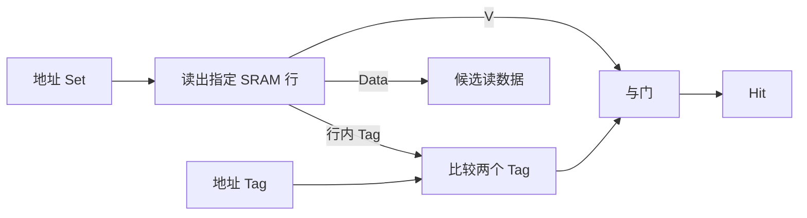
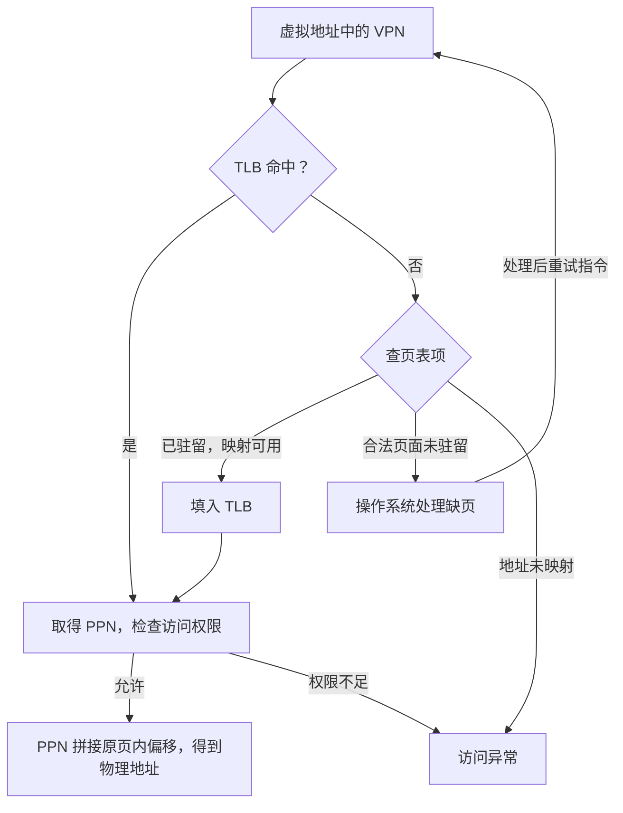

# 《数字设计与计算机体系结构》第八章 存储与 I/O 系统

> [!note] 本章主线与阅读约定
> 第六章给出 `lw`、`sw` 的语义，第七章由 ALU 算出有效地址，再通过存储接口完成读写。本章继续追踪这个地址。先用存储层次处理访问速度问题，再分别解决 Cache 中的数据定位、虚拟地址转换和外设选择。
>
> 例题沿用 [本章课件](<Chapter 8 Memory & I_O System.pdf>) 的 MIPS 教学约定。Cache 和 MMIO 的 MIPS 例按 32 位字节地址、一个字 4 B 计算。虚拟内存例和章节练习使用各自给出的位宽、字长与容量。页码均指含封面的 PDF 页码。

> [!important] 学完本章应能独立完成的操作
> 1. 给定一串读地址和空 Cache，逐次判断命中，并说出缺失后哪一行发生了变化。
> 2. 给定一个虚拟地址、TLB 和页表，找出物理地址，或指出需要进入哪种异常处理。
> 3. 给定设备地址和一条 `lw` 或 `sw`，指出译码器使能谁、读数据从哪里返回。

---

## 一、存储层次与局部性

### 1. 第七章的存储接口为什么需要改变实现？

对 `lw` 而言，ALU 的结果是地址。只有存储系统提供 `ReadData`，CPU 才能把目标字写回寄存器。第七章把这一段访问当作已知延迟。若每次取指和读写数据都等较慢的主存，访存会限制处理器完成指令的速度，这就是**存储器墙**（Memory Wall）。 [课件第 3～6 页](<Chapter 8 Memory & I_O System.pdf#page=3>)

第五章的 SRAM 与 DRAM 各适合不同的位置。越靠近 CPU 的层越强调访问时间，下面的层承担更多容量。

| 层次 | 课件中的介质 | 在系统中的用途 |
|---|---|---|
| Cache | SRAM | 保存一部分主存块，快速提供近期或相邻的数据 |
| 主存 | DRAM | 保存当前驻留的程序页和数据页 |
| 后备存储 | SSD 或 HDD | 为需要从存储设备装入的文件页等提供数据，也可用于保存被换出的页面 |

### 2. 一组地址里如何辨认两种局部性？

- **时间局部性**（Temporal Locality）。循环反复读取同一个计数值。把它留在 Cache，后几次可直接命中。
- **空间局部性**（Spatial Locality）。顺着数组读 `a[0]`、`a[1]`、`a[2]`。假设三个元素处于同一块，第一次访问时把整块调入，后面的访问能在同一 Cache 行取到别的字。

一次 `lw` 要一个字，Cache 缺失时可以从主存搬一整个**块**。看第 8 页的箭头，从 Cache 给 CPU 返回的是本次所需的字，主存与 Cache 之间填充的是块。时间局部性解释了**为什么保留这个块**，空间局部性解释了**为什么连相邻数据也一起搬**。 [课件第 7～8 页](<Chapter 8 Memory & I_O System.pdf#page=7>)

---

## 二、存储性能与平均访问时间

### 1. 先列命中与缺失两条路径

**命中**是在当前层找到请求的数据。**缺失**时先确认当前层没有，再请求下一层。设本层查询耗时 $t_{\mathrm{hit}}$，确认缺失后额外耗时的平均值为 $p_{\mathrm{miss}}$。一次命中耗时 $t_{\mathrm{hit}}$，一次缺失平均耗时 $t_{\mathrm{hit}}+p_{\mathrm{miss}}$。将两条路径按频率加权，得到平均存储器访问时间（AMAT）。

$$
\begin{aligned}
h &= \frac{\text{命中次数}}{\text{到达本层的访问次数}}, \qquad m=1-h \\
\mathrm{AMAT} &= h\,t_{\mathrm{hit}}+m(t_{\mathrm{hit}}+p_{\mathrm{miss}})
                 =t_{\mathrm{hit}}+m\,p_{\mathrm{miss}}
\end{aligned}
$$

> [!example] 2,000 次访存中有 1,250 次命中
>
> 命中率 $h=1250/2000=62.5\%$，缺失率 $m=750/2000=37.5\%$。查 Cache 每次要 1 个周期，缺失后访问主存再花 100 个周期。总共付了 2,000 次查询时间和 750 次额外时间。
>
> $$\mathrm{AMAT}=\frac{2000\times1+750\times100}{2000}=38.5\text{ 个周期}$$
>
> 若题目把缺失时的 **101 周期总耗时**直接给出，就用两条路径加权，算式是 $0.625\times1+0.375\times101$。 [课件第 10～15 页](<Chapter 8 Memory & I_O System.pdf#page=10>)

### 2. 多走一层，就要乘上到达这一层的概率

课件第 13 页依次画出 Cache、主存和后备存储。按图中的简化模型，若 $m_{\mathrm C}$ 为 Cache 缺失率，$m_{\mathrm M}$ 为已经到达主存时的缺失率，则

$$\mathrm{AMAT}=t_{\mathrm C}+m_{\mathrm C}(t_{\mathrm M}+m_{\mathrm M}t_{\mathrm D})$$

$t_{\mathrm M}$ 是上层缺失后访问主存的时间，$t_{\mathrm D}$ 是再往下一层的额外代价。每次访问都付 $t_{\mathrm C}$。只有 Cache 缺失才付 $t_{\mathrm M}$，只有连续两层缺失才付 $t_{\mathrm D}$。第 14～15 页的算例只算到主存。后面增加 L2 时，仍用这个办法逐层展开。

---

## 三、Cache 的组织与地址字段

### 1. 一行存什么？组和路怎样数？

课件先处理读操作。Cache 的一行（line）可以容纳一个主存块，并保存两个用于命中判定的字段。**有效位 V** 表示该行已有可用内容，**标记 Tag** 区分映射到同一组的不同主存块。组号来自地址选中的行位置。 [课件第 17～24 页](<Chapter 8 Memory & I_O System.pdf#page=17>)

设 Cache 的数据容量为 $C$ B，块大小为 $b$ B，相联度为 $N$，即每组有 $N$ 路。总行数 $B=C/b$，组数 $S=B/N$。计算数据容量时只计 Data，计算实现需要的 SRAM 位数时还要计 V、Tag 等元数据。

| 组织方式 | 相联度 $N$ | 组数 $S$ | 本次请求查哪些行？ |
|---|---:|---:|---|
| 直接映射（Direct Mapped） | 1 | $B$ | 查地址指定的那一行 |
| 组相联（Set Associative） | $N$ | $B/N$ | 查地址指定组内的 $N$ 路 |
| 全相联（Fully Associative） | $B$ | 1 | 查唯一一组内的全部行 |

### 2. 用除法理解为什么地址要切成三段

设 $A$ 是字节地址。先除以块大小，得到主存块号 $q$ 和块内偏移 $d$。再将块号除以组数，把余数作为组索引，把商作为 Tag。两个等式也可用于反向验算。

$$
\begin{aligned}
A &= q\,b+d  && (0\le d<b) \\
q &= \mathrm{Tag}\cdot S+\mathrm{Set} && (0\le \mathrm{Set}<S)
\end{aligned}
$$

$b$、$S$ 都是 2 的幂时，这两次除法可以直接用切地址位完成。按 `Tag | Set | Offset` 从高位到低位排列。Offset 占 $\log_2 b$ 位，Set 占 $\log_2 S$ 位，余下的高位归 Tag。图中如果还画了 `Block Offset | Byte Offset`，前者是块内第几个字，后者是这个字内第几个字节。对于一个字 4 B 的对齐 `lw`，最低 2 位始终是 `00`。 [课件第 40、44 页](<Chapter 8 Memory & I_O System.pdf#page=40>)

### 3. 直接映射电路怎样判命中？

沿用课件的 $C=32$ B、$b=4$ B。直接映射有 8 组，所以 32 位地址拆成 `Tag 27 | Set 3 | 字内偏移 2`。每行的数据部分恰好是一个 32 位字。第 24 页的 SRAM 有 8 行，每行含 1 位 V、27 位 Tag、32 位 Data，合计 $8(1+27+32)=480$ 位，其中 256 位存的是数据。



对地址 `0x04`，主存块号为 1，所以选组 1，Tag 为 0。若此行 `V=0`，即使存储位恰好也是 0，Hit 仍为 0。若 V 为 1 但 Tag 不等，说明这一行存了同组的另一个块。只有 `V=1` 且 Tag 相等时才能采用读出的 Data。缺失时从下层取块，更新这一行的 Data、Tag、V，再完成本次读取。 [课件第 22～24 页](<Chapter 8 Memory & I_O System.pdf#page=22>)

---

## 四、从三组访问序列看相联度和块大小

### 1. 直接映射的命中来自哪里？

初始 Cache 为空，每块一字，8 组，每组 1 路。课件循环 5 轮，每轮读 `0x04、0x0C、0x08`。以下只计循环中 `lw` 的数据访问。

| 访问序号 | 字节地址 | 主存块号 | Set | 该组在访问前的状态 | 结果 |
|---:|---|---:|---:|---|---|
| 1 | `0x04` | 1 | 1 | 无效 | 缺失，填块 1 |
| 2 | `0x0C` | 3 | 3 | 无效 | 缺失，填块 3 |
| 3 | `0x08` | 2 | 2 | 无效 | 缺失，填块 2 |
| 4 | `0x04` | 1 | 1 | V 为 1，Tag 为 0 | 命中 |

三个块各有自己的组，之后也没有访问其他块把它们逐出。所以 15 次访问中仅前 3 次缺失，缺失率 $3/15=20\%$。第 28 页标的 75% 对应当时走完的前 4 次访问。 [课件第 25～29 页](<Chapter 8 Memory & I_O System.pdf#page=25>)

### 2. 发生冲突时，只增加相联度会怎样？

把序列换成 `0x04、0x24`，仍循环 5 轮。块号为 1 和 9。两种布局的块大小和总行数相同。

| 布局 | 两个块的 Set | 两个块的 Tag | 读完前两次后 | 10 次访问的缺失率 |
|---|---|---|---|---:|
| 直接映射，8 组 | 都是 1 | 0、1 | 组 1 只留块 9，下一次读块 1 又要换回 | $10/10=100\%$ |
| 两路组相联，4 组 | 都是 1 | 0、2 | 两个块在组 1 各占一路，后续可持续命中 | $2/10=20\%$ |

看第 34 页电路时，2 位 Set 同时接到两路 SRAM 的选行端，28 位地址 Tag 并行送给两个比较器。每路分别检查 V 和 Tag，得到 `Hit₀`、`Hit₁`。任一路命中就算整体命中，选数 MUX 再取相应一路的 Data。**组内路号由比较结果确定**。全相联可视为把所有行放在同一组，地址中省去 Set，比较与选择的范围扩大到所有行。 [课件第 30～38 页](<Chapter 8 Memory & I_O System.pdf#page=30>)

### 3. 为利用空间局部性，再单独改变块大小

回到第一组序列 `0x04、0x0C、0x08`，恢复直接映射。容量仍为 32 B，改为每块 16 B（4 字），所以只剩 2 组。第一次读 `0x04` 会将 `0x00–0x0F` 装入组 0。后两个地址虽然读取不同字，也属于这一个块，15 次访问中只缺失 1 次，缺失率约为 6.67%。

第 41 页用另一地址 `0x8000009C` 检查两级选择。32 位地址按下列位范围拆分。

| 字段 | 位范围 | 本例的值 | 接到哪里？ |
|---|---|---|---|
| Tag | `A[31:5]` | `0x4000004` | Tag 比较器 |
| Set | `A[4]` | 1 | 选中 SRAM 第 1 行 |
| 块内字索引 | `A[3:2]` | `11`，即 3 | 四选一 MUX 的选择端 |
| 字内偏移 | `A[1:0]` | `00` | 字访问时对应对齐字地址 |

可用算术核对。块首为 `0x80000090`，与请求地址相差 12 B，即第 3 号字。命中后才能采用这一行中由 MUX 选出的字。扩块是让同一个块覆盖更多相邻地址，提高相联度是让同一组容纳更多不同的块。 [课件第 39～44 页](<Chapter 8 Memory & I_O System.pdf#page=39>)

---

## 五、Cache 缺失类型、替换与多级组织

### 1. 根据访问历史判断缺失原因

| 类型 | 判断方法 | 对应例子 |
|---|---|---|
| 强制缺失（Compulsory Miss） | 这是该块第一次被访问 | Cache 为空时，第一次读 `0x04` |
| 容量缺失（Capacity Miss） | 该块以前用过，但同容量的全相联 LRU Cache 也会缺失 | 8 行 Cache 循环读取 9 个不同块，重访某块前已装入 8 个其他块 |
| 冲突缺失（Conflict Miss） | 同容量的全相联 LRU Cache 本可命中，当前映射下却在组内被逐出 | `0x04` 与 `0x24` 反复抢直接映射的组 1 |

题目若只问某一步是否缺失，先按有效位与 Tag 模拟。需要进一步区分容量和冲突时，再用同块大小、同容量的全相联 LRU 作参照。 [课件第 45～46 页](<Chapter 8 Memory & I_O System.pdf#page=45>)

### 2. 组满时在组内决定换谁

缺失后只在地址指定组里找位置。先找无效行，有空位就填入。该组每行都有效时，替换策略才决定要逐出哪一路。

| 策略 | 组满时换出 | 命中时怎样更新状态？ |
|---|---|---|
| RAND（随机） | 随机选一路 | 无需维护先后 |
| FIFO（先进先出） | 最早装入的一路 | 保持原装入顺序 |
| LRU（最近最少使用） | 距上次访问最久的一路 | 将命中的路记为最近使用 |

**两路 LRU 的硬件状态。** 课件第 47～50 页连读 `0x04、0x24、0x54`。块号 1、9、21 对 4 取余均为 1。读第一笔后，Way 0 有效且最近使用。读第二笔填入 Way 1，并将组内的 `U` 改为 1，表示最近使用的是 Way 1。第三笔缺失且该组已满，逐出 Way 0，再把 `U` 改回 0。两路只需 1 位记录这两个次序。如果在第二、三笔之间再读一次 `0x04`，LRU 的 `U` 会因命中而翻回 0，接下来逐出 Way 1。FIFO 仍会逐出最早装入的 Way 0。 [课件第 47～51 页](<Chapter 8 Memory & I_O System.pdf#page=47>)

### 3. 两组两路的 LRU 访问表

Cache 有 4 行、每组 2 路，初始为空。课件图把主存块 `0、1、4、5` 分给组 0，把 `2、3、6、7` 分给组 1。因此按题图取块号的次低位选组。每一步先找组，再更新这一组的状态。下表的组内顺序为**最近使用 → 最久未使用**。 [课件第 52～53 页](<Chapter 8 Memory & I_O System.pdf#page=52>)

| 步骤 | 访问块 | 组 0 | 组 1 | 结果 |
| ---: | ---: | --- | --- | --- |
| 1 | 1 | 1 | 空 | 缺失，填空位 |
| 2 | 2 | 1 | 2 | 缺失，填空位 |
| 3 | 4 | 4, 1 | 2 | 缺失，填空位 |
| 4 | 1 | 1, 4 | 2 | 命中 |
| 5 | 3 | 1, 4 | 3, 2 | 缺失，填空位 |
| 6 | 7 | 1, 4 | 7, 3 | 缺失，逐出 2 |
| 7 | 0 | 0, 1 | 7, 3 | 缺失，逐出 4 |
| 8 | 1 | 1, 0 | 7, 3 | 命中 |
| 9 | 2 | 1, 0 | 2, 7 | 缺失，逐出 3 |
| 10 | 5 | 5, 1 | 2, 7 | 缺失，逐出 0 |
| 11 | 4 | 4, 5 | 2, 7 | 缺失，逐出 1 |
| 12 | 6 | 4, 5 | 6, 2 | 缺失，逐出 7 |
| 13 | 4 | 4, 5 | 6, 2 | 命中 |
| 14 | 7 | 4, 5 | 7, 6 | 缺失，逐出 2 |
| 15 | 2 | 4, 5 | 2, 7 | 缺失，逐出 6 |

命中率为 $3/15=20\%$。例如第 4 步访问块 1 将它移到最近使用端，因此第 7 步应逐出块 4。

> [!warning] 模拟题先确认题目给定的映射和状态表示
> 本题若用块号对 2 取余，选到的组会和课件图不同。表中的顺序是 LRU 次序，课件图的行位置是物理 Cache 行。命中时更新的是使用次序，块的数据仍在原来的路上。

### 4. 从缺失率回到 AMAT

容量增加可减少容量缺失，相联度提高可减少冲突缺失，但每次查询可能要比较更多 Tag。固定容量加大块有两种作用。较多相邻数据能一次调入，同时行数减少，可能使组内竞争加剧。第 56 页小容量曲线先降后升，大块还可能增加一次调入的搬运时间。是否值得改动，可把新参数放回 AMAT 检验。

**多级 Cache 的做法。** 用小而快的 L1 服务每次查询，用更大的 L2 接住 L1 的缺失。第 58 页裸片图中 L1 指令和数据 Cache 分开，对应第七章的取指与数据访问两条通路，L2 统一。若 L1、L2 的查询时间分别为 $t_1,t_2$，各自的局部缺失率为 $m_1,m_2$，L2 缺失再付主存访问时间 $t_{\mathrm{mem}}$，则

$$\mathrm{AMAT}=t_1+m_1\bigl(t_2+m_2t_{\mathrm{mem}}\bigr).$$

例如 $m_1=5\%$、$m_2=20\%$。以 100 次原始访问看，平均 5 次到达 L2，其中 1 次再去主存。若 $t_1=1$、$t_2=8$、$t_{\mathrm{mem}}=100$ 周期，每 100 次的额外成本是 $5\times8+1\times100$ 周期，AMAT 为 $1+1.4=2.4$ 周期。 [课件第 55～58 页](<Chapter 8 Memory & I_O System.pdf#page=55>)

---

## 六、从地址位宽推到硬件连线

### 1. 直接映射练习

主存 1 MiB，Cache 8 KiB，每块 512 B。课件图按一个字 4 B 处理，地址以字节为单位。 [课件第 59～62 页](<Chapter 8 Memory & I_O System.pdf#page=59>)

1. **数地址和组。** 主存字节地址有 20 位。Cache 有 $8192/512=16$ 行，直接映射下就是 16 组，组索引 4 位。
2. **从低位切地址。** 一块含 $512/4=128$ 个字，4 B 的字内偏移需 2 位，128 个字需 7 位索引。主存地址为 `Tag 7 | Set 4 | 块内字索引 7 | 字内偏移 2`。Cache 数据区的内部位置用后 13 位定位。
3. **接电路。** Set 选 SRAM 行。地址 Tag 和选中行的 Tag 作相等比较，与 V 合成 Hit。7 位块内字索引控制读出该行中的哪个字。
4. **代入题目地址。** `0x0022A = 1 × 0x200 + 0x2A`。它属于主存第 1 块，映射到 Cache 第 1 组，Tag 为 0。块内 `0x2A` 即 42 B，除以 4 得商 10、余数 2，所以在第 10 号字的第 2 号字节，编号从 0 开始。实际命中还要检查 V 和 Tag。

> [!note] 对齐访问中的低位与题目指定的低位
> 第 60 页示意的 `00` 用于对齐的字访问。第 62 页指定的是地址 `0x0022A`，它的最低两位是 `10`，指明具体的字内字节。

### 2. 八路组相联练习

主存 64 MiB，Cache 256 KiB，每组 8 路，每块 8 个 64 位字。题目按字节编址、按字访问。 [课件第 63 页](<Chapter 8 Memory & I_O System.pdf#page=63>)

每字 8 B，每块 $8\times8=64$ B，每组装 $8\times64=512$ B，故有 $256\text{ KiB}/512\text{ B}=512$ 组。主存地址 26 位，三段低位合计 $9+3+3=15$ 位，留下 11 位 Tag。

| 查找步骤 | 本题的参数与电路 |
|---|---|
| 1. 按组索引读目录 | 9 位 Set 选出 512 张相联块表中的一张。每张 8 行，每行固定对应一路 |
| 2. 读出 Tags 并判定有效性 | 每行有 11 位 Tag 和 1 位 V。8 个 11 位相等比较器并行比较，结果分别与 V 相与 |
| 3. 由命中位置得到路号 | 例如第 5 路命中，路号编码为 `101`。组索引和两段偏移已经由主存地址给出 |

主存地址是 `Tag 11 | Set 9 | 块内字索引 3 | 字内偏移 3`。如果 Cache 数据区按组、路连续排列，数据区地址可写成 `Set 9 | 路号 3 | 块内字索引 3 | 字内偏移 3`，共 18 位。对齐字访问的低 3 位是 `000`。主存的 Tag 提供比较对象，命中的目录行号提供路号。

---

## 七、虚拟内存与页表

### 1. 为什么主存可以只留一部分页面？

存储设备的容量大，访问代价远高于 DRAM。课件把 DRAM 看作后备存储中的页面的高速缓存，程序常用的页留在 DRAM，需要时再装入未驻留的页。程序使用虚拟地址，操作系统可以为每个进程建立各自的映射并设置权限。同一虚拟地址在不同进程中可能引用不同的数据。 [课件第 66～72 页](<Chapter 8 Memory & I_O System.pdf#page=66>)

| 问题 | Cache 数据块 | 虚拟内存的页 |
|---|---|---|
| 管理的单位 | 主存块与 Cache 行 | 虚拟页与等大的物理页框 |
| 放置位置由谁决定？ | 组索引限制可用的组，命中由 Tag 判定 | 页表记录虚拟页对应的物理页框，可映射到任一可用页框 |
| 所需内容暂时不在本层怎么办？ | 硬件向下一级请求块 | 合法页面未驻留时，操作系统处理缺页 |

### 2. 为什么转换后低位保持原值？

页与页框大小相等。把整个虚拟页放入物理页框，字节距页首的位置不会改变。页大小为 $2^k$ B 时，地址低 $k$ 位是页内偏移 $d$，其余高位是页号。用虚拟页号（VPN）查到物理页号（PPN），再拼回偏移。

$$\mathrm{VA}=\mathrm{VPN}\cdot 2^k+d,\qquad \mathrm{PA}=\mathrm{PPN}\cdot 2^k+d.$$

**课件例。** 虚拟地址空间 2 GiB，物理内存 128 MiB，页面 4 KiB。字节地址位数分别为 31 和 27，页内偏移均为 12 位。虚拟地址是 `VPN 19 | 页内偏移 12`，物理地址是 `PPN 15 | 页内偏移 12`。4 KiB 对应十六进制的 `0x1000`，所以低 3 个十六进制数字直接给出页内偏移。 [课件第 73～77 页](<Chapter 8 Memory & I_O System.pdf#page=73>)

### 3. 沿页表完成三次访问

课件用单级页表保存映射。CPU 通过页表基址和 VPN 定位页表项，简化的表项包含驻留有效位和 PPN。有了表项才能判断是否有可用的物理页框。 [课件第 78～83 页](<Chapter 8 Memory & I_O System.pdf#page=78>)

| 虚拟地址 | 用哪个 VPN 查表？ | 页表返回什么？ | 接下来发生什么？ |
|---|---|---|---|
| `0x247C` | `0x2` | 有效，PPN 为 `0x7FFF` | 页框首地址 `0x07FFF000` 加 `0x47C`，得到 `0x07FFF47C` |
| `0x5F20` | `0x5` | 有效，PPN 为 `0x0001` | `0x1000 + 0xF20 = 0x1F20` |
| `0x73E0` | `0x7` | 课件表项显示未驻留 | 进入缺页处理，转换后仍沿用 `0x3E0` |

第三行假设该页在进程的合法地址范围内。操作系统找到空闲页框，必要时先选一页换出，再装入所需页面或按映射要求初始化。更新页表及相关 TLB 状态后重试指令。若地址未映射或访问权限不足，则按访问异常处理。

---

## 八、TLB 与内存保护

### 1. 为什么查完页表才读数据会慢？

页表也放在主存。以课件的单级页表为例，若每次都查表，一次读数据会先访存读页表项，再访存读目标字。顺序读同一页时，变的是低 12 位偏移，VPN 和 PPN 对应关系可以复用。TLB（转换后备缓冲器，快表）保存近期用过的页表转换，命中时省去那一次页表访问。 [课件第 84～86 页](<Chapter 8 Memory & I_O System.pdf#page=84>)

### 2. 两项全相联 TLB 的数据流

第 87 页以 `VA=0x247C` 为例。19 位 VPN `0x00002` 同时送给两个条目的比较器，各路再用自己的有效位检查匹配结果。第 0 项匹配，故 PPN 选择器输出 `0x7FFF`。偏移 `0x47C` 绕过比较器与选择器，直接接到物理地址低 12 位。输出还是 `0x07FFF47C`。这一电路和两路 Cache 的结构相似，比较字段换成 VPN，选出的内容是 PPN。 [课件第 87 页](<Chapter 8 Memory & I_O System.pdf#page=87>)



### 3. 把三种结果放在一次 `lw` 里检查

设目标是虚拟地址 `0x5F20`，页表中 VPN 5 已驻留到 PPN 1。

| 当前状态 | 这一笔 `lw` 经过的步骤 |
|---|---|
| TLB 里已有 VPN 5 的有效转换 | 直接拼出 `0x1F20`，使用转换后的地址读取数据 |
| TLB 里没有 VPN 5 | 读页表项，确认页面已驻留并取得 PPN 1，填入转换后继续访存 |
| 已得到物理地址，但数据未在 Cache 中 | 向下一层请求包含 `0x1F20` 的块，等待数据返回 |

把目标改为 `0x73E0` 且页表显示页面未驻留时，才进入上一节的缺页处理。定位问题时先问**缺的是地址转换、物理页框中的页面，还是 Cache 里的数据**。

### 4. 同一个虚拟地址如何获得进程隔离？

进程 A 与 B 都访问 `0x247C` 时，VPN 都为 2，偏移都为 `0x47C`。A 的页表可以把 VPN 2 指向帧 `0x7FFF`，B 的页表可以把它指向帧 `0x0001`，分别得到 `0x07FFF47C` 和 `0x0000147C`。处理器按当前进程的映射和访问权限取址，使用 TLB 时也要确保命中的是当前地址空间的转换。若操作系统有意把两者映射到同一个页框，并设置适当权限，它们就能共享该页。 [课件第 69、88～89 页](<Chapter 8 Memory & I_O System.pdf#page=88>)

---

## 九、页面替换

Cache 的替换发生在已选中的组内。课件的页面替换题则在分给进程的 3 个页框中选择。每步先判断页是否驻留，缺页时优先填空闲页框，页框全部占用时才换页。 [课件第 90～99 页](<Chapter 8 Memory & I_O System.pdf#page=90>)

### 1. 同一序列怎样比较 FIFO、LRU 和 OPT？

访问序列为 `P1, P2, P1, P5, P4, P1, P3, P4, P2, P4`。第 5 步之前驻留的是 `P1、P2、P5`，且 `P1` 已经在第 3 步用过一次。此时三种策略各根据一项信息作决定。

| 策略 | 第 5 步换出 | 为什么？ | 第 6 步访问 `P1` |
|---|---|---|---|
| FIFO | `P1` | 最早调入，命中时保持装入先后 | 缺页 |
| LRU | `P2` | 上次访问在第 2 步，距现在最远 | 命中 |
| OPT | `P5` | 往后检查，`P5` 再也不用 | 命中 |

OPT（最优替换）换出未来最晚再使用的页。它需要知道未来访问序列，常用来衡量给定序列和页框数下所能达到的最好结果。RAND 则可随机选择换出页，本题比较的是有确定决策依据的三种策略。

继续做完课件示例。下表列出每次访问后的驻留集合，按页号书写，具体淘汰原因仍依策略判定。粗体是本步命中。

| 步骤 | 访问页 | FIFO | LRU | OPT |
|---:|---|---|---|---|
| 1 | P1 | P1 | P1 | P1 |
| 2 | P2 | P1、P2 | P1、P2 | P1、P2 |
| 3 | P1 | **P1**、P2 | **P1**、P2 | **P1**、P2 |
| 4 | P5 | P1、P2、P5 | P1、P2、P5 | P1、P2、P5 |
| 5 | P4 | P2、P4、P5 | P1、P4、P5 | P1、P2、P4 |
| 6 | P1 | P1、P4、P5 | **P1**、P4、P5 | **P1**、P2、P4 |
| 7 | P3 | P1、P3、P4 | P1、P3、P4 | P2、P3、P4 |
| 8 | P4 | P1、P3、**P4** | P1、P3、**P4** | P2、P3、**P4** |
| 9 | P2 | P1、P2、P3 | P2、P3、P4 | **P2**、P3、P4 |
| 10 | P4 | P2、P3、P4 | P2、P3、**P4** | P2、P3、**P4** |

FIFO 命中 2 次，LRU 命中 4 次，OPT 命中 5 次。总访问数为 10，故命中率分别为 20%、40%、50%。

### 2. 四个页循环访问，三个页框会发生什么？

课件接着重复访问 `P1 → P2 → P3 → P4`。读到 `P4` 时，FIFO 和 LRU 都逐出 `P1`，紧接着却要用 `P1`。此后同一页的两次访问之间正好隔着三个不同的页，FIFO 和 LRU 始终在下一次重用前将它逐出。OPT 第一次装入 `P4` 时逐出后续用得最晚的 `P3`，保住即将访问的 `P1、P2`。取课件展示的前 10 次，三种策略分别命中 0、0、4 次。

---

## 十、存储器映射 I/O

### 1. 怎样用第七章的存储接口接收外设数据？

存储器映射 I/O（Memory-Mapped I/O，MMIO）将部分地址分配给设备寄存器。CPU 仍用 `lw` 和 `sw` 发出请求。课件把 `0xFFFF0000–0xFFFFFFFF` 作为示例的 I/O 地址区间，已分配的外设寄存器由具体地址进一步区分。第 105 页的硬件在原有存储接口上增加了译码器、I/O 寄存器和读数据选择器。 [课件第 101～105 页](<Chapter 8 Memory & I_O System.pdf#page=101>)

| 路径 | 输入与作用 |
|---|---|
| 写数据 | `WriteData` 连到主存和 I/O 寄存器的数据输入端 |
| 写控制 | 译码器用 `Address` 确定目标，结合 `MemWrite` 产生 `WEM/WE1/WE2`，只有目标接收写入 |
| 读数据 | 译码器按地址给出 `RDsel`，读 MUX 从各设备或主存的输出中取一路送回 `ReadData` |

用布尔式看写控制。若 `SEL1` 表示地址命中设备 1，写使能就满足 $WE_1=SEL_1\land MemWrite$。这样即便 `lw` 也选中了设备 1，设备的写寄存器仍不会因为这一读操作装入 `WriteData`。而 `RDsel=00/01/10` 分别接通主存、设备 1、设备 2。

### 2. 对同一设备先写 42，再读回

课件指定设备 1 的寄存器地址为 `0xFFFFFFF4`。MIPS 的 `lw/sw` 把 16 位立即数符号扩展，再与基址寄存器内容相加。立即数 `0xFFF4` 表示 −12，因此代码可直接把位移写成 `-12`。 [课件第 106～108 页](<Chapter 8 Memory & I_O System.pdf#page=106>)

```mips
addi $t0, $zero, 42
sw   $t0, -12($zero)
lw   $t3, -12($zero)
```

| 指令 | ALU 地址与输入数据 | 外设侧动作 | 完成时的结果 |
|---|---|---|---|
| `sw` | `Address=0xFFFFFFF4`，`WriteData=42`，`MemWrite=1` | `WE1=1`，`WEM=WE2=0` | 有效沿将 42 写入设备 1 的 I/O 寄存器 |
| `lw` | `Address=0xFFFFFFF4`，`MemWrite=0` | 所有写使能均关闭，`RDsel=01` | 设备 1 的输出经 `ReadData` 写入 `$t3` |

设备读出的可能是输入、状态或可读回的配置值，由该寄存器的接口定义决定。在实际系统中，MMIO 区域通常设置为不可缓存，使这类访问到达设备。

---

## 十一、I/O 接口扩展选学

在 MMIO 的 CPU 一侧，程序读写设备寄存器。在设备一侧，还需要决定如何在物理线路上传位、采样电压或驱动外设。课件用集成串行端口、定时器和 ADC 的 PIC32 举例。 [课件第 109～116 页](<Chapter 8 Memory & I_O System.pdf#page=109>)

### 1. SPI 与 UART 的采样时序

| 接口 | 接收方怎样找到一位的采样时刻？ | 如何读课件波形？ |
|---|---|---|
| SPI | 主机提供 `SCK`，两端按配置的时钟边沿采样 | 发送和接收各有一条数据线。第 112 页依次显示 bit 7 到 bit 0 |
| UART | 线路空闲为高，起始位拉低后，接收方按约定波特率推算采样时刻 | `8N1` 有 1 个起始位、8 个数据位、无校验、1 个停止位。9,600 波特时每位约 $104.17\,\mu s$ |

### 2. 模拟 I/O 与 PWM

ADC 把模拟输入量化为数字码，例如把传感器电压采集成程序可读的数据。DAC 把数字码变为模拟输出。$N$ 位无符号码共有 $2^N$ 个值，从 0 到 $2^N-1$。用 8 位核对第 114 页的范围，上限应为 255。

PWM 用改变高电平持续时间来改变平均输出。设周期为 $T$，高电平持续 $t_{\mathrm{high}}$，占空比为 $D=t_{\mathrm{high}}/T$。低电平为 0、高电平为 3.3 V 时，25% 占空比的理想平均值为 $3.3\times0.25=0.825$ V。第 115 页的串联电阻与对地电容构成 **RC 低通滤波器**，平滑脉冲并保留平均值。该页正文的「高通」应按图读为「低通」。

### 3. PC 上的接口各连什么？

第 116 页以显示器、蓝牙模块和电机为外设例子。第 117～118 页转到 PC，USB 可连通用外设，SATA 可连接存储设备，扩展卡可接 PCIe。传统 PCI 是并行总线，PCIe 使用串行链路，DDR 对应内存接口。TCP/IP 运行在以太网、Wi-Fi 等链路所承载的网络通信之上。 [课件第 117～118 页](<Chapter 8 Memory & I_O System.pdf#page=117>)

---

## 十二、核心公式与易错点

| 题目给出 | 推导顺序 |
|---|---|
| Cache 容量、块大小、相联度 | 先统一成字节，再算总行数 $C/b$ 和组数 $C/(bN)$，最后从低位依次确定 Offset、Set、Tag |
| 一个访问地址和 Cache 当前状态 | 地址拆成字段 → Set 选组 → 用 V 与 Tag 判命中 → 命中时按偏移选数据，缺失时先找空位再替换 |
| 多层命中时间与缺失率 | 各层只统计实际到达的请求，从最内层额外代价开始向外展开 AMAT |
| 地址空间大小和页大小 | 先算页内偏移位数，从两种地址位宽分别扣除它，得到 VPN、PPN 位宽 |
| MMIO 指令 | 按 MIPS 规则先算有效地址，再用地址找目标。写时看写使能，读时看 MUX 选择和写回 |

| 易混的量 | 解题时检查什么？ |
|---|---|
| 主存块号、组号、路号 | 主存块号标识原块，块号按映射规则决定组，命中的路由 Tag 比较确定 |
| Cache 数据容量与硬件存储量 | 数据容量只统计 Data，硬件位数还要计入 Tag、有效位、替换状态等 |
| FIFO 与 LRU | 访问命中时，FIFO 的装入顺序持续有效，LRU 的使用顺序需要更新 |
| TLB 命中、页面驻留、数据 Cache 命中 | 分别检查转换是否缓存、页面是否在主存、目标数据块是否在 Cache |
| Cache 有效位、页表有效位 | 前者参与判断一行是否含有效块，课件页表模型中的有效位表示页面是否驻留 |
| `WriteData` 与 `ReadData` | MMIO 写数据由 CPU 给出，读数据由被选设备提供，两者的值取决于设备定义 |

---

## 十三、自测练习与解析

### 题 1　Cache 地址位宽

32 位字节地址，Cache 数据容量 16 KiB、四路、每块 64 B。求组数和 `Tag | Set | Offset` 位宽。

**解析。** 有 $16384/64=256$ 行，四行一组得到 64 组。64 B 块需要 6 位偏移，64 组需要 6 位索引，剩余 20 位为 Tag，得到 `20 | 6 | 6`。若每字 4 B，6 位偏移还能拆成 4 位块内字索引和 2 位字内偏移。

### 题 2　区分 FIFO 和 LRU

同一组有两路，初始为空，访问该组中的块 `A、B、A、C、A`。第 4 步分别换出谁？最后一步是否命中？

**解析。** 第三步命中 A，没有改变 FIFO 的装入顺序，却让 A 变成 LRU 的最近使用块。装 C 时 FIFO 换出 A，最后一步缺失。LRU 换出 B，最后一步命中。

### 题 3　区分局部和全局缺失率

L1 查询 1 周期、缺失率 5%。L2 查询 8 周期、局部缺失率 20%。L2 缺失再花 100 周期访问主存。求所有访存中请求主存的比例和 AMAT。

**解析。** $0.05\times0.20=1\%$ 的原始访问请求主存。L2 的 8 周期也只由 5% 的访问支付，所以 AMAT 为 $1+0.05\times8+0.01\times100=2.4$ 周期。

### 题 4　TLB 未命中后怎样继续？

页大小 4 KiB，虚拟地址 `0x73E0` 在 TLB 中未命中。若页表把 VPN 7 映射到有效的 PPN `0x12`，求物理地址。这一步会触发缺页吗？

**解析。** VPN 是 `0x7`，偏移为 `0x3E0`。页表已提供有效映射，填入 TLB 后，物理地址为 `0x12000 + 0x3E0 = 0x123E0`。本次转换只多查了页表，页面已驻留。

### 题 5　推导 MMIO 控制信号

按本章模型，执行 `sw $t0,-12($zero)` 时，写目标是谁？换成 `lw` 时，什么信号决定返回数据的来源？

**解析。** 两条指令的有效地址均为 `0xFFFFFFF4`。`sw` 使 `MemWrite=1`，译码器只置 `WE1`。`lw` 时 `MemWrite=0`，读 MUX 根据 `RDsel=01` 将设备 1 的输出接到 `ReadData`。

---

## 十四、英文术语与课件定位

| 中文 | 英文或缩写 |
|---|---|
| 存储器墙 / 局部性 | Memory Wall / Locality |
| 命中 / 缺失 / 缺失代价 | Hit / Miss / Miss Penalty |
| 平均存储器访问时间 | Average Memory Access Time，AMAT |
| 块 / Cache 行 / 组 / 路 | Block / Cache Line / Set / Way |
| 标记 / 有效位 / 偏移 | Tag / Valid Bit / Offset |
| 虚拟页 / 物理页框 / 页表 | Virtual Page / Physical Page Frame / Page Table |
| 虚拟页号 / 物理页号 | Virtual Page Number，VPN / Physical Page Number，PPN |
| 缺页 / 转换后备缓冲器 | Page Fault / Translation Lookaside Buffer，TLB |
| 存储器映射 I/O / 地址译码器 | Memory-Mapped I/O，MMIO / Address Decoder |

| 内容 | PDF 页码 | 复习时独立完成 |
|---|---|---|
| 存储层次、局部性与 AMAT | 3～15 | 画出命中和缺失两条时间路径 |
| Cache 映射与块大小 | 17～44 | 按给出的容量切地址，逐次模拟读访问 |
| Cache 替换、多级组织与练习 | 45～63 | 按组模拟 LRU，指出组、Tag、路号各从哪里得到 |
| 虚拟内存、页表、TLB 与页面替换 | 66～99 | 从具体虚拟地址算出物理地址，再比较替换结果 |
| MMIO 与外设接口 | 101～118 | 追踪 `lw` 和 `sw` 的地址、写使能与返回数据 |

回看 [第五章的存储器阵列与地址译码](<../第五章 常见数字模块/第五章.md>) 时，可对照 Cache 的选行和 MMIO 的选设备。需要复核 `lw/sw` 的有效地址或控制信号时，分别见 [第六章体系结构](<../第六章 体系结构/第六章.md>) 和 [第七章 CPU 设计](<../第七章 CPU设计/第七章.md>)。
