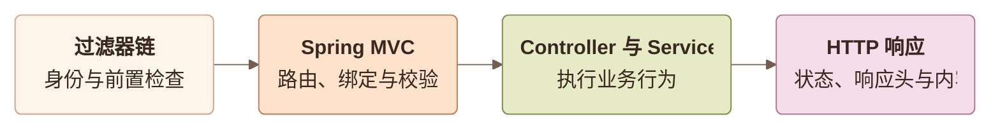
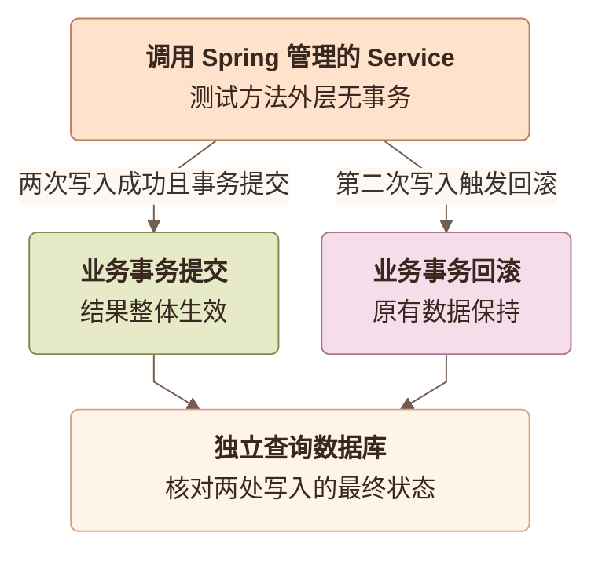

# 软件测试体系

面向 Java 后端开发的测试知识笔记。练习工程基线为 JDK 21、Maven、JUnit Jupiter、Spring Boot 3.3.13、MyBatis 和 MySQL 8.x。接入正式项目时，依赖版本跟随项目的 `pom.xml`。学习顺序与验收见[软件测试体系学习计划书](../../学习计划/未开始/软件测试体系学习计划书.md)。

**阅读导航**

- [1. 测试基础与用例设计](#1-测试基础与用例设计)
- [2. JUnit 5 与 Mockito](#2-junit-5-与-mockito)
- [3. Spring Boot 接口测试](#3-spring-boot-接口测试)
- [4. MySQL 集成测试](#4-mysql-集成测试)
- [5. 接口工具、性能与安全](#5-接口工具性能与安全)
- [6. 测试报告、覆盖率与 CI](#6-测试报告覆盖率与-ci)
- [7. Python LLM API 与 Agent 测试](#7-python-llm-api-与-agent-测试)
- [8. 测试层级速查](#8-测试层级速查)

## 1. 测试基础与用例设计

### 1.1 测试目标与基本术语

测试从**预期行为**出发。需求和接口契约决定预期，测试把它变成可观察的返回值、异常、状态变化或副作用，执行后比较实际结果。一次通过表示在指定输入、版本和环境下观察到了预期结果。输入组合、运行时序和环境很多，测试只能为已覆盖的风险提供证据。

| 术语 | 含义 |
|---|---|
| 被测对象（SUT） | 本次要验证的方法、类、组件或系统。范围决定失败时如何定位。 |
| 测试数据与前置条件 | 输入、已有记录、当前时间、调用者身份和初始状态。 |
| 测试环境 | 运行程序与观察结果所需的 JDK、配置、数据库和外部依赖。 |
| 测试断言 | 对实际结果的检查，例如返回值等于 20、没有新增记录、两个写操作都回滚。 |
| 测试替身 | 为控制依赖行为而提供的简化对象，例如返回固定数据的 Stub。 |
| 测试预期的依据 | 已确认的业务规则、接口规范、人工核对的例子或应一直成立的业务不变量。 |

### 1.2 多个维度下的测试分类

| 分类维度 | 常见类型 | 关注点 |
|---|---|---|
| 是否执行系统 | 静态检查、动态测试 | 评审需求、审查代码、静态分析属于静态检查。执行被测程序并观察行为属于动态测试。 |
| 如何选用例 | 黑盒、白盒、经验驱动 | 黑盒依据外部契约，白盒依据代码结构和分支，经验驱动用既往缺陷和领域知识补充。 |
| 测什么 | 功能、非功能 | 功能关注业务结果，非功能关注性能、安全、可靠性、兼容性等属性。 |
| 为什么测 | 冒烟、确认修复、回归、验收、探索 | 冒烟确认关键链路可用，确认测试核对已知缺陷的修复，回归关注已有行为，验收依据交付标准，探索依据观察结果动态调整用例。 |

这些维度可以叠加。例如用真实 HTTP 验证一个关键业务流程，可以同时是黑盒、系统级和冒烟测试。探索性测试适合规则复杂且还有未知风险的区域。可重复、风险高、预期明确的场景适合进入长期自动回归。相关术语和测试技术见 [ISTQB CTFL 大纲第 2、4 章](https://istqb.org/wp-content/uploads/2024/11/ISTQB_CTFL_Syllabus_v4.0.1.pdf)。

### 1.3 测试层级与测试金字塔

| 层级 | 典型被测范围 | 适合回答的问题 |
|---|---|---|
| 单元 | 一个函数、类或紧密协作的小单元 | 余额刚好足够时扣减结果是否正确？拒绝请求有没有触发写入调用？ |
| 组件或切片 | 有明确边界的一组协作组件，如 Spring MVC 层 | JSON 是否能绑定到请求对象？校验异常是否映射为约定响应？ |
| 集成 | 两个或多个真实组件的交互，如 Mapper 与 MySQL | SQL 映射、数据库约束和事务提交是否符合预期？ |
| 系统 | 整个应用作为被测系统 | 应用启动后，各模块配置和关键业务是否能协同工作？ |
| 端到端 | 从真实入口经必要组件走完一条业务流程 | 一次正式请求能否得到正确响应，并留下正确的最终数据？ |

> [!note] 按实际装配范围判断测试层级
>
> 先确认**哪些组件真实运行、哪些依赖用了替身，以及从哪里观察结果**。例如同样是 `MockMvc`，既可以只加载 MVC 切片，也可以运行在完整应用上下文中。

测试金字塔表达的是反馈速度和维护成本。多用快速单测覆盖规则分支，用少量集成与端到端测试守住高风险连接点。数量比例按业务风险和维护成本调整。

### 1.4 需求、验收条件与用例

**需求**描述业务目标，**验收条件**给出可判定的规则，**测试条件**指出要验证的情形，**测试用例**为该情形指定具体前置条件、输入、操作与预期结果。用例可记录需求编号和版本、用例编号、风险等级、测试层级及结果，让变更后能找到受影响的检查。

以教学规则「可用额度为 100，申请值为正整数且不超过可用额度」为例。验收条件是有效申请只扣除申请值，无效申请保持余额。测试条件可以选“申请值恰好等于余额”。对应例子是余额 100、申请 100、预期接受且余额变为 0。遇到零值、重试次序或接口错误码未定义的情况，先把该条件标为待确认。用例字段见[学习计划书的测试用例模板](../../学习计划/未开始/软件测试体系学习计划书.md#101-测试用例模板)。

### 1.5 等价类与边界值

**等价类**把预期由系统以同一规则处理的数据放到一组，每组选代表值。**边界值分析**重点检查相邻类别的临界处，验证包含端点、比较运算符、取整和单位转换。对于整数区间 `1` 到 `100`，边界附近可以取 `0、1、2、99、100、101`。如果还接受来自 HTTP 的未解析文本、缺失字段或空值，这些情况分别由请求绑定或参数校验规则决定。

| 教学例中的输入类 | 代表值 | 可观察结果 |
|---|---|---|
| 合法值 | `1`、`50`、`100` | 申请被接受，余额分别剩 `99`、`50`、`0`。 |
| 小于最小值 | `0`、`-1` | 请求被拒绝，余额保持 100。 |
| 大于可用额度 | `101` | 请求被拒绝，余额保持 100。 |

时间窗口同样有边界。若契约定义 `[开始, 截止)`，则开始时刻允许、截止时刻拒绝，用小于、等于、大于临界点的三个可控时刻验证。误差单位用业务协议的精度，例如秒或毫秒。边界技术的细分见 [ISTQB CTFL 大纲第 4.2 节](https://istqb.org/wp-content/uploads/2024/11/ISTQB_CTFL_Syllabus_v4.0.1.pdf)。

### 1.6 判定表、状态迁移与经验补充

判定表适合多个布尔条件共同决定结果。每条可行规则对应一个条件组合，`任意` 表示该条件在本规则中对结果无影响。先明确业务优先级，再合并结果相同的组合。下面的教学规则先检查窗口，再校验额度。

| 窗口开放 | 额度有效 | 接受申请 | 余额变化 |
|---|---|---|---|
| 否 | 任意 | 否 | 保持原值 |
| 是 | 否 | 否 | 保持原值 |
| 是 | 是 | 是 | 扣减本次额度 |

状态迁移测试围绕**起始状态、事件、守卫条件和结果状态**。例如一条教学申请从 `已提交` 收到撤销事件，仅当规则允许撤销时才转为 `已撤销` 并返还一次。再次撤销时是否返回成功取决于契约，但“余额不重复增加”仍可作为不变量。非法迁移需要同时验证错误响应和状态保持。因果关系分析适合梳理哪些输入会触发哪些结果。错误推测和探索性测试适合补充延迟重试、输入缺失、历史数据和少见状态组合。

### 1.7 异常分类、业务不变量与优先级

| 场景 | 典型问题 | 适合观察的结果 |
|---|---|---|
| 输入错误 | 缺字段、格式不匹配、超出数值范围 | 业务错误码或校验响应，以及无持久化副作用。 |
| 状态错误 | 已过期、已取消、不同身份的资源归属不符 | 错误响应、状态及受保护数据保持原值。 |
| 依赖失败 | 数据库异常、外部超时 | 错误传播或约定的恢复机制，以及提交、回滚或重试后的最终状态。 |
| 重复请求 | 网络恢复后同一逻辑请求再次送达 | 同一业务效果只产生一次，具体响应按契约。 |

**业务不变量**是操作之后必须成立的约束，例如余额不为负、录取人数不超容量、成功记录与实扣金额相符。高价值测试优先覆盖影响资产、安全、持久化数据完整性和关键状态的规则。代码覆盖率衡量执行到的代码结构，场景覆盖率衡量覆盖了哪些业务条件，缺陷检出率需要说明样本和统计口径，三类数字回答不同问题。

### 1.8 可维护性与 Maven 工程布局

测试应尽可能独立、可重复、可定位。使用可控的初始数据和时间，每条测试只依赖自己所声明的条件，失败信息要能指出预期与实际的差别。同一代码在相同条件下偶尔失败，通常应先检查时间、并行执行、共享资源、网络和数据顺序。随着业务规则变化，更新该规则的测试和预期依据。

| Maven 目录 | 内容 |
|---|---|
| `src/main/java` | 生产 Java 代码。 |
| `src/main/resources` | 生产资源和配置。 |
| `src/test/java` | 测试代码，包名通常对应被测代码。 |
| `src/test/resources` | 测试用配置、示例请求和初始数据脚本。 |
| `target/` | 本地构建输出、测试报告和覆盖率报告。 |

IDEA 适合快速运行单个方法或测试类。Maven 入口提供本地和 CI 可重复的发现规则与报告。排查两处结果差异时，先核对模块、项目 JDK、测试配置与环境变量。`java -version` 用于查看当前命令行 Java，`mvn -version` 显示 Maven 实际使用的 Java。Maven 阶段和报告见[第 6 章](#6-测试报告覆盖率与-ci)。[Apache Maven 标准目录](https://maven.apache.org/guides/introduction/introduction-to-the-standard-directory-layout.html)

---

## 2. JUnit 5 与 Mockito

JUnit Platform 为 IDE 和构建工具提供发现、启动和跟踪测试的入口。JUnit Jupiter 提供 `@Test`、断言与扩展 API，并通过 Jupiter 引擎发现和执行该类测试。Mockito 用于控制协作者的行为和验证关键交互。Spring Boot 3.3.13 的 `spring-boot-starter-test` 已包含这两类测试依赖，分别管理 JUnit Jupiter 5.10.5 与 Mockito 5.11.0。项目有统一的依赖管理时，测试依赖也跟随项目版本。[JUnit 5 架构](https://docs.junit.org/5.10.5/user-guide/index.html#overview-what-is-junit-5) · [Spring Boot 测试支持](https://docs.spring.io/spring-boot/3.3/reference/testing/index.html) · [依赖版本表](https://docs.spring.io/spring-boot/3.3/appendix/dependency-versions/coordinates.html)

### 2.1 被测单元与 AAA

单元可以是一个方法，也可以是由少量对象实现的一项业务行为。先约定输入、返回值、异常和可观察的状态变化，再决定测试如何调用它。一个有效名称能说出触发条件和预期行为，例如 `debitEqualToBalanceLeavesZero`。

| 部分 | 写什么 |
|---|---|
| Arrange | 构造被测对象与初始数据，例如余额为 5 |
| Act | 执行一个业务动作，例如扣减 5 |
| Assert | 断言剩余量恰为 0，或检查与同一行为有关的返回值和状态 |

下面使用教学规则。扣减必须为正且不能超过余额，恰好扣完允许，失败时余额保持原值。示例省略常规 import，`@Test` 与 `Assertions` 来自 `org.junit.jupiter.api`，参数化注解来自 `org.junit.jupiter.params` 及其 `provider` 子包。

```java
final class Quota {
    private int remaining;

    Quota(int remaining) {
        if (remaining < 0) {
            throw new IllegalArgumentException("余额不能为负");
        }
        this.remaining = remaining;
    }

    int remaining() {
        return remaining;
    }

    int debit(int units) {
        if (units <= 0) {
            throw new IllegalArgumentException("扣减量必须为正");
        }
        if (units > remaining) {
            throw new QuotaExceededException();
        }
        remaining -= units;
        return remaining;
    }
}

final class QuotaExceededException extends RuntimeException {}

class QuotaTest {
    @Test
    void debitEqualToBalanceLeavesZero() {
        var quota = new Quota(5);

        int result = quota.debit(5);

        assertAll("恰好扣完", () -> assertEquals(0, result),
                () -> assertEquals(0, quota.remaining()));
    }

    @ParameterizedTest
    @CsvSource({"5, 1, 4", "5, 4, 1", "5, 5, 0"})
    void validDebitsLeaveExpectedBalance(int balance, int units, int expected) {
        assertEquals(expected, new Quota(balance).debit(units));
    }

    @ParameterizedTest
    @ValueSource(ints = {0, -1})
    void nonPositiveDebitLeavesBalanceUnchanged(int units) {
        var quota = new Quota(5);

        assertThrows(IllegalArgumentException.class, () -> quota.debit(units));
        assertEquals(5, quota.remaining());
    }

    @Test
    void excessDebitLeavesBalanceUnchanged() {
        var quota = new Quota(5);

        assertThrows(QuotaExceededException.class, () -> quota.debit(6));
        assertEquals(5, quota.remaining());
    }
}
```

### 2.2 断言、异常与失败信息

| API | 断言意图 |
|---|---|
| `assertEquals(expected, actual)` | 比较契约规定的值。期望值放在前面，便于失败时辨认差异 |
| `assertTrue`、`assertFalse` | 验证业务条件，例如校验是否允许提交 |
| `assertNull`、`assertNotNull` | 验证空值约定。若字段有确定取值，再断言字段值 |
| `assertIterableEquals` | 比较可迭代对象中的元素及顺序。业务允许任意顺序时按集合语义验证 |
| `assertThrows(T.class, action)` | 断言抛出类型 `T` 或其子类，并返回异常对象。契约提供稳定错误码时一并断言 |
| `assertThrowsExactly(T.class, action)` | 契约要求严格限定异常类型时使用 |
| `assertDoesNotThrow` | 明确检查某个动作可完成。需要验证结果时也断言返回值或状态 |
| `assertAll` | 把同一业务结果的多个检查放在一起，便于一次查看相互独立的差异 |

> [!tip] 异常断言只包住目标调用
>
> 把数据准备放在 lambda 外。断言预期异常后，如果业务要求失败时保持原状态，再检查状态或写入副作用。

用**稳定异常类型和错误码**表达业务契约，错误消息仅在文案本身是契约时严格比较。程序意外抛出异常时，沿堆栈定位其发生在准备、执行还是断言阶段。

近似测量值可用 `assertEquals(expected, actual, delta)`，误差来自业务精度约定。金额常用 `BigDecimal`。`compareTo` 会把 `1.0` 与 `1.00` 当作同一个数值，`equals` 同时比较数值与小数位。金额计算应明确舍入规则和比较口径。[JUnit Jupiter 断言](https://docs.junit.org/5.10.5/user-guide/index.html#writing-tests-assertions)

### 2.3 参数化、生命周期与确定性

| 场景 | 写法 |
|---|---|
| 一列简单输入 | `@ValueSource` |
| 多列输入加期望 | `@CsvSource` |
| 复杂对象、集合或多参数组合 | `@MethodSource`，同类工厂通常使用 `static` 并返回 `Stream<Arguments>` |
| 引用类型允许 `null`，或字符串、集合等允许空值 | 按签名使用 `@NullSource`、`@EmptySource` |

只有多个数据行共享相同的规则和断言时，才适合合成一个参数化测试。不同的契约或副作用保留独立方法。每条数据在测试报告中对应一次调用，`@BeforeEach` 与 `@AfterEach` 分别围绕每次调用执行。[JUnit Jupiter 参数化测试](https://docs.junit.org/5.10.5/user-guide/index.html#writing-tests-parameterized-tests)

默认 `PER_METHOD` 为每个测试建立新测试实例。用 `@BeforeEach` 创建常用的可变对象，用 `@AfterEach` 关闭或清理资源。`@BeforeAll` 与 `@AfterAll` 负责类级资源，默认通常声明为 `static`。使用 `@TestInstance(PER_CLASS)` 时要明确此实例的可变字段可能在用例间共享。静态字段、外部数据库和全局配置可跨实例共享，需显式隔离。[JUnit Jupiter 测试实例生命周期](https://docs.junit.org/5.10.5/user-guide/index.html#writing-tests-test-instance-lifecycle)

让结果由可控输入决定。时间逻辑注入 `Clock`，随机逻辑传入固定种子或可控随机源，线程协作使用明确的同步信号和超时，外部 HTTP 响应由可控替身提供。使用小型测试数据工厂减少重复准备，保留本用例重要的字段和边界值。单条通过而整组偶发失败时，优先检查共享数据、执行顺序与资源清理。

### 2.4 回归测试与轻量 TDD

**回归测试**复验已定义的行为，以发现改动带来的意外破坏。修复缺陷时，先让目标用例因预期的业务差异而失败，再修复并验证该用例与关联场景。独立预期值来自需求、接口契约或手算样例。上例取期望 `0`，依据是业务允许恰好扣完。如果实现误用 `>=` 拒绝这笔扣减，预期仍然是 `0`。

**TDD**用一轮失败的测试表达新增行为，再用最小实现满足它，最后在行为稳定后整理代码。重构阶段保留对外行为，修改需求时同步修订受影响的用例。只检查代码是否被执行时，可用变异测试思路检查断言强度，例如判断把 `>` 改成 `>=` 是否能被恰好扣完的用例发现。

### 2.5 测试替身与 Service 单测

SUT 表示实际执行的被测对象，Service 的协作者可以是 Mapper、外部客户端、消息发布器或时钟。只对测试需要控制的边界使用替身。

| 替身 | 典型用途 |
|---|---|
| Dummy | 仅满足方法参数要求，本场景不会访问它 |
| Fake | 提供可工作的简化实现，例如内存仓库 |
| Stub | 返回预设值或异常，选择业务分支 |
| Mock | 可配置行为，也可验证调用、参数和次数 |
| Spy | 包装真实对象，未替换的方法通常仍执行真实逻辑 |

`@ExtendWith(MockitoExtension.class)` 负责初始化注解声明的 mock。`@Mock` 创建依赖替身。`@InjectMocks` 尝试把这些替身注入真实被测对象，适用于依赖明确的类。直接通过构造器组装被测对象也能让依赖一目了然。`@Mock` 的作用范围是测试对象图，需要替换 Spring Bean 时使用测试上下文提供的机制。[Mockito API](https://raw.githubusercontent.com/mockito/mockito/v5.11.0/src/main/java/org/mockito/Mockito.java) · [Mockito Jupiter 扩展](https://raw.githubusercontent.com/mockito/mockito/v5.11.0/subprojects/junit-jupiter/src/main/java/org/mockito/junit/jupiter/MockitoExtension.java)

下面继续使用前面的 `Quota`，假设仓库负责读取余额和持久化扣减。此处的 `append` 仅代表 Service 向仓库发出的命令，并发扣减的正确性由事务、数据约束和真实数据库测试验证。示例省略 JDK、JUnit 和 Mockito import。

```java
record QuotaChange(long studentId, int units, int remaining) {}

interface QuotaRepository {
    OptionalInt remaining(long studentId);
    void append(QuotaChange change);
}

final class StudentNotFoundException extends RuntimeException {}

final class QuotaService {
    private final QuotaRepository repository;

    QuotaService(QuotaRepository repository) {
        this.repository = repository;
    }

    int remaining(long studentId) {
        return repository.remaining(studentId).orElseThrow(StudentNotFoundException::new);
    }

    QuotaChange reserve(long studentId, int units) {
        int remaining = new Quota(remaining(studentId)).debit(units);
        var change = new QuotaChange(studentId, units, remaining);
        repository.append(change);
        return change;
    }
}

@ExtendWith(MockitoExtension.class)
class QuotaServiceTest {
    @Mock QuotaRepository repository;
    @InjectMocks QuotaService service;

    @Test
    void storesChangeForValidDebit() {
        when(repository.remaining(7L)).thenReturn(OptionalInt.of(5));

        QuotaChange result = service.reserve(7L, 2);

        assertEquals(new QuotaChange(7L, 2, 3), result);
        verify(repository).append(new QuotaChange(7L, 2, 3));
    }

    @Test
    void neverStoresDebitForMissingStudent() {
        when(repository.remaining(7L)).thenReturn(OptionalInt.empty());

        assertThrows(StudentNotFoundException.class, () -> service.reserve(7L, 2));

        verify(repository, never()).append(any(QuotaChange.class));
    }

    @Test
    void propagatesReadFailureWithNoWrite() {
        var failure = new IllegalStateException("仓库读取失败");
        when(repository.remaining(7L)).thenThrow(failure);

        assertSame(failure, assertThrows(IllegalStateException.class,
                () -> service.reserve(7L, 2)));
        verify(repository, never()).append(any(QuotaChange.class));
    }
}
```

### 2.6 Mockito 的行为与边界

| 用法 | 适用条件 |
|---|---|
| `when(...).thenReturn(...)`、`thenThrow(...)` | 对有返回值的调用控制输入与失败分支 |
| `doThrow(...).when(mock).operation()` | 模拟 `void` 调用失败。普通 mock 上未配置的 `void` 调用默认无动作，`doNothing` 可用于显式约定这类行为 |
| `verify(mock)`、`times(n)`、`never()`、`atLeastOnce()` | 调用本身构成业务约束时检查，例如拒绝订单后禁止发起扣款 |
| `eq(value)`、`any(Type.class)` | 选择部分值精确匹配，其余只要求类型。一次调用使用了匹配器时，其余参数也应使用匹配器 |
| `ArgumentCaptor.forClass(T.class)` | 参数缺少值相等语义或只关心部分字段时，先 `verify(mock).save(captor.capture())` 再断言 `getValue()` |

先断言返回值、异常或可观察状态，再补关键交互。`verify(…, never())` 能说明本次调用没有通过指定协作者发出写入，数据库最终状态需由集成测试查询。将 stub 放在用到它的测试里。未配置的方法可能返回空值、空容器或类型默认值，造成错误分支表面通过。严格存根检查能提示未使用的 stub 或参数不匹配。对真实对象使用 `Spy` 时，`when(spy.method())` 可能触发真实调用，需要避免有副作用的预执行。[Mockito API](https://raw.githubusercontent.com/mockito/mockito/v5.11.0/src/main/java/org/mockito/Mockito.java)

---

## 3. Spring Boot 接口测试

### 3.1 请求链路与测试层级

常见 Servlet 请求先经过注册的过滤器，再由 Spring MVC 匹配路由。它将路径、查询参数和请求体绑定为 Java 值，在适用的位置执行校验，调用 Controller 和 Service，最后把结果编码成响应。MVC 处理过程中出现的异常可以交给异常解析器和 `@RestControllerAdvice`。发生在 MVC 之前的认证或授权拒绝通常由安全过滤器链处理。



| 方式 | 装配范围 | 可以回答的问题 |
|---|---|---|
| 直接调用 Controller 方法 | Java 对象 | Controller 内显式业务分派是否正确 |
| `@WebMvcTest(QuotaController.class)` | MVC 切片与选定 Controller，依赖由测试提供 | 路由、绑定、校验、序列化、已装配的过滤器和错误映射是否符合契约 |
| `@SpringBootTest` + `@AutoConfigureMockMvc` | 完整应用上下文，MVC 请求仍通过模拟 Servlet 环境 | Controller、Service、配置及连接到测试环境的依赖能否协同 |
| `@SpringBootTest(webEnvironment = RANDOM_PORT)` | 完整上下文和随机端口 HTTP 服务器 | 实际 HTTP 请求能否穿过服务器、应用及已接入的真实依赖 |

`MockMvc` 通过 `DispatcherServlet` 处理请求，可覆盖 MVC 相关配置。**切片刻意缩小 Bean 扫描范围**。Controller 所依赖的 Service 在 Boot 3.3.13 可用 `@MockBean` 加入切片，需要参与测试的配置显式引入。完整上下文装配更多组件，启动成本和隔离要求更高。若加载失败，先读异常因果链中最直接的缺失 Bean 或配置绑定错误，再按所选测试层级处理。[Spring Boot 3.3 应用测试](https://docs.spring.io/spring-boot/3.3/reference/testing/spring-boot-applications.html)

### 3.2 用 MockMvc 验证 GET 与 POST

以下 Controller 与测试沿用第 2 章的 `QuotaService`，假设应用使用 `spring-boot-starter-web`、`spring-boot-starter-validation` 和 `spring-boot-starter-test`，此教学场景未接入安全过滤器链。将示例类放在同一个 Java 包内，并让 Spring Boot 主配置能扫描到控制器和异常处理。省略常规 import。`@Valid` 从 `jakarta.validation` 导入，`@NotNull` 和 `@Min` 从 `jakarta.validation.constraints` 导入。

```java
record QuotaResponse(int remaining) {}
record ReserveRequest(@NotNull @Min(1) Integer units) {}
record ApiError(String code, String message) {}

@RestController
@RequestMapping("/students/{studentId}/quota")
class QuotaController {
    private final QuotaService service;

    QuotaController(QuotaService service) {
        this.service = service;
    }

    @GetMapping
    QuotaResponse read(@PathVariable("studentId") long studentId) {
        return new QuotaResponse(service.remaining(studentId));
    }

    @PostMapping("/reservations")
    @ResponseStatus(HttpStatus.CREATED)
    QuotaChange reserve(@PathVariable("studentId") long studentId,
                        @Valid @RequestBody ReserveRequest request) {
        return service.reserve(studentId, request.units());
    }
}

@RestControllerAdvice
class QuotaErrorAdvice {
    @ExceptionHandler(QuotaExceededException.class)
    @ResponseStatus(HttpStatus.CONFLICT)
    ApiError quotaExceeded() {
        return new ApiError("QUOTA_EXCEEDED", "可用额度不足");
    }

    @ExceptionHandler(StudentNotFoundException.class)
    @ResponseStatus(HttpStatus.NOT_FOUND)
    ApiError studentNotFound() {
        return new ApiError("STUDENT_NOT_FOUND", "学生不存在");
    }
}

@WebMvcTest(QuotaController.class)
class QuotaControllerTest {
    @Autowired MockMvc mvc;
    @MockBean QuotaService service;

    @Test
    void readsBalance() throws Exception {
        when(service.remaining(7L)).thenReturn(5);

        mvc.perform(get("/students/{studentId}/quota", 7L))
                .andExpect(status().isOk())
                .andExpect(content().contentTypeCompatibleWith(MediaType.APPLICATION_JSON))
                .andExpect(jsonPath("$.remaining").value(5));
    }

    @Test
    void createsReservation() throws Exception {
        when(service.reserve(7L, 2)).thenReturn(new QuotaChange(7L, 2, 3));

        mvc.perform(post("/students/{studentId}/quota/reservations", 7L)
                        .contentType(MediaType.APPLICATION_JSON)
                        .content("{\"units\":2}"))
                .andExpect(status().isCreated())
                .andExpect(jsonPath("$.remaining").value(3));
    }

    @Test
    void rejectsMissingUnitsBeforeServiceCall() throws Exception {
        mvc.perform(post("/students/{studentId}/quota/reservations", 7L)
                        .contentType(MediaType.APPLICATION_JSON)
                        .content("{}"))
                .andExpect(status().isBadRequest());

        verifyNoInteractions(service);
    }

    @Test
    void mapsQuotaFailureToConflict() throws Exception {
        when(service.reserve(7L, 6)).thenThrow(new QuotaExceededException());

        mvc.perform(post("/students/{studentId}/quota/reservations", 7L)
                        .contentType(MediaType.APPLICATION_JSON)
                        .content("{\"units\":6}"))
                .andExpect(status().isConflict())
                .andExpect(jsonPath("$.code").value("QUOTA_EXCEEDED"));
    }
}
```

`perform` 执行请求，`andExpect` 描述响应契约。`get` 与 `post` 来自 `MockMvcRequestBuilders`，`status`、`content` 和 `jsonPath` 来自 `MockMvcResultMatchers`。示例采用固定 JSON 以便看清实际发送的数据。验证缺字段、意外字段或不可读 JSON 时，发送小型原始请求体便于控制结构。大量常规请求可通过 `ObjectMapper` 生成。[Spring MVC MockMvc](https://docs.spring.io/spring-framework/reference/6.1/testing/spring-mvc-test-framework.html)

### 3.3 输入校验与异常响应

`@RequestBody` 将请求体交给消息转换器，`@Valid` 对得到的 DTO 应用约束。示例使用 `Integer` 来表达缺失或 JSON `null`，由 `@NotNull` 拒绝，`@Min(1)` 负责下界。不可读 JSON 或无法转换的字段通常在反序列化时失败，范围不合法通常在绑定完成后校验失败。宽松的类型转换受反序列化配置影响，应选择能确定不符合契约的输入。[Spring MVC 请求体](https://docs.spring.io/spring-framework/reference/6.1/web/webmvc/mvc-controller/ann-methods/requestbody.html)

| 状态码 | 常见用途 |
|---|---|
| `200`、`201`、`204` | 成功并返回业务结果、创建成功、成功且无响应体 |
| `400` | 请求格式、参数绑定或校验失败 |
| `401`、`403` | JSON API 中常用于缺少有效身份凭据、已认证但权限不满足。具体行为由安全策略定义 |
| `404` | 请求资源不存在，某些接口也用它隐藏不可见资源的存在 |
| `409` | 当前业务状态与请求冲突，例如本例额度不足 |
| `500` | 未预期的服务端错误。响应保留通用提示，日志在服务端记录关联信息与诊断上下文 |

由接口契约决定每种业务状态的 HTTP 映射，测试同时核对关键响应字段、错误码与必要响应头。统一校验错误格式时，分别配置 DTO 校验异常和请求体读取异常，再按契约验证各自的响应。重复提交是业务行为，可以约定复用首次结果或明确拒绝。验证持久化副作用时，需要检查最终记录或实际发生次数。[Spring MVC 异常处理](https://docs.spring.io/spring-framework/reference/6.1/web/webmvc/mvc-controller/ann-exceptionhandler.html)

### 3.4 身份、角色和资源归属

身份认证回答请求者是谁，授权判断该身份能否操作指定资源。最小权限矩阵同时包含匿名、合法所有者、同角色下的其他用户和获授权的管理员等情形，按项目确认的规则挑选。对会改变业务状态的操作，拒绝结果还应结合 Service 交互或持久化状态来验证无写入。

引入 `spring-security-test` 后，可以用 `@WithMockUser` 或 MockMvc 请求后处理器提供模拟身份，条件是测试实际装配了目标安全策略。`@WithMockUser(roles = "STUDENT")` 对应 `ROLE_STUDENT`，用 `authorities` 时使用给出的完整权限字符串。模拟身份可验证角色和归属规则。会话建立、真实令牌验证及账号状态需在相应认证链路中单独验证。启用了 CSRF 且接口要求令牌的写请求，可以在正常路径测试中通过 `.with(csrf())` 附带由测试框架构造的令牌，并保留独立的拒绝路径测试。[Spring Security 模拟用户 API](https://docs.spring.io/spring-security/site/docs/6.3.10/api/org/springframework/security/test/context/support/WithMockUser.html) · [MockMvc 认证测试](https://docs.spring.io/spring-security/reference/6.5/servlet/test/mockmvc/authentication.html) · [MockMvc CSRF 测试](https://docs.spring.io/spring-security/reference/6.5/servlet/test/mockmvc/csrf.html)

### 3.5 真实 HTTP、隔离与结果解释

需要验证服务器处理或 HTTP 边界时，用 `@SpringBootTest(webEnvironment = SpringBootTest.WebEnvironment.RANDOM_PORT)` 启动本地测试服务器。Spring Boot 3.3 中可以注入 `TestRestTemplate`，或用 `@LocalServerPort` 取得端口后使用 Java HTTP 客户端。给测试环境配置专用 MySQL 和外部服务替身。如果服务端把变更提交到了数据库，测试方法的事务与真实 HTTP 服务端事务位于不同线程，数据清理应显式安排在请求后的独立操作中。[Spring Boot 3.3 运行服务器的测试](https://docs.spring.io/spring-boot/3.3/reference/testing/spring-boot-applications.html#features.testing.spring-boot-applications.with-running-server)

手工 API 客户端适合探索请求、查看原始响应和确认新接口的实际行为。稳定契约适合沉淀为自动化断言。将大量输入组合放进轻量 MVC 切片，用少量完整上下文或真实 HTTP 测试覆盖最重要的跨层风险。

---

## 4. MySQL 集成测试

### 4.1 真实 Mapper 与 SQL 行为

Service 单元测试通过 Mockito 控制 Mapper 返回值。真实 Mapper 测试要装载映射配置，经由 MyBatis 和 JDBC 把 SQL 发给 MySQL，再检查约束、受影响行数和读取结果。H2 可以用于部分通用查询。MySQL 特有的语法、排序规则和锁行为应在目标 MySQL 版本上验证。

| 行为 | 有意义的断言 |
|---|---|
| `INSERT` | 普通单行插入影响 `1` 行，查询得到正确的列值，采用数据库生成主键时实体 ID 已回填 |
| `SELECT` | 有匹配时映射出的字段、集合和排序符合契约。无匹配时按 Mapper 的返回类型检查 `null`、空集合或空 `Optional` |
| `UPDATE` | 命中时核对变更字段和应保持的字段。对会修改数据的条件更新，验证条件不足时影响 `0` 行且数据保持原值 |
| `DELETE` | 命中后用查询确认记录不可见或已删除，区分项目定义的逻辑删除与物理删除 |
| 数据库约束 | 对唯一键、非空、外键分别构造一个明确的违规输入，检查数据库拒绝该写入，原有数据依然符合约束 |

使用 Mapper 接口绑定 XML 时，`namespace` 对应接口全限定名，语句 `id` 对应方法名。参数名和类型影响绑定，查询列的别名、`resultMap` 和类型处理器影响结果映射。若单条查询可能得到多条记录，要明确查询语义并测试相应的数据组合。用 `selectOne` 语义获取单条记录时，多行属于结果不符合契约。使用 `useGeneratedKeys="true"` 回填主键时，`keyProperty` 指向接收主键的 Java 属性。查看 `INSERT` 的返回值和重新读取的数据，可以分别验证受影响行数和实际写入结果。 [MyBatis Mapper XML 文档](https://mybatis.org/mybatis-3/sqlmap-xml.html) · [MyBatis Java API](https://mybatis.org/mybatis-3/java-api.html)

**教学片段。** 假设 `studentMapper.insert` 返回受影响行数并回填 ID，`findById` 返回 `Student`。这些断言验证写入与映射。是否已经提交，要在事务结束后另行观察。

```java
Student student = new Student("IT-001", "Ada");

assertEquals(1, studentMapper.insert(student));
assertNotNull(student.getId());

Student stored = studentMapper.findById(student.getId());
assertNotNull(stored);
assertEquals("IT-001", stored.getStudentNo());
assertEquals("Ada", stored.getName());
```

### 4.2 测试数据准备与隔离

在 Spring Boot 练习工程中，可以用 `@SpringBootTest` 装载真实 Mapper，通过 `@ActiveProfiles("test")` 选择 `src/test/resources/application-test.yml`。测试配置指向独立 schema，例如 `school_test`。测试账号仅拥有测试库所需权限。项目维护的测试配置、脚本和合成数据可放进仓库，连接密码通过环境变量等途径提供。 [Spring Boot Profiles](https://docs.spring.io/spring-boot/3.3/reference/features/profiles.html) · [Spring TestContext 环境配置](https://docs.spring.io/spring-framework/reference/testing/testcontext-framework/ctx-management/env-profiles.html)

> [!important] 写入前核对测试数据库
>
> 确认**实际连接的实例和 schema** 都属于测试环境。测试配置缺失时直接报错，避免落到开发库或正式库。

| 数据策略 | 适用场景 | 边界 |
|---|---|---|
| 固定种子数据 | 只读查询、公共字典 | 在每次初始化时保证相同内容，后续用例保持共享部分只读 |
| 每个用例自建数据 | 可独立执行的增删改及并行用例 | 用不同业务键或独立 schema 隔离记录，明确插入、提交与删除的先后顺序 |
| 测试事务回滚 | 同线程、同数据源下的基础 Mapper 写操作 | 只清理加入该事务的写入。验证提交、真实 HTTP 或跨线程写入时另行清理 |
| 显式清理或重建 | 已提交的写入、并发测试或端到端测试 | 按业务键清理所创建的数据，外键关联表按依赖顺序处理。独享库可在测试边界统一重建 |

建表和基础数据是不同的准备工作。测试库的结构可以沿用项目的 Flyway 或 Liquibase 迁移脚本，再添加与测试场景有关的合成数据。写入操作前应知道哪些数据归当前用例，测试完成后应能通过回滚或清理恢复环境。并行执行时，两个用例若使用相同业务键或同时清理同一批数据，即使任选一个单独运行都能成功，也可能互相污染。 [Spring Boot 数据库初始化](https://docs.spring.io/spring-boot/3.3/how-to/data-initialization.html)

### 4.3 Testcontainers 管理测试实例

Testcontainers 在测试期间启动真实 MySQL 容器，等待服务就绪，再提供 JDBC 连接。它减少了对共享数据库实例的依赖。前置条件包括可运行且可访问的 Docker、可拉取的 MySQL 镜像和容器资源。固定测试镜像版本有助于重现 SQL 行为。已有独立 MySQL 实例时，也能用测试 profile 达到本章需要的数据隔离。 [Testcontainers MySQL 模块](https://java.testcontainers.org/modules/databases/mysql/)

Spring Boot `3.3.13` 管理的 Testcontainers 为 `1.19.8`。沿用这套依赖管理时，添加 `org.testcontainers:mysql`、`org.testcontainers:junit-jupiter` 和 `org.springframework.boot:spring-boot-testcontainers`，范围用 `test`。同时由项目提供 `com.mysql:mysql-connector-j` 驱动。Jupiter 的 `@Testcontainers` 和 `@Container` 管理容器生命周期，Boot 的 `@ServiceConnection` 向 JDBC 自动配置提供连接详情。自行创建 `DataSource` 的项目需要确认自定义配置读取了对应连接。另一种手段是用 `@DynamicPropertySource` 注册容器提供的 URL、用户名和密码。 [Spring Boot 3.3 Testcontainers 文档](https://docs.spring.io/spring-boot/3.3/reference/testing/testcontainers.html) · [Spring Boot 3.3 依赖坐标](https://docs.spring.io/spring-boot/3.3/appendix/dependency-versions/coordinates.html)

**教学片段。** 以下集成测试装载已有的 Boot 工程，使用容器连接并核对实际 schema。项目启用的迁移脚本仍需能在空库中运行。`mysql:8.0.36` 只是固定镜像的示例，项目以自己要验证的版本为准。

```java
@Testcontainers
@SpringBootTest
class MySqlConnectionIT {
    @Container
    @ServiceConnection
    static final MySQLContainer<?> MYSQL = new MySQLContainer<>("mysql:8.0.36")
            .withDatabaseName("school_test");

    @Autowired
    JdbcTemplate jdbc;

    @Test
    void usesIsolatedDatabase() {
        assertEquals("school_test", jdbc.queryForObject("SELECT DATABASE()", String.class));
    }
}
```

静态 `@Container` 在同一个测试类的方法间共享，启动次数少，数据仍需按用例隔离。实例字段的容器按方法重启，准备成本较高，也要确保应用上下文中的数据源指向本次实例。跨类共享时要考虑 Spring 测试上下文缓存，连接的生命周期应覆盖所有使用它的测试。容器启动失败、连接失败、建表失败和业务断言失败发生在不同阶段，可以根据各阶段输出定位。 [Testcontainers Jupiter 生命周期](https://java.testcontainers.org/test_framework_integration/junit_5/) · [Spring Boot 容器与上下文生命周期](https://docs.spring.io/spring-boot/3.3/reference/testing/testcontainers.html)

### 4.4 Spring 事务和提交边界

#### 4.4.1 业务事务的生效条件

通常将 `@Transactional` 放在通过 Spring Bean 代理调用的 Service 方法上。以默认代理模式为例，同一个对象内通过 `this` 调用另一个事务方法会绕过代理。使用同一事务管理器和数据源的多个 Mapper 操作可以参与同一个业务事务，Service 的事务边界决定一起提交或一起回滚的操作。SQL 成功只表示语句已执行，真正的提交发生在事务结束时。提交、回滚与会话或连接资源归还也是各自独立的阶段。 [Spring Framework 6.1 `@Transactional` 参考](https://github.com/spring-projects/spring-framework/blob/v6.1.21/framework-docs/modules/ROOT/pages/data-access/transaction/declarative/annotations.adoc) · [MyBatis-Spring 事务文档](https://mybatis.org/spring/transactions.html)

Spring 6.1 的默认回滚规则是未捕获的 `RuntimeException` 和 `Error` 触发回滚。需要让某种检查型异常触发回滚时，用 `rollbackFor` 明确指定。业务方法自己吞掉异常并正常返回时，外层代理看不到该异常，事务仍可能提交。如果一个经过代理的内层 `REQUIRED` 方法把共享事务标为 `rollbackOnly`，即使外层捕获异常后继续运行，最终提交也可能抛出 `UnexpectedRollbackException`。默认的 `REQUIRED` 在已有事务时加入其中，在没有事务时才开启事务。 [Spring Framework 6.1 `@Transactional` API](https://docs.spring.io/spring-framework/docs/6.1.x/javadoc-api/org/springframework/transaction/annotation/Transactional.html) · [Spring Framework 6.1 事务传播](https://github.com/spring-projects/spring-framework/blob/v6.1.21/framework-docs/modules/ROOT/pages/data-access/transaction/declarative/tx-propagation.adoc)

#### 4.4.2 如何证明真实提交和回滚

Spring 测试上的 `@Transactional` 通常在测试结束后自动回滚。业务方法使用默认 `REQUIRED` 时，经常加入这个外层测试事务。此时测试线程在事务内读到写入，只能证明当前事务可见，测试结束后的自动回滚也不能单独证明业务方法按预期回滚。验证业务事务时，可让测试方法在外层无事务的情况下调用代理 Service，**在业务事务结束后独立读取数据库状态**。需要分段控制已经启动的测试事务时，`TestTransaction` 提供显式提交和结束事务的能力。 [Spring Framework 6.1 测试事务](https://github.com/spring-projects/spring-framework/blob/v6.1.21/framework-docs/modules/ROOT/pages/testing/testcontext-framework/tx.adoc)



| 场景 | 事务结束后核对 |
|---|---|
| A 与 B 两次写入均成功 | A、B 的新状态都已持久化 |
| A 已写入，B 触发需要回滚的错误 | A、B 都保持调用前状态，业务异常符合契约 |
| 内层 `REQUIRED` 标记只回滚，外层捕获异常 | 外层试图提交时出现相应异常，A、B 都没有半提交 |

线程绑定的 JDBC 事务通常不会传给新启动的线程。并发任务或真实 HTTP 服务器线程会按各自的事务边界执行。主测试线程要先提交供工作线程读取的基础数据，等工作任务全部结束后再检查状态，并显式清除这些线程已提交的数据。 [Spring Framework 6.1 `@Transactional` API](https://docs.spring.io/spring-framework/docs/6.1.x/javadoc-api/org/springframework/transaction/annotation/Transactional.html)

### 4.5 可控并发和业务不变量

#### 4.5.1 竞争窗口与数据库保护

并发测试关注多个请求对同一业务资源的竞争。典型问题包括两个请求都读到同一旧值后发生覆盖写入、已录取数量超过容量，以及相同业务请求被重复写入。事务隔离影响可见性与锁定行为，需按项目使用的隔离级别和索引验证。应使用真实 MySQL，并确保多个竞争任务在各自的事务和连接中执行。 [MySQL 8.0 InnoDB 事务与锁](https://dev.mysql.com/doc/refman/8.0/en/innodb-locking-transaction-model.html)

| 数据库保护方式 | 测试关注点 |
|---|---|
| 唯一约束 | 对应业务键最终最多一条记录，约束冲突按业务契约处理 |
| 条件更新 | 把条件和更新合并为一条 SQL，检查失败方报告的结果与受影响行数，并核对最终余额或容量 |
| 悲观锁 | 例如在事务中使用 `SELECT ... FOR UPDATE` 锁定需要修改的记录，验证锁定后的读取、判断和写入正确衔接 |
| 乐观锁 | 按旧版本号更新并增加版本号，验证冲突被检测到，并按业务契约拒绝或重试 |

锁范围还受 SQL 的实际索引访问路径影响。暴露给应用的锁等待、死锁和正常业务拒绝应分别处理。若设计允许在死锁后重试，应重新执行被回滚的完整事务，并检查外部可见的副作用只产生一次。 [MySQL 8.0 锁定读](https://dev.mysql.com/doc/refman/8.0/en/innodb-locking-reads.html) · [MySQL 8.0 死锁处理](https://dev.mysql.com/doc/refman/8.0/en/innodb-deadlocks-handling.html)

#### 4.5.2 同步起跑与检查最终状态

1. 先提交两笔请求共用的初始资源，保证工作线程能读取。
2. 使用 `CountDownLatch` 同步起跑。一个门闩计数为任务数，任务到达起跑点时各减一次。另一个计数为 `1`，主线程确认任务就绪后释放。线程池要能让所有参与起跑协作的任务同时抵达，需要同时占用数据库连接的任务也要有足够连接。
3. 用 `Future.get(timeout, unit)` 收集所有结果，把工作线程异常带回测试线程，并区分业务拒绝、意外异常与测试超时。确保超时也能释放门闩并停止或清理任务。等待任务结束后再清理它们使用的数据。
4. 在新的读取边界核对数据库。同步起跑能制造竞争机会，精确控制某个读写窗口需在接近该业务步骤处协调。重复运行可发现偶发问题，验证结论仍以已覆盖的交错和最终断言为范围。 [Java 21 CountDownLatch](https://docs.oracle.com/en/java/javase/21/docs/api/java.base/java/util/concurrent/CountDownLatch.html) · [Java 21 Future](https://docs.oracle.com/en/java/javase/21/docs/api/java.base/java/util/concurrent/Future.html)

> [!example] 并发扣减的最终状态
>
> 假设初始余额为 100，每次申请成功扣除 80，余额不足则拒绝。其他条件都满足时，两笔同时申请应**恰好一笔成功，最终余额为 20**，成功结果对应唯一有效记录。断言可以允许任一线程先成功。正式项目中的报名、预占、录取、撤销和退课按已确认的业务规则定义断言。

### 4.6 可控时间与幂等性

有截止时间的业务应把时钟作为依赖。应用使用注入的 `Clock` 读取当前时刻，测试使用 `Clock.fixed` 固定到截止前一刻、恰好到期和到期后。时间间隔如 `72` 小时可使用 `Instant` 和 `Duration`，若需求定义按当地日历计算则要显式使用对应时区。若查询由数据库的当前时间函数决定，Java 的固定时钟无法控制该值，需要将判定时间作为查询参数，或在相应层控制时间来源。 [Java 21 Clock](https://docs.oracle.com/en/java/javase/21/docs/api/java.base/java/time/Clock.html)

幂等性要求相同业务操作反复调用时，其一次性副作用仍只发生一次。发布任务可分别检查到期前、到期后首次执行、同一时点重复执行。若业务契约规定审核期修改须沿用首次计时，还应检查首次确定的截止时间保持原值。断言应同时覆盖返回结果、状态迁移和实际写入次数。并发重试还需要确认去重标识或唯一约束与所保护的业务写入处于合适的事务边界。

---

## 5. 接口工具、性能与安全

### 5.1 接口的手工调试与集合回归

接口工具把 HTTP 请求保存成可重复执行的配置。调试时观察实际发送的请求、响应头和响应体，适合定位字段、认证或环境配置问题。集合回归会依次执行已保存的请求，在测试环境核对契约。MockMvc 和 JUnit 等代码级测试随代码提交，可控制依赖和测试数据，适合频繁运行和定位失败层级。可以选用 Apifox 的测试场景或 Postman 的 Collection Runner 来组织跨接口回归。 [Apifox 场景用例](https://docs.apifox.com/5632037m0) · [Postman Collection Runner](https://learning.postman.com/latest-v-12/docs/tests-and-scripts/running-collections/intro-to-collection-runs)

| 请求部分 | 测试关注点 |
|---|---|
| 方法、地址和路径 | 方法是否符合操作语义，目标环境和资源标识是否正确 |
| Query 参数 | 筛选、分页、排序、默认值和边界 |
| 请求头和 Cookie | 媒体类型、认证身份、会话范围与过期行为 |
| 请求体 | JSON 字段、类型、必填项和业务约束 |

把基地址和测试账号配置在对应环境，以 `{{baseUrl}}` 等变量引用。Bearer Token 通过 `Authorization` 头传递，使用会话的系统则按接口契约使用 Cookie。集合共享和导出时保留变量名及必要配置，凭据从本地或 CI 的秘密配置注入。真实密码、Token 和带凭据的连接串应排除在共享文件、日志与报告之外。 [Apifox 环境和变量](https://docs.apifox.com/doc-5537408) · [Postman 变量](https://learning.postman.com/docs/use/send-requests/variables/variables)

集合中的断言可以组合 HTTP 状态、响应结构、关键业务字段和错误码。创建后再查询的场景应提取本次响应里的资源 ID，接着验证查询命中了该资源。创建失败时，后续依赖该 ID 的步骤应按场景配置停止或显式标记未执行。使用本轮变量和独立数据，避免读到上次执行保留的状态。超时或时间上限也可作为接口断言，持续负载下的延迟分布由性能测试验证。 [Apifox 接口断言](https://docs.apifox.com/assertions) · [Postman Collection Runner](https://learning.postman.com/latest-v-12/docs/tests-and-scripts/running-collections/intro-to-collection-runs)

执行前的数据准备应可重复，执行后可按本轮 ID 或数据标记清理。接口文档描述契约，断言把其中可观察的部分固化为检查。文档与实际响应出现偏差时应追溯已确认的需求再更新。报告应列出环境、接口版本、实际执行范围及通过、失败、跳过情况，方便区分断言失败与未执行的用例。

### 5.2 性能指标与测试类型

| 指标 | 含义与读法 |
|---|---|
| 响应时间 | 单次请求从测量起点到完成的耗时。先确认工具是否把 DNS、连接和 TLS 等阶段算进去。 |
| P95、P99 | 近似表示 95%、99% 的样本耗时小于或等于相应数值。用来观察平均值容易掩盖的慢请求。样本太少时高分位数容易波动。 |
| 请求速率 | 单位时间尝试发起的请求数。设定速率和实际达到的速率应分别看。 |
| 吞吐量 | 单位时间完成的处理量，例如每秒完成的请求或成功完成的业务操作。比较时统一单位、统计位置和成功口径。 |
| 错误率 | 满足失败定义的请求数占样本总数的比例。超时、网络错误、异常状态码和业务错误可按场景分别统计。 |
| 并发请求数与虚拟用户数 | 并发请求数描述同一时间在途的请求，虚拟用户数描述执行用户脚本的数量。一个用户脚本可包含等待、串行请求或并行请求。 |

- **基准测试**固定环境和负载，用结果作为后续比较的参照。
- **负载测试**模拟预期使用量，观察延迟、吞吐量和错误率能否满足约定。
- **压力测试**在受控条件下超过预期负载，观察退化、拒绝和停止加压后的恢复。
- **容量测试**在给定资源、数据与接口组合下，寻找仍满足目标的持续处理能力。

解读时一起看**实际请求速率、吞吐量、分位延迟和错误率**。响应很快却大量报错，说明成功业务的处理能力仍需单独核对。报告所用的数据量、冷热缓存、预热时长、稳态区间、样本量、网络、数据库和应用配置应明确。CPU、连接池、数据库等待和发压端资源等证据可帮助区分服务端瓶颈与发压端限制。结论只适用于测得的环境和负载模型。负载测试在独立且获准的测试环境中执行。 [k6 内置指标与统计口径](https://grafana.com/docs/k6/latest/using-k6/metrics/reference/)

### 5.3 k6 与 JMeter 的读图和判定

| 工具 | 场景与结果组织 |
|---|---|
| k6 | 用脚本表达请求、虚拟用户或到达速率场景。用 `check` 记录每次响应的业务判断，用阈值判定整次执行通过或失败。 |
| JMeter | 用测试计划组织线程组、请求采样器、计时器、断言和结果收集。图形界面适合编辑和调试，正式负载用命令行模式执行。 |

k6 中 `http_req_duration` 统计发送、等待和接收阶段的耗时，连接等阶段有各自的指标。`http_req_failed` 依赖请求失败的判定规则，`checks` 反映业务断言的成功比例。配置了目标到达速率时，还应查看实际发送量和 `dropped_iterations`，确认样本代表计划中的负载。业务正确性和性能阈值都应基于项目目标。 [k6 内置指标](https://grafana.com/docs/k6/latest/using-k6/metrics/reference/) · [k6 检查和阈值](https://grafana.com/docs/learning-hub/k6-performance-testing/03-establishing-a-baseline/18-checks-vs-thresholds/) · [JMeter 测试计划](https://jmeter.apache.org/usermanual/build-test-plan.html)

### 5.4 安全回归与业务权限

安全回归围绕已有约束定义预期。输入校验关注类型、长度、枚举和重复字段的处理规则。数据库访问关注业务数据经过参数绑定，文件访问关注操作限制在授权资源范围。权限回归从身份、角色和具体资源三个维度观察行为。接口允许某个角色提交申请，仍须针对该身份能操作的申请做资源归属验证。

| 条件 | 可观察的预期 |
|---|---|
| 已认证且有操作权限 | 得到契约规定的成功响应，允许的状态变化或返回字段正确。 |
| 凭据缺失、无效或过期 | 根据契约拒绝访问，响应仅包含允许公开的信息。 |
| 已认证但角色或资源权限不符 | 根据契约拒绝访问，目标数据保持原状态，响应仅包含允许公开的字段。 |
| 输入类型、长度或取值不合法 | 返回约定的错误结构，关键业务写入无变化。 |

正常和拒绝两条路径都需要断言响应体，写入操作还应核对数据状态。使用独立的测试身份和测试数据，检查错误体、日志和测试产物中敏感字段的可见范围。具体的 HTTP 状态码、字段，以及资源是否允许公开存在性，以接口契约为准。

---

## 6. 测试报告、覆盖率与 CI

### 6.1 Maven 生命周期与测试分组

JUnit 提供测试编程和运行模型，Maven 在构建生命周期中通过插件发现和运行用例。`mvn test` 执行到 `test`，常用 Surefire 运行快测。`mvn package` 继续执行到打包阶段，通常产出 JAR 或 WAR。`mvn verify` 继续经过集成测试及验证阶段。将 Failsafe 的 `integration-test` 和 `verify` 两个目标绑定到构建后，这个入口会运行集成测试并核对结果。环境的启动与清理可分别绑定在 `pre-integration-test` 和 `post-integration-test`。 [Maven Surefire](https://maven.apache.org/surefire/maven-surefire-plugin/) · [Maven Failsafe](https://maven.apache.org/surefire/maven-failsafe-plugin/index.html) · [Failsafe 配置](https://maven.apache.org/surefire/maven-failsafe-plugin/usage.html)

| 用例分组 | 命名示例 | 常用入口 | 默认报告目录 |
|---|---|---|---|
| 快测，由 Surefire 执行 | `EnrollmentServiceTest` | `mvn test` | `target/surefire-reports/` |
| 集成测试，由 Failsafe 执行 | `EnrollmentRepositoryIT` | 配置 Failsafe 后运行 `mvn verify` | `target/failsafe-reports/` |

`*Test` 和 `*IT` 分别是两类插件的一种默认匹配模式，可以被项目配置改写。类名表达用例分组，实际运行范围由插件绑定、匹配规则、测试引擎、活动 Profile 和过滤选项共同决定。项目提供 Maven Wrapper 时，PowerShell 可用 `.\mvnw.cmd test` 和 `.\mvnw.cmd verify`，类 Unix 环境可用 `./mvnw test` 和 `./mvnw verify`。指定 Surefire 测试类可用 `mvn -Dtest=EnrollmentServiceTest test`。 [Surefire 测试匹配规则](https://maven.apache.org/surefire/maven-surefire-plugin/examples/inclusion-exclusion.html) · [Failsafe 测试匹配规则](https://maven.apache.org/surefire/maven-failsafe-plugin/examples/inclusion-exclusion.html)

### 6.2 结果报告与失败定位

测试报告记录测试类、执行数量、失败、错误和跳过状态。Surefire 和 Failsafe 默认输出文本和 XML，可以在各模块的 `target` 目录下找 `TEST-*.xml`。控制台汇总适合查看构建范围，报告中的堆栈、断言对比和测试方法名可定位具体失败。 [Surefire 报告概览](https://maven.apache.org/surefire/maven-surefire-plugin/) · [Failsafe 报告概览](https://maven.apache.org/surefire/maven-failsafe-plugin/index.html)

> [!tip] 构建通过后核对关键用例
>
> 到对应模块的 Surefire 或 Failsafe 报告中查找目标用例，确认**实际执行范围**及通过、失败、跳过情况。

| 失败线索 | 排查方向 |
|---|---|
| 编译失败 | 确认错误来自生产代码还是测试代码，再核对编译器、依赖、导入和类型。编译未通过时，对应测试方法不会执行。 |
| 预期值与实际值不同 | 核对需求来源、准备数据、断言和业务实现。 |
| 测试抛出意料之外的异常 | 从最早的异常和原因链区分准备阶段、被测方法和清理阶段。业务约定的异常可用专门断言验证。 |
| 上下文启动或连库失败 | 核对 profile、必要依赖、容器、环境变量和连接配置。 |
| 同一测试偶尔失败 | 检查共享数据、时间、顺序、并行和清理，保留首次失败的证据。 |
| 预期的测试未出现在报告 | 核对模块、执行阶段、插件绑定、发现规则与过滤条件。 |

### 6.3 JaCoCo 覆盖率与业务覆盖

JaCoCo agent 记录运行期间的字节码执行信息。Maven 的 `prepare-agent` 负责为测试 JVM 准备 agent 参数，`report` 读取执行数据并生成 HTML、XML 或 CSV。使用独立 JVM 运行的应用也需要在实际执行被测代码的 JVM 上采集，报告才会包含那部分代码路径。阅读报告前应核对采集范围和参与生成的测试组。 [JaCoCo prepare-agent](https://www.jacoco.org/jacoco/trunk/doc/prepare-agent-mojo.html) · [JaCoCo report](https://www.jacoco.org/jacoco/trunk/doc/report-mojo.html)

| 口径 | 它回答的问题 |
|---|---|
| 行覆盖率 | 哪些有行号映射的源代码行至少执行了一个关联指令？ |
| 分支覆盖率 | 哪些 `if`、`switch` 等判定分支被执行？异常路径需要另外通过场景断言核对。 |
| 场景覆盖 | 已定义的业务风险中，哪些有可执行用例和可观察断言？通常用需求或场景清单核对。 |

覆盖率提示执行到了哪里。是否验证关键结果，要检查断言本身。比如事务失败分支被执行后，仍应核对数据库有无留下部分写入。质量门槛可以结合关键包和高风险分支，再通过场景清单核对关键业务规则、异常和回归路径。用例修复后可观察覆盖变化，选取下一处有业务意义的遗漏。 [JaCoCo 覆盖率计数规则](https://www.jacoco.org/jacoco/trunk/doc/counters.html)

### 6.4 GitHub Actions 的自动验证

CI 将已推送的 Git 变更放到一致的环境自动构建和运行测试。GitHub Actions 的 Workflow 定义触发条件和 Jobs，Job 在 Runner 上运行若干 Step。`push` 和 `pull_request` 是常见触发事件。工作流可依次检出代码、配置和项目一致的 JDK、恢复 Maven 依赖缓存、运行项目的测试命令，再保存报告。缓存用于加快下载，报告产物用于追溯本次运行。 [GitHub Actions 工作流语法](https://docs.github.com/en/actions/reference/workflows-and-actions/workflow-syntax) · [GitHub Actions 构建和测试 Java](https://docs.github.com/en/actions/tutorials/build-and-test-code/java-with-maven)

将所需的 Maven 命令作为判断步骤，让非零退出状态反映到任务结果。需要排查失败时，应设置结果上传步骤在测试失败后也尝试保存报告，例如按条件让上传步骤在成功或失败时运行。连接串密码、测试账号密钥等从 Secrets 或受控环境配置读取，并限定在适用的测试流程中。构建命令、JDK 版本、活动 profile 和数据库前置条件与本地约定保持一致，方便复现。 [GitHub Actions 步骤条件](https://docs.github.com/en/actions/reference/workflows-and-actions/expressions#status-check-functions) · [GitHub Actions Secrets](https://docs.github.com/en/actions/how-tos/write-workflows/choose-what-workflows-do/use-secrets)

### 6.5 AI 辅助测试的人工核验

AI 可以根据接口和代码提出用例、断言或样板。人的主要工作是核对**预期从哪里来**，例如正式业务规则、已确认的输入输出约定或可信的例题。把实现逻辑原样复制到测试里计算预期，会让同一个错误同时出现在实现和测试中。

审查时关注改动范围、断言是否真正约束可观察结果、模拟依赖的位置、边界和失败路径，以及数据库写入、并发与清理的影响。用修复前版本或受控的失败条件确认关键回归用例确实能发现问题。最后运行正确的测试组，核对报告与 `git diff`，将验证结论关联到需求编号和提交。需求、用例、实现、本地执行、回归和 CI 由此形成可追溯的验证链路。

---

## 7. Python LLM API 与 Agent 测试

### 7.1 确定性程序行为

Python `pytest` 可以用 `assert` 验证返回值和状态，用 `pytest.raises(...)` 验证异常，用 `@pytest.mark.parametrize(...)` 表达同一规则的多组输入。Fixture 管理每条测试的初始状态和资源清理。用依赖注入或替身给模型客户端提供固定响应，便于验证鉴权失败、限流、超时、网络中断和服务端错误时的程序行为。[pytest 参数化](https://docs.pytest.org/en/stable/how-to/parametrize.html) · [pytest Fixture](https://docs.pytest.org/en/stable/how-to/fixtures.html)

重试测试应明确哪些错误可重试、最多尝试几次、退避时间如何计算，以及重新调用会不会重复产生外部副作用。通过可控时钟或替代等待函数断言实际计划的等待时间。服务协议使用 `Retry-After` 时，按约定验证缺失、合法值和不可解析值的处理。

### 7.2 流式响应和工具调用

流式测试要区分传输分片、协议事件与消息内容。一个网络分片可能只包含事件的一部分，也可能跨越多个事件边界。用固定分片验证事件拼接、空片段、缺少可选字段，以及流中断时消息历史应如何更新或回滚。字段如 `choices`、`delta`、`content` 的规则以实际服务协议为准。工具调用验证结构、参数约束和执行结果的处理，业务授权仍由应用判断。[AI 的错误处理笔记](../../AI/基础知识/补充理解/错误处理.md)

### 7.3 模型输出评测

**程序契约**可以精确断言，例如 JSON 符合 Schema、工具参数有效、引用 ID 来自本次检索结果。对于**模型输出质量**，用固定样本和明确评分维度评估，例如答案是否被引用支持、是否遗漏关键事实。记录模型和提示词版本、样本范围及评分标准，以便比较变更前后的结果。模型输出评测与应用代码回归分别记录，可以判断问题来自程序逻辑、数据还是模型表现。

---

## 8. 测试层级速查

| 想验证的行为 | 测试入口 | 关键证据 |
|---|---|---|
| 计算边界、异常、状态转换 | [JUnit 5](#2-junit-5-与-mockito) | 返回值、异常以及被测对象的状态。 |
| Service 在依赖异常或业务拒绝时的决策 | [JUnit 5 与 Mockito](#2-junit-5-与-mockito) | 业务结果和必要的交互，例如拒绝时未触发写入。 |
| HTTP 参数绑定、校验、权限与响应契约 | [Spring Boot 接口测试](#3-spring-boot-接口测试) | HTTP 状态、关键字段和业务状态。 |
| SQL、约束、真正提交或回滚、并发一致性 | [MySQL 集成测试](#4-mysql-集成测试) | 事务完成后的数据、受影响行数和业务不变量。 |
| 一次真实请求贯穿应用与数据库 | [Spring Boot 接口测试](#3-spring-boot-接口测试) | 外部响应与隔离数据库中一致的最终状态。 |
| 跑了哪些测试，哪里值得补充 | [报告、覆盖率与 CI](#6-测试报告覆盖率与-ci) | 测试报告中的执行和跳过情况、覆盖缺口及对应业务风险。 |
